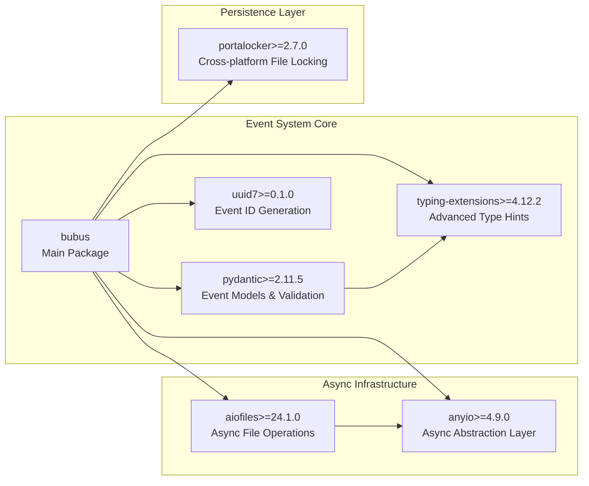
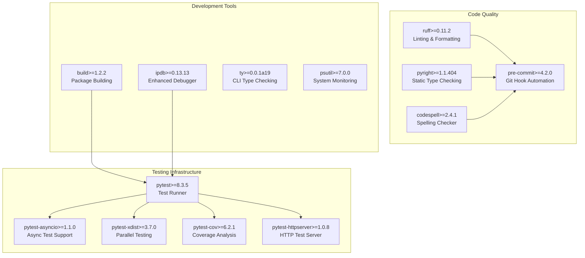
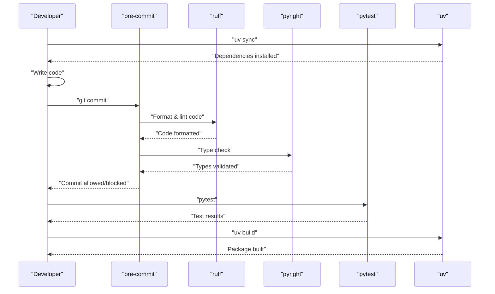

<!-- source: DeepWiki mcp.deepwiki.com · repo browser-use/bubus · page 5.1 Project Configuration and Dependencies · fetched 2026-10-30 -->

# Project Configuration and Dependencies

<details>
<summary>Relevant source files</summary>

The following files were used as context for generating this wiki page:

- [bubus/__init__.py](bubus/__init__.py)
- [pyproject.toml](pyproject.toml)

</details>


This document covers the bubus project's configuration structure, dependency management, and development tooling setup. It explains how the project is organized, what external libraries it depends on, and how the development environment is configured through `pyproject.toml` and related configuration files.

For information about the actual package structure and API exports, see [Package Structure and Exports](#6.1). For details about the CI/CD pipeline that uses these configurations, see [CI/CD and Publishing](#5.4).

## Project Structure Overview

The bubus project follows modern Python packaging standards with a centralized configuration approach using `pyproject.toml` as the single source of truth for project metadata, dependencies, and tool configurations.

**Project Dependencies and Configuration Architecture**

```mermaid
graph TB
    subgraph "Project Configuration"
        PT["pyproject.toml<br/>Central Configuration"]
        UV["uv Package Manager<br/>Dependency Resolution"]
        VENV[".venv<br/>Virtual Environment"]
    end
    
    subgraph "Runtime Dependencies"
        AIOFILES["aiofiles>=24.1.0<br/>Async File I/O"]
        ANYIO["anyio>=4.9.0<br/>Async Compatibility"]
        PORTALOCKER["portalocker>=2.7.0<br/>File Locking"]
        PYDANTIC["pydantic>=2.11.5<br/>Data Validation"]
        TYPING_EXT["typing-extensions>=4.12.2<br/>Type System"]
        UUID7["uuid7>=0.1.0<br/>UUID Generation"]
    end
    
    subgraph "Development Dependencies"
        RUFF["ruff>=0.11.2<br/>Linting & Formatting"]
        PYTEST["pytest>=8.3.5<br/>Testing Framework"]
        PYRIGHT["pyright>=1.1.404<br/>Type Checking"]
        BUILD["build>=1.2.2<br/>Package Building"]
        PRECOMMIT["pre-commit>=4.2.0<br/>Git Hooks"]
    end
    
    subgraph "Build System"
        HATCHLING["hatchling<br/>Build Backend"]
        PACKAGE["bubus Package<br/>Distribution"]
    end
    
    PT --> UV
    UV --> VENV
    PT --> AIOFILES
    PT --> ANYIO
    PT --> PORTALOCKER
    PT --> PYDANTIC
    PT --> TYPING_EXT
    PT --> UUID7
    
    PT --> RUFF
    PT --> PYTEST
    PT --> PYRIGHT
    PT --> BUILD
    PT --> PRECOMMIT
    
    PT --> HATCHLING
    HATCHLING --> PACKAGE
```


Sources: [pyproject.toml:1-129]()

## Project Metadata Configuration

The project metadata is defined in the `[project]` section, establishing bubus as a modern Python package with specific version and compatibility requirements.

| Configuration | Value | Purpose |
|---------------|-------|---------|
| **name** | `bubus` | Package name for PyPI distribution |
| **version** | `1.5.6` | Current release version |
| **description** | Advanced Pydantic-powered event bus with async support | Package summary |
| **requires-python** | `>=3.11,<4.0` | Python version compatibility |
| **authors** | Nick Sweeting | Project maintainer |

The project targets Python 3.11+ exclusively, leveraging modern Python features for async programming and type annotations. The MIT license classification indicates open-source availability with permissive usage terms.

Sources: [pyproject.toml:1-24]()

## Runtime Dependencies

The bubus library has a carefully curated set of runtime dependencies that support its core functionality as an async event bus system.

**Runtime Dependency Graph**


### Core Dependencies Analysis

- **`pydantic>=2.11.5`**: Provides the foundation for `BaseEvent` and `EventResult` models with automatic validation and type casting
- **`uuid7>=0.1.0`**: Generates time-ordered UUIDs for event tracking and hierarchy management
- **`typing-extensions>=4.12.2`**: Enables advanced typing features for generic event types and result validation
- **`anyio>=4.9.0`**: Provides async compatibility layer for cross-platform async operations
- **`aiofiles>=24.1.0`**: Supports async file I/O for Write-Ahead Logging (WAL) functionality  
- **`portalocker>=2.7.0`**: Handles cross-platform file locking for concurrent WAL access

Sources: [pyproject.toml:13-20]()

## Development Dependencies

The development environment uses `uv` as the package manager with an extensive set of development tools configured through the `[tool.uv]` section.

**Development Toolchain Configuration**


### Development Dependency Categories

| Category | Dependencies | Purpose |
|----------|-------------|---------|
| **Code Quality** | `ruff`, `pyright`, `pre-commit`, `codespell` | Automated code formatting, linting, type checking, and quality enforcement |
| **Testing** | `pytest`, `pytest-asyncio`, `pytest-xdist`, `pytest-cov`, `pytest-httpserver` | Comprehensive async testing with parallel execution and coverage analysis |
| **Development** | `build`, `ipdb`, `ty`, `psutil` | Package building, debugging, CLI tools, and system monitoring |

Sources: [pyproject.toml:114-128]()

## Build System Configuration

The project uses the modern `hatchling` build backend with specific inclusion rules for distribution packaging.

```toml
[build-system]
requires = ["hatchling"]
build-backend = "hatchling.build"

[tool.hatch.build]
include = [
    "bubus/**/*.py",
    "!tests/**/*.py",
]
```

The build configuration ensures only the core `bubus` package is included in distributions, explicitly excluding test files to minimize package size.

Sources: [pyproject.toml:25-27](), [pyproject.toml:58-62]()

## Development Tool Configurations

### Ruff Configuration

Ruff serves as both linter and formatter with strict configuration targeting modern Python practices:

```toml
[tool.ruff]
line-length = 130
fix = true

[tool.ruff.lint]
preview = true
select = ["ASYNC", "E", "F", "FAST", "I", "PLE"]
ignore = ["ASYNC109", "E101", "E402", "E501", "F841", "E731", "W291"]
```

The configuration enables async-specific linting rules while maintaining a 130-character line limit for readability.

### Pyright Type Checking

Static type checking is configured for strict mode to ensure type safety:

```toml
[tool.pyright]
typeCheckingMode = "strict"
reportMissingImports = "error"
reportMissingTypeStubs = false
venvPath = "."
venv = ".venv"
```

This enforces comprehensive type checking while allowing for third-party packages without type stubs.

### Pytest Configuration

The testing framework is configured for async support with parallel execution capabilities:

```toml
[tool.pytest.ini_options]
asyncio_mode = "auto"
asyncio_default_fixture_loop_scope = "function"
addopts = "-svx --strict-markers --tb=short --dist=loadscope"
```

This configuration automatically handles async test execution with loadscope distribution for optimal parallel testing.

Sources: [pyproject.toml:33-82]()

## Tool Integration Workflow

**Development Workflow Integration**


The development workflow ensures code quality through automated tooling integration, with `pre-commit` hooks enforcing standards before commits and `uv` managing the entire dependency lifecycle.

Sources: [pyproject.toml:33-128]()

## Package Export Structure

The `bubus` package exports a clean public API through its `__init__.py` module:

```python
from bubus.models import BaseEvent, EventHandler, EventResult, PythonIdentifierStr, PythonIdStr, UUIDStr
from bubus.service import EventBus

__all__ = [
    'EventBus',
    'BaseEvent', 
    'EventResult',
    'EventHandler',
    'UUIDStr',
    'PythonIdStr', 
    'PythonIdentifierStr',
]
```

This provides users with access to the core event system components while maintaining a clean separation between internal implementation and public API.

Sources: [bubus/__init__.py:1-14]()

---

