<!-- source: DeepWiki mcp.deepwiki.com · repo browser-use/bubus · page 5.2 Testing Framework and Patterns · fetched 2026-10-30 -->

# Integration and Pattern Testing

Relevant source files

The following files were used as context for generating this wiki page:

- [tests/conftest.py](tests/conftest.py)
- [tests/test_comprehensive_patterns.py](tests/test_comprehensive_patterns.py)
- [tests/test_eventbus.py](tests/test_eventbus.py)

This document covers the comprehensive integration testing strategy for the bubus event system, focusing on complex multi-bus scenarios, parent-child event relationships, typed event results, and advanced workflow patterns. The testing framework validates cross-system interactions, event forwarding patterns, type safety integration, and concurrent event processing under various conditions.

For basic test organization and framework setup, see [5.1](#5.1). For performance and scale testing, see [5.2](#5.2).

## Integration Testing Architecture

The integration testing system validates complex event patterns across multiple `EventBus` instances, ensuring proper event propagation, parent-child relationships, cross-bus communication, and type-safe result handling work correctly under all scenarios.

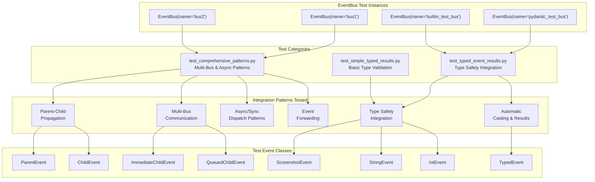

**Sources:** [tests/test_comprehensive_patterns.py:1-255](), [tests/test_typed_event_results.py:1-185](), [tests/test_simple_typed_results.py:1-63]()

## Comprehensive Pattern Integration Testing

The comprehensive pattern testing validates complex scenarios involving multi-bus communication, parent-child relationships, and mixed async/sync dispatch patterns working together in realistic workflows.

### Multi-Pattern Integration Workflow

The `test_comprehensive_patterns()` function validates all major patterns working together:

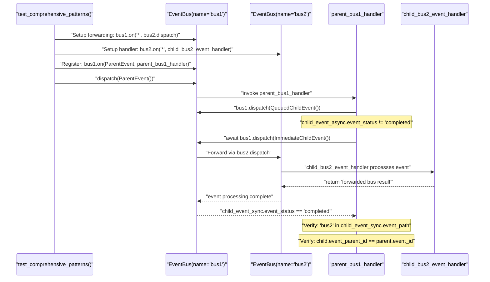

Key integration patterns tested in [tests/test_comprehensive_patterns.py:25-155]():
- Event forwarding with `bus1.on('*', bus2.dispatch)` at [tests/test_comprehensive_patterns.py:45]()
- Mixed async dispatch (`bus1.dispatch()`) and sync dispatch (`await bus1.dispatch()`) in [tests/test_comprehensive_patterns.py:57-63]()
- Parent-child relationship preservation across bus boundaries at [tests/test_comprehensive_patterns.py:91-95]()
- Event path tracking validation at [tests/test_comprehensive_patterns.py:77]()

**Sources:** [tests/test_comprehensive_patterns.py:25-155]()

### Execution Order and Race Condition Testing

The comprehensive test validates execution order consistency and detects race conditions:

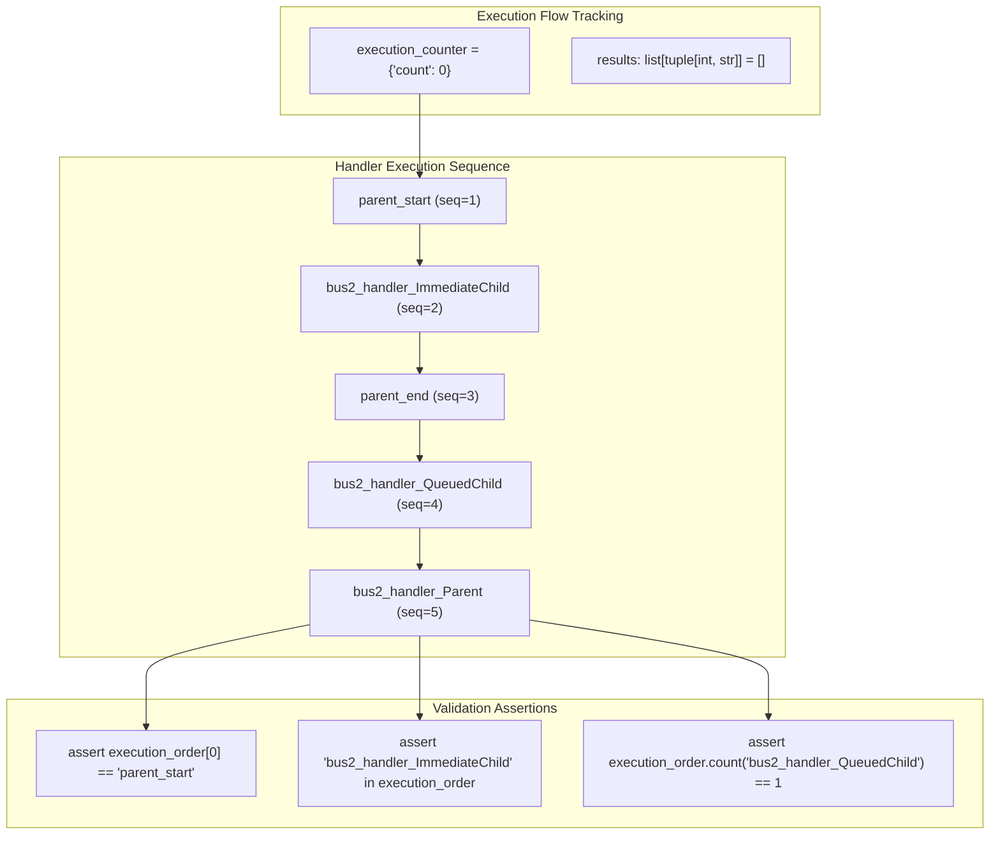

The execution tracking system in [tests/test_comprehensive_patterns.py:32-152]() ensures:
- Handler execution order is deterministic and trackable
- Each event type is processed exactly once on each bus
- Parent-child relationships are maintained throughout complex execution flows

**Sources:** [tests/test_comprehensive_patterns.py:32-152]()

## Typed Event Result Integration Testing

Integration testing validates the type safety system for event results, including automatic casting to Pydantic models, built-in types, and error handling for type validation failures.

### Pydantic Model Result Casting

The `test_pydantic_model_result_casting()` function validates automatic casting of handler returns to Pydantic models:

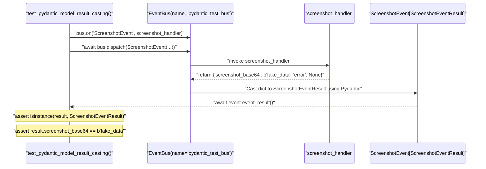

The test validates several integration aspects in [tests/test_typed_event_results.py:28-53]():
- Handler returns a `dict` that gets automatically cast to `ScreenshotEventResult`
- The `ScreenshotEvent[ScreenshotEventResult]` type annotation drives the casting
- Result validation occurs through Pydantic's validation system
- Final result is accessible via `event.event_result()`

**Sources:** [tests/test_typed_event_results.py:28-53]()

### Built-in Type Validation Integration

The type system integrates with Python's built-in types for validation:

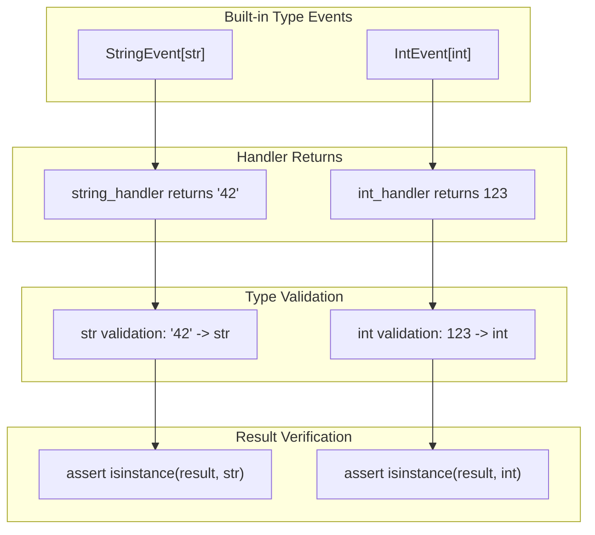

Key validation points in [tests/test_typed_event_results.py:55-86]():
- `StringEvent[str]` with handler returning `'42'` validates as proper `str`
- `IntEvent[int]` with handler returning `123` validates as proper `int`
- Type casting preserves the original values while ensuring type safety

**Sources:** [tests/test_typed_event_results.py:55-86]()

### Type Casting Failure Handling

The integration system handles type casting failures gracefully:

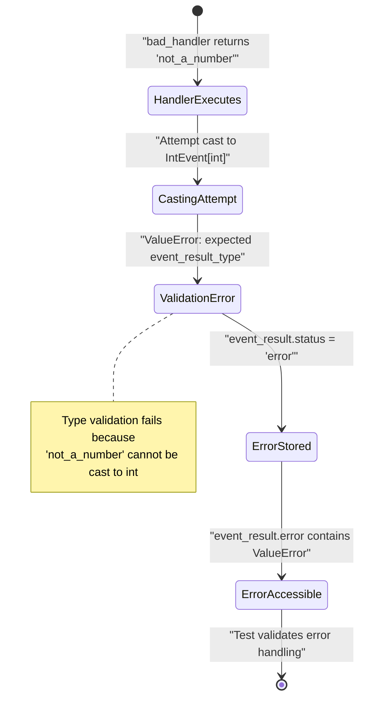

The error handling integration is tested in [tests/test_typed_event_results.py:88-118]():
- Handler returns incompatible type (`'not_a_number'` for `IntEvent[int]`)
- System catches `ValueError` during type casting
- Error is stored in `event_result.status = 'error'` and `event_result.error`
- Event processing continues despite individual handler failures

**Sources:** [tests/test_typed_event_results.py:88-118]()

### Event Result Type Storage and Inspection

The type system stores type information for runtime inspection:

| Property | Value | Purpose |
|----------|-------|---------|
| `event_result.result_type` | `str`, `int`, `ScreenshotEventResult` | Type annotation from event |
| `event_result.result` | Actual casted result object | The validated result value |
| `event_result.status` | `'success'` or `'error'` | Validation outcome |

Testing in [tests/test_typed_event_results.py:147-171]() validates:
- `result_type` property correctly stores the expected type
- Actual result matches the expected type after casting
- Type information is accessible for debugging and inspection

**Sources:** [tests/test_typed_event_results.py:147-171]()

## Async vs Sync Dispatch Pattern Testing

The integration tests validate the critical behavioral differences between async and sync event dispatch patterns, ensuring handlers execute at the correct times.

### Dispatch Timing Validation

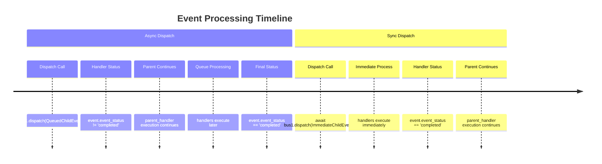

The timing differences are validated in [tests/test_comprehensive_patterns.py:56-66]():
- Async dispatch: `child_event_async.event_status != 'completed'` immediately after dispatch
- Sync dispatch: `child_event_sync.event_status == 'completed'` after awaiting dispatch

**Sources:** [tests/test_comprehensive_patterns.py:56-66]()

### Handler Result Validation

For sync dispatched events, handler results are immediately available and validated:

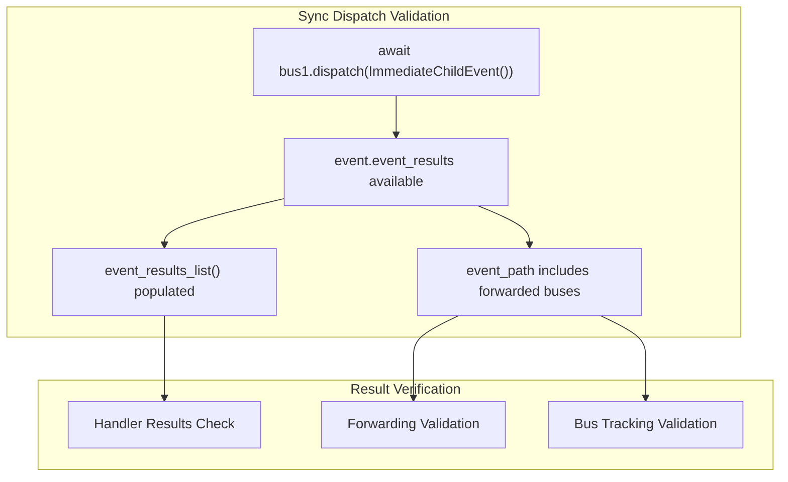

The validation checks multiple aspects in [tests/test_comprehensive_patterns.py:67-87]():
- Handler results are populated in `event_results`
- Forwarded events show processing on target buses
- Event paths correctly reflect multi-bus processing

**Sources:** [tests/test_comprehensive_patterns.py:67-87]()

## Race Condition and Stress Testing

The integration testing includes comprehensive stress testing to validate system behavior under concurrent load and identify potential race conditions in multi-bus and typed result scenarios.

### Multi-Bus Stress Test Architecture

The `test_race_condition_stress()` function creates complex concurrent scenarios across multiple buses:

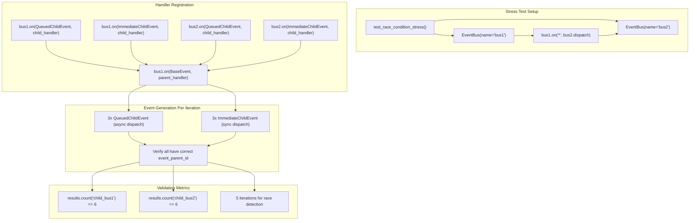

The stress test validates consistency across 5 iterations in [tests/test_comprehensive_patterns.py:223-233]():
- Each iteration dispatches 6 child events (3 queued, 3 immediate)
- Events are processed on both `bus1` and `bus2` due to forwarding
- Parent-child relationships must be maintained for all events
- Event counts are verified to detect race conditions or missed events

**Sources:** [tests/test_comprehensive_patterns.py:176-245]()

### Concurrent Handler Execution with Type Safety

The stress testing also validates that typed results work correctly under concurrent load:

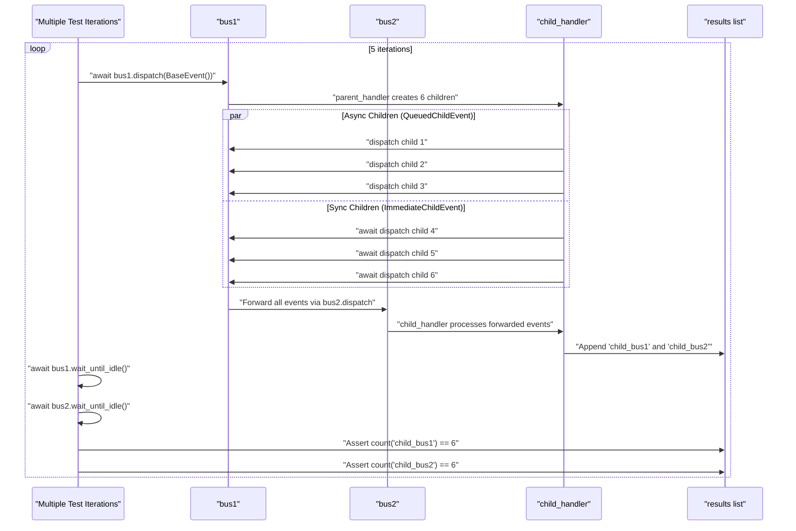

Key concurrent validation points in [tests/test_comprehensive_patterns.py:194-233]():
- Mixed async (`dispatch()`) and sync (`await dispatch()`) patterns under load
- Event forwarding consistency across multiple buses
- Parent-child relationship integrity during concurrent processing
- Result counting accuracy to detect missed or duplicated events

**Sources:** [tests/test_comprehensive_patterns.py:194-233]()

## Error Handling Integration Testing

Integration tests validate that parent-child relationships and event processing remain consistent even when handlers encounter errors.

### Error Resilience Validation

The error handler test ensures system stability when handlers fail:

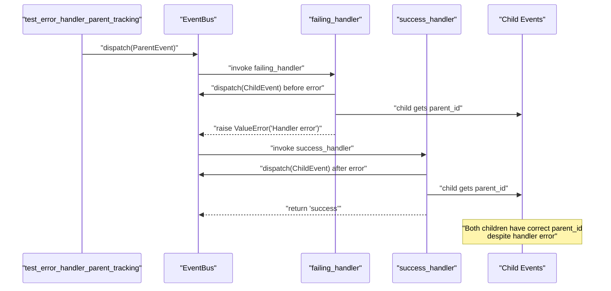

Critical validation points from [tests/test_parent_event_tracking.py:263-295]():
- Child events dispatched before handler errors maintain proper `event_parent_id`
- Subsequent handlers continue to work correctly
- Error in one handler doesn't affect parent tracking for other handlers

**Sources:** [tests/test_parent_event_tracking.py:263-295]()

## Event Completion and Lifecycle Testing

Integration tests validate the complete event lifecycle, including the `event_are_all_children_complete()` method for coordinating complex event hierarchies.

### Children Completion Tracking

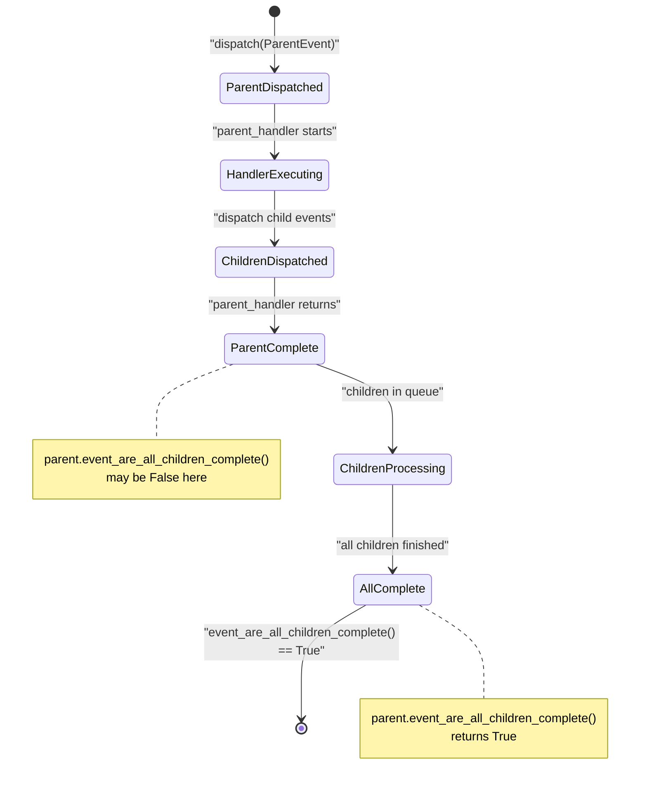

The completion tracking test validates proper lifecycle management in [tests/test_parent_event_tracking.py:438-474]():
- Initially no children exist, so `event_are_all_children_complete()` returns `True`
- After children are dispatched and processed, all have `event_status == 'completed'`
- Parent correctly tracks completion state of all child events

**Sources:** [tests/test_parent_event_tracking.py:438-474]()

---

