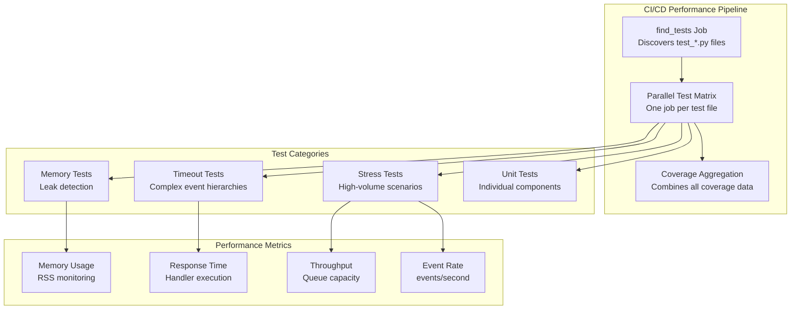
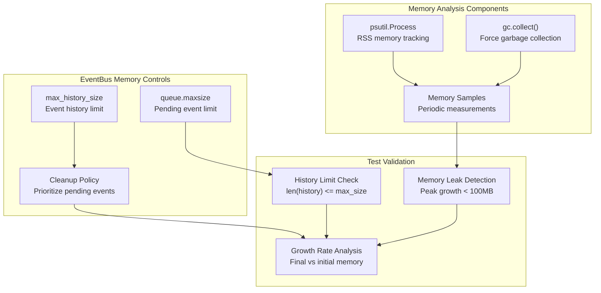
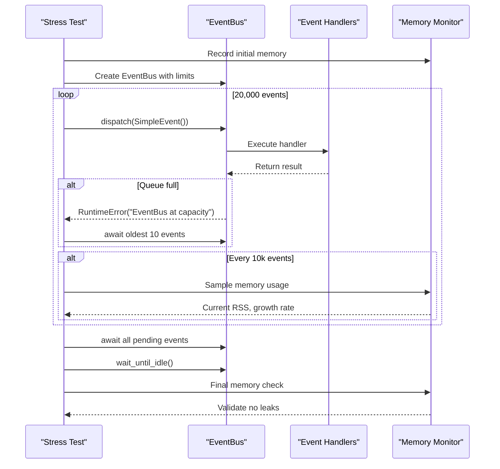
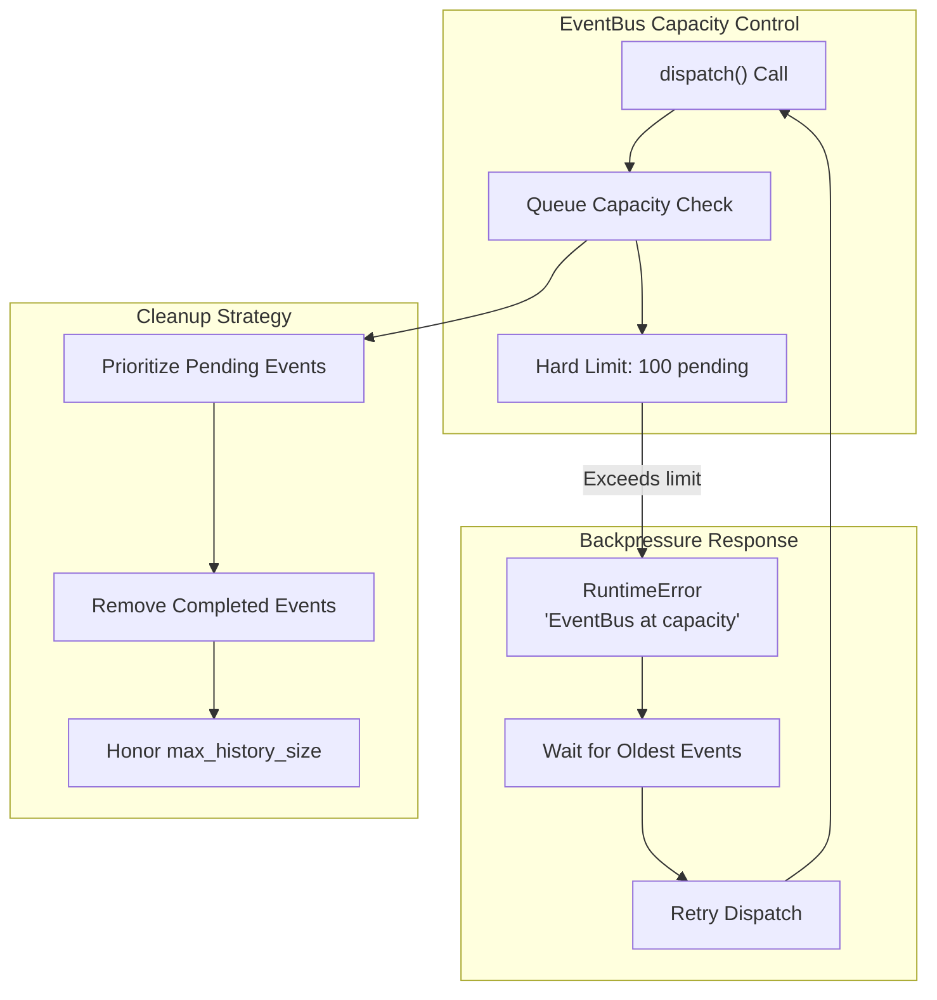
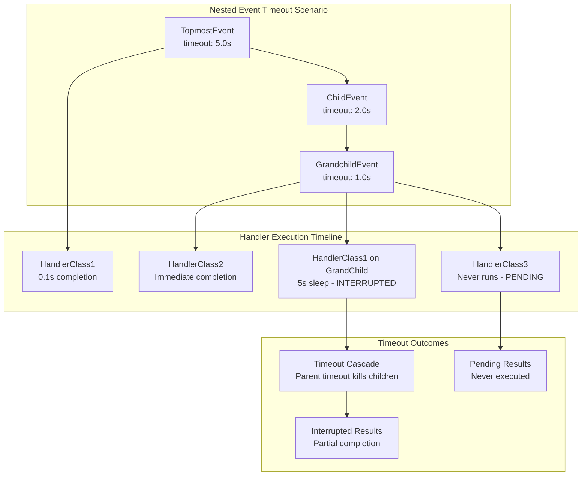
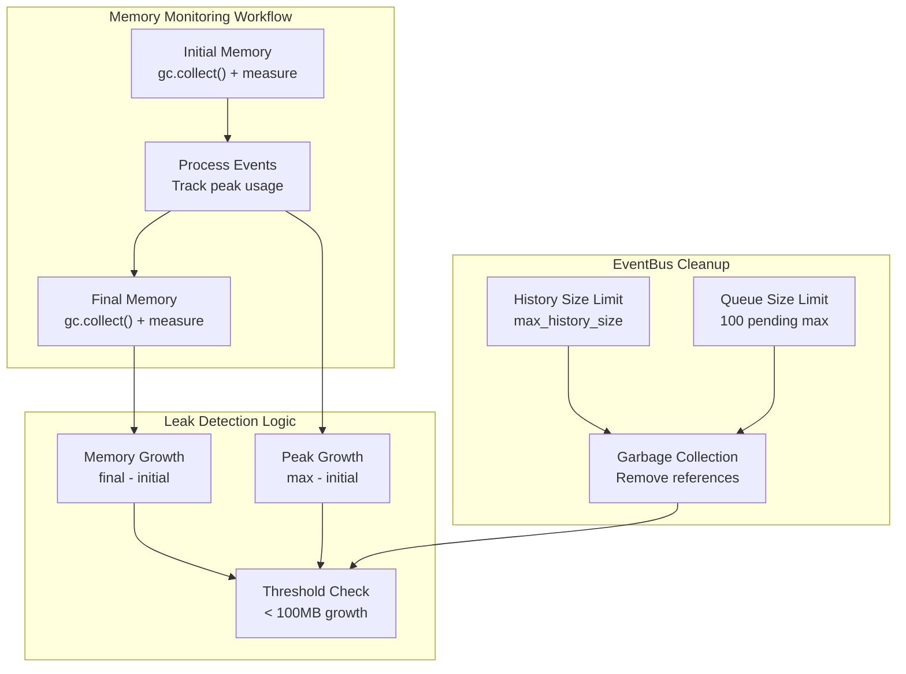

<!-- source: DeepWiki mcp.deepwiki.com · repo browser-use/bubus · page 5.3 Performance Testing and Stress Analysis · fetched 2026-10-30 -->

# Performance Testing and Stress Analysis

<details>
<summary>Relevant source files</summary>

The following files were used as context for generating this wiki page:

- [.github/workflows/test.yaml](.github/workflows/test.yaml)
- [tests/test_handler_timeout.py](tests/test_handler_timeout.py)
- [tests/test_stress_20k_events.py](tests/test_stress_20k_events.py)

</details>


This document covers performance testing methodologies, stress analysis techniques, and memory management strategies for the bubus event bus library. It provides guidance on testing high-volume event processing, measuring system performance under load, and ensuring reliable operation under stress conditions.

For general testing patterns and frameworks, see [Testing Framework and Patterns](#5.2). For development and debugging tools, see [Event Debugging and Tree Visualization](#4.4).

## Purpose and Scope

Performance testing in bubus focuses on three primary areas:

- **High-Volume Event Processing**: Testing system behavior with thousands of concurrent events
- **Memory Management**: Monitoring memory usage, detecting leaks, and validating cleanup mechanisms
- **Reliability Under Stress**: Ensuring timeout enforcement, resource limits, and graceful degradation work correctly

The testing framework provides automated performance validation through CI/CD pipelines and specialized stress test suites.

## Performance Testing Architecture

### Test Pipeline Structure



The CI/CD system automatically discovers and executes performance tests in parallel, providing comprehensive coverage analysis and performance metrics.

Sources: [.github/workflows/test.yaml:21-53](), [.github/workflows/test.yaml:89-128]()

### Memory Monitoring Infrastructure



Memory monitoring uses `psutil` for accurate RSS measurement and implements automatic cleanup policies to prevent unbounded growth.

Sources: [tests/test_stress_20k_events.py:13-16](), [tests/test_stress_20k_events.py:135-144]()

## High-Volume Event Processing

### Stress Testing Framework

The primary stress test validates processing of 20,000 events with comprehensive monitoring:

| Metric | Target | Validation |
|--------|--------|------------|
| Event Count | 20,000 | `processed_count == total_events` |
| Duration | < 120 seconds | `duration < 120` |
| Memory Growth | < 100 MB peak | `peak_growth < 100` |
| History Size | ≤ `max_history_size` | `len(event_history) <= max_size` |
| Event Rate | Variable | `events_dispatched / duration` |



The stress test implements backpressure handling by completing the oldest pending events when the queue reaches capacity, ensuring sustained throughput.

Sources: [tests/test_stress_20k_events.py:26-156]()

### Event Rate and Throughput Analysis

Event processing rates are monitored continuously during stress testing:

```python
# Performance calculation during stress test
elapsed = time.time() - start_time
rate = dispatched / elapsed
print(f'Rate: {rate:.0f} events/sec')
```

Typical performance characteristics observed:
- **Dispatch Rate**: 10,000+ events/second for simple events
- **Processing Rate**: Limited by handler complexity and concurrency
- **Memory Efficiency**: < 100MB growth for 20k events indicates proper cleanup

Sources: [tests/test_stress_20k_events.py:84-91]()

## Resource Limit Enforcement

### Queue Capacity Management



The EventBus enforces a hard limit of 100 pending events to prevent unbounded memory growth. When capacity is reached, callers receive a `RuntimeError` and must handle backpressure.

Sources: [tests/test_stress_20k_events.py:159-194]()

### History Management and Cleanup

Event history cleanup prioritizes keeping pending and active events over completed ones:

| Event Status | Priority | Cleanup Behavior |
|-------------|----------|------------------|
| `pending` | Highest | Always retained |
| `started` | High | Retained when possible |
| `completed` | Low | First to be removed |
| `error` | Medium | Retained for debugging |

Sources: [tests/test_stress_20k_events.py:197-242]()

## Timeout and Reliability Testing

### Complex Event Hierarchy Testing



Complex timeout scenarios test cascading timeouts where parent event timeouts interrupt child event processing, ensuring proper cleanup and resource management.

Sources: [tests/test_handler_timeout.py:11-178]()

### Handler State Tracking

During timeout scenarios, the system tracks handler states:

| Handler State | Description | Test Validation |
|--------------|-------------|-----------------|
| **Completed** | Handler finished before timeout | Result available |
| **Interrupted** | Handler killed by timeout | Partial execution |
| **Pending** | Handler never started | No execution |
| **Error** | Handler failed with exception | Error captured |

The timeout test validates that timeouts properly interrupt long-running handlers while preserving completed results.

Sources: [tests/test_handler_timeout.py:124-178]()

## Memory Management Strategies

### Memory Leak Detection



Memory leak detection involves measuring RSS memory at key points and validating that growth stays within acceptable bounds (< 100MB for 20k events).

Sources: [tests/test_stress_20k_events.py:29-137]()

### Resource Cleanup Validation

Test cleanup verification ensures proper resource management:

```python
# Verify EventBus properly stops and cleans up
await bus.stop(timeout=0, clear=True)
print('EventBus stopped successfully')
```

The cleanup process includes:
- Stopping the event processing loop
- Clearing pending events (when `clear=True`)
- Canceling background tasks
- Releasing queue resources

Sources: [tests/test_stress_20k_events.py:147-156]()

## Performance Metrics and Benchmarking

### Key Performance Indicators

| Metric Category | Measurement | Target Range |
|----------------|-------------|--------------|
| **Throughput** | Events/second | 10,000+ for simple events |
| **Latency** | Handler execution time | < handler timeout |
| **Memory** | RSS growth | < 100MB for 20k events |
| **Reliability** | Completion rate | 100% within limits |
| **Cleanup** | Resource release | Complete after stop() |

### Continuous Performance Monitoring

The CI/CD pipeline provides continuous performance validation:

1. **Parallel Test Execution**: Each test file runs in isolation
2. **Coverage Analysis**: Performance tests contribute to overall coverage
3. **Failure Detection**: Tests fail if performance degrades beyond thresholds
4. **Resource Monitoring**: Memory and timing metrics logged for analysis

Sources: [.github/workflows/test.yaml:42-87](), [tests/test_stress_20k_events.py:108-137]()

### Performance Test Integration

Performance tests integrate seamlessly with the standard test suite, running automatically on every commit and providing immediate feedback on performance regressions.

Sources: [.github/workflows/test.yaml:1-145]()

---

