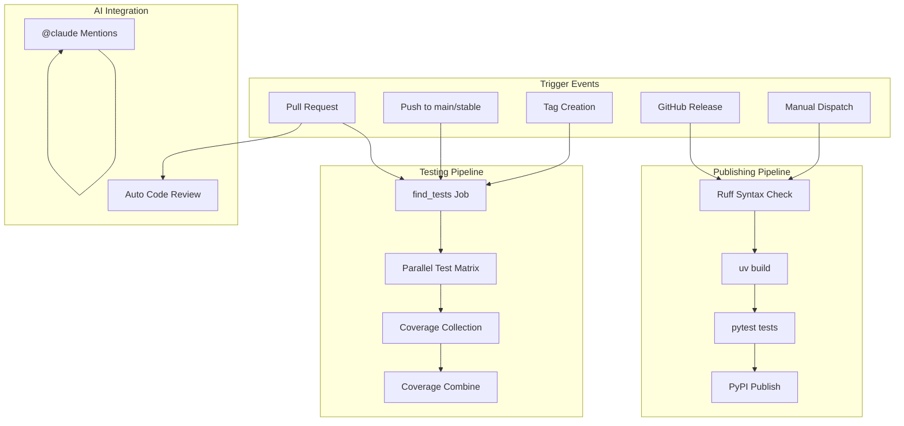
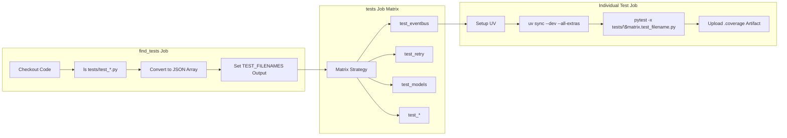
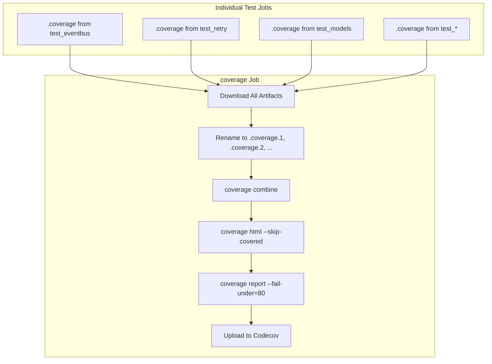
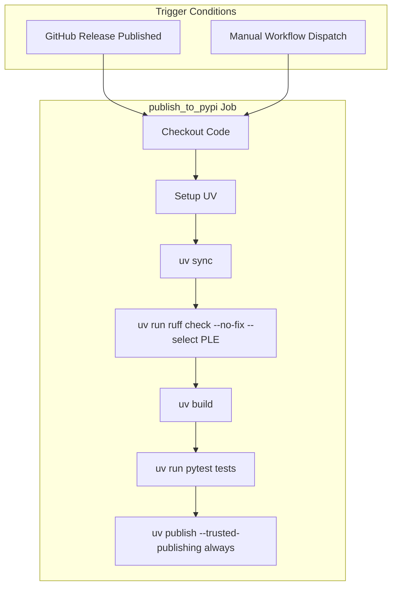
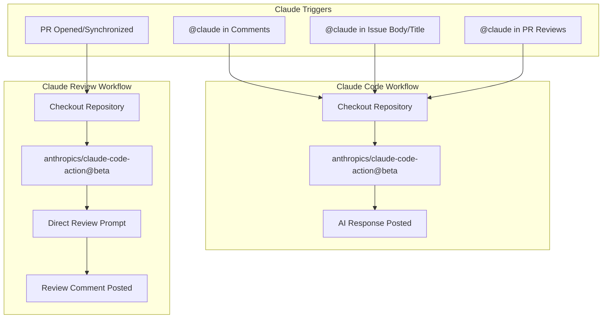

<!-- source: DeepWiki mcp.deepwiki.com · repo browser-use/bubus · page 5.4 CI/CD and Publishing · fetched 2026-10-30 -->

# CI/CD and Publishing

<details>
<summary>Relevant source files</summary>

The following files were used as context for generating this wiki page:

- [.github/workflows/claude-code-review.yml](.github/workflows/claude-code-review.yml)
- [.github/workflows/claude.yml](.github/workflows/claude.yml)
- [.github/workflows/publish.yml](.github/workflows/publish.yml)
- [.github/workflows/test.yaml](.github/workflows/test.yaml)

</details>


This document covers the automated testing pipeline, publishing workflow, and development automation systems used in the bubus project. It explains the GitHub Actions workflows that handle continuous integration, testing, coverage analysis, and PyPI publishing.

For information about manual testing patterns and test development, see [Testing Framework and Patterns](#5.2). For project configuration details, see [Project Configuration and Dependencies](#5.1).

## CI/CD Architecture Overview

The bubus project uses GitHub Actions to provide comprehensive automation covering testing, code review, and publishing. The system is designed around three main workflow categories: testing automation, publishing automation, and AI-assisted development.

### CI/CD Pipeline Flow



Sources: [.github/workflows/test.yaml:1-145](), [.github/workflows/publish.yml:1-27](), [.github/workflows/claude.yml:1-64](), [.github/workflows/claude-code-review.yml:1-78]()

## Testing Pipeline Architecture

The testing system uses a dynamic test discovery mechanism that automatically parallelizes test execution across multiple runners. This approach provides both speed and comprehensive coverage analysis.

### Test Discovery and Parallel Execution



The `find_tests` job uses shell commands to discover test files and convert them to a JSON array that feeds the matrix strategy:

```bash
TEST_FILENAMES="$(ls tests/test_*.py | sed 's|^tests/||' | sed 's|\.py$||' | jq -R -s -c 'split("\n")[:-1]')"
```

Sources: [.github/workflows/test.yaml:22-40](), [.github/workflows/test.yaml:42-87]()

### Coverage Collection and Analysis



The coverage system enforces an 80% minimum coverage threshold and generates both HTML reports and markdown summaries that appear in the GitHub Actions summary.

Sources: [.github/workflows/test.yaml:89-144]()

## Publishing Pipeline

The publishing workflow implements a secure, automated deployment process to PyPI using trusted publishing. It includes validation steps to prevent publishing broken packages.

### PyPI Publishing Flow



The workflow uses several safety mechanisms:
- **Quick syntax validation**: `ruff check --select PLE` catches syntax errors early
- **Full test suite**: All tests must pass before publishing
- **Trusted publishing**: No manual token management required
- **Conditional execution**: Only runs on actual releases or manual dispatch

Sources: [.github/workflows/publish.yml:12-26]()

## AI Integration Workflows

The project includes two Claude AI integration workflows that assist with development and code review processes.

### Claude Integration Architecture



The AI workflows provide:
- **Interactive assistance**: Responds to `@claude` mentions in issues and PRs
- **Automated code review**: Reviews all PRs with focus on code quality, security, and best practices
- **CI integration**: Claude can read CI results to provide context-aware feedback

Sources: [.github/workflows/claude.yml:14-38](), [.github/workflows/claude-code-review.yml:14-52]()

## Workflow Configuration and Permissions

The workflows are configured with specific permissions and security settings to enable their functionality while maintaining security.

### Permissions Matrix

| Workflow | contents | pull-requests | issues | actions | id-token | statuses |
|----------|----------|---------------|---------|---------|----------|----------|
| test.yaml | write | write | write | read | - | write |
| publish.yml | write | - | - | - | write | - |
| claude.yml | read | read | read | read | write | - |
| claude-code-review.yml | read | read | read | - | write | - |

### Environment Variables and Secrets

The workflows use several configuration mechanisms:
- **Environment variables**: `IN_DOCKER: 'True'` for test containerization
- **Secrets**: `ANTHROPIC_API_KEY` for Claude AI integration
- **UV configuration**: Automated dependency management with caching
- **Trusted publishing**: OIDC-based PyPI authentication

Sources: [.github/workflows/test.yaml:2-8](), [.github/workflows/publish.yml:8-11](), [.github/workflows/claude.yml:21-26](), [.github/workflows/claude-code-review.yml:22-26]()

## Development Automation Benefits

This CI/CD setup provides several key benefits for bubus development:

1. **Parallel testing**: Automatic test discovery and parallel execution reduces CI time
2. **Coverage enforcement**: 80% coverage threshold prevents regression
3. **Safe publishing**: Multi-stage validation before PyPI deployment
4. **AI assistance**: Automated code review and interactive help
5. **Zero-configuration**: Developers only need to push code; automation handles the rest

The system integrates with the broader development workflow covered in [Testing Framework and Patterns](#5.2) and uses the project configuration described in [Project Configuration and Dependencies](#5.1).

---

