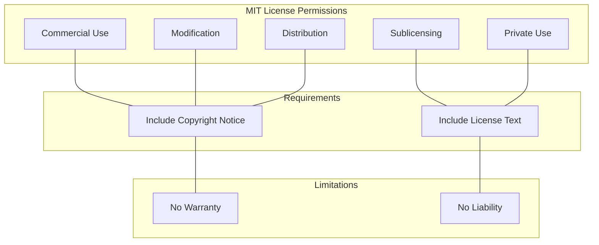
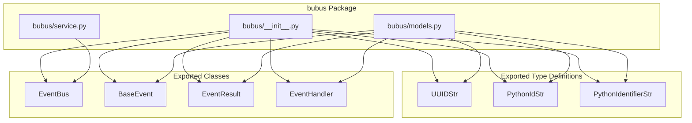
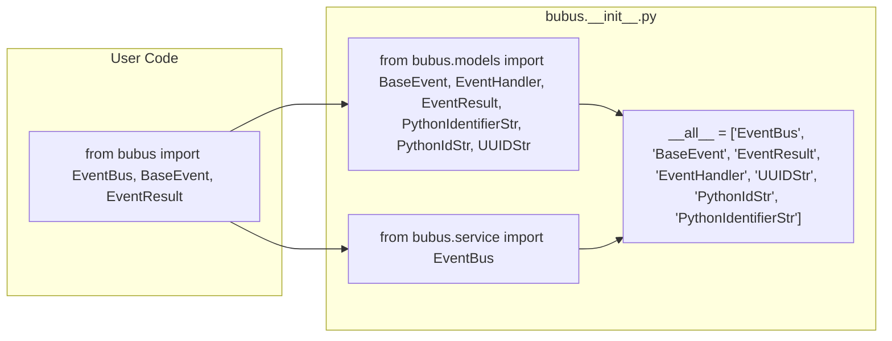
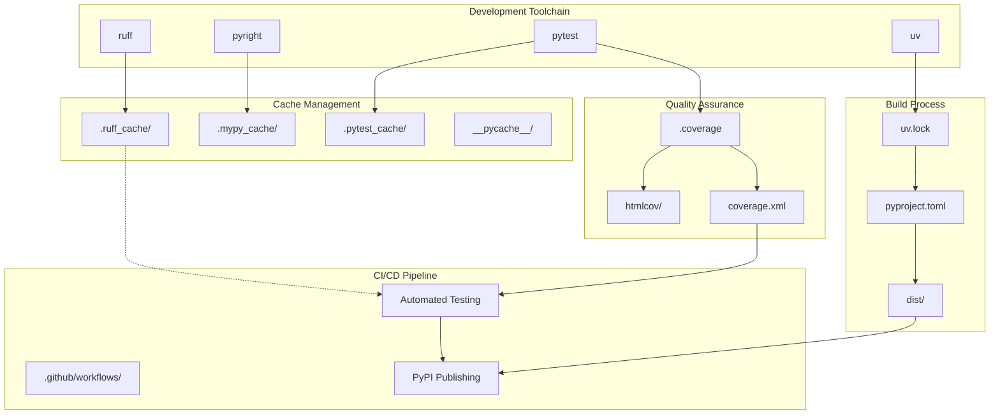

<!-- source: DeepWiki mcp.deepwiki.com · repo browser-use/bubus · page 6 Project Information · fetched 2026-10-30 -->

# Project Information

<details>
<summary>Relevant source files</summary>

The following files were used as context for generating this wiki page:

- [LICENSE](LICENSE)
- [bubus/__init__.py](bubus/__init__.py)

</details>


This document provides essential project metadata, licensing information, and organizational structure for the bubus event bus system. It covers the legal framework, copyright details, and how the project is structured and distributed.

For detailed license terms and copyright information, see [License and Legal Information](6.2). For comprehensive package structure and public API exports, see [Package Structure and Exports](6.1).

## Project Overview

The bubus project is an event bus system designed for the browser-use agent, developed by Browser Use. It provides asynchronous event-driven architecture capabilities with Pydantic-powered type safety, concurrency control, and observability features.

### Project Identity

| Property | Value |
|----------|-------|
| Project Name | bubus |
| Repository | https://github.com/browser-use/bubus |
| Copyright Holder | Browser Use |
| Copyright Year | 2025 |
| License | MIT License |

Sources: [LICENSE:3]()

## License Summary

The bubus project is released under the MIT License, providing broad permissions for use, modification, and distribution. The license grants rights to use, copy, modify, merge, publish, distribute, sublicense, and sell the software without restriction, subject to inclusion of the original copyright notice and license terms.



**MIT License Structure for bubus Project**

Sources: [LICENSE:1-21]()

## Public API Structure

The bubus package provides a clean public API through its `__init__.py` module, exporting core classes and type definitions for event-driven systems.

**Core Public API Export Structure**



### Package Module Organization

| Module | Exported Classes | Purpose |
|--------|------------------|---------|
| `bubus.service` | `EventBus` | Core event dispatching and management |
| `bubus.models` | `BaseEvent`, `EventResult`, `EventHandler` | Event modeling and result handling |
| `bubus.models` | `UUIDStr`, `PythonIdStr`, `PythonIdentifierStr` | Type validation utilities |

**Public API Import Pattern**



Sources: [bubus/__init__.py:1-14]()

## Project Organization

The bubus project follows standard Python package organization patterns with development tooling exclusions defined in `.gitignore`.

### Development Environment Structure

| Category | Files/Directories | Purpose |
|----------|------------------|---------|
| Source Code | `bubus/` package directory | Core event bus implementation |
| Python Cache | `__pycache__/`, `*.py[cod]`, `*.pyo` | Compiled bytecode files |
| Development Tools | `.ruff_cache/`, `.mypy_cache/`, `.pytest_cache/` | Tool-generated cache directories |
| Virtual Environment | `.venv*`, `venv/`, `env/`, `ENV/` | Python environment isolation |
| IDE Support | `.vscode/`, `.idea/`, `*.swp`, `*.swo` | Editor and IDE configurations |
| Build Artifacts | `dist/`, `build/`, `*.egg-info/` | Package distribution files |
| Testing | `.coverage`, `htmlcov/`, `coverage.xml` | Test coverage reports |
| Documentation | `site/` | Generated documentation |

Sources: [bubus/__init__.py:1](), [LICENSE:1]()

## Copyright and Attribution

The bubus project is copyrighted by Browser Use as of 2025. All source code, documentation, and associated materials are subject to this copyright unless otherwise specified.

### Copyright Notice

```
Copyright (c) 2025 Browser Use
```

This copyright notice must be included in all copies or substantial portions of the software when redistributing or modifying the code, as required by the MIT License terms.

Sources: [LICENSE:3]()

## Distribution and Publishing

The bubus package uses modern Python tooling for development, testing, and distribution with comprehensive quality assurance processes.



**Modern Python Development and Distribution Pipeline**

### Development Environment Files

The project excludes various development and build artifacts from version control:

| File Pattern | Tool/Purpose | Description |
|-------------|-------------|-------------|
| `__pycache__/`, `*.py[cod]` | Python Runtime | Compiled bytecode cache |
| `.ruff_cache/` | `ruff` | Linter/formatter cache |
| `.mypy_cache/` | `mypy`/`pyright` | Type checker cache |
| `.pytest_cache/` | `pytest` | Test execution cache |
| `uv.lock` | `uv` | Dependency lock file |
| `dist/` | Build Tools | Distribution packages |
| `.coverage`, `htmlcov/` | `pytest-cov` | Test coverage reports |

Sources: [LICENSE:1]()

## Project Scope and Boundaries

The bubus project encompasses:

- **Core Event Bus System**: Asynchronous event dispatching and handling
- **Type Safety**: Pydantic-based validation and generic type support  
- **Concurrency Control**: Advanced semaphore management and retry mechanisms
- **Observability**: Event history tracking and visualization capabilities
- **Development Tooling**: Comprehensive testing and CI/CD infrastructure

The project maintains clear boundaries around event-driven architecture patterns while providing extensibility through handler registration and event forwarding mechanisms.

Sources: [LICENSE:1-21]()

---

