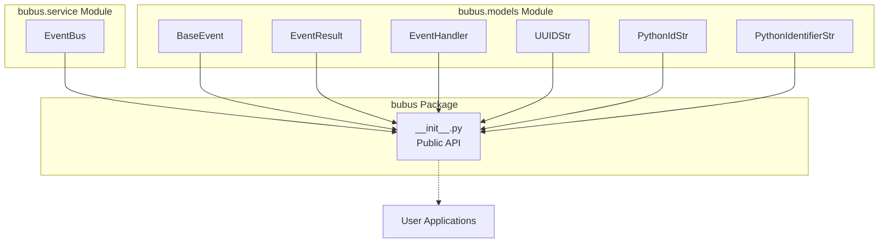
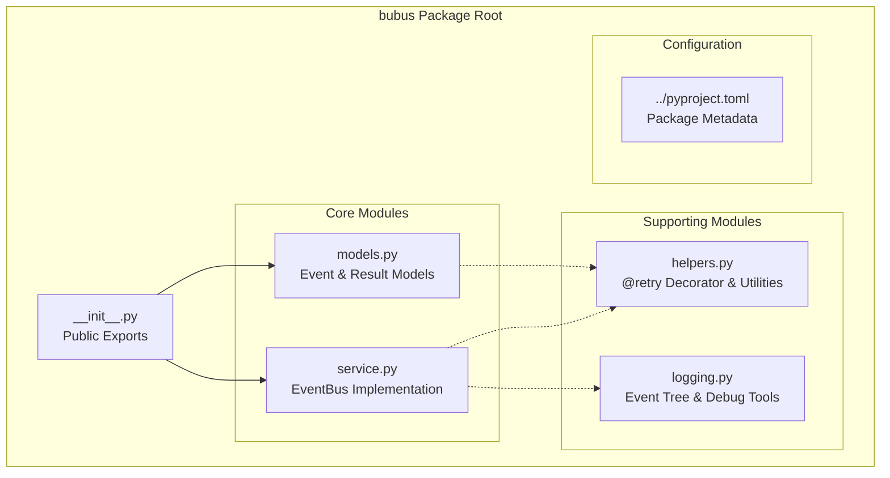
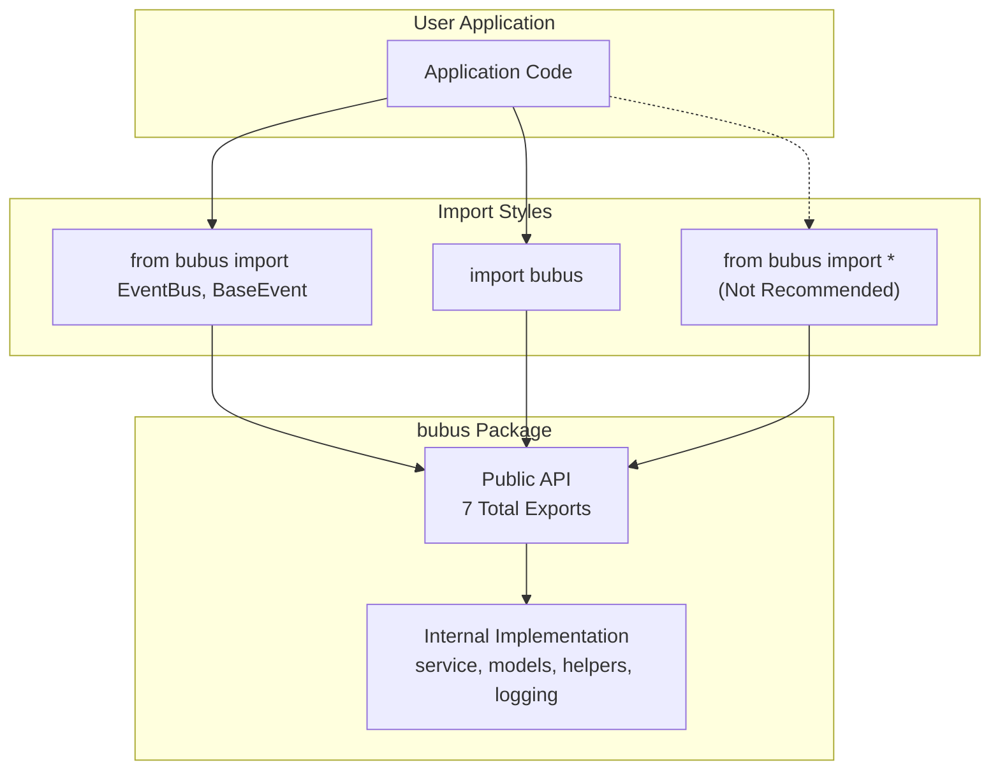
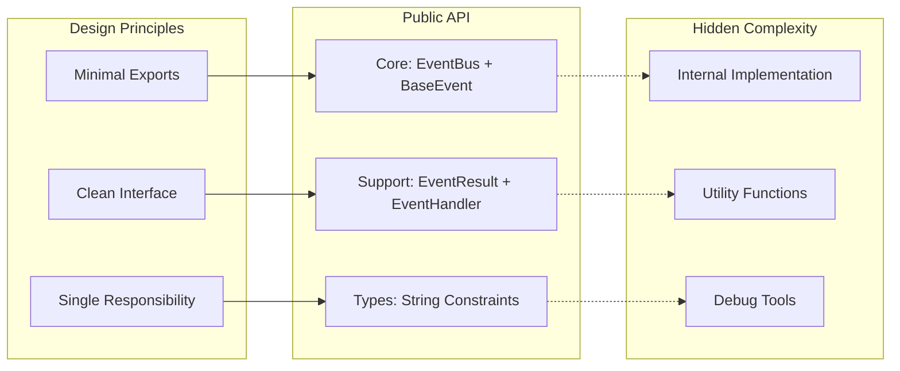

<!-- source: DeepWiki mcp.deepwiki.com · repo browser-use/bubus · page 6.1 Package Structure and Exports · fetched 2026-10-30 -->

# Package Structure and Exports

<details>
<summary>Relevant source files</summary>

The following files were used as context for generating this wiki page:

- [README.md](README.md)
- [bubus/__init__.py](bubus/__init__.py)

</details>


This document covers the organization of the bubus package, its public API exports, and recommended import patterns. It details how the library's functionality is structured across modules and exposes a clean, minimal public interface for users.

For detailed API documentation of these exports, see [EventBus API](#3.1) and [BaseEvent and EventResult API](#3.2).

## Public API Overview

The bubus library exposes a minimal, carefully curated public API through its main package import. All user-facing functionality is available through direct imports from the `bubus` package.

### Main Exports

The public API consists of seven key exports defined in [bubus/__init__.py:6-13]():

```python
from bubus import (
    EventBus,           # Main event bus service
    BaseEvent,          # Base event model class  
    EventResult,        # Handler result wrapper
    EventHandler,       # Handler function type
    UUIDStr,           # UUID string type alias
    PythonIdStr,       # Python identifier string type
    PythonIdentifierStr # Alternative Python identifier type
)
```

### Export Sources



**Export Sources Mapping**

| Export | Source Module | Purpose |
|--------|---------------|---------|
| `EventBus` | `bubus.service` | Main event processing service |
| `BaseEvent` | `bubus.models` | Base class for all events |
| `EventResult` | `bubus.models` | Handler execution result wrapper |
| `EventHandler` | `bubus.models` | Type alias for handler functions |
| `UUIDStr` | `bubus.models` | UUID string type constraint |
| `PythonIdStr` | `bubus.models` | Python identifier string type |
| `PythonIdentifierStr` | `bubus.models` | Alternative identifier string type |

Sources: [bubus/__init__.py:3-4]()

## Package Structure

The bubus package follows a clean modular architecture separating concerns across focused modules.

### Core Module Organization



### Module Responsibilities

| Module | Primary Responsibility | Key Classes/Functions |
|--------|----------------------|----------------------|
| `service.py` | Event bus implementation and processing | `EventBus` |
| `models.py` | Event models and type definitions | `BaseEvent`, `EventResult`, type aliases |
| `helpers.py` | Utility functions and decorators | `@retry` decorator, semaphore utilities |
| `logging.py` | Event debugging and visualization | Event tree logging, timeout analysis |

Sources: [bubus/__init__.py:1-14]()

## Import Patterns

### Recommended Import Style

The library is designed for clean, straightforward imports from the main package:

```python
# Primary import pattern - import specific exports
from bubus import EventBus, BaseEvent

# Alternative - import entire package
import bubus

# Event definition
class MyEvent(bubus.BaseEvent):
    data: str

# Event bus usage  
bus = bubus.EventBus()
```

### Import Pattern Hierarchy



### Type Annotation Imports

For type hints and advanced usage, additional imports may be needed:

```python
from bubus import EventBus, BaseEvent, EventResult, EventHandler
from typing import Any, Dict, List

# Type-annotated event
class TypedEvent(BaseEvent[str]):  # Expects str return from handlers
    value: int

# Type-annotated handler
async def typed_handler(event: TypedEvent) -> str:
    return f"Value: {event.value}"
```

Sources: [README.md:22-24](), [README.md:119-136]()

## Internal Module Details

### Service Module (`bubus.service`)

Contains the core `EventBus` implementation responsible for:
- Event dispatching and queuing
- Handler registration and execution
- Event lifecycle management
- Multi-bus forwarding
- Memory management

The `EventBus` class is the primary orchestrator exported to users.

### Models Module (`bubus.models`)  

Provides the foundational data models and types:
- `BaseEvent`: Generic Pydantic model for all events
- `EventResult`: Container for handler execution results  
- Type aliases for string constraints and validation

These models leverage Pydantic for validation and type safety.

### Supporting Modules

**Helpers Module (`bubus.helpers`)**
- `@retry` decorator for automatic retry logic
- Semaphore utilities for concurrency control
- Timeout and backoff management

**Logging Module (`bubus.logging`)**  
- Event tree visualization
- Debugging utilities
- Timeout analysis tools

Sources: [bubus/__init__.py:3-4]()

## Export Design Philosophy

### Minimal Surface Area

The public API intentionally exposes only 7 exports to maintain simplicity:



### Type Safety Focus

The exports prioritize type safety through:
- **Pydantic Integration**: `BaseEvent` extends Pydantic's `BaseModel`
- **Generic Types**: `BaseEvent[T]` for handler return type validation
- **String Constraints**: `UUIDStr`, `PythonIdStr` for validated string types
- **Handler Types**: `EventHandler` type alias for function signatures

### User Experience Design

The export design follows these principles:
- **Single Import Source**: All functionality through `from bubus import ...`
- **Intuitive Names**: `EventBus` and `BaseEvent` clearly indicate purpose
- **Gradual Complexity**: Core functionality requires minimal imports
- **Advanced Features**: Available through the same clean interface

Sources: [bubus/__init__.py:6-13](), [README.md:115-136]()

---

