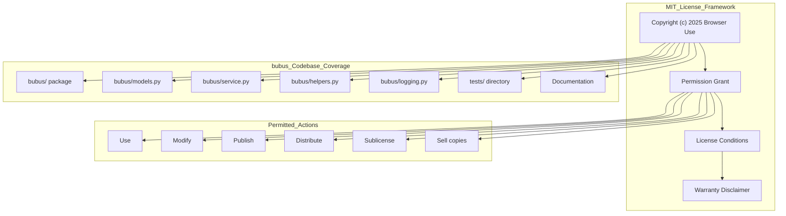
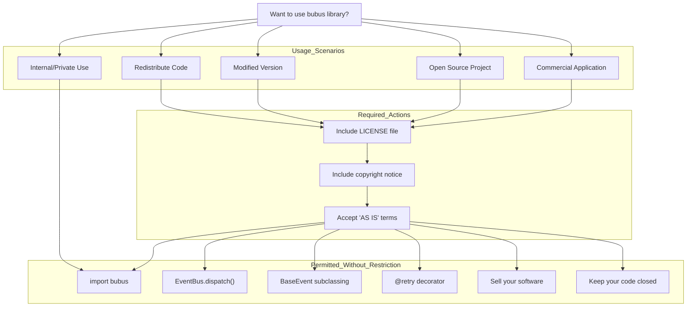

<!-- source: DeepWiki mcp.deepwiki.com · repo browser-use/bubus · page 6.2 License and Legal Information · fetched 2026-10-30 -->

# License and Legal Information

<details>
<summary>Relevant source files</summary>

The following files were used as context for generating this wiki page:

- [LICENSE](LICENSE)

</details>


This page provides comprehensive legal information about the bubus library, including licensing terms, copyright notices, usage rights, and legal obligations. This information applies to all components of the bubus event bus system and governs how the library can be used, modified, and distributed.

For information about the package structure and public API exports, see [Package Structure and Exports](#6.1).

## License Overview

The bubus library is released under the MIT License, one of the most permissive open source licenses available. This license provides broad permissions for both commercial and non-commercial use while maintaining minimal restrictions.

### MIT License Structure

The following diagram illustrates the key components and relationships within the MIT License framework as it applies to the bubus codebase:



Sources: [LICENSE:1-22]()

## Copyright Information

The bubus library is copyrighted by Browser Use as of 2025. This copyright notice must be included in all copies or substantial portions of the software, ensuring proper attribution to the original authors.

### Copyright Coverage

| Component | File Path | Copyright Status |
|-----------|-----------|------------------|
| Core EventBus | `bubus/service.py` | Covered |
| Event Models | `bubus/models.py` | Covered |
| Helper Functions | `bubus/helpers.py` | Covered |
| Logging System | `bubus/logging.py` | Covered |
| Test Suite | `tests/` | Covered |
| Documentation | All docs | Covered |

Sources: [LICENSE:3]()

## Usage Rights and Permissions

The MIT License grants extensive permissions without requiring royalty payments or complex compliance procedures. The following diagram shows the decision flow for various usage scenarios:



Sources: [LICENSE:5-10]()

## License Conditions and Obligations

The MIT License imposes minimal conditions on users. The primary obligations are straightforward and designed to ensure proper attribution while maximizing freedom of use.

### Required Actions

When using, modifying, or distributing bubus, you must:

1. **Include Copyright Notice**: The copyright notice from [LICENSE:3]() must be preserved
2. **Include License Text**: The full MIT License text from [LICENSE:1-22]() must be included
3. **Apply to All Copies**: Both notices must appear in all copies or substantial portions

### Substantial Portions Definition

The license applies to "substantial portions" of the software. For bubus, this includes:

- Complete modules like `bubus/service.py` or `bubus/models.py`
- Core classes like `EventBus`, `BaseEvent`, or `EventResult`
- Significant code blocks like the `@retry` decorator implementation
- Modified versions of any core functionality

Sources: [LICENSE:10-14]()

## Warranty Disclaimer and Liability

The MIT License includes comprehensive warranty disclaimers and liability limitations that protect both the original authors and users.

### Warranty Terms

The software is provided **"AS IS"** without warranty of any kind. This means:

| Warranty Type | Coverage | Status |
|---------------|----------|---------|
| Express Warranty | Explicitly stated guarantees | **None** |
| Implied Warranty | Legal assumptions of quality | **Disclaimed** |
| MERCHANTABILITY | Fitness for general use | **Disclaimed** |
| FITNESS FOR PURPOSE | Suitability for specific use | **Disclaimed** |
| NON-INFRINGEMENT | Freedom from IP claims | **Disclaimed** |

### Liability Limitations

The authors and copyright holders are not liable for:

- Direct damages from software use
- Indirect or consequential damages  
- Claims arising from software functionality
- Issues related to `EventBus` behavior
- Problems with `@retry` mechanisms
- Data loss from event processing failures

Sources: [LICENSE:15-22]()

## Legal Compliance Guidelines

To ensure proper compliance when using bubus in your projects, follow these practical guidelines based on common usage patterns.

### For Application Developers

When building applications that use bubus:

```python
# Your application code can freely use:
from bubus import EventBus, BaseEvent
from bubus.helpers import retry

# No licensing restrictions on your business logic
class MyBusinessEvent(BaseEvent[str]):
    data: str

# Commercial use is fully permitted
bus = EventBus("production-app")
```

**Requirement**: Include [LICENSE:1-22]() in your application's legal documentation or dependencies folder.

### For Library Authors

When creating libraries that depend on bubus:

- Include bubus license in your dependency documentation
- Your library can use any license (including proprietary)
- No requirement to open-source your code
- Full permission to modify bubus source if needed

### For Distributors

When redistributing bubus source code:

- Must include complete [LICENSE:1-22]() file
- Must preserve [LICENSE:3]() copyright notice  
- Can bundle with other software
- Can charge for distribution services
- Can modify source code freely

Sources: [LICENSE:1-22]()