# Page: Overview

# Overview

<details>
<summary>Relevant source files</summary>

The following files were used as context for generating this wiki page:

- [README.md](README.md)
- [bubus/__init__.py](bubus/__init__.py)

</details>


The `bubus` library is a production-ready, Pydantic-powered asynchronous event bus system for Python applications. It provides type-safe event processing with FIFO ordering, automatic parent-child event tracking, multi-bus communication, and advanced concurrency controls.

For detailed implementation specifics, see [Core Architecture](#2). For complete API documentation, see [API Reference](#3). For advanced usage patterns and debugging capabilities, see [Advanced Features](#4).

## Purpose and Core Value Proposition

`bubus` enables event-driven architectures with strong type safety and predictable execution semantics. The system combines Pydantic's validation capabilities with async Python patterns to deliver reliable event processing for both simple pub-sub patterns and complex distributed event workflows.

Key benefits include automatic event metadata management, built-in concurrency controls via the `@retry` decorator, write-ahead logging for durability, and sophisticated debugging tools for event tree visualization.

### Core Architecture Components

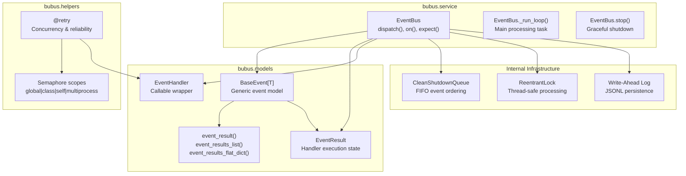

Sources: [bubus/__init__.py:1-14](), [README.md:507-513](), [README.md:592-622]()

## Core Event Processing Model

The system operates on a publish-subscribe pattern where `EventBus` instances manage event dispatch and handler execution. Events are defined as Pydantic models inheriting from `BaseEvent`, providing type safety and validation. Each event dispatch creates `EventResult` objects that track handler execution outcomes.

### Key Components Overview

| Component | Purpose | Key Features |
|-----------|---------|--------------|
| `EventBus` | Central event broker | FIFO processing, parallel handlers, inter-bus forwarding |
| `BaseEvent` | Event data model | Pydantic validation, automatic metadata, parent-child tracking |
| `EventResult` | Handler execution tracker | Async result handling, error tracking, timeout management |
| `CleanShutdownQueue` | Event ordering | FIFO guarantees, graceful shutdown |
| `ReentrantLock` | Concurrency control | Thread-safe processing, context tracking |

Sources: [README.md:499-589](), [README.md:592-779]()

### Event Processing Flow

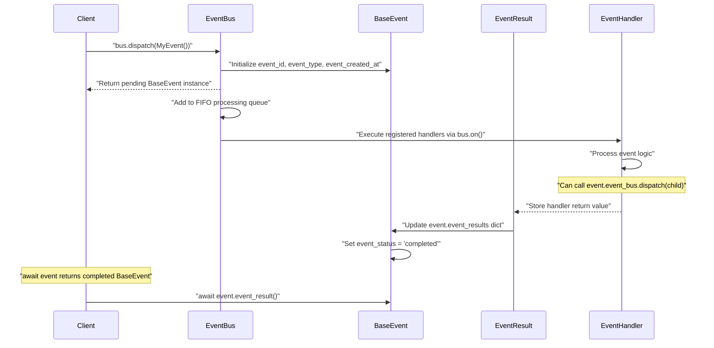

Sources: [README.md:21-42](), [README.md:546-553](), [README.md:643-670]()

## Core Capabilities

| Feature | Description | Key Components |
|---------|-------------|----------------|
| **Type-Safe Events** | Pydantic models with `BaseEvent[T]` generic typing | `BaseEvent`, automatic validation |
| **Handler Registration** | Multiple registration patterns with wildcard support | `bus.on(EventClass, handler)`, `bus.on('*', handler)` |
| **FIFO Processing** | Strict event ordering with async handler support | `CleanShutdownQueue`, sequential execution |
| **Event Hierarchies** | Automatic parent-child tracking for nested events | `event_parent_id`, `event_children` |
| **Multi-Bus Forwarding** | Event routing between `EventBus` instances | `event_path`, loop prevention |
| **Result Aggregation** | Multiple handlers per event with result collection | `event_results_list()`, `event_results_flat_dict()` |
| **Concurrency Control** | Built-in retry logic and semaphore management | `@retry` decorator, semaphore scopes |
| **Persistence** | Write-ahead logging to JSONL files | `wal_path` parameter |

### Multi-Bus Event Forwarding

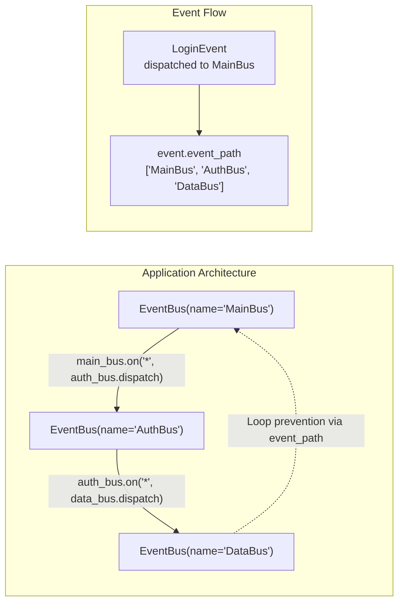

Sources: [README.md:145-165](), [README.md:151-164]()

### Built-in Concurrency and Reliability

The `@retry` decorator provides automatic retry logic with semaphore-based concurrency control:

```python
from bubus.helpers import retry

@retry(
    retries=3,
    wait=2,
    semaphore_limit=5,
    semaphore_scope='global'
)
async def reliable_handler(event: MyEvent):
    # Automatic retry on failures
    # Maximum 5 concurrent executions
    return await external_api_call()
```

Sources: [README.md:822-924](), [README.md:838-853]()

## Integration Architecture

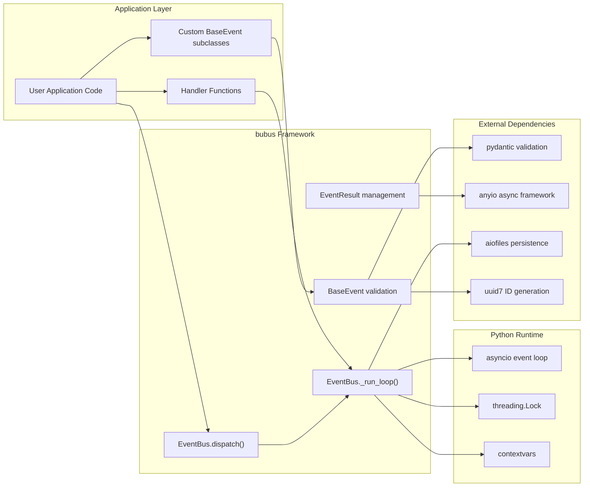

Sources: [README.md:17-42](), [README.md:70-87]()

The `bubus` system provides a comprehensive foundation for building reactive applications with strong type safety, flexible concurrency models, and sophisticated event relationship tracking. Its modular architecture allows for both simple pub-sub patterns and complex event-driven workflows with inter-service communication capabilities.

---

# Page: Core Architecture

# Core Architecture

<details>
<summary>Relevant source files</summary>

The following files were used as context for generating this wiki page:

- [README.md](README.md)
- [bubus/models.py](bubus/models.py)
- [bubus/service.py](bubus/service.py)

</details>


This document provides a detailed overview of the core architectural components and design patterns in the bubus event bus system. It covers the foundational classes, data models, and processing pipelines that enable asynchronous, type-safe event-driven programming in Python.

For specific API documentation and method signatures, see [EventBus API](#3.1) and [BaseEvent and EventResult API](#3.2). For advanced features like multi-bus communication and debugging tools, see [Advanced Features](#4).

## Core Class Architecture

The bubus architecture centers around three primary classes that work together to provide a complete event processing system:

### Class Hierarchy and Relationships

```mermaid
classDiagram
    class EventBus {
        +str name
        +str id
        +dict handlers
        +CleanShutdownQueue event_queue
        +dict event_history
        +bool _is_running
        +dispatch(event) BaseEvent
        +on(pattern, handler) None
        +expect(event_type) BaseEvent
        +step() BaseEvent
        +process_event(event) None
        +execute_handler(event, handler) Any
    }
    
    class BaseEvent~T~ {
        +str event_type
        +str event_id
        +str event_parent_id
        +list event_path
        +dict event_results
        +datetime event_created_at
        +Any event_result_type
        +__await__() Self
        +event_result() T
        +event_mark_complete_if_all_handlers_completed()
    }
    
    class EventResult~T~ {
        +str handler_id
        +str handler_name
        +str status
        +T result
        +BaseException error
        +datetime started_at
        +datetime completed_at
        +list event_children
        +__await__() T
        +update(**kwargs) Self
    }
    
    class CleanShutdownQueue~T~ {
        +bool _is_shutdown
        +deque _getters
        +deque _putters
        +shutdown(immediate) None
        +get() T
        +put(item) None
    }
    
    class ReentrantLock {
        +asyncio.Semaphore _semaphore
        +int _depth
        +__aenter__() Self
        +__aexit__() None
        +locked() bool
    }
    
    EventBus ||--o{ BaseEvent : "manages"
    EventBus ||--|| CleanShutdownQueue : "uses"
    BaseEvent ||--o{ EventResult : "contains"
    EventBus ||--|| ReentrantLock : "synchronizes with"
    
    note for BaseEvent "Generic type T defines expected result type"
    note for EventResult "Auto-casting to T with Pydantic validation"
```

Sources: [bubus/service.py:250-1506](), [bubus/models.py:200-972]()

### Event Bus Service Core

The `EventBus` class in [bubus/service.py:250-1506]() serves as the central event dispatcher and coordination hub. It maintains several key data structures:

- **`handlers`**: Dictionary mapping event patterns to handler functions [bubus/service.py:270]()
- **`event_queue`**: FIFO queue for pending events using `CleanShutdownQueue` [bubus/service.py:271]()  
- **`event_history`**: Dictionary tracking all processed events by ID [bubus/service.py:272]()
- **`_runloop_task`**: Background asyncio task processing the event queue [bubus/service.py:275]()

The service maintains a global registry of all active instances via `EventBus.all_instances` [bubus/service.py:261]() to enable cross-bus communication and memory monitoring.

Sources: [bubus/service.py:250-342]()

## Event Processing Pipeline

The event processing follows a structured pipeline from dispatch to completion:

### Event Lifecycle Flow

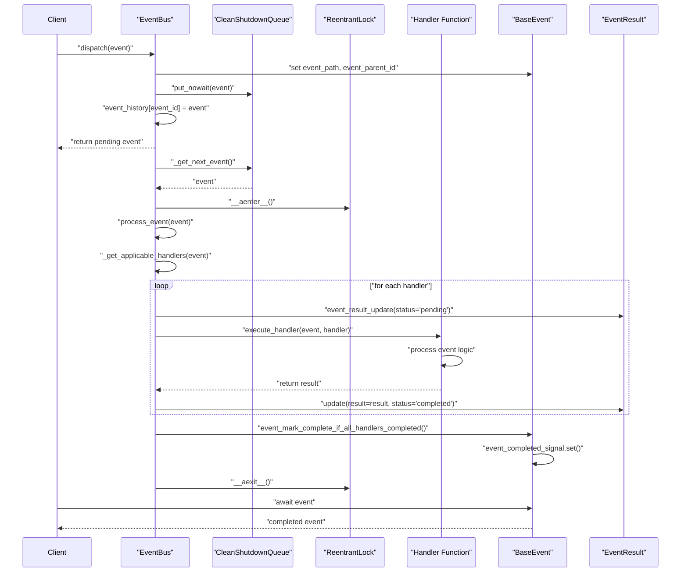

Sources: [bubus/service.py:485-588](), [bubus/service.py:929-1013](), [bubus/service.py:1080-1232]()

### Handler Execution Model

Handler execution supports both synchronous and asynchronous functions with automatic type validation:

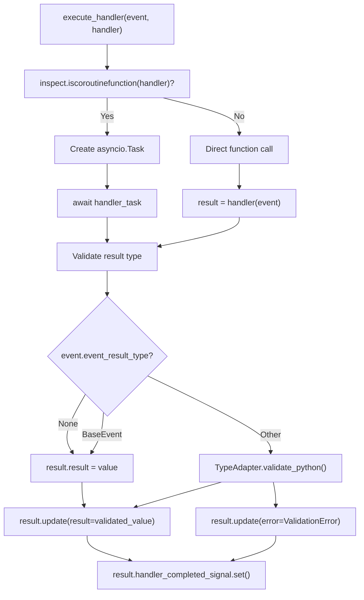

Sources: [bubus/service.py:1080-1232](), [bubus/models.py:897-960]()

## Event Model System

### BaseEvent Structure

The `BaseEvent` class in [bubus/models.py:200-792]() provides the foundational data model for all events. It extends Pydantic's `BaseModel` with event-specific metadata and processing capabilities:

| Field Category | Fields | Purpose |
|----------------|--------|---------|
| **Identity** | `event_id`, `event_type`, `event_schema` | Unique identification and versioning |
| **Hierarchy** | `event_parent_id`, `event_path`, `event_children` | Parent-child relationships and routing |
| **Timing** | `event_created_at`, `event_started_at`, `event_completed_at` | Lifecycle timestamps |
| **Processing** | `event_results`, `event_timeout`, `event_status` | Handler execution tracking |
| **Type System** | `event_result_type` | Expected return type validation |

Sources: [bubus/models.py:216-258]()

### EventResult Tracking

Each handler execution creates an `EventResult` instance that tracks the processing state and outcome:

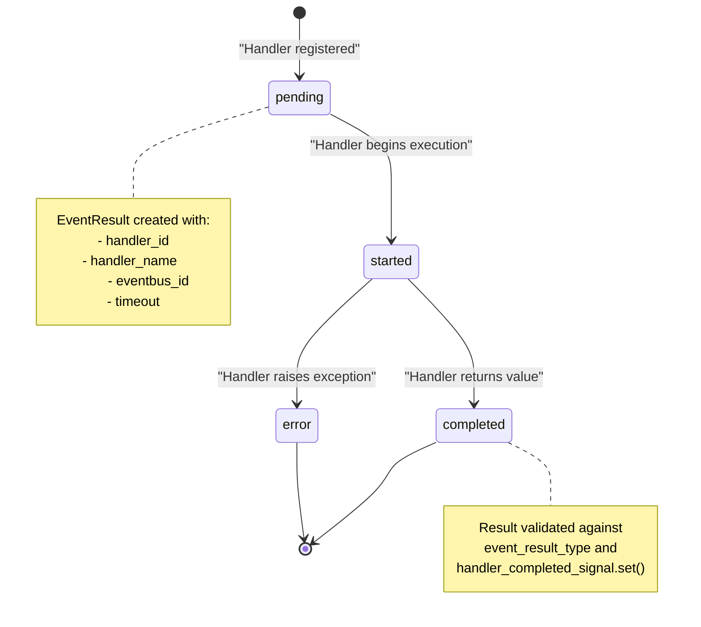

Sources: [bubus/models.py:811-968]()

## Concurrency and Synchronization

### Global Lock Coordination

The system uses a `ReentrantLock` [bubus/service.py:147-198]() to coordinate event processing across all EventBus instances while allowing nested event dispatch from within handlers:

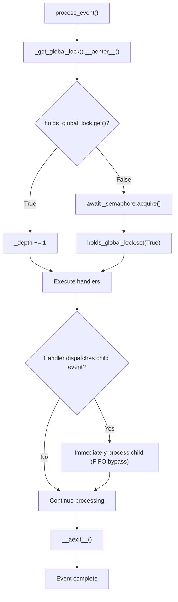

Sources: [bubus/service.py:147-210](), [bubus/service.py:951-953]()

### Context Variable Management  

The system uses several `ContextVar` instances to track execution state across async boundaries:

- **`_current_event_context`**: Tracks the currently processing event [bubus/service.py:138]()
- **`inside_handler_context`**: Indicates if code is executing within a handler [bubus/service.py:140]()  
- **`holds_global_lock`**: Tracks lock ownership for reentrancy [bubus/service.py:142]()
- **`_current_handler_id_context`**: Identifies the active handler for child event tracking [bubus/service.py:144]()

Sources: [bubus/service.py:137-145](), [bubus/service.py:1103-1107]()

## Type System Integration

### Generic Type Extraction

The type system automatically extracts expected result types from `BaseEvent[T]` generic parameters using Pydantic's metadata:

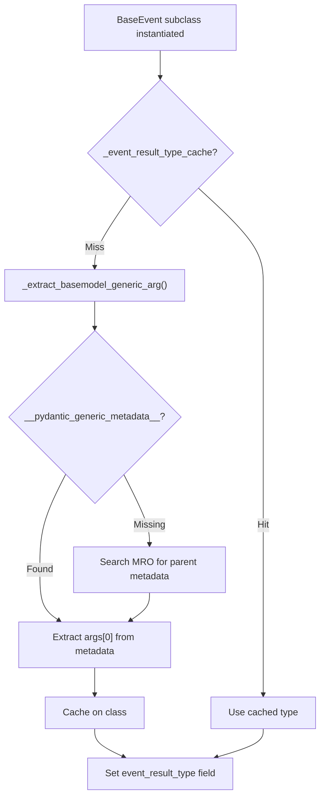

Sources: [bubus/models.py:172-198](), [bubus/models.py:375-410]()

### Result Validation Pipeline

Handler return values are automatically validated and cast to the expected type:

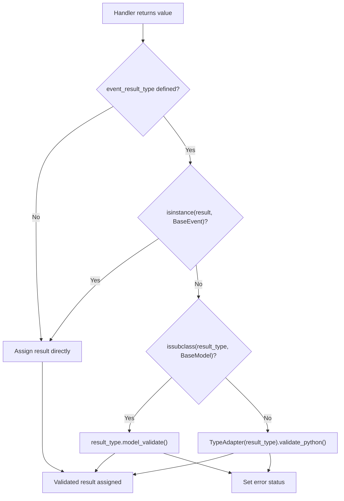

Sources: [bubus/models.py:909-940]()

This architecture provides a robust foundation for building event-driven applications with strong typing, automatic validation, and comprehensive lifecycle management while maintaining high performance through careful concurrency control and memory management.

---

# Page: EventBus Service Implementation

# EventBus Service Implementation

<details>
<summary>Relevant source files</summary>

The following files were used as context for generating this wiki page:

- [bubus/service.py](bubus/service.py)
- [tests/test_eventbus.py](tests/test_eventbus.py)

</details>


This document covers the internal architecture and implementation details of the `EventBus` class, which serves as the central event processing engine in the bubus library. It focuses on the asynchronous processing mechanisms, concurrency control, and event lifecycle management.

For information about the data models that EventBus processes, see [Data Models](#2.2). For details about retry mechanisms and semaphore-based concurrency, see [Resilience and Concurrency](#2.3).

## Core Architecture Overview

The `EventBus` class implements a sophisticated asynchronous event processing system with guaranteed FIFO (First-In-First-Out) ordering and comprehensive lifecycle management. The implementation centers around three core components: the event bus controller, a custom queue system, and a global locking mechanism.

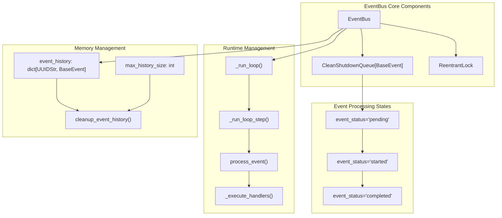

**Sources:** [bubus/service.py:250-342](), [bubus/service.py:56-135](), [bubus/service.py:147-198]()

## Event Queue Management

The `CleanShutdownQueue` class extends `asyncio.Queue` to provide clean shutdown capabilities without generating warnings during event loop closure. This custom implementation handles graceful termination and prevents common asyncio shutdown errors.

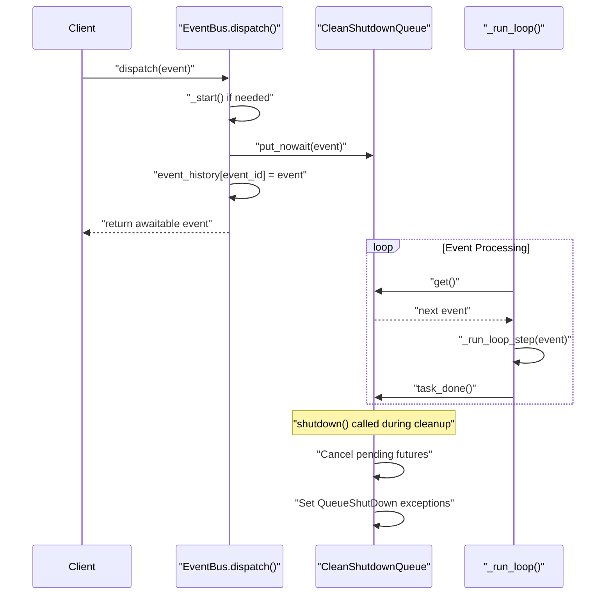

Key queue management features:

| Feature | Implementation | Purpose |
|---------|---------------|---------|
| Clean Shutdown | `shutdown(immediate=True)` | Prevents asyncio warnings on cleanup |
| Capacity Control | `maxsize=50` when `max_history_size` set | Memory leak prevention |
| Exception Handling | `QueueShutDown` exception | Graceful termination signaling |

**Sources:** [bubus/service.py:56-135](), [bubus/service.py:485-588](), [bubus/service.py:742-809]()

## Event Processing Pipeline

The event processing pipeline implements a multi-stage architecture that ensures proper event lifecycle management and handler execution ordering.

```mermaid
graph LR
    subgraph "Dispatch Stage"
        DISPATCH["dispatch()"]
        VALIDATE["Validate event fields"]
        PARENT["Set event_parent_id"]
        QUEUE["Queue event"]
    end
    
    subgraph "Processing Stage"
        GET["_get_next_event()"]
        LOCK["Acquire global lock"]
        HANDLERS["_get_applicable_handlers()"]
        EXECUTE["_execute_handlers()"]
    end
    
    subgraph "Completion Stage"
        LOG["_default_log_handler()"]
        WAL["_default_wal_handler()"]
        MARK["event_mark_complete()"]
        PARENT_CHECK["Check parent completion"]
    end
    
    DISPATCH --> VALIDATE
    VALIDATE --> PARENT
    PARENT --> QUEUE
    
    QUEUE --> GET
    GET --> LOCK
    LOCK --> HANDLERS
    HANDLERS --> EXECUTE
    
    EXECUTE --> LOG
    LOG --> WAL
    WAL --> MARK
    MARK --> PARENT_CHECK
```

The pipeline processes events through these key methods:

- `dispatch()`: Synchronous event queuing with validation [bubus/service.py:485-588]()
- `step()`: Single event processing cycle [bubus/service.py:929-960]()
- `process_event()`: Handler execution coordination [bubus/service.py:962-1012]()
- `_execute_handlers()`: Parallel or serial handler execution [bubus/service.py:1037-1077]()

**Sources:** [bubus/service.py:485-588](), [bubus/service.py:929-1012](), [bubus/service.py:1037-1077]()

## Concurrency and Locking

The EventBus implements a sophisticated concurrency model using a global re-entrant lock that works across different asyncio tasks through context variables.

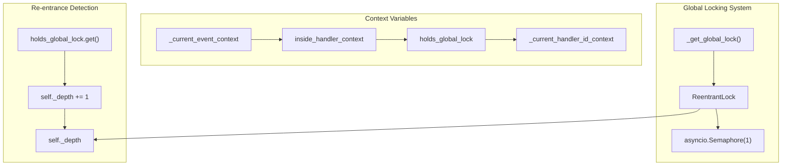

The concurrency system provides:

| Component | Purpose | Implementation |
|-----------|---------|---------------|
| `ReentrantLock` | Cross-task re-entrance | Context variable tracking [bubus/service.py:147-198]() |
| `_current_event_context` | Parent-child event linking | ContextVar for event hierarchy [bubus/service.py:138]() |
| `inside_handler_context` | Nested event detection | Prevents recursive handler calls [bubus/service.py:140]() |
| `holds_global_lock` | Lock state tracking | Re-entrance depth management [bubus/service.py:142]() |

**Sources:** [bubus/service.py:137-210](), [bubus/service.py:951](), [bubus/service.py:1103-1107]()

## Handler Execution Engine

The handler execution engine supports both synchronous and asynchronous handlers with comprehensive error handling and deadlock detection.

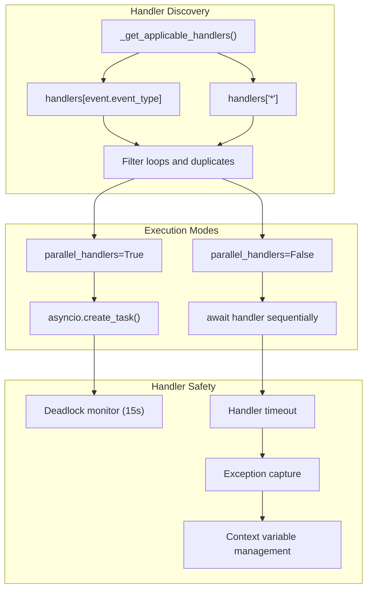

Handler execution features:

- **Loop Prevention**: Checks event path and handler history [bubus/service.py:1233-1287]()
- **Deadlock Detection**: 15-second monitor task [bubus/service.py:1110-1120]()
- **Context Management**: Proper context variable propagation [bubus/service.py:1102-1174]()
- **Result Tracking**: Handler-specific result objects [bubus/service.py:1098-1100]()

**Sources:** [bubus/service.py:1014-1035](), [bubus/service.py:1080-1231](), [bubus/service.py:1233-1287]()

## Memory Management and Cleanup

The EventBus implements comprehensive memory management to prevent memory leaks in long-running applications.

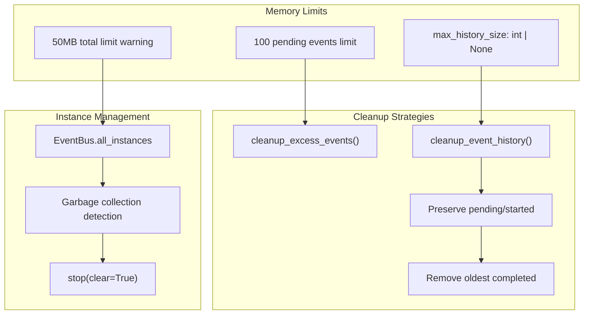

Memory management mechanisms:

| Mechanism | Trigger | Implementation |
|-----------|---------|---------------|
| Event History Cleanup | After each event | `cleanup_event_history()` [bubus/service.py:1371-1431]() |
| Capacity Limiting | Before dispatch | 100 pending events check [bubus/service.py:547-557]() |
| Instance Tracking | Class-level | `WeakSet` for garbage collection [bubus/service.py:261]() |
| Memory Monitoring | On shutdown/cleanup | Total usage warning [bubus/service.py:1439-1505]() |

**Sources:** [bubus/service.py:1371-1431](), [bubus/service.py:547-557](), [bubus/service.py:1439-1505](), [bubus/service.py:261]()

## Instance Management

The EventBus class implements sophisticated instance lifecycle management with automatic cleanup hooks and name collision detection.

```mermaid
graph LR
    subgraph "Instance Creation"
        INIT["__init__()"]
        NAME_CHECK["Check name conflicts"]
        UUID_SUFFIX["Auto-generate suffix"]
        WEAK_SET_ADD["Add to all_instances"]
    end
    
    subgraph "Lifecycle Hooks"
        EVENT_LOOP["Get running loop"]
        HOOK_CLOSE["Hook loop.close()"]
        REGISTER["Register in loop"]
        AUTO_START["_start() on first dispatch"]
    end
    
    subgraph "Cleanup"
        STOP["stop()"]
        CLEAR_FLAG["clear=True"]
        REMOVE_WEAK["Remove from WeakSet"]
        GC_CHECK["_check_total_memory_usage()"]
    end
    
    INIT --> NAME_CHECK
    NAME_CHECK --> UUID_SUFFIX
    UUID_SUFFIX --> WEAK_SET_ADD
    
    WEAK_SET_ADD --> EVENT_LOOP
    EVENT_LOOP --> HOOK_CLOSE
    HOOK_CLOSE --> REGISTER
    REGISTER --> AUTO_START
    
    AUTO_START --> STOP
    STOP --> CLEAR_FLAG
    CLEAR_FLAG --> REMOVE_WEAK
    REMOVE_WEAK --> GC_CHECK
```

Key instance management features:

- **Name Uniqueness**: Automatic suffix generation for conflicts [bubus/service.py:276-312]()
- **Auto-start**: Lazy initialization on first `dispatch()` call [bubus/service.py:667-723]()
- **Loop Integration**: Event loop close hook registration [bubus/service.py:675-708]()
- **Graceful Shutdown**: Clean termination with optional clearing [bubus/service.py:725-789]()

**Sources:** [bubus/service.py:261-325](), [bubus/service.py:667-723](), [bubus/service.py:725-789](), [bubus/service.py:332-348]()

---

# Page: Event Models and Result System

# Event Models and Result System

<details>
<summary>Relevant source files</summary>

The following files were used as context for generating this wiki page:

- [bubus/models.py](bubus/models.py)
- [tests/test_attribute_error_fix.py](tests/test_attribute_error_fix.py)

</details>


This document covers the core data structures and lifecycle management for events and their results in the bubus library. It focuses on the `BaseEvent` and `EventResult` classes, their properties, state management, and result aggregation patterns.

For information about how these models integrate with the EventBus service implementation, see [EventBus Service Implementation](#2.1). For details on multi-bus communication patterns that use these models, see [Multi-Bus Communication and Event Forwarding](#4.2).

## Event Model Architecture

The event system is built around two primary model classes that work together to track event processing and results.

```mermaid
classDiagram
    class BaseEvent~T_EventResultType~ {
        +event_id: UUIDStr
        +event_type: PythonIdentifierStr
        +event_schema: str
        +event_timeout: float
        +event_result_type: Any
        +event_path: list[PythonIdentifierStr]
        +event_parent_id: UUIDStr
        +event_created_at: datetime
        +event_processed_at: datetime
        +event_results: dict[PythonIdStr, EventResult]
        +_event_completed_signal: asyncio.Event
        +event_result() → T_EventResultType
        +event_results_list() → list[T_EventResultType]
        +event_mark_complete_if_all_handlers_completed()
        +__await__() → Self
    }
    
    class EventResult~T_EventResultType~ {
        +id: UUIDStr
        +status: Literal["pending", "started", "completed", "error"]
        +event_id: UUIDStr
        +handler_id: PythonIdStr
        +handler_name: str
        +result_type: Any
        +result: T_EventResultType
        +error: BaseException
        +event_children: list[BaseEvent]
        +_handler_completed_signal: asyncio.Event
        +update(**kwargs) → Self
        +__await__() → T_EventResultType
    }
    
    BaseEvent ||--o{ EventResult : "contains"
    EventResult ||--o{ BaseEvent : "event_children"
    BaseEvent --> BaseEvent : "parent-child hierarchy"
```

Sources: [bubus/models.py:200-972]()

## Event Lifecycle State Machine

Events progress through distinct states as they are processed by the EventBus system. Each handler execution creates an `EventResult` that tracks its own lifecycle in parallel.

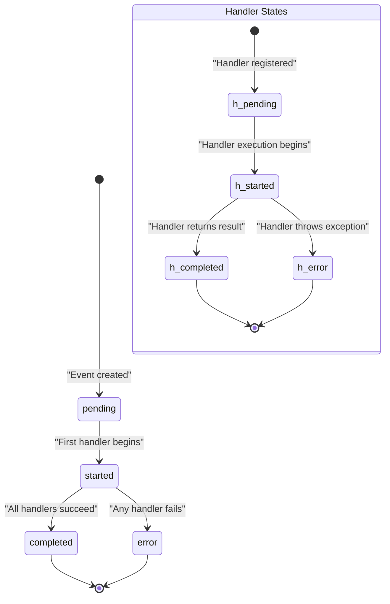

Sources: [bubus/models.py:424-458](), [bubus/models.py:824-960]()

## Core Event Properties

The `BaseEvent` class provides comprehensive metadata tracking and result aggregation through its properties and methods.

### Event Identification and Metadata

| Property | Type | Description |
|----------|------|-------------|
| `event_id` | `UUIDStr` | UUID7 identifier for the event |
| `event_type` | `PythonIdentifierStr` | Event class name (auto-set) |
| `event_schema` | `str` | Schema version with library version |
| `event_timeout` | `float` | Handler timeout in seconds |
| `event_path` | `list[PythonIdentifierStr]` | Bus routing history |

Sources: [bubus/models.py:216-241]()

### Timing and Status Properties

The event model provides computed properties that aggregate timing information from all handler results:

```mermaid
graph LR
    subgraph "Computed Properties"
        ES["event_status"]
        ESA["event_started_at"] 
        ECA["event_completed_at"]
    end
    
    subgraph "Source Data"
        ER["event_results"]
        EPA["event_processed_at"]
    end
    
    ER --> ES
    ER --> ESA
    ER --> ECA
    EPA --> ESA
    EPA --> ECA
```

Sources: [bubus/models.py:424-458]()

## Result Collection System

`BaseEvent` provides multiple methods for collecting and processing handler results with different aggregation patterns.

### Result Access Methods

| Method | Return Type | Purpose |
|--------|-------------|---------|
| `event_result()` | `T_EventResultType \| None` | Get first non-None result |
| `event_results_list()` | `list[T_EventResultType]` | Get all results as list |
| `event_results_by_handler_id()` | `dict[PythonIdStr, T_EventResultType]` | Results keyed by handler ID |
| `event_results_by_handler_name()` | `dict[str, T_EventResultType]` | Results keyed by handler name |
| `event_results_flat_dict()` | `dict[str, Any]` | Merge dict results into single dict |
| `event_results_flat_list()` | `list[Any]` | Flatten list results into single list |

Sources: [bubus/models.py:566-647]()

### Result Filtering System

All result collection methods accept filtering parameters for flexible result processing:

```mermaid
flowchart TD
    A["event_results_filtered()"] --> B{"include filter"}
    B -->|truthy results| C["Filter Results"]
    B -->|custom filter| D["Custom Logic"]
    
    C --> E{"raise_if_any=True"}
    D --> E
    
    E -->|has errors| F["Raise First Error"]
    E -->|no errors| G{"raise_if_none=True"}
    
    G -->|no results| H["Raise ValueError"]
    G -->|has results| I["Return Filtered Results"]
    
    F --> END[Exception]
    H --> END
    I --> END[Results Dict]
```

Sources: [bubus/models.py:474-533]()

## Type System Integration

The event model integrates with Python's type system through generic parameters and automatic result validation.

### Generic Type Parameter

Events can be parameterized with expected result types using the generic `T_EventResultType`:

```python
class ScreenshotEvent(BaseEvent[bytes]):
    event_result_type = bytes
    screenshot_width: int = 1920
    screenshot_height: int = 1080
```

### Automatic Result Type Inference

The `_extract_basemodel_generic_arg()` function automatically extracts the generic type parameter and sets `event_result_type`:

```mermaid
flowchart TD
    A["BaseEvent[SomeType]"] --> B["_extract_basemodel_generic_arg()"]
    B --> C{"Check __pydantic_generic_metadata__"}
    C -->|found| D["Extract type argument"]
    C -->|not found| E["Check MRO"]
    E --> F{"Found in parent?"}
    F -->|yes| D
    F -->|no| G["Return None"]
    D --> H["Cache on class"]
    G --> I["Use default None"]
    H --> J["Set event_result_type"]
    I --> J
```

Sources: [bubus/models.py:172-198](), [bubus/models.py:375-411]()

## EventResult Lifecycle Management

Each handler execution creates an `EventResult` that tracks its individual processing state and manages result validation.

### Result Update Process

The `EventResult.update()` method handles result assignment with automatic type validation:

```mermaid
flowchart TD
    A["update(result=value)"] --> B{"Is result BaseException?"}
    B -->|yes| C["Convert to error"]
    B -->|no| D{"Has result_type?"}
    
    D -->|no| E["Direct assignment"]
    D -->|yes| F{"Is BaseEvent?"}
    
    F -->|yes| G["Skip validation"]
    F -->|no| H{"Is BaseModel subclass?"}
    
    H -->|yes| I["Pydantic validation"]
    H -->|no| J["TypeAdapter validation"]
    
    I --> K["Assign validated result"]
    J --> K
    G --> K
    E --> K
    
    C --> L["Set error status"]
    K --> M["Update timestamps"]
    L --> M
    M --> N["Signal completion"]
```

Sources: [bubus/models.py:897-960]()

## Parent-Child Event Hierarchy

The event system automatically tracks parent-child relationships when handlers dispatch new events during execution.

### Hierarchy Structure

```mermaid
graph TD
    subgraph "Parent Event"
        PE["ParentEvent"]
        PER1["EventResult[handler1]"]
        PER2["EventResult[handler2]"]
        
        PE --> PER1
        PE --> PER2
    end
    
    subgraph "Child Events"
        CE1["ChildEvent1"]
        CE2["ChildEvent2"]
        CE3["ChildEvent3"]
    end
    
    PER1 --> CE1
    PER1 --> CE2
    PER2 --> CE3
    
    subgraph "Properties"
        PC["event_children"]
        PAC["event_are_all_children_complete()"]
    end
    
    PE -.-> PC
    PE -.-> PAC
```

### Completion Dependency

Parent events wait for all child events to complete before marking themselves as complete:

Sources: [bubus/models.py:691-741]()

## Async Completion Patterns

Both `BaseEvent` and `EventResult` implement `__await__` to enable async/await syntax for waiting on completion.

### Event Await Behavior

The `BaseEvent.__await__()` method implements sophisticated logic to handle deadlock prevention when waiting for child events from within handler contexts:

```mermaid
sequenceDiagram
    participant Handler as "Event Handler"
    participant Event as "BaseEvent"
    participant Bus as "EventBus"
    participant Signal as "asyncio.Event"
    
    Handler->>Event: await event
    Event->>Event: Check if inside_handler_context
    alt Inside Handler Context
        Event->>Bus: Process queued events
        loop Until Complete
            Bus->>Bus: Process one event
            Event->>Signal: Check completion
        end
    else Outside Handler Context
        Event->>Signal: await signal.wait()
    end
    Signal-->>Event: Event complete
    Event-->>Handler: Return completed event
```

Sources: [bubus/models.py:277-354]()

## Event Validation and Schema Management

The event model includes comprehensive validation through Pydantic model validators that automatically set metadata fields.

### Automatic Field Population

Three model validators automatically populate event metadata:

| Validator | Purpose |
|-----------|---------|
| `_set_event_type_from_class_name` | Sets `event_type` to class name |
| `_set_event_schema_from_class_name` | Sets `event_schema` with version |
| `_set_event_result_type_from_generic_arg` | Extracts generic type parameter |

Sources: [bubus/models.py:355-411]()

---

# Page: Concurrency Control and Reliability

# Concurrency Control and Reliability

<details>
<summary>Relevant source files</summary>

The following files were used as context for generating this wiki page:

- [bubus/helpers.py](bubus/helpers.py)
- [tests/test_handler_timeout.py](tests/test_handler_timeout.py)
- [tests/test_name_conflict_gc.py](tests/test_name_conflict_gc.py)
- [tests/test_semaphores.py](tests/test_semaphores.py)
- [tests/test_stress_20k_events.py](tests/test_stress_20k_events.py)

</details>


## Purpose and Scope

This document covers bubus's comprehensive concurrency control and reliability mechanisms, focusing on the `@retry` decorator system, semaphore-based resource management, timeout handling, and system overload protection. These features ensure robust, reliable event processing under load while preventing resource exhaustion and system instability.

For information about the core EventBus service implementation, see [EventBus Service Implementation](#2.1). For details about event models and result handling, see [Event Models and Result System](#2.2).

## The @retry Decorator System

The `@retry` decorator in [bubus/helpers.py:427-530]() provides the foundation for reliable asynchronous function execution with built-in concurrency control, timeout management, and retry logic.

### Core Decorator Architecture

```mermaid
graph TB
    subgraph "Retry Decorator System"
        RD["`@retry`<br/>Decorator"]
        
        subgraph "Configuration Parameters"
            RP["retries: int"]
            RW["wait: float"]
            RT["timeout: float"]
            RO["retry_on: tuple[Exception]"]
            BF["backoff_factor: float"]
        end
        
        subgraph "Semaphore Parameters"
            SL["semaphore_limit: int"]
            SN["semaphore_name: str"]
            SS["semaphore_scope: Literal"]
            ST["semaphore_timeout: float"]
            SX["semaphore_lax: bool"]
        end
        
        subgraph "Execution Pipeline"
            SA["Semaphore Acquisition"]
            EE["Function Execution"]
            RH["Retry Handling"]
            CU["Cleanup & Release"]
        end
    end
    
    RD --> RP
    RD --> SL
    RD --> SA
    SA --> EE
    EE --> RH
    RH --> CU
    
    RP --> RH
    SL --> SA
```

**Sources:** [bubus/helpers.py:427-470]()

### Retry Logic and Error Handling

The retry system implements exponential backoff with configurable exception filtering:

```mermaid
sequenceDiagram
    participant Client
    participant RetryWrapper as "@retry wrapper"
    participant Function as "Wrapped Function"
    participant ErrorHandler as "Error Handler"
    
    Client->>RetryWrapper: call function(*args, **kwargs)
    RetryWrapper->>RetryWrapper: acquire semaphore (if configured)
    
    loop For each attempt (0 to retries)
        RetryWrapper->>Function: execute with timeout
        alt Success
            Function-->>RetryWrapper: return result
            RetryWrapper-->>Client: return result
        else Exception raised
            Function-->>ErrorHandler: exception
            ErrorHandler->>ErrorHandler: check if exception in retry_on
            alt Should retry AND attempts remaining
                ErrorHandler->>ErrorHandler: calculate backoff wait time
                ErrorHandler->>ErrorHandler: await asyncio.sleep(wait)
                Note over ErrorHandler: wait *= backoff_factor
            else Final failure
                ErrorHandler-->>RetryWrapper: raise final exception
                RetryWrapper-->>Client: raise exception
            end
        end
    end
    
    RetryWrapper->>RetryWrapper: release semaphore
```

**Sources:** [bubus/helpers.py:349-403](), [tests/test_semaphores.py:849-890]()

## Semaphore-Based Concurrency Control

The semaphore system provides fine-grained concurrency control with four different scopes to match various use cases.

### Semaphore Scope Types

| Scope | Key Generation | Use Case | Implementation |
|-------|----------------|----------|----------------|
| `global` | `semaphore_name` | System-wide limits | `asyncio.Semaphore` |
| `class` | `ClassName.semaphore_name` | Per-class limits | `asyncio.Semaphore` |
| `self` | `id(instance).semaphore_name` | Per-instance limits | `asyncio.Semaphore` |
| `multiprocess` | `semaphore_name` | Cross-process limits | `portalocker.NamedBoundedSemaphore` |

**Sources:** [bubus/helpers.py:124-146](), [bubus/helpers.py:148-198]()

### Semaphore Acquisition Flow

```mermaid
graph TD
    subgraph "Semaphore Acquisition Process"
        SA["Start Acquisition"]
        GSK["Generate Semaphore Key"]
        GCS["Get/Create Semaphore"]
        
        subgraph "Scope Check"
            CMP["Is multiprocess?"]
            AMP["Acquire Multiprocess"]
            AAP["Acquire Asyncio"]
        end
        
        subgraph "Multiprocess Handling"
            NBC["Create NamedBoundedSemaphore"]
            RTL["Retry with Backoff"]
            FBK["Fallback to asyncio"]
        end
        
        subgraph "Error Handling"
            LAX["semaphore_lax?"]
            THR["Throw TimeoutError"]
            CNT["Continue without limit"]
        end
    end
    
    SA --> GSK
    GSK --> GCS
    GCS --> CMP
    CMP -->|Yes| AMP
    CMP -->|No| AAP
    
    AMP --> NBC
    NBC --> RTL
    RTL -->|Success| SA
    RTL -->|Failure| LAX
    
    AAP -->|Timeout| LAX
    AAP -->|Success| SA
    
    LAX -->|False| THR
    LAX -->|True| CNT
```

**Sources:** [bubus/helpers.py:215-320](), [bubus/helpers.py:322-347]()

### Multiprocess Semaphore Reliability

The multiprocess semaphore implementation includes sophisticated error recovery:

```mermaid
graph TB
    subgraph "Multiprocess Semaphore Resilience"
        MSC["Multiprocess Semaphore Creation"]
        
        subgraph "Error Recovery"
            LFD["Lock File Disappeared"]
            SLF["Stale Lock Files"]
            FNF["FileNotFoundError"]
            ALK["Already Locked Error"]
        end
        
        subgraph "Recovery Actions"
            CLN["Clean Stale Locks"]
            RCR["Recreate Semaphore"]
            FBK["Fallback to asyncio.Semaphore"]
            RTY["Retry with Backoff"]
        end
        
        subgraph "Cleanup Strategy"
            DIR["Ensure Directory Exists"]
            TMO["Remove Old Lock Files"]
            AGR["Aggressive Timeout (0.1s)"]
        end
    end
    
    MSC --> LFD
    MSC --> SLF
    MSC --> FNF
    MSC --> ALK
    
    LFD --> RCR
    SLF --> CLN
    FNF --> FBK
    ALK --> RTY
    
    RCR --> DIR
    CLN --> TMO
    FBK --> AGR
```

**Sources:** [bubus/helpers.py:154-192](), [bubus/helpers.py:253-295]()

## Timeout Management and System Protection

### Per-Operation Timeout Control

Each retry-decorated function operates under strict timeout controls:

```mermaid
graph LR
    subgraph "Timeout Hierarchy"
        ST["semaphore_timeout<br/>Semaphore acquisition limit"]
        OT["timeout<br/>Per-attempt execution limit"]
        TT["Total Time<br/>All attempts + waits"]
    end
    
    subgraph "Timeout Calculations"
        STC["semaphore_timeout = <br/>timeout * (limit - 1)"]
        BWT["backoff_wait = <br/>wait * (backoff_factor ^ attempt)"]
        TTT["total_time ≤ <br/>(timeout + wait) * (retries + 1)"]
    end
    
    ST --> STC
    OT --> BWT
    TT --> TTT
```

**Sources:** [bubus/helpers.py:200-213](), [bubus/helpers.py:349-403]()

### System Overload Detection

The system continuously monitors resource usage to prevent overload conditions:

| Resource | Threshold | Action |
|----------|-----------|---------|
| CPU Usage | > 85% | Log warning |
| Memory Usage | > 85% | Log warning |
| Active Operations | > 30 | Log warning |

```mermaid
graph TD
    subgraph "System Overload Protection"
        SOD["System Overload Detection"]
        
        subgraph "Monitoring"
            CPU["CPU Percent Check"]
            MEM["Memory Percent Check"] 
            OPS["Active Operations Count"]
        end
        
        subgraph "Thresholds"
            CT["CPU > 85%"]
            MT["Memory > 85%"]
            OT["Operations > 30"]
        end
        
        subgraph "Response"
            LOG["Log Warning"]
            RED["Reduce Concurrency"]
            THR["Throttle Operations"]
        end
    end
    
    SOD --> CPU
    SOD --> MEM
    SOD --> OPS
    
    CPU --> CT
    MEM --> MT
    OPS --> OT
    
    CT --> LOG
    MT --> LOG
    OT --> LOG
    
    LOG --> RED
    RED --> THR
```

**Sources:** [bubus/helpers.py:84-122](), [bubus/helpers.py:406-425]()

## Integration with EventBus Architecture

### Handler Execution with Retry Control

The `@retry` decorator integrates seamlessly with EventBus handler execution:

```mermaid
sequenceDiagram
    participant EB as "EventBus"
    participant HD as "Handler Dispatcher"
    participant RD as "@retry Decorator"
    participant SM as "Semaphore Manager"
    participant HF as "Handler Function"
    
    EB->>HD: execute_handler(event, handler)
    HD->>RD: call decorated handler
    RD->>SM: acquire semaphore (if configured)
    SM-->>RD: semaphore acquired/timeout
    
    alt Semaphore acquired
        loop Retry attempts
            RD->>HF: execute handler with timeout
            alt Success
                HF-->>RD: return result
                RD-->>HD: return result
            else Retryable error
                HF-->>RD: raise exception
                RD->>RD: wait with backoff
            end
        end
    else Semaphore timeout
        alt semaphore_lax = True
            RD->>HF: execute without semaphore
        else semaphore_lax = False
            RD-->>HD: raise TimeoutError
        end
    end
    
    RD->>SM: release semaphore
    HD-->>EB: handler result/error
```

**Sources:** [tests/test_semaphores.py:632-695](), [tests/test_semaphores.py:696-774]()

### Event Handler Reliability Patterns

Common patterns for applying concurrency control to EventBus handlers:

```python
# Global concurrency limit for expensive operations
@retry(
    wait=3,
    retries=3, 
    timeout=30,
    semaphore_limit=2,
    semaphore_scope='global'
)
async def expensive_handler(event: MyEvent) -> str:
    # Only 2 instances of this handler run system-wide
    pass

# Per-instance concurrency for stateful handlers  
@retry(
    timeout=10,
    semaphore_limit=1,
    semaphore_scope='self'
)
async def stateful_handler(self, event: MyEvent) -> str:
    # Only 1 handler per instance can run
    pass

# Cross-process coordination
@retry(
    semaphore_limit=3,
    semaphore_scope='multiprocess',
    semaphore_lax=True  # Graceful degradation
)
async def shared_resource_handler(event: MyEvent) -> str:
    # Max 3 handlers across all processes
    pass
```

**Sources:** [tests/test_semaphores.py:522-627](), [bubus/helpers.py:427-470]()

### Active Operation Tracking

The system tracks active operations for monitoring and overload detection:

```mermaid
graph TB
    subgraph "Active Operation Lifecycle"
        START["Operation Start"]
        TRACK["Track Active Operations"]
        CHECK["Check System Overload"]
        EXEC["Execute Operation"]
        CLEAN["Cleanup & Decrement"]
    end
    
    subgraph "Global State"
        AOC["_active_retry_operations: int"]
        AOL["_active_operations_lock: threading.Lock"]
        LOC["_last_overload_check: float"]
        OCI["_overload_check_interval: 5.0s"]
    end
    
    START --> TRACK
    TRACK --> CHECK
    CHECK --> EXEC
    EXEC --> CLEAN
    
    TRACK --> AOC
    CHECK --> LOC
    CLEAN --> AOC
```

**Sources:** [bubus/helpers.py:84-87](), [bubus/helpers.py:406-425](), [bubus/helpers.py:500-527]()

This concurrency control and reliability system ensures that bubus can handle high-throughput event processing while maintaining system stability and providing graceful degradation under load conditions. The integration of semaphores, timeouts, retry logic, and system monitoring creates a robust foundation for reliable distributed event processing.

---

# Page: API Reference

# API Reference

<details>
<summary>Relevant source files</summary>

The following files were used as context for generating this wiki page:

- [README.md](README.md)
- [bubus/models.py](bubus/models.py)
- [bubus/service.py](bubus/service.py)

</details>


This document provides complete API reference documentation for all public interfaces and methods in the bubus event bus library. It covers the core classes (`EventBus`, `BaseEvent`, `EventResult`), their methods, properties, and usage patterns.

For architectural overview and design patterns, see [Core Architecture](#2). For advanced usage patterns and examples, see [Advanced Features](#4). For testing and development workflows, see [Development and Testing](#5).

## Core API Classes

The bubus API consists of three primary classes that work together to provide the event bus functionality:

### Class Relationships

```mermaid
classDiagram
    class EventBus {
        +name: str
        +id: str
        +event_history: dict
        +handlers: dict
        +dispatch(event) BaseEvent
        +on(pattern, handler) void
        +expect(event_type) BaseEvent
        +wait_until_idle() void
        +stop() void
    }
    
    class BaseEvent~T~ {
        +event_id: str
        +event_type: str
        +event_status: str
        +event_results: dict
        +event_children: list
        +event_result() T
        +event_results_list() list
        +event_results_by_handler_id() dict
        +__await__() Self
    }
    
    class EventResult~T~ {
        +id: str
        +handler_id: str
        +handler_name: str
        +status: str
        +result: T
        +error: Exception
        +started_at: datetime
        +completed_at: datetime
        +__await__() T
    }
    
    EventBus ||--o{ BaseEvent : "manages"
    BaseEvent ||--o{ EventResult : "contains"
    EventResult ||--o{ BaseEvent : "tracks children"
```

Sources: [bubus/service.py:250-506](), [bubus/models.py:200-792](), [bubus/models.py:811-968]()

## EventBus API

The `EventBus` class is the central component that manages event processing and handler execution.

### Constructor

```python
EventBus(
    name: str | None = None,
    wal_path: Path | str | None = None, 
    parallel_handlers: bool = False,
    max_history_size: int | None = 50
)
```

| Parameter | Type | Default | Description |
|-----------|------|---------|-------------|
| `name` | `str \| None` | `None` | Unique bus identifier (auto-generated if not provided) |
| `wal_path` | `Path \| str \| None` | `None` | Path for write-ahead logging to JSONL file |
| `parallel_handlers` | `bool` | `False` | If True, handlers run concurrently per event |
| `max_history_size` | `int \| None` | `50` | Max events to keep in history (None = unlimited) |

Sources: [bubus/service.py:278-348]()

### Core Methods

#### `dispatch(event: BaseEvent) -> BaseEvent`

Synchronously enqueue an event for processing and return the pending event object immediately.

```python
# Returns immediately with pending event
event = bus.dispatch(MyEvent(data="test"))

# Await the event to get completed version  
completed_event = await event
```

**Parameters:**
- `event`: BaseEvent instance to process

**Returns:** The same event object (now with pending status and handler results)

**Behavior:**
- Validates event metadata (id, type, schema)
- Sets parent-child relationships automatically
- Updates event path tracking  
- Enforces memory limits (100 pending events max if `max_history_size` set)
- Auto-starts event loop if not running

Sources: [bubus/service.py:485-588]()

#### `on(event_pattern, handler) -> None`

Register a handler function for events matching a pattern.

```python
# By event class (recommended)
bus.on(UserEvent, handle_user)

# By string pattern  
bus.on('UserEvent', handle_user)

# Wildcard - all events
bus.on('*', universal_handler)

# Forward to another bus
bus.on('*', other_bus.dispatch)
```

**Parameters:**
- `event_pattern`: Event class, string name, or `'*'` for all events
- `handler`: Sync/async function, method, or classmethod

**Handler Signatures Supported:**
- `handler(event: BaseEvent) -> Any` (function)
- `handler(self, event: BaseEvent) -> Any` (method) 
- `handler(cls, event: BaseEvent) -> Any` (classmethod)

Sources: [bubus/service.py:423-483]()

#### `expect(event_type, *, include=None, exclude=None, timeout=None) -> BaseEvent`

Wait for a specific event type to be dispatched with optional filtering.

```python
# Wait for any ResponseEvent
response = await bus.expect(ResponseEvent, timeout=30)

# Wait with custom filter
response = await bus.expect(
    ResponseEvent,
    include=lambda e: e.request_id == "123",
    timeout=30
)
```

**Parameters:**
- `event_type`: Event class or string name to wait for
- `include`: Optional filter function that must return True
- `exclude`: Optional filter function that must return False  
- `timeout`: Max wait time in seconds (None = wait forever)

**Returns:** First matching event when dispatched (not when completed)

**Raises:** `asyncio.TimeoutError` if timeout exceeded

Sources: [bubus/service.py:590-683]()

#### `wait_until_idle(timeout=None) -> None`

Wait until all events are processed and the bus is idle.

```python
await bus.wait_until_idle()           # Wait indefinitely
await bus.wait_until_idle(timeout=5)  # Wait up to 5 seconds
```

**Parameters:**
- `timeout`: Max wait time in seconds (None = wait forever)

**Raises:** `TimeoutError` if timeout exceeded

Sources: [bubus/service.py:817-863]()

#### `stop(timeout=None, clear=False) -> None`

Stop the event bus, optionally waiting for completion and clearing memory.

```python
await bus.stop()                    # Immediate shutdown
await bus.stop(timeout=1.0)        # Graceful stop, wait up to 1s  
await bus.stop(clear=True)         # Stop and free all memory
```

**Parameters:**
- `timeout`: Max wait time for pending events (None = immediate, 0 = don't wait)
- `clear`: If True, clear event history and remove from global tracking

Sources: [bubus/service.py:742-816]()

### Properties

#### Core State Properties

| Property | Type | Description |
|----------|------|-------------|
| `name` | `str` | Bus identifier name |
| `id` | `str` | Unique UUID7 for this bus instance |
| `parallel_handlers` | `bool` | Whether handlers run concurrently |
| `max_history_size` | `int \| None` | Memory limit for event history |

#### Event Status Properties

| Property | Type | Description |
|----------|------|-------------|
| `events_pending` | `list[BaseEvent]` | Events not yet started processing |
| `events_started` | `list[BaseEvent]` | Events currently being processed |
| `events_completed` | `list[BaseEvent]` | Events that finished processing |
| `event_history` | `dict[str, BaseEvent]` | All events by event_id |

Sources: [bubus/service.py:374-390]()

### Event Processing Flow

```mermaid
sequenceDiagram
    participant "Client" as C
    participant "EventBus" as EB
    participant "Handler" as H
    participant "EventResult" as ER
    
    C->>EB: "dispatch(event)"
    EB->>EB: "validate & enqueue event"
    EB-->>C: "return pending event"
    
    EB->>H: "execute handlers"
    H->>ER: "create result"
    H->>H: "process event logic"
    H->>ER: "update result"
    ER->>EB: "signal completion"
    
    Note over C: "await event"
    C->>EB: "wait for completion"
    EB-->>C: "return completed event"
```

Sources: [bubus/service.py:929-983](), [bubus/service.py:1080-1232]()

## BaseEvent API

The `BaseEvent` class is the base class for all events in the bubus system, providing metadata tracking and result access methods.

### Generic Type Parameter

`BaseEvent` is a generic class that accepts a type parameter specifying the expected return type from handlers:

```python
class MyEvent(BaseEvent[str]):  # Handlers must return str
    data: str

class DataEvent(BaseEvent[dict]):  # Handlers must return dict  
    query: str
```

Sources: [bubus/models.py:200-225]()

### Core Fields

#### Metadata Fields

| Field | Type | Default | Description |
|-------|------|---------|-------------|
| `event_type` | `str` | Class name | Event type identifier |
| `event_id` | `str` | Generated UUID7 | Unique event identifier |
| `event_schema` | `str` | `ClassName@version` | Schema version string |
| `event_timeout` | `float` | `300.0` | Handler timeout in seconds |
| `event_result_type` | `type` | Auto-detected | Expected handler return type |

#### Tracking Fields

| Field | Type | Default | Description |
|-------|------|---------|-------------|
| `event_path` | `list[str]` | `[]` | Bus names that processed this event |
| `event_parent_id` | `str \| None` | `None` | Parent event ID (auto-set) |
| `event_created_at` | `datetime` | `now()` | When event was created |
| `event_results` | `dict` | `{}` | Handler results by handler_id |

Sources: [bubus/models.py:216-254]()

### Properties

#### Status Properties

| Property | Type | Description |
|----------|------|-------------|
| `event_status` | `str` | `'pending'`, `'started'`, or `'completed'` |
| `event_started_at` | `datetime \| None` | When first handler started |
| `event_completed_at` | `datetime \| None` | When all handlers completed |
| `event_children` | `list[BaseEvent]` | Child events dispatched during handling |

Sources: [bubus/models.py:424-458]()

#### Utility Properties

```python
# Get the current EventBus (only works inside handlers)
current_bus = event.event_bus
```

Sources: [bubus/models.py:771-791]()

### Awaiting Events

Events can be awaited directly to wait for completion:

```python
# Dispatch returns immediately
event = bus.dispatch(MyEvent())

# Await to wait for all handlers to complete  
completed_event = await event
```

**Behavior:**
- Returns the same event object after all handlers complete
- If called from within a handler, processes child events immediately (prevents deadlock)
- Does not raise handler exceptions by default

Sources: [bubus/models.py:277-353]()

### Result Access Methods

#### `event_result(timeout=None, include=None, raise_if_any=True, raise_if_none=True) -> T`

Get the first successful handler result.

```python
# Get first non-None result
result = await event.event_result()

# Get result with custom filter
result = await event.event_result(
    include=lambda r: isinstance(r.result, str) and len(r.result) > 5
)

# Don't raise on errors or missing results
result = await event.event_result(raise_if_any=False, raise_if_none=False)
```

**Parameters:**
- `timeout`: Max wait time (None = use event timeout)
- `include`: Filter function for results to include
- `raise_if_any`: Raise if any handler had an error
- `raise_if_none`: Raise if no valid results found

Sources: [bubus/models.py:566-578]()

#### `event_results_list(timeout=None, include=None, raise_if_any=True, raise_if_none=True) -> list[T]`

Get all handler results as a list.

```python
# Get all successful results
results = await event.event_results_list()  # [result1, result2, ...]

# Get all results including errors/None
all_results = await event.event_results_list(raise_if_any=False, raise_if_none=False)
```

Sources: [bubus/models.py:580-591]()

#### `event_results_by_handler_id(timeout=None, include=None, raise_if_any=True, raise_if_none=True) -> dict[str, T]`

Get results organized by handler ID.

```python
results = await event.event_results_by_handler_id()
# {'handler_id_1': result1, 'handler_id_2': result2}
```

Sources: [bubus/models.py:534-548]()

#### `event_results_by_handler_name(timeout=None, include=None, raise_if_any=True, raise_if_none=True) -> dict[str, T]`

Get results organized by handler name.

```python
results = await event.event_results_by_handler_name() 
# {'MyClass.method_name': result1, 'function_name': result2}
```

Sources: [bubus/models.py:550-564]()

#### `event_results_flat_dict(timeout=None, include=None, raise_if_any=True, raise_if_none=False, raise_if_conflicts=True) -> dict`

Merge all dict results into a single flat dict.

```python
# Merge all handler dict results
config = await event.event_results_flat_dict()
# {'key1': 'value1', 'key2': 'value2', ...}

# Allow key conflicts (last handler wins)  
config = await event.event_results_flat_dict(raise_if_conflicts=False)
```

Sources: [bubus/models.py:593-625]()

#### `event_results_flat_list(timeout=None, include=None, raise_if_any=True, raise_if_none=True) -> list`

Merge all list results into a single flat list.

```python
items = await event.event_results_flat_list()
# [item1, item2, item3, ...]
```

Sources: [bubus/models.py:627-646]()

## EventResult API

The `EventResult` class represents the result of a single handler execution, tracking status, return values, and errors.

### Core Fields

#### Handler Information

| Field | Type | Description |
|-------|------|-------------|
| `id` | `str` | Unique result identifier |
| `handler_id` | `str` | Unique handler identifier |
| `handler_name` | `str` | Human-readable handler name |
| `eventbus_id` | `str` | ID of bus that executed handler |
| `eventbus_name` | `str` | Name of bus that executed handler |

#### Execution Status

| Field | Type | Description |
|-------|------|-------------|
| `status` | `str` | `'pending'`, `'started'`, `'completed'`, or `'error'` |
| `started_at` | `datetime \| None` | When handler started execution |
| `completed_at` | `datetime \| None` | When handler finished execution |
| `timeout` | `float \| None` | Handler timeout in seconds |

#### Results

| Field | Type | Description |
|-------|------|-------------|
| `result` | `T \| None` | Handler return value (validated against result_type) |
| `error` | `Exception \| None` | Exception if handler failed |
| `event_children` | `list[BaseEvent]` | Child events dispatched during execution |

Sources: [bubus/models.py:822-849]()

### Awaiting Results

EventResult objects can be awaited to get the handler result:

```python
# Get specific handler result
handler_result = event.event_results['handler_id']
value = await handler_result  # Returns result or raises exception
```

**Behavior:**
- Waits for handler to complete with timeout
- Returns result value on success
- Raises handler exception on error
- Raises TimeoutError if handler times out

Sources: [bubus/models.py:870-895]()

### Result Validation and Type Casting

When a handler returns a value, EventResult automatically validates and casts it according to the event's `event_result_type`:

```python
class MyEvent(BaseEvent[int]):  # Expect int results
    pass

# Handler must return int or validation error occurs
def handler(event: MyEvent) -> int:
    return 42  # ✅ Valid
    # return "42"  # ❌ Would raise ValidationError
```

**Validation Rules:**
- `BaseEvent` results are always allowed (for event forwarding)
- Pydantic models are validated using `model_validate()`
- Other types are validated using `TypeAdapter.validate_python()`
- Validation errors are captured in `error` field

Sources: [bubus/models.py:897-959]()

## Type System Integration

### Handler Type Protocols

The bubus API uses protocol-based typing to support various handler patterns:

```mermaid
classDiagram
    class EventHandlerFunc~T~ {
        <<protocol>>
        +__call__(event: T) Any
    }
    
    class AsyncEventHandlerFunc~T~ {
        <<protocol>>
        +__call__(event: T) Awaitable~Any~
    }
    
    class EventHandlerMethod~T~ {
        <<protocol>>
        +__call__(self, event: T) Any
        +__self__: Any
    }
    
    class AsyncEventHandlerMethod~T~ {
        <<protocol>>
        +__call__(self, event: T) Awaitable~Any~
        +__self__: Any
    }
```

This enables proper type checking for all handler patterns:

```python
# All of these are properly typed
def sync_function(event: MyEvent) -> str: ...
async def async_function(event: MyEvent) -> str: ...

class Service:
    def method(self, event: MyEvent) -> str: ...
    async def async_method(self, event: MyEvent) -> str: ...
    
    @classmethod 
    def class_method(cls, event: MyEvent) -> str: ...
```

Sources: [bubus/models.py:70-150]()

### Generic Type Extraction

BaseEvent automatically extracts the generic type parameter for result validation:

```python
class MyEvent(BaseEvent[list[str]]):  # Complex generic types supported
    pass

# Type is automatically detected and cached
assert MyEvent().__dict__['event_result_type'] == list[str]
```

Sources: [bubus/models.py:172-410]()

## Memory Management

### Automatic Cleanup

EventBus includes automatic memory management features:

- **History Limits**: `max_history_size` parameter controls event retention
- **Smart Cleanup**: Prioritizes keeping active events over completed ones  
- **Memory Monitoring**: Warns when total memory usage exceeds 50MB
- **Cleanup Methods**: `cleanup_event_history()` and `cleanup_excess_events()`

```python
# Configure memory limits
bus = EventBus(max_history_size=100)  # Keep max 100 events

# Manual cleanup
removed_count = bus.cleanup_event_history()

# Complete memory cleanup  
await bus.stop(clear=True)
```

Sources: [bubus/service.py:1346-1505]()

### Hard Limits

When memory limits are enabled, EventBus enforces a hard limit of 100 pending events to prevent runaway memory usage:

```python
# Will raise RuntimeError if 100+ events are pending
event = bus.dispatch(MyEvent())  # May fail if at capacity
```

Sources: [bubus/service.py:547-557]()

This comprehensive API reference covers all public interfaces and methods in the bubus library. For usage examples and patterns, see the other sections of this documentation.

---

# Page: EventBus API

# EventBus API

<details>
<summary>Relevant source files</summary>

The following files were used as context for generating this wiki page:

- [README.md](README.md)
- [bubus/service.py](bubus/service.py)
- [tests/test_event_bus_property.py](tests/test_event_bus_property.py)

</details>


This document provides comprehensive API documentation for the `EventBus` class, the central dispatcher component of the bubus library. It covers all public methods, properties, configuration parameters, and usage patterns for managing event processing and handler execution.

For information about event models and result handling, see [BaseEvent and EventResult API](#3.2). For advanced concurrency features like the retry decorator, see [Retry Decorator and Helpers API](#3.3).

## EventBus Class Architecture

The `EventBus` class serves as the central event dispatcher, managing event queuing, handler execution, and result aggregation across asynchronous processing workflows.

```mermaid
classDiagram
    class EventBus {
        +name: str
        +id: UUIDStr
        +parallel_handlers: bool
        +wal_path: Path
        +max_history_size: int
        +event_queue: CleanShutdownQueue
        +event_history: dict
        +handlers: dict
        +all_instances: WeakSet
        
        +on(event_pattern, handler)
        +dispatch(event) BaseEvent
        +expect(event_type, timeout) BaseEvent
        +wait_until_idle(timeout)
        +stop(timeout, clear)
        +events_pending: list
        +events_started: list  
        +events_completed: list
        +log_tree() str
    }
    
    class CleanShutdownQueue {
        +get() BaseEvent
        +put(item)
        +shutdown(immediate)
        +qsize() int
        +empty() bool
    }
    
    class BaseEvent {
        +event_id: str
        +event_type: str
        +event_results: dict
        +event_status: str
    }
    
    EventBus ||--o CleanShutdownQueue : "manages"
    EventBus ||--o{ BaseEvent : "processes"
    EventBus --> EventBus : "all_instances WeakSet"
```

Sources: [bubus/service.py:250-348]()

## Core Event Management Methods

### `on()` - Handler Registration

The `on()` method subscribes handlers to specific event types or patterns, supporting multiple registration patterns and handler types.

```mermaid
graph LR
    EP[event_pattern] --> |"str"| ES["'UserEvent'"]
    EP --> |"class"| EC[UserEvent]
    EP --> |"wildcard"| EW["'*'"]
    
    H[handler] --> |"sync function"| SF[def handler_func]
    H --> |"async function"| AF[async def handler_func]
    H --> |"method"| M[obj.method]
    H --> |"classmethod"| CM[Class.method]
    
    ES --> R[handlers dict]
    EC --> R
    EW --> R
    SF --> R
    AF --> R
    M --> R
    CM --> R
```

**Method Signature:**
```python
def on(
    self,
    event_pattern: str | Type[BaseEvent] | Literal['*'],
    handler: Callable[[BaseEvent], Any]
) -> None
```

**Parameters:**
- `event_pattern`: Event type to match - can be event class, string name, or `'*'` for all events
- `handler`: Function or method to execute when pattern matches

**Handler Types Supported:**
- Sync functions: `def handler(event: BaseEvent) -> Any`
- Async functions: `async def handler(event: BaseEvent) -> Any`
- Instance methods: `obj.method(event: BaseEvent) -> Any`
- Class methods: `@classmethod def method(cls, event: BaseEvent) -> Any`
- Static methods: `@staticmethod def method(event: BaseEvent) -> Any`

Sources: [bubus/service.py:423-484](), [README.md:56-110]()

### `dispatch()` - Event Queuing

The `dispatch()` method enqueues events for processing and returns the event object immediately for awaiting completion.

```mermaid
sequenceDiagram
    participant C as "Client Code"
    participant EB as "EventBus"
    participant Q as "event_queue"
    participant H as "event_history"
    
    C->>EB: dispatch(event)
    EB->>EB: validate event fields
    EB->>EB: set event_parent_id from context
    EB->>EB: append bus name to event_path
    EB->>Q: put_nowait(event)
    EB->>H: store event by event_id
    EB-->>C: return event (pending)
    
    Note over C: await event to get completed event
```

**Method Signature:**
```python
def dispatch(self, event: T_ExpectedEvent) -> T_ExpectedEvent
```

**Parameters:**
- `event`: BaseEvent instance to process

**Returns:**
- The same event object, which can be awaited for completion

**Key Behaviors:**
- Synchronous enqueueing with immediate return
- Automatic parent-child relationship tracking via context variables
- Hard limit of 100 pending events when `max_history_size` is set
- Auto-starts the event processing loop on first dispatch

Sources: [bubus/service.py:485-588](), [README.md:485-502]()

### `expect()` - Event Waiting

The `expect()` method waits for specific events to be dispatched with optional filtering and timeout support.

```mermaid
graph TB
    subgraph "expect() Flow"
        START[expect called] --> REG[register temp handler]
        REG --> WAIT[wait for future]
        WAIT --> |"matching event"| RESOLVE[resolve future]
        WAIT --> |"timeout"| TIMEOUT[raise TimeoutError]
        RESOLVE --> CLEANUP[remove temp handler]
        TIMEOUT --> CLEANUP
        CLEANUP --> RETURN[return event]
    end
    
    subgraph "Filter Functions"
        INC["include filter"] --> |"must return True"| MATCH[event matches]
        EXC["exclude filter"] --> |"must return False"| MATCH
        PRED["predicate (deprecated)"] --> |"alias for include"| INC
    end
```

**Method Signature:**
```python
async def expect(
    self,
    event_type: str | Type[BaseEvent],
    include: Callable[[BaseEvent], bool] = lambda _: True,
    exclude: Callable[[BaseEvent], bool] = lambda _: False,
    predicate: Callable[[BaseEvent], bool] = lambda _: True,  # deprecated
    timeout: float | None = None
) -> BaseEvent
```

**Parameters:**
- `event_type`: Event type string or class to wait for
- `include`: Filter function that must return `True` for event to match
- `exclude`: Filter function that must return `False` for event to match  
- `timeout`: Maximum wait time in seconds (`None` = wait forever)

**Returns:**
- The first matching event when dispatched (not when completed)

Sources: [bubus/service.py:590-683](), [README.md:273-314]()

## Lifecycle Management Methods

### `wait_until_idle()` - Completion Waiting

Waits until all events are processed and the bus has no pending work.

**Method Signature:**
```python
async def wait_until_idle(self, timeout: float | None = None) -> None
```

**Behavior:**
- Waits for event queue to empty via `queue.join()`
- Waits for internal `_on_idle` event to be set
- Double-checks no events are in `started` or `pending` states
- Yields control to allow runloop to settle completely

Sources: [bubus/service.py:817-863]()

### `stop()` - Bus Shutdown

Gracefully stops the event bus with optional timeout and memory cleanup.

**Method Signature:**
```python
async def stop(self, timeout: float | None = None, clear: bool = False) -> None
```

**Parameters:**
- `timeout`: Maximum time to wait for pending events (`None` = immediate shutdown)
- `clear`: If `True`, clears event history and removes from global tracking

**Shutdown Process:**
1. Wait for idle state (if timeout > 0)
2. Signal shutdown to queue and runloop
3. Cancel runloop task
4. Clean up memory and references (if `clear=True`)

Sources: [bubus/service.py:742-816]()

## State Inspection Properties

The EventBus provides properties for inspecting current processing state:

| Property | Type | Description |
|----------|------|-------------|
| `events_pending` | `list[BaseEvent]` | Events not yet started processing |
| `events_started` | `list[BaseEvent]` | Events currently being processed |
| `events_completed` | `list[BaseEvent]` | Events that finished processing |
| `event_history` | `dict[str, BaseEvent]` | All events by `event_id` |

**Property Implementation:**
```mermaid
graph LR
    EH[event_history] --> |"filter by"| ES[event_started_at]
    EH --> |"filter by"| EC[event_completed_at]
    
    ES --> |"is None"| EP[events_pending]
    ES --> |"is not None"| EST[events_started]
    EC --> |"is not None"| ECO[events_completed]
```

Sources: [bubus/service.py:374-389]()

## Configuration Parameters

### Constructor Parameters

```python
def __init__(
    self,
    name: str | None = None,
    wal_path: Path | str | None = None,
    parallel_handlers: bool = False,
    max_history_size: int | None = 50
)
```

**Configuration Options:**

| Parameter | Default | Description |
|-----------|---------|-------------|
| `name` | `f"{class}_{uuid[-8:]}"` | Unique bus identifier |
| `wal_path` | `None` | Path for write-ahead logging to JSONL |
| `parallel_handlers` | `False` | Execute handlers concurrently vs serially |
| `max_history_size` | `50` | Max events in history (`None` = unlimited) |

**Name Uniqueness:**
- Auto-generates unique suffix if name conflicts detected
- Uses WeakSet to track active instances across event loops
- Warns on conflicts and suggests using `stop(clear=True)`

Sources: [bubus/service.py:278-348]()

## Memory Management Features

### Automatic Cleanup

```mermaid
graph TB
    subgraph "Memory Management"
        MH[max_history_size] --> |"limit exceeded"| CL[cleanup_event_history]
        CL --> |"remove oldest"| CO[completed events]
        CL --> |"then remove"| ST[started events]  
        CL --> |"finally remove"| PE[pending events]
    end
    
    subgraph "Global Monitoring"
        AI[all_instances WeakSet] --> |"monitor total"| TM[total memory usage]
        TM --> |"> 50MB"| WA[warning logged]
        WA --> |"suggestions"| SG["reduce history_size<br/>stop(clear=True)<br/>reduce payloads"]
    end
```

**Memory Limits:**
- Default 50 event history limit prevents unbounded growth
- Hard limit of 100 pending events when memory management enabled
- Global memory monitoring across all EventBus instances
- Warnings when total memory exceeds 50MB

Sources: [bubus/service.py:1371-1506](), [README.md:416-448]()

## Event Processing Pipeline

### Internal Processing Flow

```mermaid
graph TB
    subgraph "EventBus._run_loop()"
        RL[_run_loop] --> SE[step]
        SE --> GE[_get_next_event]
        GE --> PE[process_event]
        PE --> GH[_get_applicable_handlers]
        PE --> EH[_execute_handlers]
        PE --> MC[event_mark_complete_if_all_handlers_completed]
    end
    
    subgraph "Handler Execution"
        EH --> |"parallel_handlers=True"| PAR[create tasks]
        EH --> |"parallel_handlers=False"| SER[execute serially]
        PAR --> EXE[execute_handler]
        SER --> EXE
        EXE --> CTX[set context vars]
        EXE --> MON[deadlock monitor]
        EXE --> RUN[run handler function]
    end
```

**Context Variables:**
- `_current_event_context`: Current event being processed
- `inside_handler_context`: Whether inside handler execution  
- `_current_handler_id_context`: Current handler ID for child tracking
- `holds_global_lock`: Global lock re-entrancy tracking

Sources: [bubus/service.py:864-894](), [bubus/service.py:1037-1232]()

## Usage Patterns

### Basic Event Handling
```python
bus = EventBus(name='MyBus')
bus.on(UserLoginEvent, handle_login)
event = await bus.dispatch(UserLoginEvent(username='alice'))
result = await event.event_result()
```

### Multi-Bus Event Forwarding  
```python
main_bus = EventBus(name='Main')
auth_bus = EventBus(name='Auth')
main_bus.on('*', auth_bus.dispatch)  # Forward all events
```

### Event Expectation with Filtering
```python
response = await bus.expect(
    APIResponseEvent,
    include=lambda e: e.request_id == request.id,
    timeout=30.0
)
```

Sources: [README.md:21-42](), [README.md:145-165](), [README.md:277-310]()

---

# Page: BaseEvent and EventResult API

# BaseEvent and EventResult API

<details>
<summary>Relevant source files</summary>

The following files were used as context for generating this wiki page:

- [.pre-commit-config.yaml](.pre-commit-config.yaml)
- [README.md](README.md)
- [bubus/models.py](bubus/models.py)
- [tests/test_simple_typed_results.py](tests/test_simple_typed_results.py)
- [tests/test_typed_event_results.py](tests/test_typed_event_results.py)

</details>


This page provides comprehensive API documentation for the `BaseEvent` and `EventResult` classes, which form the core data models of the bubus event system. These classes handle event lifecycle management, type-safe result collection, and hierarchical event relationships.

For information about the EventBus implementation that processes these models, see [EventBus API](#3.1). For details about the retry mechanisms that work with these classes, see [Retry Decorator API](#3.3).

## BaseEvent Class Overview

The `BaseEvent` class is the foundation of all events in the bubus system. It extends Pydantic's `BaseModel` and implements the `Generic[T_EventResultType]` pattern for type-safe result handling.

### Core Event Structure

```mermaid
classDiagram
    class BaseEvent {
        +event_type: str
        +event_schema: str  
        +event_timeout: float
        +event_result_type: Any
        +event_id: UUIDStr
        +event_path: list[str]
        +event_parent_id: UUIDStr
        +event_created_at: datetime
        +event_processed_at: datetime
        +event_results: dict[str, EventResult]
        +__await__()
        +event_result()
        +event_results_list()
        +event_results_by_handler_name()
    }
    
    class EventResult {
        +id: UUIDStr
        +status: Literal["pending", "started", "completed", "error"]
        +event_id: UUIDStr
        +handler_id: str
        +handler_name: str
        +result_type: Any
        +result: T_EventResultType
        +error: BaseException
        +event_children: list[BaseEvent]
        +__await__()
        +update()
    }
    
    BaseEvent ||--o{ EventResult : "contains"
    EventResult ||--o{ BaseEvent : "tracks children"
```

Sources: [bubus/models.py:200-254](), [bubus/models.py:811-849]()

### Event Lifecycle and Status Management

Events progress through distinct lifecycle stages, tracked automatically by the system:

```mermaid
stateDiagram-v2
    [*] --> pending : "Event created"
    pending --> started : "First handler begins"
    started --> completed : "All handlers done"
    started --> error : "Handler throws exception"
    completed --> [*]
    error --> [*]
    
    note right of pending : "event_created_at set"
    note right of started : "event_processed_at set"
    note right of completed : "event_completed_signal.set()"
```

The `event_status` property [bubus/models.py:404-406]() dynamically computes the current status based on completion timestamps. The `__str__` method [bubus/models.py:263-275]() displays status using emoji indicators: ⏳ (pending), 🏃 (started), ✅ (completed), ❌ (error).

Sources: [bubus/models.py:424-458](), [bubus/models.py:263-275]()

## EventResult Class Overview

Each `EventResult` instance represents the outcome of a single handler processing an event. EventResults are automatically created and managed by the EventBus during event processing.

### Result Status Transitions

```mermaid
stateDiagram-v2
    [*] --> pending : "EventResult created"
    pending --> started : "Handler execution begins"
    started --> completed : "Handler returns value"
    started --> error : "Handler throws exception"
    completed --> [*] : "handler_completed_signal.set()"
    error --> [*] : "handler_completed_signal.set()"
```

The `update()` method [bubus/models.py:853-915]() handles status transitions and automatic timestamp management, including type validation when `result_type` is specified.

Sources: [bubus/models.py:811-849](), [bubus/models.py:867-915]()

## Type System Integration

The bubus type system uses Pydantic and Generic typing to provide compile-time and runtime type safety:

```mermaid
graph TB
    subgraph "Generic Type Declaration"
        GE["BaseEvent[str]"]
        GT["Generic[T_EventResultType]"]
        TA["TypeAdapter validation"]
    end
    
    subgraph "Runtime Type Extraction"
        PMD["__pydantic_generic_metadata__"]
        ERT["_extract_basemodel_generic_arg()"]
        CACHE["_event_result_type_cache"]
    end
    
    subgraph "Result Validation"
        UV["update() method"]
        PV["Pydantic validation"]
        TC["Type casting"]
    end
    
    GE --> PMD
    GT --> ERT
    PMD --> ERT
    ERT --> CACHE
    CACHE --> UV
    UV --> PV
    UV --> TC
    TA --> TC
```

The `_extract_basemodel_generic_arg()` function [bubus/models.py:172-197]() extracts Generic type parameters from the class hierarchy, with caching for performance. The `_set_event_result_type_from_generic_arg()` validator [bubus/models.py:356-391]() automatically sets `event_result_type` from Generic declarations.

Sources: [bubus/models.py:172-197](), [bubus/models.py:375-410](), [bubus/models.py:897-915]()

## Async Patterns and Event Awaiting

Both `BaseEvent` and `EventResult` implement the `__await__` protocol for seamless async integration:

### BaseEvent Awaiting with Deadlock Prevention

The `BaseEvent.__await__()` method [bubus/models.py:277-334]() includes sophisticated deadlock prevention when awaiting events from within handlers:

```mermaid
sequenceDiagram
    participant Handler as "Event Handler"
    participant Event as "Child Event"
    participant EventBus as "EventBus.process_event()"
    participant Queue as "EventBus.event_queue"
    
    Handler->>Event: "await child_event"
    Event->>Event: "Check inside_handler_context"
    
    alt "Inside handler + holds_global_lock"
        Event->>EventBus: "Process queued events"
        EventBus->>Queue: "get_nowait()"
        Queue-->>EventBus: "next event"
        EventBus->>EventBus: "process_event()"
        EventBus-->>Event: "Child completes"
        Event-->>Handler: "Return completed event"
    else "Normal context"
        Event->>Event: "await event_completed_signal"
        Event-->>Handler: "Return when signaled"
    end
```

Sources: [bubus/models.py:277-353](), [bubus/models.py:286-342]()

### EventResult Awaiting

EventResult awaiting [bubus/models.py:916-929]() is simpler, waiting for the handler to complete and returning the result or raising any error:

```python
# EventResult.__await__ simplified logic
async def wait_for_handler_to_complete_and_return_result():
    await asyncio.wait_for(self.handler_completed_signal.wait(), timeout=self.timeout)
    if self.status == 'error' and self.error:
        raise self.error
    return self.result
```

Sources: [bubus/models.py:916-929]()

## Result Aggregation Methods

BaseEvent provides multiple methods for collecting and filtering handler results:

### Core Result Methods

| Method | Return Type | Purpose |
|--------|-------------|---------|
| `event_result()` | `T_EventResultType \| None` | First non-None result |
| `event_results_list()` | `list[T_EventResultType]` | All results as list |
| `event_results_by_handler_name()` | `dict[str, T_EventResultType]` | Results by handler name |
| `event_results_by_handler_id()` | `dict[str, T_EventResultType]` | Results by handler ID |
| `event_results_flat_dict()` | `dict[str, Any]` | Merged dict results |
| `event_results_flat_list()` | `list[Any]` | Merged list results |

All result methods accept common parameters:

- `timeout`: Override default event timeout
- `include`: Filter function for result inclusion  
- `raise_if_any`: Raise on handler errors (default True)
- `raise_if_none`: Raise if no results match filter (default True)

Sources: [bubus/models.py:566-646]()

### Result Filtering

The default filter function `_event_result_is_truthy()` [bubus/models.py:460-472]() excludes:
- Non-completed results (`status != 'completed'`)
- `None` results
- Exception results
- BaseEvent results (forwarded events)

Custom filters can be provided via the `include` parameter:

```python
# Example: Include only string results
string_results = await event.event_results_list(
    include=lambda r: isinstance(r.result, str) and r.status == 'completed'
)
```

Sources: [bubus/models.py:460-472](), [bubus/models.py:474-532]()

## Parent-Child Event Relationships

Events can spawn child events during handler execution, creating hierarchical relationships tracked automatically:

```mermaid
graph TD
    subgraph "Event Hierarchy"
        PE["Parent Event"]
        CE1["Child Event 1"]  
        CE2["Child Event 2"]
        GE1["Grandchild Event 1"]
        GE2["Grandchild Event 2"]
    end
    
    subgraph "Tracking Fields"
        PID["event_parent_id"]
        PATH["event_path"]
        CHILDREN["event_children"]
    end
    
    PE --> CE1
    PE --> CE2  
    CE1 --> GE1
    CE2 --> GE2
    
    CE1 --> PID
    CE2 --> PID
    GE1 --> PID
    GE2 --> PID
    
    PE --> PATH
    CE1 --> PATH
    CE2 --> PATH
    
    PE --> CHILDREN
    CE1 --> CHILDREN
    CE2 --> CHILDREN
```

The `event_children` property [bubus/models.py:408-414]() aggregates children from all EventResults. The `event_are_all_children_complete()` method [bubus/models.py:696-713]() recursively checks completion status with cycle detection.

Sources: [bubus/models.py:427-433](), [bubus/models.py:723-740](), [bubus/models.py:849]()

## Property Reference

### BaseEvent Core Properties

| Property | Type | Default | Description |
|----------|------|---------|-------------|
| `event_type` | `str` | Class name | Event type identifier |
| `event_schema` | `str` | `{module}.{class}@{version}` | Schema version string |
| `event_timeout` | `float` | `300.0` | Processing timeout in seconds |
| `event_result_type` | `Any` | Auto-extracted from Generic | Expected result type |
| `event_id` | `str` | UUID7 | Unique event identifier |
| `event_path` | `list[str]` | `[]` | Bus routing path |
| `event_parent_id` | `str \| None` | `None` | Parent event ID |

Sources: [bubus/models.py:216-254]()

### BaseEvent Computed Properties

| Property | Type | Description |
|----------|------|-------------|
| `event_status` | `str` | Current lifecycle status |
| `event_children` | `list[BaseEvent]` | All child events |
| `event_started_at` | `datetime \| None` | First handler start time |
| `event_completed_at` | `datetime \| None` | All handlers completion time |
| `event_bus` | `EventBus` | Currently processing bus (handler context only) |

Sources: [bubus/models.py:424-458](), [bubus/models.py:770-791]()

### EventResult Properties

| Property | Type | Description |
|----------|------|-------------|
| `id` | `str` | Unique result ID |
| `status` | `Literal` | Handler execution status |
| `event_id` | `str` | Associated event ID |
| `handler_id` | `str` | Unique handler identifier |
| `handler_name` | `str` | Human-readable handler name |
| `result_type` | `Any` | Expected result type |
| `result` | `T_EventResultType` | Handler return value |
| `error` | `BaseException \| None` | Handler exception |
| `event_children` | `list[BaseEvent]` | Child events spawned during execution |

Sources: [bubus/models.py:823-849]()

## Usage Patterns

### Basic Event Definition
```python
from bubus import BaseEvent

class UserLoginEvent(BaseEvent[dict]):
    username: str
    timestamp: datetime
```

### Result Access Patterns
```python
# Wait for first result
user_data = await event.event_result()

# Get all results by handler name  
all_results = await event.event_results_by_handler_name()

# Merge dict results from multiple handlers
merged = await event.event_results_flat_dict()
```

### Child Event Handling
```python
async def parent_handler(event: ParentEvent):
    # Dispatch child event using current bus
    child = await event.event_bus.dispatch(ChildEvent())
    return child.result
```

Sources: [tests/test_event_bus_property.py:244-320]()

---

# Page: Retry Decorator and Helpers API

# Retry Decorator and Helpers API

<details>
<summary>Relevant source files</summary>

The following files were used as context for generating this wiki page:

- [README.md](README.md)
- [bubus/helpers.py](bubus/helpers.py)
- [tests/test_name_conflict_gc.py](tests/test_name_conflict_gc.py)

</details>


This page documents the helper utilities provided by the `bubus.helpers` module, including the `@retry` decorator for robust retry mechanisms with semaphore-based concurrency control, the `@time_execution` decorator for performance monitoring, and utility functions for system resource management.

These utilities are designed for use with EventBus handlers but can be applied to any asynchronous functions that require reliability, concurrency control, or performance monitoring.

For information about EventBus handler registration, see [EventBus API](#3.1). For details about the underlying event processing architecture, see [EventBus Service Implementation](#2.1).

## Retry Decorator

### Function Signature and Core Parameters

The `retry` decorator is defined in [bubus/helpers.py:427-470]() with the following signature:

```python
def retry(
    wait: float = 3,
    retries: int = 3,
    timeout: float = 5,
    retry_on: tuple[type[Exception], ...] | None = None,
    backoff_factor: float = 1.0,
    semaphore_limit: int | None = None,
    semaphore_name: str | None = None,
    semaphore_lax: bool = True,
    semaphore_scope: Literal['multiprocess', 'global', 'class', 'self'] = 'global',
    semaphore_timeout: float | None = None,
)
```

### Core Retry Parameters

| Parameter | Type | Default | Description |
|-----------|------|---------|-------------|
| `wait` | `float` | `3` | Seconds to wait between retries |
| `retries` | `int` | `3` | Number of retry attempts after initial failure |
| `timeout` | `float` | `5` | Per-attempt timeout in seconds |
| `retry_on` | `tuple[type[Exception], ...] \| None` | `None` | Specific exception types to retry on (None = retry all) |
| `backoff_factor` | `float` | `1.0` | Multiplier for wait time after each retry (1.0 = no backoff) |

### Semaphore Parameters

| Parameter | Type | Default | Description |
|-----------|------|---------|-------------|
| `semaphore_limit` | `int \| None` | `None` | Maximum concurrent executions (creates semaphore if set) |
| `semaphore_name` | `str \| None` | `None` | Custom name for semaphore (defaults to function name) |
| `semaphore_lax` | `bool` | `True` | If True, continue without semaphore on acquisition failure |
| `semaphore_scope` | `Literal[...]` | `'global'` | Scope for semaphore sharing |
| `semaphore_timeout` | `float \| None` | `None` | Maximum time to wait for semaphore acquisition |

Sources: [bubus/helpers.py:427-470]()

## Semaphore Scoping and Concurrency Control

The decorator provides four distinct semaphore scopes that control how concurrency limits are applied:

```mermaid
graph TB
    subgraph "Semaphore Scopes"
        MS["multiprocess<br/>Cross-process sharing<br/>NamedBoundedSemaphore"]
        GS["global<br/>Process-wide sharing<br/>asyncio.Semaphore"]
        CS["class<br/>Per-class sharing<br/>asyncio.Semaphore"]
        SS["self<br/>Per-instance sharing<br/>asyncio.Semaphore"]
    end
    
    subgraph "Scope Implementation"
        MPDIR["MULTIPROCESS_SEMAPHORE_DIR<br/>/tmp/browser_use_semaphores/"]
        GLOBAL_REG["GLOBAL_RETRY_SEMAPHORES<br/>dict[str, Semaphore]"]
        KEY_GEN["_get_semaphore_key()<br/>Scope-based key generation"]
    end
    
    MS --> MPDIR
    GS --> GLOBAL_REG
    CS --> GLOBAL_REG
    SS --> GLOBAL_REG
    
    MS --> KEY_GEN
    GS --> KEY_GEN
    CS --> KEY_GEN
    SS --> KEY_GEN
    
    subgraph "Key Generation Logic"
        BASE["semaphore_name or func.__name__"]
        CLASS_KEY["class_name.base_name"]
        SELF_KEY["instance_id.base_name"]
    end
    
    KEY_GEN --> BASE
    CS --> CLASS_KEY
    SS --> SELF_KEY
```

### Scope Behavior

- **`multiprocess`**: Uses [portalocker.utils.NamedBoundedSemaphore]() for cross-process coordination via filesystem locks
- **`global`**: Shares one semaphore across all calls to any function with the same name
- **`class`**: All instances of a class share one semaphore per function name
- **`self`**: Each instance gets its own semaphore per function name

### Semaphore Key Generation

The semaphore key is generated by [_get_semaphore_key():124-146]():

```python
def _get_semaphore_key(func_name, semaphore_name, semaphore_scope, args):
    base_name = semaphore_name or func_name
    
    if semaphore_scope == 'class' and args and hasattr(args[0], '__class__'):
        return f'{args[0].__class__.__name__}.{base_name}'
    elif semaphore_scope == 'self' and args:
        return f'{id(args[0])}.{base_name}'
    else:
        return base_name
```

Sources: [bubus/helpers.py:124-197](), [bubus/helpers.py:76-81]()

## Timeout and Retry Behavior

The retry mechanism implements exponential backoff and sophisticated timeout handling:

```mermaid
sequenceDiagram
    participant Client
    participant "retry() wrapper" as Wrapper
    participant "Semaphore System" as Sem
    participant "Target Function" as Func
    participant "System Monitor" as Monitor
    
    Client->>Wrapper: "Call decorated function"
    Wrapper->>Monitor: "_check_system_overload_if_needed()"
    Wrapper->>Monitor: "_track_active_operations(increment=True)"
    
    alt semaphore_limit is set
        Wrapper->>Sem: "_get_or_create_semaphore()"
        Wrapper->>Sem: "acquire(timeout=semaphore_timeout)"
        alt acquisition fails and semaphore_lax=False
            Sem-->>Wrapper: "TimeoutError"
            Wrapper-->>Client: "TimeoutError"
        end
    end
    
    loop retries + 1 attempts
        Wrapper->>Func: "asyncio.timeout(timeout)"
        alt function succeeds
            Func-->>Wrapper: "return result"
            break
        else function fails
            Func-->>Wrapper: "raise exception"
            alt not in retry_on types
                break
            end
            alt not final attempt
                Wrapper->>Wrapper: "await asyncio.sleep(wait * backoff_factor^attempt)"
            end
        end
    end
    
    Wrapper->>Monitor: "_track_active_operations(increment=False)"
    alt semaphore was acquired
        Wrapper->>Sem: "release()"
    end
    Wrapper-->>Client: "return result or raise final exception"
```

### Timeout Calculation

Semaphore timeout is calculated by [_calculate_semaphore_timeout():200-213]():

```python
def _calculate_semaphore_timeout(semaphore_timeout, timeout, semaphore_limit):
    if semaphore_timeout is None:
        # Default: wait if all slots occupied with max timeout operations
        return max(timeout, timeout * (semaphore_limit - 1))
    else:
        return max(0.01, semaphore_timeout) if semaphore_timeout == 0 else semaphore_timeout
```

### Backoff Strategy

Wait time between retries follows the formula: `wait * (backoff_factor ** attempt)`

Sources: [bubus/helpers.py:349-403](), [bubus/helpers.py:200-213](), [bubus/helpers.py:374-390]()

## System Overload Detection

The decorator includes built-in system monitoring to prevent resource exhaustion:

```mermaid
graph TB
    subgraph "Overload Detection"
        CHECK["_check_system_overload()"]
        CPU["CPU Usage > 85%"]
        MEM["Memory Usage > 85%"]
        OPS["Active Operations > 30"]
    end
    
    subgraph "Monitoring State"
        INTERVAL["_overload_check_interval<br/>5.0 seconds"]
        LAST_CHECK["_last_overload_check"]
        ACTIVE_COUNT["_active_retry_operations"]
        LOCK["_active_operations_lock"]
    end
    
    subgraph "Dependencies"
        PSUTIL["psutil (optional)<br/>PSUTIL_AVAILABLE"]
        NO_PSUTIL["No monitoring if<br/>psutil unavailable"]
    end
    
    CHECK --> CPU
    CHECK --> MEM
    CHECK --> OPS
    
    CHECK --> INTERVAL
    CHECK --> LAST_CHECK
    
    OPS --> ACTIVE_COUNT
    ACTIVE_COUNT --> LOCK
    
    CHECK --> PSUTIL
    PSUTIL --> NO_PSUTIL
    
    CPU --> WARNING["Log warning with details"]
    MEM --> WARNING
    OPS --> WARNING
```

The system checks for overload conditions every 5 seconds and logs warnings when thresholds are exceeded. This helps identify when too many concurrent operations might cause system instability.

Sources: [bubus/helpers.py:90-122](), [bubus/helpers.py:406-425](), [bubus/helpers.py:21-28]()

## Multiprocess Semaphore Implementation

For multiprocess coordination, the decorator uses filesystem-based semaphores with robust error handling:

```mermaid
graph TB
    subgraph "Multiprocess Semaphore Flow"
        CREATE["_get_or_create_semaphore()"]
        ACQUIRE["_acquire_multiprocess_semaphore()"]
        EXECUTE["Function execution"]
        RELEASE["Release via asyncio.to_thread()"]
    end
    
    subgraph "Error Handling"
        FILE_MISSING["FileNotFoundError<br/>Lock file disappeared"]
        ALREADY_LOCKED["'Already locked' error<br/>Stale lock from crashed process"]
        TIMEOUT_ERR["TimeoutError<br/>Could not acquire in time"]
        FALLBACK["Fall back to asyncio.Semaphore"]
    end
    
    subgraph "File System"
        TEMP_DIR["MULTIPROCESS_SEMAPHORE_DIR<br/>/tmp/browser_use_semaphores/"]
        LOCK_FILES["*.lock files<br/>Per semaphore instance"]
        CLEANUP["Automatic cleanup<br/>Files older than 5 minutes"]
    end
    
    CREATE --> ACQUIRE
    ACQUIRE --> EXECUTE
    EXECUTE --> RELEASE
    
    ACQUIRE --> FILE_MISSING
    ACQUIRE --> ALREADY_LOCKED
    ACQUIRE --> TIMEOUT_ERR
    
    FILE_MISSING --> FALLBACK
    ALREADY_LOCKED --> CLEANUP
    TIMEOUT_ERR --> FALLBACK
    
    CREATE --> TEMP_DIR
    TEMP_DIR --> LOCK_FILES
    ACQUIRE --> CLEANUP
```

### Multiprocess Error Recovery

The implementation includes sophisticated error recovery for filesystem-based coordination:

1. **Automatic cleanup**: Removes stale lock files older than 5 minutes
2. **Recreation on disappearance**: Recreates semaphores if lock files are removed
3. **Fallback mechanism**: Falls back to asyncio semaphores if filesystem operations fail
4. **Exponential backoff**: Uses increasing delays for acquisition retries

Sources: [bubus/helpers.py:215-320](), [bubus/helpers.py:154-197](), [bubus/helpers.py:76-82]()

## Integration with EventBus

The retry decorator integrates seamlessly with EventBus handlers:

```python
from bubus import BaseEvent, EventBus
from bubus.helpers import retry

class WorkEvent(BaseEvent[str]):
    event_result_type = str
    work_id: int

bus = EventBus(name='work_bus')

@retry(
    retries=3,
    wait=1.0,
    timeout=10.0,
    semaphore_limit=5,
    semaphore_scope='global'
)
async def process_work(event: WorkEvent) -> str:
    # Handler implementation with retry protection
    return f"Processed work {event.work_id}"

bus.on('WorkEvent', process_work)
```

### Handler Registration Patterns

The decorator can be applied in multiple ways:

1. **Direct handler decoration**: Apply `@retry` directly to handler functions
2. **Class method decoration**: Use with class-based handlers and appropriate semaphore scope
3. **Dynamic registration**: Apply to handlers registered via `bus.on()`

Sources: [tests/test_semaphores.py:632-694](), [tests/test_semaphores.py:696-773]()

## Configuration Examples

### Basic Retry Configuration

```python
@retry(wait=2.0, retries=5, timeout=30.0)
async def unreliable_operation():
    # Will retry up to 5 times with 2-second waits
    pass
```

### Selective Exception Retry

```python
@retry(
    retries=3,
    retry_on=(ConnectionError, TimeoutError),
    backoff_factor=2.0
)
async def network_operation():
    # Only retries on specific exceptions with exponential backoff
    pass
```

### Multiprocess Concurrency Control

```python
@retry(
    semaphore_limit=3,
    semaphore_scope='multiprocess',
    semaphore_name='cpu_intensive_work',
    semaphore_lax=False
)
async def cpu_intensive_task():
    # Limited to 3 concurrent executions across all processes
    pass
```

### Class-Scoped Semaphores

```python
class Worker:
    @retry(
        semaphore_limit=2,
        semaphore_scope='class',
        semaphore_timeout=10.0
    )
    async def process_item(self, item):
        # All Worker instances share the same semaphore
        # Max 2 concurrent process_item calls across all instances
        pass
```

Sources: [tests/test_semaphores.py:525-627](), [bubus/helpers.py:458-469]()

---

# Page: Advanced Features

# Advanced Features

<details>
<summary>Relevant source files</summary>

The following files were used as context for generating this wiki page:

- [README.md](README.md)
- [tests/test_comprehensive_patterns.py](tests/test_comprehensive_patterns.py)

</details>


This document covers the sophisticated capabilities of bubus that go beyond basic event dispatching and handling. These features enable complex event-driven architectures with reliable concurrency control, event persistence, debugging capabilities, and multi-service communication patterns.

For basic EventBus usage and API reference, see [EventBus API](#3.1). For testing patterns specific to advanced features, see [Testing Framework and Patterns](#5.2).

## Event Hierarchy and Parent-Child Relationships

The bubus event system automatically tracks relationships between events when handlers dispatch child events. This creates a tree structure that enables sophisticated debugging and audit trails.

### Parent-Child Event Tracking Architecture

```mermaid
graph TD
    PE[ParentEvent] --> PH["parent_handler()"]
    PH --> CD1["bus.dispatch(ChildEvent1)"]
    PH --> CD2["await bus.dispatch(ChildEvent2)"]
    
    CD1 --> CE1[ChildEvent1]
    CD2 --> CE2[ChildEvent2]
    
    CE1 --> CH1["child_handler_1()"]
    CE2 --> CH2["child_handler_2()"]
    
    CH2 --> CD3["bus.dispatch(GrandchildEvent)"]
    CD3 --> GCE[GrandchildEvent]
    
    PE -.-> |"event_children"| CE1
    PE -.-> |"event_children"| CE2
    CE2 -.-> |"event_children"| GCE
    
    CE1 -.-> |"event_parent_id"| PE
    CE2 -.-> |"event_parent_id"| PE
    GCE -.-> |"event_parent_id"| CE2
```

**Sources:** [README.md:230-265](), [tests/test_comprehensive_patterns.py:47-102]()

### Sync vs Async Child Event Processing

```mermaid
sequenceDiagram
    participant PH as "parent_handler()"
    participant Bus as "EventBus"
    participant Queue as "FIFO Queue"
    
    PH->>Bus: "bus.dispatch(AsyncChildEvent)"
    Bus->>Queue: "enqueue for later"
    Bus-->>PH: "return pending event"
    
    PH->>Bus: "await bus.dispatch(SyncChildEvent)"
    Bus->>Bus: "process immediately (jump queue)"
    Bus-->>PH: "return completed event"
    
    Note over PH: "parent handler completes"
    
    Queue->>Bus: "process AsyncChildEvent"
    Bus->>Bus: "run child handlers"
```

**Sources:** [README.md:208-226](), [tests/test_comprehensive_patterns.py:55-66]()

Child events dispatched with `await` jump the FIFO queue and process immediately, while non-awaited dispatches are queued for later processing. The `event_parent_id` field automatically links children to their parent, and `event_children` provides reverse lookup.

## Multi-Bus Communication and Event Forwarding

Multiple `EventBus` instances can forward events between each other, enabling microservice-style architecture with automatic loop prevention.

### Event Forwarding Implementation

```mermaid
graph LR
    subgraph "MainBus"
        MB[EventBus] --> MH["main_handlers"]
    end
    
    subgraph "AuthBus" 
        AB[EventBus] --> AH["auth_handlers"]
    end
    
    subgraph "DataBus"
        DB[EventBus] --> DH["data_handlers"]
    end
    
    MB --> |"on('*', auth_bus.dispatch)"| AB
    AB --> |"on('*', data_bus.dispatch)"| DB
    DB --> |"on('*', main_bus.dispatch)"| MB
    
    subgraph "Event Metadata"
        EP["event_path: ['MainBus', 'AuthBus', 'DataBus']"]
        LP["Loop Prevention Logic"]
    end
    
    AB -.-> EP
    EP -.-> LP
```

**Sources:** [README.md:145-165](), [tests/test_comprehensive_patterns.py:29-45]()

### Loop Prevention Mechanism

The `event_path` field tracks which buses have already processed an event, preventing infinite forwarding loops:

```mermaid
flowchart TD
    E[Event] --> Check{"bus.name in event.event_path?"}
    Check -->|Yes| Skip["Skip Processing"]
    Check -->|No| Process["Add bus.name to event_path"]
    Process --> Execute["Execute Handlers"]
    Execute --> Forward["Forward to Other Buses"]
```

**Sources:** [README.md:158-164](), [tests/test_comprehensive_patterns.py:76-87]()

Each bus checks if its name is already in `event.event_path` before processing. If found, the event is skipped to prevent loops.

## Type System and Automatic Result Validation

The bubus type system leverages Pydantic for automatic validation of event data and handler return values.

### Generic Event Result Types

```mermaid
classDiagram
    class BaseEvent~T~ {
        +event_result_type: type[T]
        +event_result() → T
        +event_results_list() → list[T]
    }
    
    class ScreenshotEvent {
        +width: int
        +height: int
    }
    
    class ScreenshotResult {
        +image_bytes: bytes
        +error: str
    }
    
    class EventResult~T~ {
        +result: T
        +__await__() → T
        +validate_result()
    }
    
    BaseEvent~T~ <|-- ScreenshotEvent
    ScreenshotEvent --> ScreenshotResult : "BaseEvent[ScreenshotResult]"
    EventResult~T~ --> BaseEvent~T~ : "contained in event_results"
```

**Sources:** [README.md:356-411](), [README.md:602-635]()

### Result Validation Pipeline

```mermaid
flowchart TD
    Handler["Handler Function"] --> Return["return result"]
    Return --> Validate{"TypeAdapter.validate()"}
    Validate -->|Valid| Store["EventResult.result = value"]
    Validate -->|Invalid| Error["raise ValidationError"]
    Store --> Aggregate["BaseEvent.event_results[handler_id]"]
    
    Aggregate --> Access1["await event.event_result()"]
    Aggregate --> Access2["await event.event_results_list()"]
    Aggregate --> Access3["await event.event_results_flat_dict()"]
```

**Sources:** [README.md:377-390](), [README.md:650-763]()

The `TypeAdapter` from Pydantic validates but does not coerce handler return values, ensuring strict type safety.

## Event Debugging and Tree Visualization

The bubus logging system provides comprehensive debugging capabilities for complex event trees and handler execution analysis.

### Event Tree Structure Visualization

```mermaid
graph TD
    subgraph "EventBus.event_history"
        EH["Dict[event_id, BaseEvent]"]
    end
    
    subgraph "Event Tree Logging"
        LET["log_eventbus_tree()"] --> Parse["Parse event_children relationships"]
        Parse --> Build["Build tree structure"]
        Build --> Render["Render ASCII tree"]
    end
    
    subgraph "Handler Analysis"
        TO["Timeout Detection"] --> Status["Handler Status Analysis"]
        Status --> Tree["Handler Execution Tree"]
    end
    
    EH --> LET
    EH --> TO
```

**Sources:** [README.md:267-268](), [tests/test_comprehensive_patterns.py:167-171]()

### Event Status and Timeout Tracking

The system tracks detailed execution metadata for debugging handler issues:

```mermaid
stateDiagram-v2
    [*] --> pending : "event created"
    pending --> started : "first handler begins"
    started --> completed : "all handlers finish"
    started --> timeout : "event_timeout exceeded"
    started --> error : "handler raises exception"
    
    timeout --> [*] : "cleanup"
    error --> [*] : "cleanup"
    completed --> [*] : "cleanup"
```

**Sources:** [README.md:628-631](), [README.md:804-807]()

The `log_eventbus_tree()` function in `bubus.logging` provides visual debugging output showing the complete event hierarchy and handler execution status.

## Concurrency Control and Retry Mechanisms

The `@retry` decorator provides sophisticated concurrency control with semaphores and automatic retry logic for unreliable operations.

### Retry Decorator Architecture

```mermaid
graph TD
    subgraph "Retry Configuration"
        RC["@retry(timeout=5, retries=3, wait=2)"] --> SM["Semaphore Management"]
        RC --> BF["Backoff Factor Calculation"]
    end
    
    subgraph "Semaphore Scopes"
        SM --> Global["semaphore_scope='global'"]
        SM --> Class["semaphore_scope='class'"]
        SM --> Self["semaphore_scope='self'"]
        SM --> Multi["semaphore_scope='multiprocess'"]
    end
    
    subgraph "Execution Flow"
        Acquire["Acquire Semaphore"] --> Execute["Execute Function"]
        Execute --> Success["Success"]
        Execute --> Retry["Retry on Exception"]
        Retry --> Wait["Backoff Wait"]
        Wait --> Execute
        Success --> Release["Release Semaphore"]
        Retry --> Release
    end
    
    RC --> Acquire
```

**Sources:** [README.md:825-924]()

### Semaphore Scope Implementation

```mermaid
flowchart TD
    Call["Function Call"] --> Scope{"semaphore_scope"}
    
    Scope -->|global| GlobalSem["Global semaphore shared across all calls"]
    Scope -->|class| ClassSem["Per-class semaphore shared across instances"]
    Scope -->|self| SelfSem["Per-instance semaphore"]
    Scope -->|multiprocess| MultiSem["Cross-process semaphore"]
    
    GlobalSem --> Limit["Apply semaphore_limit"]
    ClassSem --> Limit
    SelfSem --> Limit
    MultiSem --> Limit
    
    Limit --> Execute["Execute with concurrency control"]
```

**Sources:** [README.md:868-890]()

The retry system supports different semaphore scopes to control concurrency at various levels, from global limits to per-instance restrictions.

## Write-Ahead Logging and Persistence

The WAL system persists completed events to JSONL files for audit trails, debugging, and event replay capabilities.

### WAL Implementation Architecture

```mermaid
sequenceDiagram
    participant Event as "BaseEvent"
    participant Bus as "EventBus"
    participant WAL as "WAL Writer"
    participant File as "events.jsonl"
    
    Bus->>Event: "process handlers"
    Event->>Bus: "event completed"
    Bus->>WAL: "serialize completed event"
    WAL->>File: "append JSON line"
    
    Note over File: "{"event_type": "MyEvent", "timestamp": "...", ...}"
```

**Sources:** [README.md:475-492]()

### Event Serialization Format

The WAL system serializes events using Pydantic's JSON serialization, creating a structured log of all completed events:

| Field | Description | Source |
|-------|-------------|---------|
| `event_type` | Event class name | `BaseEvent.event_type` |
| `event_id` | Unique identifier | `BaseEvent.event_id` |
| `event_created_at` | Creation timestamp | `BaseEvent.event_created_at` |
| `event_completed_at` | Completion timestamp | `BaseEvent.event_completed_at` |
| Custom fields | Event-specific data | Subclass fields |

**Sources:** [README.md:488-491](), [README.md:607-622]()

The WAL is enabled by setting `wal_path` when creating an `EventBus` instance: `EventBus(wal_path='./events.jsonl')`.

---

# Page: Event Hierarchies and Parent-Child Tracking

# Event Hierarchies and Parent-Child Tracking

<details>
<summary>Relevant source files</summary>

The following files were used as context for generating this wiki page:

- [bubus/models.py](bubus/models.py)
- [tests/test_parent_event_tracking.py](tests/test_parent_event_tracking.py)

</details>


This document covers how bubus automatically tracks hierarchical relationships between events, enabling complex event workflows where handlers can dispatch child events and the system maintains parent-child relationships across multiple levels. This includes automatic parent ID assignment, child event tracking, and completion semantics that consider entire event trees.

For information about multi-bus event forwarding patterns, see [Multi-Bus Communication and Event Forwarding](#4.2). For debugging event trees and visualization, see [Event Debugging and Tree Visualization](#4.4).

## Core Hierarchy Architecture

The bubus event system automatically establishes and maintains parent-child relationships when events are dispatched from within event handlers. This creates a tree structure where each event can have multiple children, and completion tracking propagates through the entire hierarchy.

```mermaid
graph TD
    subgraph "Event Tree Structure"
        PE["ParentEvent"] --> CE1["ChildEvent1"]
        PE --> CE2["ChildEvent2"] 
        CE1 --> GCE1["GrandchildEvent1"]
        CE1 --> GCE2["GrandchildEvent2"]
        CE2 --> GCE3["GrandchildEvent3"]
    end
    
    subgraph "Parent-Child Metadata"
        PE2["event_parent_id: None<br/>event_children: [CE1, CE2]"]
        CE12["event_parent_id: PE.event_id<br/>event_children: [GCE1, GCE2]"]
        GCE12["event_parent_id: CE1.event_id<br/>event_children: []"]
    end
    
    PE -.-> PE2
    CE1 -.-> CE12
    GCE1 -.-> GCE12
```

**Sources:** [bubus/models.py:238-240](), [bubus/models.py:428-433](), [tests/test_parent_event_tracking.py:74-114]()

## Automatic Parent ID Assignment

When an event is dispatched from within an event handler, the bubus system automatically sets the `event_parent_id` field to track the hierarchical relationship. This happens transparently without requiring explicit configuration.

```mermaid
sequenceDiagram
    participant Handler as "Event Handler"
    participant EventBus as "EventBus.dispatch()"
    participant ChildEvent as "Child BaseEvent"
    participant ParentEvent as "Parent BaseEvent"
    
    Handler->>EventBus: dispatch(child_event)
    EventBus->>EventBus: inside_handler_context.get()
    EventBus->>EventBus: get current processing event
    EventBus->>ChildEvent: set event_parent_id = parent.event_id
    EventBus->>ParentEvent: add child to event_results[handler].event_children
    EventBus->>EventBus: queue child_event for processing
```

The system uses context variables to track which event is currently being processed and automatically assigns parent relationships:

| Field | Purpose | Set By | Example Value |
|-------|---------|--------|---------------|
| `event_parent_id` | References parent event | EventBus during dispatch | `"01234567-89ab-cdef-0123-456789abcdef"` |
| `event_children` | List of child events | Computed from EventResult.event_children | `[ChildEvent1, ChildEvent2]` |
| `event_path` | Bus routing path | EventBus during dispatch | `["MainBus", "PluginBus"]` |

**Sources:** [bubus/models.py:238-240](), [tests/test_parent_event_tracking.py:42-73](), [tests/test_parent_event_tracking.py:175-198]()

## Multi-Level Event Hierarchies

The system supports arbitrarily deep event hierarchies where grandchildren, great-grandchildren, and deeper levels are automatically tracked. Each level maintains its own parent-child relationships.

```mermaid
graph TB
    subgraph "3-Level Hierarchy Example"
        P["ParentEvent<br/>message: 'root'<br/>event_parent_id: None"]
        C["ChildEvent<br/>data: 'level1'<br/>event_parent_id: P.event_id"]  
        GC["GrandchildEvent<br/>value: 42<br/>event_parent_id: C.event_id"]
        
        P --> C
        C --> GC
    end
    
    subgraph "Handler Chain"
        H1["parent_handler()<br/>dispatches ChildEvent"]
        H2["child_handler()<br/>dispatches GrandchildEvent"]
        H3["grandchild_handler()<br/>returns result"]
        
        H1 --> H2
        H2 --> H3
    end
```

The parent-child chain is established automatically as handlers execute:

```python
# Parent handler creates child
async def parent_handler(event: ParentEvent) -> str:
    child = ChildEvent(data='level1')  # No parent_id specified
    eventbus.dispatch(child)           # parent_id set automatically
    return 'parent'

# Child handler creates grandchild  
async def child_handler(event: ChildEvent) -> str:
    grandchild = GrandchildEvent(value=42)  # No parent_id specified
    eventbus.dispatch(grandchild)           # parent_id set automatically
    return 'child'
```

**Sources:** [bubus/models.py:428-433](), [tests/test_parent_event_tracking.py:74-114](), [tests/test_parent_event_tracking.py:330-364]()

## Event Children Tracking

Parent events maintain references to their child events through the `event_children` property, which aggregates children from all handler results. This enables traversing the event tree and checking completion status.

```mermaid
graph LR
    subgraph "BaseEvent Structure"
        BE["BaseEvent"]
        ER1["EventResult1<br/>event_children: [Child1]"]
        ER2["EventResult2<br/>event_children: [Child2, Child3]"]
        
        BE --> ER1
        BE --> ER2
    end
    
    subgraph "Computed event_children Property"
        PROP["event_children<br/>[Child1, Child2, Child3]"]
        BE -.->|aggregates from| PROP
    end
    
    subgraph "Child Events"
        C1["Child1<br/>event_parent_id: BE.event_id"]
        C2["Child2<br/>event_parent_id: BE.event_id"]
        C3["Child3<br/>event_parent_id: BE.event_id"]
        
        PROP --> C1
        PROP --> C2 
        PROP --> C3
    end
```

The `event_children` property implementation aggregates children from all EventResult instances:

**Sources:** [bubus/models.py:428-433](), [bubus/models.py:849](), [tests/test_parent_event_tracking.py:296-328](), [tests/test_parent_event_tracking.py:366-399]()

## Completion Semantics with Hierarchies

Event completion in bubus considers not only the event's own handlers but also all child events in the hierarchy. An event is only considered complete when both its handlers finish AND all descendant events complete.

```mermaid
flowchart TD
    Start["Event Handler Completes"] --> CheckChildren{"All Children<br/>Complete?"}
    CheckChildren -->|No| Wait["Wait for Children"]
    CheckChildren -->|Yes| CheckGrandchildren{"All Grandchildren<br/>Complete?"}
    CheckGrandchildren -->|No| Wait
    CheckGrandchildren -->|Yes| Complete["Mark Event Complete<br/>Set event_completed_signal"]
    Wait --> CheckChildren
    
    subgraph "Completion Checking Methods"
        Method1["event_are_all_children_complete()"]
        Method2["event_mark_complete_if_all_handlers_completed()"]
    end
```

The completion checking algorithm recursively verifies the entire descendant tree:

| Method | Purpose | Recursion |
|--------|---------|-----------|
| `event_are_all_children_complete()` | Check if all descendants complete | Visits all child events recursively |
| `event_mark_complete_if_all_handlers_completed()` | Mark complete if possible | Calls `event_are_all_children_complete()` |
| `__await__()` | Wait for event completion | Processes child events during wait |

**Sources:** [bubus/models.py:691-722](), [bubus/models.py:723-740](), [bubus/models.py:277-353](), [tests/test_parent_event_tracking.py:438-473]()

## Cross-EventBus Hierarchies

Parent-child relationships work across multiple EventBus instances, enabling complex distributed event patterns where a handler on one bus dispatches events to another bus while maintaining hierarchy tracking.

```mermaid
graph TB
    subgraph "Bus1 ['MainBus']"
        PE["ParentEvent<br/>dispatched to Bus1"]
        H1["bus1_handler()<br/>dispatches child to Bus2"]
    end
    
    subgraph "Bus2 ['ServiceBus']"
        CE["ChildEvent<br/>event_parent_id: PE.event_id<br/>event_path: ['MainBus', 'ServiceBus']"]
        H2["bus2_handler()<br/>processes child"]
    end
    
    PE --> H1
    H1 -.->|cross-bus dispatch| CE
    CE --> H2
    
    subgraph "Hierarchy Maintenance"
        Track["Parent-child tracking<br/>preserved across buses"]
    end
    
    H1 -.-> Track
    CE -.-> Track
```

Cross-bus hierarchies maintain the same parent-child semantics:

- `event_parent_id` references the original parent regardless of bus
- `event_path` tracks routing through multiple buses  
- Completion still requires all children to complete across all buses

**Sources:** [bubus/models.py:237](), [tests/test_parent_event_tracking.py:200-239]()

## Implementation Details

The parent-child tracking system integrates with several core bubus components to provide seamless hierarchy management:

```mermaid
classDiagram
    class BaseEvent {
        +event_parent_id: str|None
        +event_children: list~BaseEvent~
        +event_are_all_children_complete() bool
        +event_mark_complete_if_all_handlers_completed() None
        +__await__() Self
    }
    
    class EventResult {
        +event_children: list~BaseEvent~
        +handler_completed_signal: asyncio.Event
    }
    
    class EventBus {
        +dispatch(event) BaseEvent
        +process_event(event) None
        -inside_handler_context: ContextVar
    }
    
    BaseEvent ||--o{ EventResult : "contains"
    EventResult ||--o{ BaseEvent : "tracks children"
    EventBus ||--o{ BaseEvent : "processes"
```

Key implementation components:

| Component | Responsibility | Key Methods |
|-----------|---------------|-------------|
| `BaseEvent.event_parent_id` | Store parent reference | Automatically set by EventBus |
| `EventResult.event_children` | Track handler's child events | Populated during handler execution |
| `BaseEvent.event_children` | Aggregate all children | Property computing from EventResults |
| `EventBus.dispatch()` | Set parent relationships | Uses context variables for tracking |

**Sources:** [bubus/models.py:238-240](), [bubus/models.py:428-433](), [bubus/models.py:849](), [bubus/models.py:691-722](), [bubus/models.py:723-740]()

---

# Page: Multi-Bus Communication and Event Forwarding

# Event Forwarding and Multi-Bus Communication

<details>
<summary>Relevant source files</summary>

The following files were used as context for generating this wiki page:

- [bubus/service.py](bubus/service.py)
- [tests/test_comprehensive_patterns.py](tests/test_comprehensive_patterns.py)
- [tests/test_eventbus.py](tests/test_eventbus.py)

</details>


This document covers event forwarding mechanisms between `EventBus` instances and multi-bus communication patterns. This enables building distributed event-driven architectures where events can traverse multiple bus instances while maintaining proper parent-child relationships and preventing infinite loops.

For information about basic EventBus functionality, see [EventBus Implementation](#2.1). For parent-child event relationships within a single bus, see [Parent-Child Event Tracking](#4.1).

## Event Forwarding Fundamentals

Event forwarding allows events from one `EventBus` instance to be automatically dispatched to another `EventBus`. This is achieved by registering the target bus's `dispatch` method as an event handler on the source bus using the `EventBus.on()` method.

The basic forwarding pattern uses wildcard handler registration:

```python
bus1.on('*', bus2.dispatch)  # Forward all events from bus1 to bus2
```

This creates a forwarding relationship where any event dispatched to `bus1` will also be dispatched to `bus2`. The forwarding happens automatically during event processing in the `EventBus._process_event()` method, maintaining the original event's metadata and parent-child relationships.

**EventBus.dispatch() Forwarding Flow**

```mermaid
sequenceDiagram
    participant Client
    participant EventBus1 as "EventBus(name='bus1')"
    participant Handler1 as "handler_function"
    participant ForwardHandler as "bus2.dispatch"
    participant EventBus2 as "EventBus(name='bus2')"
    participant Handler2 as "child_bus2_event_handler"

    Client->>EventBus1: "dispatch(BaseEvent())"
    EventBus1->>EventBus1: "_enqueue_event()"
    EventBus1->>Handler1: "_execute_handler()"
    EventBus1->>ForwardHandler: "_execute_handler(bus2.dispatch)"
    ForwardHandler->>EventBus2: "dispatch(event)"
    EventBus2->>EventBus2: "_enqueue_event()"
    EventBus2->>Handler2: "_execute_handler()"
    Handler2-->>EventBus2: "return result"
    EventBus2-->>ForwardHandler: "return BaseEvent"
    ForwardHandler-->>EventBus1: "return BaseEvent"
    Handler1-->>EventBus1: "return result"
    EventBus1-->>Client: "return BaseEvent"
```

Sources: [tests/test_comprehensive_patterns.py:44-45](), [README.md:157-158]()

## Multi-Bus Communication Patterns

The bubus system supports several multi-bus communication patterns through its forwarding mechanism.

### Universal Forwarding

Universal forwarding uses wildcard patterns to forward all events through the `EventBus.on()` method:

| Pattern | Effect | Handler Registration |
|---------|--------|---------------------|
| `main_bus.on('*', auth_bus.dispatch)` | Forward all events from main_bus to auth_bus | Wildcard string pattern |
| `auth_bus.on('*', data_bus.dispatch)` | Forward all events from auth_bus to data_bus | Wildcard string pattern |
| `data_bus.on('*', main_bus.dispatch)` | Bidirectional forwarding (with automatic loop prevention) | Wildcard string pattern |

### Selective Forwarding

Selective forwarding targets specific event types using `BaseEvent` subclasses or string patterns:

```python
main_bus.on(LoginEvent, auth_bus.dispatch)      # Forward only LoginEvent instances
auth_bus.on('RequestEvent', data_bus.dispatch)  # Forward events matching string pattern
```

### Event Path Tracking

Events maintain an `event_path` attribute that tracks which buses have processed them. This enables debugging and loop detection across bus boundaries.

**Multi-EventBus Communication Architecture**

```mermaid
graph TB
    subgraph BusNetwork["EventBus Network"]
        MainBus["EventBus(name='MainBus')"]
        AuthBus["EventBus(name='AuthBus')"]
        DataBus["EventBus(name='DataBus')"]
    end
    
    subgraph ForwardingRules["Handler Registrations"]
        Rule1["main_bus.on('*', auth_bus.dispatch)"]
        Rule2["auth_bus.on('*', data_bus.dispatch)"]
        Rule3["data_bus.on('*', main_bus.dispatch)"]
    end
    
    subgraph EventFlow["BaseEvent Processing"]
        LoginEvent["LoginEvent()"]
        EventPath["event.event_path = ['MainBus', 'AuthBus', 'DataBus']"]
    end
    
    MainBus -->|"forwards via *"| AuthBus
    AuthBus -->|"forwards via *"| DataBus
    DataBus -->|"loop prevention"| MainBus
    
    Rule1 --> MainBus
    Rule2 --> AuthBus
    Rule3 --> DataBus
    
    LoginEvent --> EventPath
```

Sources: [README.md:151-164](), [tests/test_comprehensive_patterns.py:76-87]()

## Parent-Child Relationships Across Buses

Parent-child event relationships are preserved when events traverse multiple buses. Child events created on any bus maintain references to their parent events, regardless of which bus the parent originated from.

### Cross-Bus Parent Tracking

When a handler on one bus creates child events, those child events properly reference the original parent event ID through the `BaseEvent.event_parent_id` field:

```python
# Parent event on bus1
parent_event = await bus1.dispatch(ParentEvent())

# Handler on bus2 (via forwarding) creates child events  
child_event = bus2.dispatch(ChildEvent())  # child_event.event_parent_id == parent_event.event_id
```

The parent-child relationship verification occurs during event creation in `BaseEvent.__init__()` and is validated across bus boundaries. The `EventBus._set_event_context()` method ensures proper parent ID tracking.

**BaseEvent Parent-Child Tracking Across EventBus Instances**

```mermaid
graph TD
    subgraph Bus1Events["EventBus(name='bus1') Events"]
        ParentEvent["ParentEvent<br/>event_id: uuid7_abc123<br/>event_parent_id: None<br/>event_path: ['bus1']"]
    end
    
    subgraph Bus2Events["EventBus(name='bus2') Forwarded Events"]
        ForwardedParent["ParentEvent (Forwarded)<br/>event_id: uuid7_abc123<br/>event_parent_id: None<br/>event_path: ['bus1', 'bus2']"]
        ImmediateChild["ImmediateChildEvent<br/>event_id: uuid7_def456<br/>event_parent_id: uuid7_abc123<br/>event_path: ['bus1', 'bus2']"]
        QueuedChild["QueuedChildEvent<br/>event_id: uuid7_ghi789<br/>event_parent_id: uuid7_abc123<br/>event_path: ['bus1', 'bus2']"]
    end
    
    subgraph ChildTracking["BaseEvent.event_children Property"]
        ChildList["parent_event.event_children = [<br/>  ImmediateChildEvent(uuid7_def456),<br/>  QueuedChildEvent(uuid7_ghi789)<br/>]"]
    end
    
    ParentEvent -->|"bus1.on('*', bus2.dispatch)"| ForwardedParent
    ForwardedParent --> ImmediateChild
    ForwardedParent --> QueuedChild
    ParentEvent --> ChildList
```

Sources: [tests/test_comprehensive_patterns.py:89-95](), [tests/test_comprehensive_patterns.py:122-124]()

## Synchronous vs Asynchronous Forwarding

Event forwarding behavior differs based on how events are dispatched and awaited:

### Asynchronous Forwarding
Events forwarded without awaiting are enqueued in the `CleanShutdownQueue` for later processing:

```python
child_event_async = bus1.dispatch(QueuedChildEvent())
# child_event_async.event_status != 'completed'
# Forwarded event will be processed asynchronously via _process_event()
```

### Synchronous Forwarding  
Events forwarded with awaiting are processed immediately, bypassing the FIFO queue:

```python
child_event_sync = await bus1.dispatch(ImmediateChildEvent())
# child_event_sync.event_status == 'completed'
# Forwarded event is fully processed via _process_event() before return
```

**EventBus.dispatch() Async vs Sync Processing**

```mermaid
graph TD
    subgraph AsyncFlow["Asynchronous Event Processing"]
        AsyncStart["bus1.dispatch(QueuedChildEvent())"]
        AsyncEnqueue["_enqueue_event() -> CleanShutdownQueue"]
        AsyncReturn["Return BaseEvent immediately<br/>(event_status: 'pending')"]
        AsyncProcess["_process_event() called later<br/>(including bus2.dispatch forwarding)"]
    end
    
    subgraph SyncFlow["Synchronous Event Processing"]
        SyncStart["await bus1.dispatch(ImmediateChildEvent())"]
        SyncEnqueue["_enqueue_event() -> CleanShutdownQueue"]
        SyncProcess["_process_event() called immediately<br/>(including bus2.dispatch forwarding)"]
        SyncWait["await event completion"]
        SyncReturn["Return BaseEvent<br/>(event_status: 'completed')"]
    end
    
    AsyncStart --> AsyncEnqueue --> AsyncReturn
    AsyncEnqueue --> AsyncProcess
    
    SyncStart --> SyncEnqueue --> SyncProcess --> SyncWait --> SyncReturn
```

Sources: [tests/test_comprehensive_patterns.py:55-66]()

## Loop Prevention Mechanisms

The bubus system includes implicit loop prevention through its event processing model:

### Event Identity Preservation
Forwarded events maintain their original `event_id`, preventing duplicate processing of the same event instance on the same bus.

### Path Tracking
The `event_path` attribute records which buses have processed an event, enabling detection of circular forwarding patterns.

### Handler Registration Patterns
Careful handler registration prevents infinite forwarding loops:

```python
# Safe: One-way forwarding
bus1.on('*', bus2.dispatch)

# Potentially unsafe: Bidirectional forwarding without filtering
# bus1.on('*', bus2.dispatch)
# bus2.on('*', bus1.dispatch)  # Could create loops
```

## Implementation Details

### EventBus.dispatch Method as Handler

The `EventBus.dispatch` method can be registered directly as an event handler using `EventBus.on()`, enabling clean forwarding syntax:

```python
def child_bus2_event_handler(event: BaseEvent[str]) -> str:
    return 'processed on bus2'

bus2.on('*', child_bus2_event_handler)
bus1.on('*', bus2.dispatch)  # EventBus.dispatch method acts as a forwarding handler
```

When registered as a handler, `EventBus.dispatch` receives the event as its first parameter and returns the dispatched `BaseEvent` instance, allowing the forwarding handler to complete successfully.

### Event Result Aggregation

Forwarded events return the `BaseEvent` object itself as the handler result, allowing access to results from the target bus through `BaseEvent.event_results`:

```python
forwarded_event = await bus1.dispatch(event)
# Check if event was processed on target bus via event_path tracking
assert 'bus2' in forwarded_event.event_path

# Access EventResult objects from target bus handlers
target_results = forwarded_event.event_results  # dict[str, EventResult]
```

The `EventResult` objects contain handler execution metadata including `handler_name`, `eventbus_name`, and the raw result values from each bus that processed the event.

### Bus Coordination

When working with multiple buses, proper coordination ensures all processing completes:

```python
# Wait for all buses to finish processing
await bus1.wait_until_idle()
await bus2.wait_until_idle()
```

**Multi-Bus Coordination Flow**

```mermaid
graph LR
    subgraph "Coordination Pattern"
        dispatch["Client dispatches event"]
        wait1["await bus1.wait_until_idle()"]
        wait2["await bus2.wait_until_idle()"]
        complete["All processing complete"]
    end
    
    dispatch --> wait1 --> wait2 --> complete
    
    subgraph "Bus Processing"
        b1_proc["Bus1 processes events<br/>(including forwarding)"]
        b2_proc["Bus2 processes<br/>forwarded events"]
    end
    
    dispatch --> b1_proc
    b1_proc --> b2_proc
```

Sources: [tests/test_comprehensive_patterns.py:109-111](), [tests/test_comprehensive_patterns.py:227-228]()

---

# Page: Type System and Automatic Result Validation

# Type System and Automatic Result Validation

<details>
<summary>Relevant source files</summary>

The following files were used as context for generating this wiki page:

- [.pre-commit-config.yaml](.pre-commit-config.yaml)
- [tests/test_auto_event_result_type.py](tests/test_auto_event_result_type.py)
- [tests/test_simple_typed_results.py](tests/test_simple_typed_results.py)
- [tests/test_typed_event_results.py](tests/test_typed_event_results.py)

</details>


This document covers bubus's comprehensive type system that provides automatic result validation, type inference, and seamless integration with Pydantic models. The system automatically extracts type information from generic parameters in `BaseEvent[T]` classes and enforces type safety throughout the event processing pipeline.

For information about the broader event model architecture, see [Event Models and Result System](#2.2). For API details on result access methods, see [BaseEvent and EventResult API](#3.2).

## Generic Type Parameter System

The bubus type system is built around Python's generic type system, where event classes inherit from `BaseEvent[T]` to specify their expected result type. The type parameter `T` is automatically extracted and used for result validation.

### Type Extraction Process

```mermaid
flowchart TD
    subgraph "Event Definition"
        ED["BaseEvent[T]"]
        CLS["class MyEvent(BaseEvent[CustomResult])"]
        INST["event = MyEvent()"]
    end
    
    subgraph "Type Extraction"
        EXTRACT["_extract_basemodel_generic_arg()"]
        STORE["event.event_result_type = T"]
    end
    
    subgraph "Result Processing"
        HANDLER["handler returns raw data"]
        VALIDATE["TypeAdapter(T).validate_python()"]
        CAST["result cast to T"]
    end
    
    CLS --> INST
    INST --> EXTRACT
    EXTRACT --> STORE
    HANDLER --> VALIDATE
    VALIDATE --> CAST
    STORE -.-> VALIDATE
    
    ED --> CLS
```

The `_extract_basemodel_generic_arg` function in `bubus.models` analyzes the class hierarchy to extract the generic type parameter from `BaseEvent[T]` declarations.

**Sources:** [tests/test_auto_event_result_type.py:257-315](), [bubus/models.py:8]()

### Supported Type Categories

| Type Category | Example | Automatic Detection |
|---------------|---------|-------------------|
| Built-in Types | `BaseEvent[str]`, `BaseEvent[int]` | ✅ |
| Pydantic Models | `BaseEvent[CustomResult]` | ✅ |
| Complex Generics | `BaseEvent[list[CustomType]]` | ✅ |
| Dict Types | `BaseEvent[dict[str, int]]` | ✅ |
| None Type | `BaseEvent[None]` | ✅ |

**Sources:** [tests/test_auto_event_result_type.py:44-150]()

## Automatic Result Casting

When event handlers return data, bubus automatically validates and casts the results to the expected type specified in the event's generic parameter.

### Result Casting Pipeline

```mermaid
sequenceDiagram
    participant H as "Handler Function"
    participant ER as "EventResult"
    participant TA as "TypeAdapter"
    participant E as "BaseEvent"
    
    H->>ER: "return handler_data"
    ER->>ER: "check event.event_result_type"
    
    alt "event_result_type is not None"
        ER->>TA: "TypeAdapter(event_result_type)"
        TA->>TA: "validate_python(handler_data)"
        TA-->>ER: "validated & cast result"
        ER->>E: "store typed result"
    else "event_result_type is None"
        ER->>E: "store raw result"
    end
    
    Note over ER,E: "Result stored in event.event_results[handler_id]"
```

**Sources:** [tests/test_typed_event_results.py:29-53]()

### Pydantic Model Casting Example

```python
class ScreenshotEventResult(BaseModel):
    screenshot_base64: bytes | None = None
    error: str | None = None

class ScreenshotEvent(BaseEvent[ScreenshotEventResult]):
    screenshot_width: int = 1080
    screenshot_height: int = 900

def screenshot_handler(event: ScreenshotEvent):
    # Handler returns dict - automatically cast to ScreenshotEventResult
    return {'screenshot_base64': b'fake_screenshot_data', 'error': None}
```

The handler returns a dictionary, but bubus automatically validates it against the `ScreenshotEventResult` schema and returns a fully-typed Pydantic model instance.

**Sources:** [tests/test_typed_event_results.py:11-53]()

## Type Inference in EventBus Methods

The `EventBus` class provides strong type inference for its `dispatch()` and `expect()` methods, eliminating the need for manual type casting in most cases.

### Dispatch Type Preservation

```mermaid
graph LR
    subgraph "Type Flow"
        INPUT["CustomEvent instance"]
        DISPATCH["bus.dispatch(event)"]
        OUTPUT["CustomEvent (same type)"]
    end
    
    subgraph "Traditional Approach"
        CAST["cast(CustomEvent, bus.dispatch(event))"]
    end
    
    INPUT --> DISPATCH
    DISPATCH --> OUTPUT
    INPUT -.-> CAST
    
    style OUTPUT fill:#e8f5e8
    style CAST fill:#fff3e0
```

The `dispatch()` method returns the exact same type as its input parameter, preserving full type information without requiring manual casting.

**Sources:** [tests/test_typed_event_results.py:243-291]()

### Expect Method Type Inference

The `expect()` method provides different type behavior based on the event type parameter:

| Input Type | Return Type | Example |
|------------|-------------|---------|
| Event Class | Same Class | `await bus.expect(CustomEvent)` → `CustomEvent` |
| String | `BaseEvent[Any]` | `await bus.expect('CustomEvent')` → `BaseEvent[Any]` |

**Sources:** [tests/test_typed_event_results.py:174-241]()

## Complex Generic Types

The type system supports complex generic constructions, including nested types and collections containing custom models.

### Complex Type Extraction

```mermaid
flowchart TB
    subgraph "Simple Types"
        ST1["BaseEvent[str]"]
        ST2["BaseEvent[CustomModel]"]
    end
    
    subgraph "Collection Types"
        CT1["BaseEvent[list[CustomModel]]"]
        CT2["BaseEvent[dict[str, CustomModel]]"]
        CT3["BaseEvent[set[int]]"]
    end
    
    subgraph "Validation Process"
        EXT["_extract_basemodel_generic_arg()"]
        TA["TypeAdapter creation"]
        VAL["Runtime validation"]
    end
    
    ST1 --> EXT
    ST2 --> EXT
    CT1 --> EXT
    CT2 --> EXT
    CT3 --> EXT
    
    EXT --> TA
    TA --> VAL
```

**Sources:** [tests/test_auto_event_result_type.py:83-114](), [tests/test_auto_event_result_type.py:186-203]()

### Module-Level vs Local Types

The type extraction system handles both module-level and locally-defined types:

```python
# Module-level type (automatically detected)
class ModuleLevelResult(BaseModel):
    result_id: str
    success: bool

class ModuleEvent(BaseEvent[ModuleLevelResult]):
    # No manual event_result_type needed
    pass

# Local type (requires manual specification in some cases)
def test_function():
    class LocalResult(BaseModel):
        data: str
    
    class LocalEvent(BaseEvent[LocalResult]):
        event_result_type: Any = LocalResult  # Manual override needed
    
    return LocalEvent()
```

**Sources:** [tests/test_auto_event_result_type.py:167-184]()

## Error Handling and Validation

The type system gracefully handles validation failures and type mismatches, storing detailed error information in `EventResult` objects.

### Validation Error Flow

```mermaid
sequenceDiagram
    participant H as "Handler"
    participant ER as "EventResult"
    participant TA as "TypeAdapter"
    participant E as "Event"
    
    H->>ER: "return invalid_data"
    ER->>TA: "validate_python(invalid_data)"
    TA-->>ER: "raises ValidationError"
    ER->>ER: "status = 'error'"
    ER->>ER: "store ValidationError"
    ER->>E: "event_results[handler_id]"
    
    Note over ER: "Error details preserved for debugging"
```

**Sources:** [tests/test_typed_event_results.py:89-118]()

### Error Information Storage

When validation fails, the `EventResult` object contains:

- `status`: Set to `'error'`
- `error`: The actual `ValidationError` or `ValueError` exception
- `result`: `None` (no valid result)
- `result_type`: The expected type that failed validation

**Sources:** [tests/test_typed_event_results.py:113-118]()

## Type Introspection and Runtime Access

The type system provides runtime access to type information for debugging and introspection purposes.

### EventResult Type Information

```mermaid
classDiagram
    class EventResult~T~ {
        +result: T | None
        +result_type: type | None
        +status: Literal["pending", "completed", "error"]
        +error: Exception | None
        +__await__() → T
    }
    
    class BaseEvent~T~ {
        +event_result_type: type | None
        +event_results: dict[str, EventResult]
        +event_result() → T
    }
    
    EventResult --> BaseEvent : "stored in"
    
    note for EventResult "result_type field stores\nexpected type for inspection"
    note for BaseEvent "event_result_type extracted\nfrom generic parameter"
```

The `EventResult.result_type` field stores the expected type for runtime inspection, enabling debugging tools and type verification.

**Sources:** [tests/test_typed_event_results.py:148-172]()

### Backwards Compatibility

The type system maintains full backwards compatibility with explicit type declarations:

```python
class LegacyEvent(BaseEvent[str]):
    event_result_type: Any = int  # Explicit override still works
    
# The explicit override takes precedence over auto-extraction
assert LegacyEvent().event_result_type is int  # Not str
```

**Sources:** [tests/test_auto_event_result_type.py:116-126]()

---

# Page: Event Debugging and Tree Visualization

# Event Debugging and Tree Visualization

<details>
<summary>Relevant source files</summary>

The following files were used as context for generating this wiki page:

- [bubus/logging.py](bubus/logging.py)
- [tests/test_log_history_tree.py](tests/test_log_history_tree.py)

</details>


This document covers the event debugging and tree visualization capabilities of the bubus event system. These tools provide visual representations of event hierarchies, handler execution flow, timing analysis, and timeout debugging. For information about event persistence and audit trails, see [Persistence and Write-Ahead Logging](#4.5). For testing and performance analysis tools, see [Performance Testing and Stress Analysis](#5.3).

## Tree Visualization System

The bubus library provides comprehensive tree visualization capabilities through the logging module, which renders event hierarchies as ASCII trees with detailed timing, status, and result information.

### Core Tree Logging Functions

The tree visualization system consists of several specialized functions that work together to provide different views of event execution:

```mermaid
flowchart TD
    subgraph "Tree Logging System"
        LEBT["log_event_tree()"]
        LERT["log_eventresult_tree()"]
        LBT["log_eventbus_tree()"]
        LTT["log_timeout_tree()"]
    end
    
    subgraph "Formatting Utilities"
        FT["format_timestamp()"]
        FRV["format_result_value()"]
    end
    
    subgraph "EventBus Integration"
        EB["EventBus.log_tree()"]
        EH["event_history"]
        BE["BaseEvent instances"]
        ER["EventResult instances"]
    end
    
    LBT --> LEBT
    LEBT --> LERT
    LERT --> LEBT
    LBT --> EH
    LEBT --> BE
    LERT --> ER
    
    LEBT --> FT
    LERT --> FT
    LERT --> FRV
    LTT --> FT
    
    EB --> LBT
    
    subgraph "Output Symbols"
        SYMBOLS["✅ completed<br/>🏃 running<br/>⏳ pending<br/>❌ error<br/>📣 event<br/>├── tree branch<br/>└── tree end"]
    end
    
    LEBT --> SYMBOLS
    LERT --> SYMBOLS
    LTT --> SYMBOLS
```

Sources: [bubus/logging.py:36-163](), [bubus/logging.py:166-208]()

### Event Tree Structure Visualization

The tree logging system renders events and their relationships using a hierarchical ASCII structure:

```mermaid
graph TD
    subgraph "Event Tree Visualization"
        ROOT["📣 RootEvent#1234 [10:30:15.123 (0.245s)]"]
        H1["└── ✅ MainBus.handler1#5678 [10:30:15.124 (0.100s)] → 'success'"]
        CHILD1["    └── 📣 ChildEvent#9012 [10:30:15.150 (0.080s)]"]
        H2["        └── ✅ MainBus.handler2#3456 [10:30:15.151 (0.079s)] → [1, 2, 3]"]
        CHILD2["            └── 📣 GrandchildEvent#7890 [10:30:15.180 (0.050s)]"]
        H3["                └── ✅ MainBus.handler3#2468 [10:30:15.181 (0.049s)] → None"]
    end
    
    subgraph "Tree Symbols"
        BRANCH["├── branch connector"]
        END["└── end connector"]
        SPACE["    continuation indent"]
        PIPE["│   vertical line"]
    end
    
    subgraph "Status Icons"
        SUCCESS["✅ completed successfully"]
        RUNNING["🏃 currently running"]
        PENDING["⏳ waiting to start"]
        ERROR["❌ failed with error"]
        EVENT["📣 event instance"]
    end
```

Sources: [bubus/logging.py:36-101](), [bubus/logging.py:104-163]()

## Event Hierarchy and Parent-Child Tracking

The tree visualization system leverages the event hierarchy system to build comprehensive views of event relationships and execution flow.

### Parent-Child Relationship Mapping

The `log_eventbus_tree` function builds a complete mapping of parent-child relationships from the EventBus history:

| Component | Purpose | Data Structure |
|-----------|---------|----------------|
| `parent_to_children` | Maps parent IDs to child event lists | `dict[str \| None, list[BaseEvent]]` |
| `root_events` | Events with no parent (`None` parent ID) | `list[BaseEvent]` |
| `child_events_by_parent` | Hierarchical event organization | Passed recursively through tree functions |

```mermaid
sequenceDiagram
    participant LBT as "log_eventbus_tree()"
    participant EH as "eventbus.event_history"
    participant LET as "log_event_tree()"
    participant LRT as "log_eventresult_tree()"
    
    LBT->>EH: Extract all events
    LBT->>LBT: Build parent_to_children mapping
    LBT->>LBT: Identify root events
    LBT->>LBT: Sort events by creation time
    
    loop For each root event
        LBT->>LET: log_event_tree(event, indent, is_last, parent_mapping)
        LET->>LET: Print event line with status and timing
        
        loop For each handler result
            LET->>LRT: log_eventresult_tree(result, new_indent, is_last)
            LRT->>LRT: Print handler line with result
            
            loop For each child event in result
                LRT->>LET: log_event_tree(child, child_indent, is_last_child)
            end
        end
        
        loop For unmapped children
            LET->>LET: Print children not shown by handlers
        end
    end
```

Sources: [bubus/logging.py:166-208](), [bubus/logging.py:36-101](), [bubus/logging.py:104-163]()

## Timeout Debugging System

The timeout debugging system provides detailed analysis when handlers exceed their configured timeout limits, showing the complete execution context and timing breakdown.

### Timeout Analysis Components

The `log_timeout_tree` function performs comprehensive timeout analysis:

```mermaid
flowchart TD
    subgraph "Timeout Detection"
        TO["Timeout Exception"]
        TER["timed_out_result: EventResult"]
        TE["Timed Out Event"]
    end
    
    subgraph "Root Event Discovery"
        RE["Find Root Event"]
        PWU["Parent Walk-Up"]
        ABI["Search all_instances"]
    end
    
    subgraph "Timing Analysis"
        CT["Calculate Timing"]
        EST["Event Start Time"]
        HRT["Handler Run Time"]
        TTL["Time-to-Live Check"]
    end
    
    subgraph "Status Classification"
        COMP["✅ Completed"]
        EXP["⏰ Expired (timed out)"]
        INT["✂️ Interrupted"]
        PEND["🔚 Pending (never started)"]
        ERR["❌ Error"]
    end
    
    TO --> TER
    TER --> TE
    TE --> RE
    RE --> PWU
    PWU --> ABI
    
    TE --> CT
    CT --> EST
    CT --> HRT
    CT --> TTL
    
    CT --> COMP
    CT --> EXP
    CT --> INT
    CT --> PEND
    CT --> ERR
    
    subgraph "Output Format"
        COL["Column-aligned display"]
        TIM["Timing columns"]
        STA["Status indicators"]
    end
    
    COMP --> COL
    EXP --> COL
    INT --> COL
    PEND --> COL
    ERR --> COL
```

Sources: [bubus/logging.py:211-451]()

### Timeout Display Format

The timeout tree uses a specialized columnar format for detailed timing analysis:

| Column | Content | Example |
|--------|---------|---------|
| 1 | Indentation and tree structure | `    ├──` |
| 2 | Status icon | `⏰` (expired), `✂️` (interrupted) |
| 3 | Handler description | `MainBus.handler_name#1234` |
| 4 | Padding to column 64 | (spaces) |
| 5 | Timing icon | `⌛️` (timed out), `⏳` (running) |
| 6 | Elapsed time | `15s` (red if timed out) |
| 7 | Slash separator | `/` |
| 8 | Max allowed time | `10s` (red if exceeded) |
| 9 | Status message | `⬅️ TIMEOUT HERE ⏰` |

Sources: [bubus/logging.py:244-331](), [bubus/logging.py:333-451]()

## Formatting and Display Utilities

The logging system includes specialized formatting functions for consistent display of timestamps, result values, and complex data structures.

### Timestamp and Duration Formatting

The `format_timestamp` function provides millisecond-precision time formatting:

```mermaid
flowchart LR
    subgraph "Timestamp Formatting"
        DT["datetime | None"]
        FT["format_timestamp()"]
        OUT["'HH:MM:SS.mmm'"]
    end
    
    DT --> FT
    FT --> OUT
    
    subgraph "Duration Calculation"
        START["started_at"]
        END["completed_at | now()"]
        CALC["(end - start).total_seconds()"]
        DUR["'(0.123s)'"]
    end
    
    START --> CALC
    END --> CALC
    CALC --> DUR
    
    subgraph "Display Examples"
        EX1["'10:30:15.123'"]
        EX2["'10:30:15.123 (0.245s)'"]
        EX3["'N/A'"]
    end
    
    OUT --> EX1
    DUR --> EX2
    FT --> EX3
```

Sources: [bubus/logging.py:14-18]()

### Result Value Formatting

The `format_result_value` function handles diverse result types with intelligent formatting:

| Result Type | Detection Logic | Display Format |
|-------------|----------------|----------------|
| `None` | `value is None` | `'None'` |
| `BaseEvent` | Has `event_type` and `event_id` attributes | `'Event(EventType#1234)'` |
| Primitives | `isinstance(value, (str, int, float, bool))` | `repr(value)` |
| `dict` | `isinstance(value, dict)` | `'dict(5 items)'` |
| `list` | `isinstance(value, list)` | `'list(3 items)'` |
| Other objects | Default case | `'ClassName(...)'` |

Sources: [bubus/logging.py:21-33]()

## EventBus Integration

The tree visualization system integrates seamlessly with the EventBus through the `log_tree()` method and event history tracking.

### EventBus Tree Logging Integration

```mermaid
graph TD
    subgraph "EventBus"
        EB["EventBus instance"]
        LT["log_tree() method"]
        EH["event_history: dict"]
    end
    
    subgraph "Event History Storage"
        BE1["BaseEvent #1"]
        BE2["BaseEvent #2"] 
        BE3["BaseEvent #3"]
        ER1["EventResult instances"]
        ER2["EventResult instances"]
        ER3["EventResult instances"]
    end
    
    subgraph "Tree Generation"
        LBT["log_eventbus_tree()"]
        PTR["Parent-to-children mapping"]
        RTL["Root event list"]
    end
    
    subgraph "Output"
        LOG["Logger output"]
        STR["String return"]
    end
    
    EB --> LT
    LT --> EH
    EH --> BE1
    EH --> BE2
    EH --> BE3
    BE1 --> ER1
    BE2 --> ER2
    BE3 --> ER3
    
    LT --> LBT
    LBT --> PTR
    LBT --> RTL
    LBT --> LOG
    LBT --> STR
```

The EventBus `log_tree()` method serves as the primary entry point for tree visualization, automatically calling `log_eventbus_tree()` and providing both logger output and return string for programmatic access.

Sources: [bubus/logging.py:166-208](), [tests/test_log_history_tree.py:23-262]()

### Multi-Bus Event Tracking

For timeout analysis across multiple EventBus instances, the system searches through `all_instances` to find parent events:

```mermaid
sequenceDiagram
    participant LTT as "log_timeout_tree()"
    participant CE as "Current Event"
    participant AI as "EventBus.all_instances"
    participant BUS1 as "EventBus #1"
    participant BUS2 as "EventBus #2"
    participant RE as "Root Event"
    
    LTT->>CE: Get event.event_parent_id
    
    loop While parent_id exists
        LTT->>AI: Iterate all EventBus instances
        LTT->>BUS1: Search event_history for parent_id
        alt Parent found in BUS1
            BUS1-->>LTT: Return parent event
            LTT->>CE: Set current = parent
        else Parent not in BUS1
            LTT->>BUS2: Search event_history for parent_id
            alt Parent found in BUS2
                BUS2-->>LTT: Return parent event
                LTT->>CE: Set current = parent
            else Parent not found
                LTT-->>RE: Break - found root
            end
        end
    end
    
    LTT->>RE: Start tree display from root
```

Sources: [bubus/logging.py:219-231]()

---

# Page: Persistence and Write-Ahead Logging

# Persistence and Write-Ahead Logging

<details>
<summary>Relevant source files</summary>

The following files were used as context for generating this wiki page:

- [bubus/service.py](bubus/service.py)
- [tests/test_eventbus.py](tests/test_eventbus.py)

</details>


Write-Ahead Logging (WAL) provides automatic persistence of completed events to disk for debugging, replay, recovery, and audit purposes. This document covers the WAL implementation in bubus, including configuration, file formats, event persistence lifecycle, and recovery patterns.

For information about event processing and lifecycle management, see [Core Architecture](#2). For performance considerations and testing approaches, see [Performance and Scale Testing](#5.2).

## WAL Overview

WAL in bubus automatically persists completed events as JSON Lines (JSONL) to a specified file path. This enables event replay, audit trails, and debugging of complex event flows without requiring manual logging infrastructure.

```mermaid
graph TB
    subgraph "EventBus Configuration"
        EB["EventBus(wal_path='./events.jsonl')"]
        WAL_PATH["wal_path: Path | None"]
    end
    
    subgraph "Event Processing Flow"
        EVENT["BaseEvent"]
        HANDLERS["Event Handlers"]
        COMPLETE["Event Completion"]
    end
    
    subgraph "WAL Persistence"
        WAL_HANDLER["_default_wal_handler()"]
        FILE_WRITE["anyio.open_file()"]
        JSONL_FILE["events.jsonl"]
    end
    
    EB --> WAL_PATH
    EVENT --> HANDLERS
    HANDLERS --> COMPLETE
    COMPLETE --> WAL_HANDLER
    WAL_HANDLER --> FILE_WRITE
    FILE_WRITE --> JSONL_FILE
    
    WAL_PATH -.-> WAL_HANDLER
```

**Sources:** [bubus/service.py:266](), [bubus/service.py:1332-1344](), [tests/test_eventbus.py:690-790]()

## Configuration and Setup

WAL is configured through the `wal_path` parameter when creating an `EventBus` instance. When `wal_path` is `None`, WAL is disabled.

| Parameter | Type | Description |
|-----------|------|-------------|
| `wal_path` | `Path \| str \| None` | File path for event persistence. Creates parent directories if needed. |

```python
# Enable WAL with file path
bus = EventBus(name='MyBus', wal_path='./logs/events.jsonl')

# WAL disabled (default)
bus = EventBus(name='MyBus')  # wal_path=None
```

The WAL file path is stored as a `Path` object and accessed throughout the event lifecycle:

```mermaid
graph LR
    subgraph "EventBus.__init__"
        PARAM["wal_path: Path | str | None"]
        CONVERT["Path(wal_path) if wal_path else None"]
        STORE["self.wal_path: Path | None"]
    end
    
    subgraph "Runtime Usage"
        CHECK["if not self.wal_path: return None"]
        MKDIR["wal_path.parent.mkdir(parents=True, exist_ok=True)"]
        WRITE["async with anyio.open_file(wal_path, 'a')"]
    end
    
    PARAM --> CONVERT
    CONVERT --> STORE
    STORE --> CHECK
    CHECK --> MKDIR
    MKDIR --> WRITE
```

**Sources:** [bubus/service.py:266](), [bubus/service.py:335](), [bubus/service.py:1340]()

## Event Persistence Workflow

WAL persistence occurs after event processing completes, ensuring only successfully processed events are recorded. The `_default_wal_handler` method is called from `process_event` for every completed event.

```mermaid
sequenceDiagram
    participant Queue as "CleanShutdownQueue"
    participant EventBus as "EventBus"
    participant Handlers as "Event Handlers"
    participant WAL as "_default_wal_handler"
    participant File as "JSONL File"
    
    Queue->>EventBus: "get next event"
    EventBus->>Handlers: "_execute_handlers()"
    Handlers->>EventBus: "handler results complete"
    EventBus->>WAL: "_default_wal_handler(event)"
    
    alt "WAL enabled (wal_path not None)"
        WAL->>WAL: "event.model_dump_json()"
        WAL->>File: "wal_path.parent.mkdir()"
        WAL->>File: "anyio.open_file(wal_path, 'a')"
        WAL->>File: "write(event_json + '\\n')"
    else "WAL disabled"
        WAL->>EventBus: "return None"
    end
    
    EventBus->>EventBus: "event_mark_complete_if_all_handlers_completed()"
```

**Sources:** [bubus/service.py:962-982](), [bubus/service.py:1332-1344]()

The persistence implementation handles errors gracefully and uses async I/O to avoid blocking event processing:

| Step | Implementation | Error Handling |
|------|----------------|----------------|
| JSON Serialization | `event.model_dump_json()` | Pydantic handles serialization errors |
| Directory Creation | `wal_path.parent.mkdir(parents=True, exist_ok=True)` | Built-in path safety |
| File Writing | `anyio.open_file(wal_path, 'a', encoding='utf-8')` | Async context manager cleanup |
| Error Logging | `logger.error()` with event details | Non-blocking error reporting |

**Sources:** [bubus/service.py:1338-1344]()

## File Format and Structure

WAL files use the JSON Lines format, with one complete event object per line. Each line contains the full event state including metadata, results, and timestamps.

### JSONL Structure

```json
{"event_type": "UserLoginEvent", "event_id": "01234567-89ab-cdef-0123-456789abcdef", "event_created_at": "2025-01-10T20:39:56.462000+00:00", "username": "alice", "is_admin": true, "event_results": {...}}
{"event_type": "AuthRequestEvent", "event_id": "01234567-89ab-cdef-0123-456789abcdef", "event_created_at": "2025-01-10T20:39:57.123000+00:00", "auth_token": "xyz123", "event_results": {...}}
```

### Event Fields Persisted

The complete `BaseEvent` model is serialized, including:

| Field Category | Fields | Purpose |
|----------------|--------|---------|
| Identity | `event_id`, `event_type`, `event_schema` | Event identification and versioning |
| Timing | `event_created_at`, `event_started_at`, `event_completed_at` | Lifecycle timestamps |
| Relationships | `event_parent_id`, `event_path`, `event_children` | Event hierarchy and routing |
| Results | `event_results`, `event_result_type` | Handler outcomes and type information |
| User Data | Custom fields from event subclasses | Domain-specific event data |

**Sources:** [bubus/models.py:76-150](), [bubus/service.py:1339]()

## Implementation Architecture

The WAL system integrates with the core event processing pipeline through a default handler pattern:

```mermaid
graph TB
    subgraph "EventBus Class Structure"
        INIT["__init__(wal_path)"]
        WAL_PATH_ATTR["self.wal_path: Path | None"]
        PROCESS_EVENT["process_event()"]
    end
    
    subgraph "WAL Handler System"
        DEFAULT_WAL["_default_wal_handler()"]
        WAL_CHECK{"self.wal_path exists?"}
        JSON_DUMP["event.model_dump_json()"]
        FILE_OPS["File Operations"]
    end
    
    subgraph "File I/O Layer"
        ANYIO["anyio.open_file()"]
        MKDIR["Path.mkdir()"]
        WRITE["f.write(json + '\\n')"]
        ERROR_LOG["logger.error()"]
    end
    
    INIT --> WAL_PATH_ATTR
    PROCESS_EVENT --> DEFAULT_WAL
    DEFAULT_WAL --> WAL_CHECK
    WAL_CHECK -->|"Yes"| JSON_DUMP
    WAL_CHECK -->|"No"| PROCESS_EVENT
    JSON_DUMP --> FILE_OPS
    FILE_OPS --> ANYIO
    FILE_OPS --> MKDIR
    ANYIO --> WRITE
    FILE_OPS --> ERROR_LOG
```

**Sources:** [bubus/service.py:278-342](), [bubus/service.py:1332-1344]()

### Handler Registration Pattern

The WAL handler is not registered through the normal `on()` method. Instead, it's called directly from `process_event()` as a built-in post-processing step:

```python
# In process_event() method:
await self._default_log_handler(event)
await self._default_wal_handler(event)  # WAL persistence happens here
```

This ensures WAL persistence occurs for every event regardless of user-defined handlers, and happens after all user handlers complete.

**Sources:** [bubus/service.py:978-979]()

## Usage Patterns and Best Practices

### Basic WAL Configuration

```python
from pathlib import Path
from bubus import EventBus, BaseEvent

# Configure WAL with automatic directory creation
bus = EventBus(
    name='ProductionBus',
    wal_path='./logs/events.jsonl'
)

class OrderEvent(BaseEvent):
    order_id: str
    customer_id: str
    total: float

# Events automatically persisted after processing
event = await bus.dispatch(OrderEvent(order_id="123", customer_id="456", total=99.99))
```

### WAL File Management

WAL files grow continuously as events are appended. Consider rotation strategies for production use:

| Strategy | Implementation | Use Case |
|----------|----------------|----------|
| Daily rotation | Include date in `wal_path`: `f'./logs/events-{date.today()}.jsonl'` | High-volume applications |
| Size-based rotation | External log rotation tools | Long-running services |
| Event-based rotation | Restart EventBus with new `wal_path` after N events | Batch processing |

### Error Handling and Monitoring

WAL errors are logged but do not interrupt event processing:

```python
# WAL errors logged but events continue processing
try:
    event_json = event.model_dump_json()
    # ... file operations
except Exception as e:
    logger.error(f'❌ {self} Failed to save event {event.event_id} to WAL file: {type(e).__name__} {e}\n{event}')
```

Monitor WAL health by watching for error logs and verifying file growth patterns match event processing rates.

**Sources:** [bubus/service.py:1270-1271](), [bubus/service.py:1259-1271]()

---

# Page: Development and Testing

# Development and Testing

<details>
<summary>Relevant source files</summary>

The following files were used as context for generating this wiki page:

- [pyproject.toml](pyproject.toml)
- [tests/conftest.py](tests/conftest.py)

</details>


This page provides a comprehensive guide for developers working with and testing bubus applications. It covers the development environment setup, project configuration, testing strategies, and CI/CD practices that ensure code quality and system reliability.

For detailed project configuration, see page 5.1. For comprehensive testing patterns, see page 5.2. For performance benchmarking, see page 5.3. For CI/CD pipeline details, see page 5.4.

## Development Environment Setup

### Project Configuration and Build System

The bubus project uses modern Python tooling with `pyproject.toml` as the central configuration file. The project requires Python ≥3.11 and uses `hatchling` as the build backend with `uv` for dependency management.

```mermaid
graph TD
    subgraph "Core Dependencies"
        PY["Python >=3.11"]
        PYDANTIC["pydantic>=2.11.5"]
        AIOFILES["aiofiles>=24.1.0"] 
        ANYIO["anyio>=4.9.0"]
        PORTALOCKER["portalocker>=2.7.0"]
    end
    
    subgraph "Development Tools"
        UV["uv Package Manager"]
        RUFF["ruff>=0.11.2"]
        PYRIGHT["pyright>=1.1.404"]
        PYTEST["pytest>=8.3.5"]
        PRECOMMIT["pre-commit>=4.2.0"]
    end
    
    subgraph "Build System"
        HATCH["hatchling build-backend"]
        INCLUDE["bubus/**/*.py included"]
        EXCLUDE["tests/**/*.py excluded"]
    end
    
    PY --> PYDANTIC
    PY --> AIOFILES
    PY --> ANYIO
    PY --> PORTALOCKER
    
    UV --> RUFF
    UV --> PYRIGHT  
    UV --> PYTEST
    UV --> PRECOMMIT
    
    HATCH --> INCLUDE
    HATCH --> EXCLUDE
```

**Sources:** [pyproject.toml:1-28](), [pyproject.toml:58-66](), [pyproject.toml:113-128]()

### Code Quality Configuration

The development environment enforces strict code quality standards through automated tooling:

| Tool | Purpose | Key Configuration |
|------|---------|-------------------|
| `ruff` | Linting and Formatting | Line length 130, single quotes, strict async checks |
| `pyright` | Type Checking | Strict mode, missing imports as errors |
| `codespell` | Spell Checking | Custom ignore list, JSON skip |
| `pre-commit` | Git Hooks | Automated quality checks |

The `ruff` configuration enables preview features and selects specific rule sets including `ASYNC`, `E`, `F`, `FAST`, `I`, and `PLE` rules while ignoring `ASYNC109` for unbounded async functions.

**Sources:** [pyproject.toml:29-49](), [pyproject.toml:51-56]()

## Testing Strategy and Framework

### Testing Philosophy

The bubus project employs a multi-layered testing approach that prioritizes both functional correctness and system performance under realistic load conditions. The testing strategy encompasses unit testing for component isolation, integration testing for workflow validation, and comprehensive performance testing that processes tens of thousands of events while monitoring system resources.

### Test Configuration

The `pytest` configuration in `pyproject.toml` establishes the testing framework with async support and comprehensive logging:

```mermaid
graph LR
    subgraph "Pytest Configuration"
        ASYNC["asyncio_mode = auto"]
        SCOPE["function scope fixtures"]
        TESTPATH["testpaths = tests/"]
        PATTERN["test_*.py pattern"]
    end
    
    subgraph "Test Execution"
        ADDOPTS["-svx --strict-markers --tb=short --dist=loadscope"]
        LOGCLI["log_cli = true"]
        LOGLEVEL["log_level = DEBUG"]
        PARALLEL["parallel execution support"]
    end
    
    subgraph "Coverage Settings"  
        SOURCE["source = bubus"]
        OMIT["omit tests and cache"]
        THRESHOLD["80% minimum coverage"]
        HTMLOUT["htmlcov/ output"]
    end
    
    ASYNC --> ADDOPTS
    SCOPE --> ADDOPTS
    TESTPATH --> PATTERN
    PATTERN --> ADDOPTS
    
    ADDOPTS --> LOGCLI
    LOGCLI --> LOGLEVEL
    LOGLEVEL --> PARALLEL
    
    SOURCE --> OMIT
    OMIT --> THRESHOLD
    THRESHOLD --> HTMLOUT
```

The `conftest.py` file sets the default logging level to `WARNING` for tests to reduce noise during test execution.

**Sources:** [pyproject.toml:67-82](), [pyproject.toml:84-111](), [tests/conftest.py:6-9]()

### Test Organization Structure

```mermaid
graph TD
    subgraph "Test Discovery and Execution" 
        TD["Test Discovery Process"]
        TF["test_*.py Pattern Matching"]  
        AM["GitHub Actions Matrix Generation"]
    end
    
    subgraph "Core Test Categories"
        TEB["TestEventBusBasics"]
        TEE["TestEventEnqueueing"]
        THR["TestHandlerRegistration"] 
        TFO["TestFIFOOrdering"]
        TEH["TestErrorHandling"]
    end
    
    subgraph "Advanced Test Categories"
        TWA["TestWriteAheadLog"]
        TER["TestEventResults"]
        TEF["TestEventBusForwarding"]
        TCI["TestComplexIntegration"]
        T20K["test_20k_events_with_memory_control"]
    end
    
    subgraph "Quality Gates"
        CC["Code Coverage ≥80%"]
        TC["Type Safety Validation"] 
        MG["Memory Leak Detection"]
        PC["Performance Benchmarks"]
    end
    
    TD --> TF
    TF --> AM
    AM --> TEB
    AM --> TEE
    AM --> THR
    AM --> TFO
    AM --> TEH
    
    TEB --> CC
    TWA --> CC
    TER --> CC
    TEF --> CC
    TCI --> CC
    T20K --> MG
    
    CC --> TC
    MG --> PC
```

The testing framework automatically discovers all test files matching the `test_*.py` pattern and executes them in parallel using GitHub Actions matrix strategy. Each test class validates specific aspects of the `EventBus` system, from basic functionality to complex multi-bus integration scenarios.

**Sources:** [tests/test_eventbus.py:86-1735](), [tests/test_20k_events.py:1-243]()

## Core Test Suite Structure

### Functional Testing Categories

The `tests/test_eventbus.py` file contains 16 comprehensive test classes that validate all aspects of EventBus functionality:

| Test Class | Purpose | Key Validations |
|------------|---------|-----------------|
| `TestEventBusBasics` | Core initialization and lifecycle | `_is_running`, `_runloop_task`, auto-start |
| `TestEventEnqueueing` | Event dispatch and queuing | `event_status`, `event_id`, `event_created_at` |
| `TestHandlerRegistration` | Handler registration patterns | String, class, wildcard handlers |
| `TestFIFOOrdering` | Event processing order | Sequential processing with delays |
| `TestErrorHandling` | Exception isolation | Handler error capture, isolation |
| `TestBatchOperations` | Bulk event processing | `asyncio.gather` patterns |
| `TestWriteAheadLog` | Persistence mechanisms | WAL file creation, JSONL format |
| `TestEventCompletion` | Async result handling | `await event`, completion tracking |
| `TestEventResults` | Result aggregation | `event_results_flat_dict`, type casting |
| `TestEventBusHierarchy` | Multi-bus communication | `event_path`, circular prevention |
| `TestComplexIntegration` | End-to-end scenarios | Multi-bus forwarding, result flattening |

```mermaid
graph TD
    subgraph "Test Execution Flow"
        TEB[TestEventBusBasics] --> "bus._is_running validation"
        TEE[TestEventEnqueueing] --> "event.event_status tracking"
        THR[TestHandlerRegistration] --> "bus.on() patterns"
        TFO[TestFIFOOrdering] --> "Sequential processing"
        TEH[TestErrorHandling] --> "Exception isolation"
    end
    
    subgraph "Advanced Integration"
        TER[TestEventResults] --> "event_results_flat_dict()"
        TEF[TestEventBusForwarding] --> "Multi-bus communication"
        TCI[TestComplexIntegration] --> "End-to-end validation"
        TEH_hierarchy[TestEventBusHierarchy] --> "event_path tracking"
    end
    
    subgraph "Persistence and Lifecycle"
        TWA[TestWriteAheadLog] --> "WAL JSONL persistence"
        TEC[TestEventCompletion] --> "await event patterns"
        TEM[TestExpectMethod] --> "bus.expect() functionality"
    end
```

**Sources:** [tests/test_eventbus.py:86-1735]()

### High-Volume Performance Testing

The `test_20k_events_with_memory_control` function represents the cornerstone of performance validation, processing 20,000 events while maintaining strict memory usage controls and performance benchmarks.

```mermaid
graph LR
    subgraph "Performance Test Components"
        IMB[get_memory_usage_mb] --> "psutil.Process.memory_info"
        EB[EventBus] --> "max_history_size enforcement"
        SH[SimpleEvent] --> "BaseEvent without Generic"
        PCL[processed_count] --> "Handler execution tracking"
    end
    
    subgraph "Memory Monitoring"
        PS[psutil_Process] --> "RSS memory tracking"
        GC[gc_collect] --> "Memory sampling at 10K intervals"
        ML[memory_samples] --> "Peak growth validation"
        MG[memory_growth] --> "< 100MB assertion"
    end
    
    subgraph "Capacity Management"
        PE[pending_events] --> "Queue overflow handling"
        RC[RuntimeError] --> "EventBus at capacity"
        BE[bus_event_queue_maxsize] --> "Default limit enforcement"
    end
    
    IMB --> ML
    EB --> PE
    SH --> PCL
    PS --> GC
    GC --> MG
    PE --> RC
```

The performance test implements sophisticated memory monitoring using `psutil.Process` to track RSS memory usage and detect potential memory leaks. The test enforces strict limits: peak memory growth must remain under 100MB, processing duration must complete within 120 seconds, and the EventBus must properly enforce its configured history limits.

**Sources:** [tests/test_20k_events.py:26-156](), [tests/test_20k_events.py:13-17]()

### Capacity and Backpressure Testing

The `test_hard_limit_enforcement` function validates the EventBus capacity management system by attempting to dispatch more events than the configured limit and ensuring proper `RuntimeError` exceptions are raised with the message "EventBus at capacity".

| Test Scenario | Expected Behavior | Validation Method |
|---------------|-------------------|-------------------|
| Dispatch 150 events | Capacity limit at 100 | `RuntimeError` count > 0 |
| Queue overflow | Backpressure activation | Events dispatched ≤ 100 |
| Slow handler processing | Pending event accumulation | `asyncio.sleep(0.5)` simulation |

**Sources:** [tests/test_20k_events.py:158-194]()

## Continuous Integration and Deployment

### CI Pipeline Architecture

The GitHub Actions workflow implements automated testing, quality assurance, and publishing through a multi-job pipeline that ensures code quality and system reliability.

```mermaid
graph TD
    subgraph "CI Pipeline Jobs"
        FT["find_tests"]
        TE["tests_matrix"] 
        COV["coverage"]
        PUB["publish"]
    end
    
    subgraph "Test Discovery Process"
        LS["ls tests/test_*.py"]
        SED1["sed 's|^tests/||'"]
        SED2["sed 's|\\.py$||'"]
        JQ["jq -R -s -c split"]
        OUT["TEST_FILENAMES"]
    end
    
    subgraph "Parallel Test Execution"
        UV["uv sync --dev --all-extras"]
        PY["pytest -x tests/\${{matrix.test_filename}}.py"]
        COV_FLAG["--cov=bubus --cov-report=term"]
        UA["actions/upload-artifact@v4"]
    end
    
    subgraph "Coverage Validation"
        DA["actions/download-artifact@v4"]
        CC["coverage combine"]
        CR["coverage report --fail-under=80"]
        HTML["coverage html --skip-covered"]
    end
    
    FT --> LS
    LS --> SED1
    SED1 --> SED2
    SED2 --> JQ
    JQ --> OUT
    OUT --> TE
    
    TE --> UV
    UV --> PY
    PY --> COV_FLAG
    COV_FLAG --> UA
    
    UA --> DA
    DA --> CC
    CC --> CR
    CR --> HTML
    
    COV --> PUB
```

The pipeline uses `uv` package manager for dependency management and `pytest` with coverage reporting. Each test file executes independently with the `-x` flag to fail fast on errors, and coverage data is collected using the `--cov=bubus` flag and aggregated across all test runs using `coverage combine`.

**Sources:** [pyproject.toml:113-128]()

### Development Workflow and Quality Assurance

The development workflow integrates multiple quality assurance practices to maintain code reliability and consistency:

```mermaid
graph LR
    subgraph "Pre-commit Hooks"
        PC["pre-commit>=4.2.0"]
        CS["codespell>=2.4.1"]
        RF["ruff formatting"]
        TC["type checking"]
    end
    
    subgraph "Coverage Requirements"
        COV80["80% minimum coverage"]
        PARALLEL["parallel coverage data"]
        COMBINE["coverage combine"]
        HTML["HTML reports"]
    end
    
    subgraph "Quality Gates"
        STRICT["pyright strict mode"]
        RUFF_RULES["ASYNC, E, F, FAST, I, PLE"]
        FAIL_FAST["pytest -x flag"]
        MEMORY["memory leak detection"]
    end
    
    PC --> CS
    CS --> RF
    RF --> TC
    
    COV80 --> PARALLEL
    PARALLEL --> COMBINE
    COMBINE --> HTML
    
    STRICT --> RUFF_RULES
    RUFF_RULES --> FAIL_FAST
    FAIL_FAST --> MEMORY
```

The system enforces a minimum code coverage threshold of 80% and generates comprehensive coverage reports. The `pre-commit` hooks ensure code quality before commits, while the CI pipeline provides comprehensive validation including memory leak detection through the performance test suite.

**Sources:** [pyproject.toml:29-56](), [pyproject.toml:84-111](), [pyproject.toml:114-128]()

## Quality Assurance Practices

### Type Safety and Static Analysis

The project enforces strict type checking and code quality through automated tooling integrated into the CI pipeline. The `uv sync --dev --all-extras` command ensures all development dependencies including type checkers and linters are properly installed.

### Memory Management Validation

The `test_cleanup_prioritizes_pending` function validates that the EventBus properly manages memory by prioritizing pending events over completed ones when enforcing history limits. This test creates a mix of completed and pending events, then verifies that cleanup operations preserve the most relevant events.

```mermaid
graph TD
    subgraph "Cleanup Validation Process"
        CE["Create Completed Events"]
        PE["Create Pending Events"]
        SH["slow_handler with asyncio.sleep"]
        HC["History Cleanup Check"]
    end
    
    subgraph "Event Status Tracking"
        CT["Complete Events Count"]
        PT["Pending Events Count"]
        ST["Started Events Count"]
        HS["History Size Validation"]
    end
    
    subgraph "Assertions"
        HL["History ≤ max_history_size"]
        PP["Pending + Started ≥ 5"]
        BS["Bus Stop Cleanup"]
    end
    
    CE --> HC
    PE --> SH
    SH --> HC
    HC --> CT
    HC --> PT
    HC --> ST
    
    CT --> HL
    PT --> PP
    ST --> PP
    HS --> BS
```

**Sources:** [tests/test_20k_events.py:196-242]()

### Resource Cleanup and Test Isolation

All performance tests implement proper cleanup procedures using `await bus.stop(timeout=0, clear=True)` to ensure test isolation and prevent resource leaks between test runs. This approach forces immediate cleanup without waiting for graceful shutdown, which is appropriate for test environments.

**Sources:** [tests/test_20k_events.py:154-155](), [tests/test_20k_events.py:192-193](), [tests/test_20k_events.py:241-242]()

---

# Page: Project Configuration and Dependencies

# Project Configuration and Dependencies

<details>
<summary>Relevant source files</summary>

The following files were used as context for generating this wiki page:

- [bubus/__init__.py](bubus/__init__.py)
- [pyproject.toml](pyproject.toml)

</details>


This document covers the bubus project's configuration structure, dependency management, and development tooling setup. It explains how the project is organized, what external libraries it depends on, and how the development environment is configured through `pyproject.toml` and related configuration files.

For information about the actual package structure and API exports, see [Package Structure and Exports](#6.1). For details about the CI/CD pipeline that uses these configurations, see [CI/CD and Publishing](#5.4).

## Project Structure Overview

The bubus project follows modern Python packaging standards with a centralized configuration approach using `pyproject.toml` as the single source of truth for project metadata, dependencies, and tool configurations.

**Project Dependencies and Configuration Architecture**
```mermaid
graph TB
    subgraph "Project Configuration"
        PT["pyproject.toml<br/>Central Configuration"]
        UV["uv Package Manager<br/>Dependency Resolution"]
        VENV[".venv<br/>Virtual Environment"]
    end
    
    subgraph "Runtime Dependencies"
        AIOFILES["aiofiles>=24.1.0<br/>Async File I/O"]
        ANYIO["anyio>=4.9.0<br/>Async Compatibility"]
        PORTALOCKER["portalocker>=2.7.0<br/>File Locking"]
        PYDANTIC["pydantic>=2.11.5<br/>Data Validation"]
        TYPING_EXT["typing-extensions>=4.12.2<br/>Type System"]
        UUID7["uuid7>=0.1.0<br/>UUID Generation"]
    end
    
    subgraph "Development Dependencies"
        RUFF["ruff>=0.11.2<br/>Linting & Formatting"]
        PYTEST["pytest>=8.3.5<br/>Testing Framework"]
        PYRIGHT["pyright>=1.1.404<br/>Type Checking"]
        BUILD["build>=1.2.2<br/>Package Building"]
        PRECOMMIT["pre-commit>=4.2.0<br/>Git Hooks"]
    end
    
    subgraph "Build System"
        HATCHLING["hatchling<br/>Build Backend"]
        PACKAGE["bubus Package<br/>Distribution"]
    end
    
    PT --> UV
    UV --> VENV
    PT --> AIOFILES
    PT --> ANYIO
    PT --> PORTALOCKER
    PT --> PYDANTIC
    PT --> TYPING_EXT
    PT --> UUID7
    
    PT --> RUFF
    PT --> PYTEST
    PT --> PYRIGHT
    PT --> BUILD
    PT --> PRECOMMIT
    
    PT --> HATCHLING
    HATCHLING --> PACKAGE
```

Sources: [pyproject.toml:1-129]()

## Project Metadata Configuration

The project metadata is defined in the `[project]` section, establishing bubus as a modern Python package with specific version and compatibility requirements.

| Configuration | Value | Purpose |
|---------------|-------|---------|
| **name** | `bubus` | Package name for PyPI distribution |
| **version** | `1.5.6` | Current release version |
| **description** | Advanced Pydantic-powered event bus with async support | Package summary |
| **requires-python** | `>=3.11,<4.0` | Python version compatibility |
| **authors** | Nick Sweeting | Project maintainer |

The project targets Python 3.11+ exclusively, leveraging modern Python features for async programming and type annotations. The MIT license classification indicates open-source availability with permissive usage terms.

Sources: [pyproject.toml:1-24]()

## Runtime Dependencies

The bubus library has a carefully curated set of runtime dependencies that support its core functionality as an async event bus system.

**Runtime Dependency Graph**
```mermaid
graph LR
    subgraph "Event System Core"
        BUBUS["bubus<br/>Main Package"]
        PYDANTIC["pydantic>=2.11.5<br/>Event Models & Validation"]
        UUID7["uuid7>=0.1.0<br/>Event ID Generation"]
        TYPING_EXT["typing-extensions>=4.12.2<br/>Advanced Type Hints"]
    end
    
    subgraph "Async Infrastructure"
        ANYIO["anyio>=4.9.0<br/>Async Abstraction Layer"]
        AIOFILES["aiofiles>=24.1.0<br/>Async File Operations"]
    end
    
    subgraph "Persistence Layer"
        PORTALOCKER["portalocker>=2.7.0<br/>Cross-platform File Locking"]
    end
    
    BUBUS --> PYDANTIC
    BUBUS --> UUID7
    BUBUS --> TYPING_EXT
    BUBUS --> ANYIO
    BUBUS --> AIOFILES
    BUBUS --> PORTALOCKER
    
    PYDANTIC --> TYPING_EXT
    AIOFILES --> ANYIO
```

### Core Dependencies Analysis

- **`pydantic>=2.11.5`**: Provides the foundation for `BaseEvent` and `EventResult` models with automatic validation and type casting
- **`uuid7>=0.1.0`**: Generates time-ordered UUIDs for event tracking and hierarchy management
- **`typing-extensions>=4.12.2`**: Enables advanced typing features for generic event types and result validation
- **`anyio>=4.9.0`**: Provides async compatibility layer for cross-platform async operations
- **`aiofiles>=24.1.0`**: Supports async file I/O for Write-Ahead Logging (WAL) functionality  
- **`portalocker>=2.7.0`**: Handles cross-platform file locking for concurrent WAL access

Sources: [pyproject.toml:13-20]()

## Development Dependencies

The development environment uses `uv` as the package manager with an extensive set of development tools configured through the `[tool.uv]` section.

**Development Toolchain Configuration**
```mermaid
graph TB
    subgraph "Code Quality"
        RUFF["ruff>=0.11.2<br/>Linting & Formatting"]
        PYRIGHT["pyright>=1.1.404<br/>Static Type Checking"]
        PRECOMMIT["pre-commit>=4.2.0<br/>Git Hook Automation"]
        CODESPELL["codespell>=2.4.1<br/>Spelling Checker"]
    end
    
    subgraph "Testing Infrastructure"
        PYTEST["pytest>=8.3.5<br/>Test Runner"]
        PYTEST_ASYNCIO["pytest-asyncio>=1.1.0<br/>Async Test Support"]
        PYTEST_XDIST["pytest-xdist>=3.7.0<br/>Parallel Testing"]
        PYTEST_COV["pytest-cov>=6.2.1<br/>Coverage Analysis"]
        PYTEST_HTTPSERVER["pytest-httpserver>=1.0.8<br/>HTTP Test Server"]
    end
    
    subgraph "Development Tools"
        BUILD["build>=1.2.2<br/>Package Building"]
        IPDB["ipdb>=0.13.13<br/>Enhanced Debugger"]
        TY["ty>=0.0.1a19<br/>CLI Type Checking"]
        PSUTIL["psutil>=7.0.0<br/>System Monitoring"]
    end
    
    RUFF --> PRECOMMIT
    PYRIGHT --> PRECOMMIT
    CODESPELL --> PRECOMMIT
    
    PYTEST --> PYTEST_ASYNCIO
    PYTEST --> PYTEST_XDIST
    PYTEST --> PYTEST_COV
    PYTEST --> PYTEST_HTTPSERVER
    
    BUILD --> PYTEST
    IPDB --> PYTEST
```

### Development Dependency Categories

| Category | Dependencies | Purpose |
|----------|-------------|---------|
| **Code Quality** | `ruff`, `pyright`, `pre-commit`, `codespell` | Automated code formatting, linting, type checking, and quality enforcement |
| **Testing** | `pytest`, `pytest-asyncio`, `pytest-xdist`, `pytest-cov`, `pytest-httpserver` | Comprehensive async testing with parallel execution and coverage analysis |
| **Development** | `build`, `ipdb`, `ty`, `psutil` | Package building, debugging, CLI tools, and system monitoring |

Sources: [pyproject.toml:114-128]()

## Build System Configuration

The project uses the modern `hatchling` build backend with specific inclusion rules for distribution packaging.

```toml
[build-system]
requires = ["hatchling"]
build-backend = "hatchling.build"

[tool.hatch.build]
include = [
    "bubus/**/*.py",
    "!tests/**/*.py",
]
```

The build configuration ensures only the core `bubus` package is included in distributions, explicitly excluding test files to minimize package size.

Sources: [pyproject.toml:25-27](), [pyproject.toml:58-62]()

## Development Tool Configurations

### Ruff Configuration

Ruff serves as both linter and formatter with strict configuration targeting modern Python practices:

```toml
[tool.ruff]
line-length = 130
fix = true

[tool.ruff.lint]
preview = true
select = ["ASYNC", "E", "F", "FAST", "I", "PLE"]
ignore = ["ASYNC109", "E101", "E402", "E501", "F841", "E731", "W291"]
```

The configuration enables async-specific linting rules while maintaining a 130-character line limit for readability.

### Pyright Type Checking

Static type checking is configured for strict mode to ensure type safety:

```toml
[tool.pyright]
typeCheckingMode = "strict"
reportMissingImports = "error"
reportMissingTypeStubs = false
venvPath = "."
venv = ".venv"
```

This enforces comprehensive type checking while allowing for third-party packages without type stubs.

### Pytest Configuration

The testing framework is configured for async support with parallel execution capabilities:

```toml
[tool.pytest.ini_options]
asyncio_mode = "auto"
asyncio_default_fixture_loop_scope = "function"
addopts = "-svx --strict-markers --tb=short --dist=loadscope"
```

This configuration automatically handles async test execution with loadscope distribution for optimal parallel testing.

Sources: [pyproject.toml:33-82]()

## Tool Integration Workflow

**Development Workflow Integration**
```mermaid
sequenceDiagram
    participant DEV as "Developer"
    participant PRECOMMIT as "pre-commit"
    participant RUFF as "ruff"
    participant PYRIGHT as "pyright"
    participant PYTEST as "pytest"
    participant UV as "uv"
    
    DEV->>UV: "uv sync"
    UV-->>DEV: "Dependencies installed"
    
    DEV->>DEV: "Write code"
    DEV->>PRECOMMIT: "git commit"
    
    PRECOMMIT->>RUFF: "Format & lint code"
    RUFF-->>PRECOMMIT: "Code formatted"
    
    PRECOMMIT->>PYRIGHT: "Type check"
    PYRIGHT-->>PRECOMMIT: "Types validated"
    
    PRECOMMIT-->>DEV: "Commit allowed/blocked"
    
    DEV->>PYTEST: "pytest"
    PYTEST-->>DEV: "Test results"
    
    DEV->>UV: "uv build"
    UV-->>DEV: "Package built"
```

The development workflow ensures code quality through automated tooling integration, with `pre-commit` hooks enforcing standards before commits and `uv` managing the entire dependency lifecycle.

Sources: [pyproject.toml:33-128]()

## Package Export Structure

The `bubus` package exports a clean public API through its `__init__.py` module:

```python
from bubus.models import BaseEvent, EventHandler, EventResult, PythonIdentifierStr, PythonIdStr, UUIDStr
from bubus.service import EventBus

__all__ = [
    'EventBus',
    'BaseEvent', 
    'EventResult',
    'EventHandler',
    'UUIDStr',
    'PythonIdStr', 
    'PythonIdentifierStr',
]
```

This provides users with access to the core event system components while maintaining a clean separation between internal implementation and public API.

Sources: [bubus/__init__.py:1-14]()

---

# Page: Testing Framework and Patterns

# Integration and Pattern Testing

<details>
<summary>Relevant source files</summary>

The following files were used as context for generating this wiki page:

- [tests/conftest.py](tests/conftest.py)
- [tests/test_comprehensive_patterns.py](tests/test_comprehensive_patterns.py)
- [tests/test_eventbus.py](tests/test_eventbus.py)

</details>


This document covers the comprehensive integration testing strategy for the bubus event system, focusing on complex multi-bus scenarios, parent-child event relationships, typed event results, and advanced workflow patterns. The testing framework validates cross-system interactions, event forwarding patterns, type safety integration, and concurrent event processing under various conditions.

For basic test organization and framework setup, see [5.1](#5.1). For performance and scale testing, see [5.2](#5.2).

## Integration Testing Architecture

The integration testing system validates complex event patterns across multiple `EventBus` instances, ensuring proper event propagation, parent-child relationships, cross-bus communication, and type-safe result handling work correctly under all scenarios.

```mermaid
graph TB
    subgraph "Test Categories"
        CPT["test_comprehensive_patterns.py<br/>Multi-Bus & Async Patterns"]
        TER["test_typed_event_results.py<br/>Type Safety Integration"]
        STR["test_simple_typed_results.py<br/>Basic Type Validation"]
    end
    
    subgraph "Integration Patterns Tested"
        PCP["Parent-Child<br/>Propagation"]
        MBC["Multi-Bus<br/>Communication"]
        ASP["Async/Sync<br/>Dispatch Patterns"]
        EFW["Event<br/>Forwarding"]
        TSI["Type Safety<br/>Integration"]
        ACR["Automatic<br/>Casting & Results"]
    end
    
    subgraph "Test Event Classes"
        PE["ParentEvent"]
        CE["ChildEvent"]
        ICE["ImmediateChildEvent"]
        QCE["QueuedChildEvent"]
        SER["ScreenshotEvent"]
        SE["StringEvent"]
        IE["IntEvent"]
        TE["TypedEvent"]
    end
    
    subgraph "EventBus Test Instances"
        EB1["EventBus(name='bus1')"]
        EB2["EventBus(name='bus2')"]
        EBP["EventBus(name='pydantic_test_bus')"]
        EBB["EventBus(name='builtin_test_bus')"]
    end
    
    CPT --> PCP
    CPT --> MBC
    CPT --> ASP
    CPT --> EFW
    TER --> TSI
    TER --> ACR
    STR --> TSI
    
    PCP --> PE
    PCP --> CE
    MBC --> ICE
    MBC --> QCE
    TSI --> SER
    TSI --> SE
    TSI --> IE
    ACR --> TE
    
    EB1 --> CPT
    EB2 --> CPT
    EBP --> TER
    EBB --> TER
```

**Sources:** [tests/test_comprehensive_patterns.py:1-255](), [tests/test_typed_event_results.py:1-185](), [tests/test_simple_typed_results.py:1-63]()

## Comprehensive Pattern Integration Testing

The comprehensive pattern testing validates complex scenarios involving multi-bus communication, parent-child relationships, and mixed async/sync dispatch patterns working together in realistic workflows.

### Multi-Pattern Integration Workflow

The `test_comprehensive_patterns()` function validates all major patterns working together:

```mermaid
sequenceDiagram
    participant Test as "test_comprehensive_patterns()"
    participant Bus1 as "EventBus(name='bus1')"
    participant Bus2 as "EventBus(name='bus2')"
    participant ParentHandler as "parent_bus1_handler"
    participant ChildHandler as "child_bus2_event_handler"
    
    Test->>Bus1: "Setup forwarding: bus1.on('*', bus2.dispatch)"
    Test->>Bus2: "Setup handler: bus2.on('*', child_bus2_event_handler)"
    Test->>Bus1: "Register: bus1.on(ParentEvent, parent_bus1_handler)"
    
    Test->>Bus1: "dispatch(ParentEvent())"
    Bus1->>ParentHandler: "invoke parent_bus1_handler"
    
    ParentHandler->>Bus1: "bus1.dispatch(QueuedChildEvent()) # async"
    Note over ParentHandler: "child_event_async.event_status != 'completed'"
    
    ParentHandler->>Bus1: "await bus1.dispatch(ImmediateChildEvent()) # sync"
    Bus1->>Bus2: "Forward via bus2.dispatch"
    Bus2->>ChildHandler: "child_bus2_event_handler processes event"
    ChildHandler-->>Bus2: "return 'forwarded bus result'"
    Bus2-->>Bus1: "event processing complete"
    Bus1-->>ParentHandler: "child_event_sync.event_status == 'completed'"
    
    Note over ParentHandler: "Verify: 'bus2' in child_event_sync.event_path"
    Note over ParentHandler: "Verify: child.event_parent_id == parent.event_id"
```

Key integration patterns tested in [tests/test_comprehensive_patterns.py:25-155]():
- Event forwarding with `bus1.on('*', bus2.dispatch)` at [tests/test_comprehensive_patterns.py:45]()
- Mixed async dispatch (`bus1.dispatch()`) and sync dispatch (`await bus1.dispatch()`) in [tests/test_comprehensive_patterns.py:57-63]()
- Parent-child relationship preservation across bus boundaries at [tests/test_comprehensive_patterns.py:91-95]()
- Event path tracking validation at [tests/test_comprehensive_patterns.py:77]()

**Sources:** [tests/test_comprehensive_patterns.py:25-155]()

### Execution Order and Race Condition Testing

The comprehensive test validates execution order consistency and detects race conditions:

```mermaid
graph TD
    subgraph "Execution Flow Tracking"
        EC["execution_counter = {'count': 0}"]
        R["results: list[tuple[int, str]] = []"]
    end
    
    subgraph "Handler Execution Sequence"
        PS["parent_start (seq=1)"]
        ICH["bus2_handler_ImmediateChild (seq=2)"]
        PE["parent_end (seq=3)"] 
        QCH["bus2_handler_QueuedChild (seq=4)"]
        PCH["bus2_handler_Parent (seq=5)"]
    end
    
    EC --> PS
    PS --> ICH
    ICH --> PE
    PE --> QCH
    QCH --> PCH
    
    subgraph "Validation Assertions"
        A1["assert execution_order[0] == 'parent_start'"]
        A2["assert 'bus2_handler_ImmediateChild' in execution_order"]
        A3["assert execution_order.count('bus2_handler_QueuedChild') == 1"]
    end
    
    PCH --> A1
    PCH --> A2
    PCH --> A3
```

The execution tracking system in [tests/test_comprehensive_patterns.py:32-152]() ensures:
- Handler execution order is deterministic and trackable
- Each event type is processed exactly once on each bus
- Parent-child relationships are maintained throughout complex execution flows

**Sources:** [tests/test_comprehensive_patterns.py:32-152]()

## Typed Event Result Integration Testing

Integration testing validates the type safety system for event results, including automatic casting to Pydantic models, built-in types, and error handling for type validation failures.

### Pydantic Model Result Casting

The `test_pydantic_model_result_casting()` function validates automatic casting of handler returns to Pydantic models:

```mermaid
sequenceDiagram
    participant Test as "test_pydantic_model_result_casting()"
    participant Bus as "EventBus(name='pydantic_test_bus')"
    participant Handler as "screenshot_handler"
    participant Event as "ScreenshotEvent[ScreenshotEventResult]"
    
    Test->>Bus: "bus.on('ScreenshotEvent', screenshot_handler)"
    Test->>Bus: "await bus.dispatch(ScreenshotEvent(...))"
    Bus->>Handler: "invoke screenshot_handler"
    Handler-->>Bus: "return {'screenshot_base64': b'fake_data', 'error': None}"
    Bus->>Event: "Cast dict to ScreenshotEventResult using Pydantic"
    Event-->>Test: "await event.event_result()"
    
    Note over Test: "assert isinstance(result, ScreenshotEventResult)"
    Note over Test: "assert result.screenshot_base64 == b'fake_data'"
```

The test validates several integration aspects in [tests/test_typed_event_results.py:28-53]():
- Handler returns a `dict` that gets automatically cast to `ScreenshotEventResult`
- The `ScreenshotEvent[ScreenshotEventResult]` type annotation drives the casting
- Result validation occurs through Pydantic's validation system
- Final result is accessible via `event.event_result()`

**Sources:** [tests/test_typed_event_results.py:28-53]()

### Built-in Type Validation Integration

The type system integrates with Python's built-in types for validation:

```mermaid
graph TB
    subgraph "Built-in Type Events"
        SE["StringEvent[str]"]
        IE["IntEvent[int]"]
    end
    
    subgraph "Handler Returns"
        SH["string_handler returns '42'"]
        IH["int_handler returns 123"]
    end
    
    subgraph "Type Validation"
        SV["str validation: '42' -> str"]
        IV["int validation: 123 -> int"]
    end
    
    subgraph "Result Verification"
        SR["assert isinstance(result, str)"]
        IR["assert isinstance(result, int)"]
    end
    
    SE --> SH
    IE --> IH
    SH --> SV
    IH --> IV
    SV --> SR
    IV --> IR
```

Key validation points in [tests/test_typed_event_results.py:55-86]():
- `StringEvent[str]` with handler returning `'42'` validates as proper `str`
- `IntEvent[int]` with handler returning `123` validates as proper `int`
- Type casting preserves the original values while ensuring type safety

**Sources:** [tests/test_typed_event_results.py:55-86]()

### Type Casting Failure Handling

The integration system handles type casting failures gracefully:

```mermaid
stateDiagram-v2
    [*] --> HandlerExecutes: "bad_handler returns 'not_a_number'"
    HandlerExecutes --> CastingAttempt: "Attempt cast to IntEvent[int]"
    CastingAttempt --> ValidationError: "ValueError: expected event_result_type"
    ValidationError --> ErrorStored: "event_result.status = 'error'"
    ErrorStored --> ErrorAccessible: "event_result.error contains ValueError"
    ErrorAccessible --> [*]: "Test validates error handling"
    
    note right of ValidationError
        Type validation fails because
        'not_a_number' cannot be cast to int
    end note
```

The error handling integration is tested in [tests/test_typed_event_results.py:88-118]():
- Handler returns incompatible type (`'not_a_number'` for `IntEvent[int]`)
- System catches `ValueError` during type casting
- Error is stored in `event_result.status = 'error'` and `event_result.error`
- Event processing continues despite individual handler failures

**Sources:** [tests/test_typed_event_results.py:88-118]()

### Event Result Type Storage and Inspection

The type system stores type information for runtime inspection:

| Property | Value | Purpose |
|----------|-------|---------|
| `event_result.result_type` | `str`, `int`, `ScreenshotEventResult` | Type annotation from event |
| `event_result.result` | Actual casted result object | The validated result value |
| `event_result.status` | `'success'` or `'error'` | Validation outcome |

Testing in [tests/test_typed_event_results.py:147-171]() validates:
- `result_type` property correctly stores the expected type
- Actual result matches the expected type after casting
- Type information is accessible for debugging and inspection

**Sources:** [tests/test_typed_event_results.py:147-171]()

## Async vs Sync Dispatch Pattern Testing

The integration tests validate the critical behavioral differences between async and sync event dispatch patterns, ensuring handlers execute at the correct times.

### Dispatch Timing Validation

```mermaid
timeline
    title Event Processing Timeline
    section Async Dispatch
        Dispatch Call    : bus1.dispatch(QueuedChildEvent())
        Handler Status   : event.event_status != 'completed'
        Parent Continues : parent_handler execution continues
        Queue Processing : handlers execute later
        Final Status     : event.event_status == 'completed'
        
    section Sync Dispatch  
        Dispatch Call    : await bus1.dispatch(ImmediateChildEvent())
        Immediate Process: handlers execute immediately
        Handler Status   : event.event_status == 'completed'
        Parent Continues : parent_handler execution continues
```

The timing differences are validated in [tests/test_comprehensive_patterns.py:56-66]():
- Async dispatch: `child_event_async.event_status != 'completed'` immediately after dispatch
- Sync dispatch: `child_event_sync.event_status == 'completed'` after awaiting dispatch

**Sources:** [tests/test_comprehensive_patterns.py:56-66]()

### Handler Result Validation

For sync dispatched events, handler results are immediately available and validated:

```mermaid
graph TD
    subgraph "Sync Dispatch Validation"
        SD["await bus1.dispatch(ImmediateChildEvent())"]
        RS["event.event_results available"]
        RL["event_results_list() populated"]
        EP["event_path includes forwarded buses"]
    end
    
    subgraph "Result Verification"
        HR["Handler Results Check"]
        FV["Forwarding Validation"]
        BT["Bus Tracking Validation"]
    end
    
    SD --> RS
    RS --> RL
    RS --> EP
    
    RL --> HR
    EP --> FV
    EP --> BT
```

The validation checks multiple aspects in [tests/test_comprehensive_patterns.py:67-87]():
- Handler results are populated in `event_results`
- Forwarded events show processing on target buses
- Event paths correctly reflect multi-bus processing

**Sources:** [tests/test_comprehensive_patterns.py:67-87]()

## Race Condition and Stress Testing

The integration testing includes comprehensive stress testing to validate system behavior under concurrent load and identify potential race conditions in multi-bus and typed result scenarios.

### Multi-Bus Stress Test Architecture

The `test_race_condition_stress()` function creates complex concurrent scenarios across multiple buses:

```mermaid
graph TB
    subgraph "Stress Test Setup"
        ST["test_race_condition_stress()"]
        B1["EventBus(name='bus1')"]
        B2["EventBus(name='bus2')"]
        FWD["bus1.on('*', bus2.dispatch)"]
    end
    
    subgraph "Handler Registration"
        CH1["bus1.on(QueuedChildEvent, child_handler)"]
        CH2["bus1.on(ImmediateChildEvent, child_handler)"]
        CH3["bus2.on(QueuedChildEvent, child_handler)"]
        CH4["bus2.on(ImmediateChildEvent, child_handler)"]
        PH["bus1.on(BaseEvent, parent_handler)"]
    end
    
    subgraph "Event Generation Per Iteration"
        AC["3x QueuedChildEvent (async dispatch)"]
        SC["3x ImmediateChildEvent (sync dispatch)"]
        VER["Verify all have correct event_parent_id"]
    end
    
    subgraph "Validation Metrics"
        EC["results.count('child_bus1') == 6"]
        EC2["results.count('child_bus2') == 6"]
        RC["5 iterations for race detection"]
    end
    
    ST --> B1
    ST --> B2
    B1 --> FWD
    FWD --> B2
    
    CH1 --> PH
    CH2 --> PH
    CH3 --> PH
    CH4 --> PH
    
    PH --> AC
    PH --> SC
    AC --> VER
    SC --> VER
    
    VER --> EC
    VER --> EC2
    VER --> RC
```

The stress test validates consistency across 5 iterations in [tests/test_comprehensive_patterns.py:223-233]():
- Each iteration dispatches 6 child events (3 queued, 3 immediate)
- Events are processed on both `bus1` and `bus2` due to forwarding
- Parent-child relationships must be maintained for all events
- Event counts are verified to detect race conditions or missed events

**Sources:** [tests/test_comprehensive_patterns.py:176-245]()

### Concurrent Handler Execution with Type Safety

The stress testing also validates that typed results work correctly under concurrent load:

```mermaid
sequenceDiagram
    participant Test as "Multiple Test Iterations"
    participant Bus1 as "bus1"
    participant Bus2 as "bus2" 
    participant Handler as "child_handler"
    participant Results as "results list"
    
    loop 5 iterations
        Test->>Bus1: "await bus1.dispatch(BaseEvent())"
        Bus1->>Handler: "parent_handler creates 6 children"
        
        par Async Children (QueuedChildEvent)
            Handler->>Bus1: "dispatch child 1"
            Handler->>Bus1: "dispatch child 2" 
            Handler->>Bus1: "dispatch child 3"
        and Sync Children (ImmediateChildEvent)
            Handler->>Bus1: "await dispatch child 4"
            Handler->>Bus1: "await dispatch child 5"
            Handler->>Bus1: "await dispatch child 6"
        end
        
        Bus1->>Bus2: "Forward all events via bus2.dispatch"
        Bus2->>Handler: "child_handler processes forwarded events"
        Handler->>Results: "Append 'child_bus1' and 'child_bus2'"
        
        Test->>Test: "await bus1.wait_until_idle()"
        Test->>Test: "await bus2.wait_until_idle()"
        Test->>Results: "Assert count('child_bus1') == 6"
        Test->>Results: "Assert count('child_bus2') == 6"
    end
```

Key concurrent validation points in [tests/test_comprehensive_patterns.py:194-233]():
- Mixed async (`dispatch()`) and sync (`await dispatch()`) patterns under load
- Event forwarding consistency across multiple buses
- Parent-child relationship integrity during concurrent processing
- Result counting accuracy to detect missed or duplicated events

**Sources:** [tests/test_comprehensive_patterns.py:194-233]()

## Error Handling Integration Testing

Integration tests validate that parent-child relationships and event processing remain consistent even when handlers encounter errors.

### Error Resilience Validation

The error handler test ensures system stability when handlers fail:

```mermaid
sequenceDiagram
    participant Test as "test_error_handler_parent_tracking"
    participant EB as "EventBus"
    participant FH as "failing_handler" 
    participant SH as "success_handler"
    participant Events as "Child Events"
    
    Test->>EB: "dispatch(ParentEvent)"
    EB->>FH: "invoke failing_handler"
    FH->>EB: "dispatch(ChildEvent) before error"
    FH->>Events: "child gets parent_id"
    FH-->>EB: "raise ValueError('Handler error')"
    EB->>SH: "invoke success_handler" 
    SH->>EB: "dispatch(ChildEvent) after error"
    SH->>Events: "child gets parent_id"
    SH-->>EB: "return 'success'"
    
    Note over Events: "Both children have correct parent_id<br/>despite handler error"
```

Critical validation points from [tests/test_parent_event_tracking.py:263-295]():
- Child events dispatched before handler errors maintain proper `event_parent_id`
- Subsequent handlers continue to work correctly
- Error in one handler doesn't affect parent tracking for other handlers

**Sources:** [tests/test_parent_event_tracking.py:263-295]()

## Event Completion and Lifecycle Testing

Integration tests validate the complete event lifecycle, including the `event_are_all_children_complete()` method for coordinating complex event hierarchies.

### Children Completion Tracking

```mermaid
stateDiagram-v2
    [*] --> ParentDispatched: "dispatch(ParentEvent)"
    ParentDispatched --> HandlerExecuting: "parent_handler starts"
    HandlerExecuting --> ChildrenDispatched: "dispatch child events"
    ChildrenDispatched --> ParentComplete: "parent_handler returns"
    ParentComplete --> ChildrenProcessing: "children in queue"
    ChildrenProcessing --> AllComplete: "all children finished"
    AllComplete --> [*]: "event_are_all_children_complete() == True"
    
    note right of ParentComplete
        parent.event_are_all_children_complete()
        may be False here
    end note
    
    note right of AllComplete
        parent.event_are_all_children_complete()
        returns True
    end note
```

The completion tracking test validates proper lifecycle management in [tests/test_parent_event_tracking.py:438-474]():
- Initially no children exist, so `event_are_all_children_complete()` returns `True`
- After children are dispatched and processed, all have `event_status == 'completed'`
- Parent correctly tracks completion state of all child events

**Sources:** [tests/test_parent_event_tracking.py:438-474]()

---

# Page: Performance Testing and Stress Analysis

# Performance Testing and Stress Analysis

<details>
<summary>Relevant source files</summary>

The following files were used as context for generating this wiki page:

- [.github/workflows/test.yaml](.github/workflows/test.yaml)
- [tests/test_handler_timeout.py](tests/test_handler_timeout.py)
- [tests/test_stress_20k_events.py](tests/test_stress_20k_events.py)

</details>


This document covers performance testing methodologies, stress analysis techniques, and memory management strategies for the bubus event bus library. It provides guidance on testing high-volume event processing, measuring system performance under load, and ensuring reliable operation under stress conditions.

For general testing patterns and frameworks, see [Testing Framework and Patterns](#5.2). For development and debugging tools, see [Event Debugging and Tree Visualization](#4.4).

## Purpose and Scope

Performance testing in bubus focuses on three primary areas:

- **High-Volume Event Processing**: Testing system behavior with thousands of concurrent events
- **Memory Management**: Monitoring memory usage, detecting leaks, and validating cleanup mechanisms
- **Reliability Under Stress**: Ensuring timeout enforcement, resource limits, and graceful degradation work correctly

The testing framework provides automated performance validation through CI/CD pipelines and specialized stress test suites.

## Performance Testing Architecture

### Test Pipeline Structure

```mermaid
graph TB
    subgraph "CI/CD Performance Pipeline"
        FT["find_tests Job<br/>Discovers test_*.py files"]
        PT["Parallel Test Matrix<br/>One job per test file"]
        COV["Coverage Aggregation<br/>Combines all coverage data"]
    end
    
    subgraph "Test Categories"
        UT["Unit Tests<br/>Individual components"]
        ST["Stress Tests<br/>High-volume scenarios"]
        TT["Timeout Tests<br/>Complex event hierarchies"]
        MT["Memory Tests<br/>Leak detection"]
    end
    
    subgraph "Performance Metrics"
        ER["Event Rate<br/>events/second"]
        MU["Memory Usage<br/>RSS monitoring"]
        TH["Throughput<br/>Queue capacity"]
        RT["Response Time<br/>Handler execution"]
    end
    
    FT --> PT
    PT --> COV
    PT --> UT
    PT --> ST
    PT --> TT
    PT --> MT
    
    ST --> ER
    MT --> MU
    ST --> TH
    TT --> RT
```

The CI/CD system automatically discovers and executes performance tests in parallel, providing comprehensive coverage analysis and performance metrics.

Sources: [.github/workflows/test.yaml:21-53](), [.github/workflows/test.yaml:89-128]()

### Memory Monitoring Infrastructure

```mermaid
graph TB
    subgraph "Memory Analysis Components"
        PSU["psutil.Process<br/>RSS memory tracking"]
        GC["gc.collect()<br/>Force garbage collection"]
        MS["Memory Samples<br/>Periodic measurements"]
    end
    
    subgraph "EventBus Memory Controls"
        MHS["max_history_size<br/>Event history limit"]
        QMS["queue.maxsize<br/>Pending event limit"]
        CLP["Cleanup Policy<br/>Prioritize pending events"]
    end
    
    subgraph "Test Validation"
        ML["Memory Leak Detection<br/>Peak growth < 100MB"]
        HL["History Limit Check<br/>len(history) <= max_size"]
        GR["Growth Rate Analysis<br/>Final vs initial memory"]
    end
    
    PSU --> MS
    GC --> MS
    MS --> ML
    
    MHS --> CLP
    QMS --> HL
    CLP --> GR
    
    ML --> GR
    HL --> GR
```

Memory monitoring uses `psutil` for accurate RSS measurement and implements automatic cleanup policies to prevent unbounded growth.

Sources: [tests/test_stress_20k_events.py:13-16](), [tests/test_stress_20k_events.py:135-144]()

## High-Volume Event Processing

### Stress Testing Framework

The primary stress test validates processing of 20,000 events with comprehensive monitoring:

| Metric | Target | Validation |
|--------|--------|------------|
| Event Count | 20,000 | `processed_count == total_events` |
| Duration | < 120 seconds | `duration < 120` |
| Memory Growth | < 100 MB peak | `peak_growth < 100` |
| History Size | ≤ `max_history_size` | `len(event_history) <= max_size` |
| Event Rate | Variable | `events_dispatched / duration` |

```mermaid
sequenceDiagram
    participant Test as "Stress Test"
    participant Bus as "EventBus"
    participant Handler as "Event Handlers" 
    participant Monitor as "Memory Monitor"
    
    Test->>Monitor: Record initial memory
    Test->>Bus: Create EventBus with limits
    
    loop 20,000 events
        Test->>Bus: dispatch(SimpleEvent())
        Bus->>Handler: Execute handler
        Handler-->>Bus: Return result
        
        alt Queue full
            Bus-->>Test: RuntimeError("EventBus at capacity")
            Test->>Bus: await oldest 10 events
        end
        
        alt Every 10k events
            Test->>Monitor: Sample memory usage
            Monitor-->>Test: Current RSS, growth rate
        end
    end
    
    Test->>Bus: await all pending events
    Test->>Bus: wait_until_idle()
    Test->>Monitor: Final memory check
    Monitor-->>Test: Validate no leaks
```

The stress test implements backpressure handling by completing the oldest pending events when the queue reaches capacity, ensuring sustained throughput.

Sources: [tests/test_stress_20k_events.py:26-156]()

### Event Rate and Throughput Analysis

Event processing rates are monitored continuously during stress testing:

```python
# Performance calculation during stress test
elapsed = time.time() - start_time
rate = dispatched / elapsed
print(f'Rate: {rate:.0f} events/sec')
```

Typical performance characteristics observed:
- **Dispatch Rate**: 10,000+ events/second for simple events
- **Processing Rate**: Limited by handler complexity and concurrency
- **Memory Efficiency**: < 100MB growth for 20k events indicates proper cleanup

Sources: [tests/test_stress_20k_events.py:84-91]()

## Resource Limit Enforcement

### Queue Capacity Management

```mermaid
graph TB
    subgraph "EventBus Capacity Control"
        DS["dispatch() Call"]
        QC["Queue Capacity Check"]
        HL["Hard Limit: 100 pending"]
    end
    
    subgraph "Backpressure Response"
        RE["RuntimeError<br/>'EventBus at capacity'"]
        WO["Wait for Oldest Events"]
        RT["Retry Dispatch"]
    end
    
    subgraph "Cleanup Strategy"
        PC["Prioritize Pending Events"]
        RC["Remove Completed Events"]
        HS["Honor max_history_size"]
    end
    
    DS --> QC
    QC --> HL
    HL -->|"Exceeds limit"| RE
    RE --> WO
    WO --> RT
    RT --> DS
    
    QC --> PC
    PC --> RC
    RC --> HS
```

The EventBus enforces a hard limit of 100 pending events to prevent unbounded memory growth. When capacity is reached, callers receive a `RuntimeError` and must handle backpressure.

Sources: [tests/test_stress_20k_events.py:159-194]()

### History Management and Cleanup

Event history cleanup prioritizes keeping pending and active events over completed ones:

| Event Status | Priority | Cleanup Behavior |
|-------------|----------|------------------|
| `pending` | Highest | Always retained |
| `started` | High | Retained when possible |
| `completed` | Low | First to be removed |
| `error` | Medium | Retained for debugging |

Sources: [tests/test_stress_20k_events.py:197-242]()

## Timeout and Reliability Testing

### Complex Event Hierarchy Testing

```mermaid
graph TD
    subgraph "Nested Event Timeout Scenario"
        TE["TopmostEvent<br/>timeout: 5.0s"]
        CE["ChildEvent<br/>timeout: 2.0s"]
        GE["GrandchildEvent<br/>timeout: 1.0s"]
    end
    
    subgraph "Handler Execution Timeline"
        H1["HandlerClass1<br/>0.1s completion"]
        H2["HandlerClass2<br/>Immediate completion"]
        H3["HandlerClass1 on GrandChild<br/>5s sleep - INTERRUPTED"]
        H4["HandlerClass3<br/>Never runs - PENDING"]
    end
    
    subgraph "Timeout Outcomes"
        TC["Timeout Cascade<br/>Parent timeout kills children"]
        IR["Interrupted Results<br/>Partial completion"]
        PR["Pending Results<br/>Never executed"]
    end
    
    TE --> CE
    CE --> GE
    
    TE --> H1
    GE --> H2
    GE --> H3
    GE --> H4
    
    H3 --> TC
    TC --> IR
    H4 --> PR
```

Complex timeout scenarios test cascading timeouts where parent event timeouts interrupt child event processing, ensuring proper cleanup and resource management.

Sources: [tests/test_handler_timeout.py:11-178]()

### Handler State Tracking

During timeout scenarios, the system tracks handler states:

| Handler State | Description | Test Validation |
|--------------|-------------|-----------------|
| **Completed** | Handler finished before timeout | Result available |
| **Interrupted** | Handler killed by timeout | Partial execution |
| **Pending** | Handler never started | No execution |
| **Error** | Handler failed with exception | Error captured |

The timeout test validates that timeouts properly interrupt long-running handlers while preserving completed results.

Sources: [tests/test_handler_timeout.py:124-178]()

## Memory Management Strategies

### Memory Leak Detection

```mermaid
graph TB
    subgraph "Memory Monitoring Workflow"
        IM["Initial Memory<br/>gc.collect() + measure"]
        PE["Process Events<br/>Track peak usage"]
        FM["Final Memory<br/>gc.collect() + measure"]
    end
    
    subgraph "Leak Detection Logic"
        MG["Memory Growth<br/>final - initial"]
        PG["Peak Growth<br/>max - initial"] 
        TH["Threshold Check<br/>< 100MB growth"]
    end
    
    subgraph "EventBus Cleanup"
        HS["History Size Limit<br/>max_history_size"]
        QS["Queue Size Limit<br/>100 pending max"]
        GC["Garbage Collection<br/>Remove references"]
    end
    
    IM --> PE
    PE --> FM
    FM --> MG
    PE --> PG
    
    MG --> TH
    PG --> TH
    
    HS --> GC
    QS --> GC
    GC --> TH
```

Memory leak detection involves measuring RSS memory at key points and validating that growth stays within acceptable bounds (< 100MB for 20k events).

Sources: [tests/test_stress_20k_events.py:29-137]()

### Resource Cleanup Validation

Test cleanup verification ensures proper resource management:

```python
# Verify EventBus properly stops and cleans up
await bus.stop(timeout=0, clear=True)
print('EventBus stopped successfully')
```

The cleanup process includes:
- Stopping the event processing loop
- Clearing pending events (when `clear=True`)
- Canceling background tasks
- Releasing queue resources

Sources: [tests/test_stress_20k_events.py:147-156]()

## Performance Metrics and Benchmarking

### Key Performance Indicators

| Metric Category | Measurement | Target Range |
|----------------|-------------|--------------|
| **Throughput** | Events/second | 10,000+ for simple events |
| **Latency** | Handler execution time | < handler timeout |
| **Memory** | RSS growth | < 100MB for 20k events |
| **Reliability** | Completion rate | 100% within limits |
| **Cleanup** | Resource release | Complete after stop() |

### Continuous Performance Monitoring

The CI/CD pipeline provides continuous performance validation:

1. **Parallel Test Execution**: Each test file runs in isolation
2. **Coverage Analysis**: Performance tests contribute to overall coverage
3. **Failure Detection**: Tests fail if performance degrades beyond thresholds
4. **Resource Monitoring**: Memory and timing metrics logged for analysis

Sources: [.github/workflows/test.yaml:42-87](), [tests/test_stress_20k_events.py:108-137]()

### Performance Test Integration

Performance tests integrate seamlessly with the standard test suite, running automatically on every commit and providing immediate feedback on performance regressions.

Sources: [.github/workflows/test.yaml:1-145]()

---

# Page: CI/CD and Publishing

# CI/CD and Publishing

<details>
<summary>Relevant source files</summary>

The following files were used as context for generating this wiki page:

- [.github/workflows/claude-code-review.yml](.github/workflows/claude-code-review.yml)
- [.github/workflows/claude.yml](.github/workflows/claude.yml)
- [.github/workflows/publish.yml](.github/workflows/publish.yml)
- [.github/workflows/test.yaml](.github/workflows/test.yaml)

</details>


This document covers the automated testing pipeline, publishing workflow, and development automation systems used in the bubus project. It explains the GitHub Actions workflows that handle continuous integration, testing, coverage analysis, and PyPI publishing.

For information about manual testing patterns and test development, see [Testing Framework and Patterns](#5.2). For project configuration details, see [Project Configuration and Dependencies](#5.1).

## CI/CD Architecture Overview

The bubus project uses GitHub Actions to provide comprehensive automation covering testing, code review, and publishing. The system is designed around three main workflow categories: testing automation, publishing automation, and AI-assisted development.

### CI/CD Pipeline Flow

```mermaid
flowchart TB
    subgraph "Trigger Events"
        PR["Pull Request"]
        PUSH["Push to main/stable"]
        TAG["Tag Creation"]
        REL["GitHub Release"]
        MANUAL["Manual Dispatch"]
    end
    
    subgraph "Testing Pipeline"
        FIND["find_tests Job"]
        PARALLEL["Parallel Test Matrix"]
        COV["Coverage Collection"]
        COMBINE["Coverage Combine"]
    end
    
    subgraph "AI Integration"
        CLAUDE_MENTION["@claude Mentions"]
        CLAUDE_REVIEW["Auto Code Review"]
    end
    
    subgraph "Publishing Pipeline"
        SYNTAX["Ruff Syntax Check"]
        BUILD["uv build"]
        TEST_PUB["pytest tests"]
        PYPI["PyPI Publish"]
    end
    
    PR --> FIND
    PUSH --> FIND
    TAG --> FIND
    
    PR --> CLAUDE_REVIEW
    CLAUDE_MENTION --> CLAUDE_MENTION
    
    REL --> SYNTAX
    MANUAL --> SYNTAX
    
    FIND --> PARALLEL
    PARALLEL --> COV
    COV --> COMBINE
    
    SYNTAX --> BUILD
    BUILD --> TEST_PUB
    TEST_PUB --> PYPI
```

Sources: [.github/workflows/test.yaml:1-145](), [.github/workflows/publish.yml:1-27](), [.github/workflows/claude.yml:1-64](), [.github/workflows/claude-code-review.yml:1-78]()

## Testing Pipeline Architecture

The testing system uses a dynamic test discovery mechanism that automatically parallelizes test execution across multiple runners. This approach provides both speed and comprehensive coverage analysis.

### Test Discovery and Parallel Execution

```mermaid
flowchart LR
    subgraph "find_tests Job"
        CHECKOUT["Checkout Code"]
        DISCOVER["ls tests/test_*.py"]
        JSON["Convert to JSON Array"]
        OUTPUT["Set TEST_FILENAMES Output"]
    end
    
    subgraph "tests Job Matrix"
        MATRIX["Matrix Strategy"]
        TEST1["test_eventbus"]
        TEST2["test_retry"]
        TEST3["test_models"]
        TESTN["test_*"]
    end
    
    subgraph "Individual Test Job"
        SETUP_UV["Setup UV"]
        SYNC["uv sync --dev --all-extras"]
        PYTEST["pytest -x tests/\$matrix.test_filename.py"]
        UPLOAD_COV["Upload .coverage Artifact"]
    end
    
    CHECKOUT --> DISCOVER
    DISCOVER --> JSON
    JSON --> OUTPUT
    
    OUTPUT --> MATRIX
    MATRIX --> TEST1
    MATRIX --> TEST2  
    MATRIX --> TEST3
    MATRIX --> TESTN
    
    TEST1 --> SETUP_UV
    SETUP_UV --> SYNC
    SYNC --> PYTEST
    PYTEST --> UPLOAD_COV
```

The `find_tests` job uses shell commands to discover test files and convert them to a JSON array that feeds the matrix strategy:

```bash
TEST_FILENAMES="$(ls tests/test_*.py | sed 's|^tests/||' | sed 's|\.py$||' | jq -R -s -c 'split("\n")[:-1]')"
```

Sources: [.github/workflows/test.yaml:22-40](), [.github/workflows/test.yaml:42-87]()

### Coverage Collection and Analysis

```mermaid
flowchart TB
    subgraph "Individual Test Jobs"
        T1[".coverage from test_eventbus"]
        T2[".coverage from test_retry"] 
        T3[".coverage from test_models"]
        TN[".coverage from test_*"]
    end
    
    subgraph "coverage Job"
        DOWNLOAD["Download All Artifacts"]
        RENAME["Rename to .coverage.1, .coverage.2, ..."]
        COMBINE["coverage combine"]
        HTML["coverage html --skip-covered"]
        REPORT["coverage report --fail-under=80"]
        CODECOV["Upload to Codecov"]
    end
    
    T1 --> DOWNLOAD
    T2 --> DOWNLOAD
    T3 --> DOWNLOAD  
    TN --> DOWNLOAD
    
    DOWNLOAD --> RENAME
    RENAME --> COMBINE
    COMBINE --> HTML
    HTML --> REPORT
    REPORT --> CODECOV
```

The coverage system enforces an 80% minimum coverage threshold and generates both HTML reports and markdown summaries that appear in the GitHub Actions summary.

Sources: [.github/workflows/test.yaml:89-144]()

## Publishing Pipeline

The publishing workflow implements a secure, automated deployment process to PyPI using trusted publishing. It includes validation steps to prevent publishing broken packages.

### PyPI Publishing Flow

```mermaid
flowchart TD
    subgraph "Trigger Conditions"
        RELEASE["GitHub Release Published"]
        WORKFLOW_DISPATCH["Manual Workflow Dispatch"]
    end
    
    subgraph "publish_to_pypi Job"
        CHECKOUT_PUB["Checkout Code"]
        SETUP_UV_PUB["Setup UV"]
        SYNC_PUB["uv sync"]
        RUFF_CHECK["uv run ruff check --no-fix --select PLE"]
        BUILD["uv build"]
        TEST_RUN["uv run pytest tests"]
        PUBLISH["uv publish --trusted-publishing always"]
    end
    
    RELEASE --> CHECKOUT_PUB
    WORKFLOW_DISPATCH --> CHECKOUT_PUB
    
    CHECKOUT_PUB --> SETUP_UV_PUB
    SETUP_UV_PUB --> SYNC_PUB
    SYNC_PUB --> RUFF_CHECK
    RUFF_CHECK --> BUILD
    BUILD --> TEST_RUN
    TEST_RUN --> PUBLISH
```

The workflow uses several safety mechanisms:
- **Quick syntax validation**: `ruff check --select PLE` catches syntax errors early
- **Full test suite**: All tests must pass before publishing
- **Trusted publishing**: No manual token management required
- **Conditional execution**: Only runs on actual releases or manual dispatch

Sources: [.github/workflows/publish.yml:12-26]()

## AI Integration Workflows

The project includes two Claude AI integration workflows that assist with development and code review processes.

### Claude Integration Architecture

```mermaid
flowchart TB
    subgraph "Claude Triggers"
        MENTION["@claude in Comments"]
        ISSUE_BODY["@claude in Issue Body/Title"]
        PR_REVIEW["@claude in PR Reviews"]
        PR_OPENED["PR Opened/Synchronized"]
    end
    
    subgraph "Claude Code Workflow"
        CLAUDE_CHECKOUT["Checkout Repository"]
        CLAUDE_ACTION["anthropics/claude-code-action@beta"]
        CLAUDE_RESPONSE["AI Response Posted"]
    end
    
    subgraph "Claude Review Workflow"
        REVIEW_CHECKOUT["Checkout Repository"]
        REVIEW_ACTION["anthropics/claude-code-action@beta"]
        DIRECT_PROMPT["Direct Review Prompt"]
        REVIEW_COMMENT["Review Comment Posted"]
    end
    
    MENTION --> CLAUDE_CHECKOUT
    ISSUE_BODY --> CLAUDE_CHECKOUT
    PR_REVIEW --> CLAUDE_CHECKOUT
    
    PR_OPENED --> REVIEW_CHECKOUT
    
    CLAUDE_CHECKOUT --> CLAUDE_ACTION
    CLAUDE_ACTION --> CLAUDE_RESPONSE
    
    REVIEW_CHECKOUT --> REVIEW_ACTION
    REVIEW_ACTION --> DIRECT_PROMPT
    DIRECT_PROMPT --> REVIEW_COMMENT
```

The AI workflows provide:
- **Interactive assistance**: Responds to `@claude` mentions in issues and PRs
- **Automated code review**: Reviews all PRs with focus on code quality, security, and best practices
- **CI integration**: Claude can read CI results to provide context-aware feedback

Sources: [.github/workflows/claude.yml:14-38](), [.github/workflows/claude-code-review.yml:14-52]()

## Workflow Configuration and Permissions

The workflows are configured with specific permissions and security settings to enable their functionality while maintaining security.

### Permissions Matrix

| Workflow | contents | pull-requests | issues | actions | id-token | statuses |
|----------|----------|---------------|---------|---------|----------|----------|
| test.yaml | write | write | write | read | - | write |
| publish.yml | write | - | - | - | write | - |
| claude.yml | read | read | read | read | write | - |
| claude-code-review.yml | read | read | read | - | write | - |

### Environment Variables and Secrets

The workflows use several configuration mechanisms:
- **Environment variables**: `IN_DOCKER: 'True'` for test containerization
- **Secrets**: `ANTHROPIC_API_KEY` for Claude AI integration
- **UV configuration**: Automated dependency management with caching
- **Trusted publishing**: OIDC-based PyPI authentication

Sources: [.github/workflows/test.yaml:2-8](), [.github/workflows/publish.yml:8-11](), [.github/workflows/claude.yml:21-26](), [.github/workflows/claude-code-review.yml:22-26]()

## Development Automation Benefits

This CI/CD setup provides several key benefits for bubus development:

1. **Parallel testing**: Automatic test discovery and parallel execution reduces CI time
2. **Coverage enforcement**: 80% coverage threshold prevents regression
3. **Safe publishing**: Multi-stage validation before PyPI deployment
4. **AI assistance**: Automated code review and interactive help
5. **Zero-configuration**: Developers only need to push code; automation handles the rest

The system integrates with the broader development workflow covered in [Testing Framework and Patterns](#5.2) and uses the project configuration described in [Project Configuration and Dependencies](#5.1).

---

# Page: Project Information

# Project Information

<details>
<summary>Relevant source files</summary>

The following files were used as context for generating this wiki page:

- [LICENSE](LICENSE)
- [bubus/__init__.py](bubus/__init__.py)

</details>


This document provides essential project metadata, licensing information, and organizational structure for the bubus event bus system. It covers the legal framework, copyright details, and how the project is structured and distributed.

For detailed license terms and copyright information, see [License and Legal Information](6.2). For comprehensive package structure and public API exports, see [Package Structure and Exports](6.1).

## Project Overview

The bubus project is an event bus system designed for the browser-use agent, developed by Browser Use. It provides asynchronous event-driven architecture capabilities with Pydantic-powered type safety, concurrency control, and observability features.

### Project Identity

| Property | Value |
|----------|-------|
| Project Name | bubus |
| Repository | https://github.com/browser-use/bubus |
| Copyright Holder | Browser Use |
| Copyright Year | 2025 |
| License | MIT License |

Sources: [LICENSE:3]()

## License Summary

The bubus project is released under the MIT License, providing broad permissions for use, modification, and distribution. The license grants rights to use, copy, modify, merge, publish, distribute, sublicense, and sell the software without restriction, subject to inclusion of the original copyright notice and license terms.

```mermaid
graph TB
    subgraph "MIT License Permissions"
        USE["Commercial Use"]
        MOD["Modification"]
        DIST["Distribution"]
        SUB["Sublicensing"]
        SELL["Private Use"]
    end
    
    subgraph "Requirements"
        COPY["Include Copyright Notice"]
        LIC["Include License Text"]
    end
    
    subgraph "Limitations"
        WARR["No Warranty"]
        LIAB["No Liability"]
    end
    
    USE --- COPY
    MOD --- COPY
    DIST --- COPY
    SUB --- LIC
    SELL --- LIC
    
    COPY --- WARR
    LIC --- LIAB
```

**MIT License Structure for bubus Project**

Sources: [LICENSE:1-21]()

## Public API Structure

The bubus package provides a clean public API through its `__init__.py` module, exporting core classes and type definitions for event-driven systems.

**Core Public API Export Structure**

```mermaid
graph TB
    subgraph "bubus Package"
        BUBUS_INIT["bubus/__init__.py"]
        BUBUS_MODELS["bubus/models.py"]
        BUBUS_SERVICE["bubus/service.py"]
    end
    
    subgraph "Exported Classes"
        EVENT_BUS["EventBus"]
        BASE_EVENT["BaseEvent"]
        EVENT_RESULT["EventResult"]
        EVENT_HANDLER["EventHandler"]
    end
    
    subgraph "Exported Type Definitions"
        UUID_STR["UUIDStr"]
        PYTHON_ID_STR["PythonIdStr"]
        PYTHON_IDENTIFIER_STR["PythonIdentifierStr"]
    end
    
    BUBUS_SERVICE --> EVENT_BUS
    BUBUS_MODELS --> BASE_EVENT
    BUBUS_MODELS --> EVENT_RESULT
    BUBUS_MODELS --> EVENT_HANDLER
    BUBUS_MODELS --> UUID_STR
    BUBUS_MODELS --> PYTHON_ID_STR
    BUBUS_MODELS --> PYTHON_IDENTIFIER_STR
    
    BUBUS_INIT --> EVENT_BUS
    BUBUS_INIT --> BASE_EVENT
    BUBUS_INIT --> EVENT_RESULT
    BUBUS_INIT --> EVENT_HANDLER
    BUBUS_INIT --> UUID_STR
    BUBUS_INIT --> PYTHON_ID_STR
    BUBUS_INIT --> PYTHON_IDENTIFIER_STR
```

### Package Module Organization

| Module | Exported Classes | Purpose |
|--------|------------------|---------|
| `bubus.service` | `EventBus` | Core event dispatching and management |
| `bubus.models` | `BaseEvent`, `EventResult`, `EventHandler` | Event modeling and result handling |
| `bubus.models` | `UUIDStr`, `PythonIdStr`, `PythonIdentifierStr` | Type validation utilities |

**Public API Import Pattern**

```mermaid
graph LR
    subgraph "User Code"
        IMPORT["from bubus import EventBus, BaseEvent, EventResult"]
    end
    
    subgraph "bubus.__init__.py"
        INIT_IMPORTS["from bubus.models import BaseEvent, EventHandler, EventResult, PythonIdentifierStr, PythonIdStr, UUIDStr"]
        SERVICE_IMPORTS["from bubus.service import EventBus"]
        ALL_EXPORT["__all__ = ['EventBus', 'BaseEvent', 'EventResult', 'EventHandler', 'UUIDStr', 'PythonIdStr', 'PythonIdentifierStr']"]
    end
    
    IMPORT --> INIT_IMPORTS
    IMPORT --> SERVICE_IMPORTS
    INIT_IMPORTS --> ALL_EXPORT
    SERVICE_IMPORTS --> ALL_EXPORT
```

Sources: [bubus/__init__.py:1-14]()

## Project Organization

The bubus project follows standard Python package organization patterns with development tooling exclusions defined in `.gitignore`.

### Development Environment Structure

| Category | Files/Directories | Purpose |
|----------|------------------|---------|
| Source Code | `bubus/` package directory | Core event bus implementation |
| Python Cache | `__pycache__/`, `*.py[cod]`, `*.pyo` | Compiled bytecode files |
| Development Tools | `.ruff_cache/`, `.mypy_cache/`, `.pytest_cache/` | Tool-generated cache directories |
| Virtual Environment | `.venv*`, `venv/`, `env/`, `ENV/` | Python environment isolation |
| IDE Support | `.vscode/`, `.idea/`, `*.swp`, `*.swo` | Editor and IDE configurations |
| Build Artifacts | `dist/`, `build/`, `*.egg-info/` | Package distribution files |
| Testing | `.coverage`, `htmlcov/`, `coverage.xml` | Test coverage reports |
| Documentation | `site/` | Generated documentation |

Sources: [bubus/__init__.py:1](), [LICENSE:1]()

## Copyright and Attribution

The bubus project is copyrighted by Browser Use as of 2025. All source code, documentation, and associated materials are subject to this copyright unless otherwise specified.

### Copyright Notice

```
Copyright (c) 2025 Browser Use
```

This copyright notice must be included in all copies or substantial portions of the software when redistributing or modifying the code, as required by the MIT License terms.

Sources: [LICENSE:3]()

## Distribution and Publishing

The bubus package uses modern Python tooling for development, testing, and distribution with comprehensive quality assurance processes.

```mermaid
flowchart TB
    subgraph "Development Toolchain"
        UV_TOOL["uv"]
        RUFF_TOOL["ruff"]
        PYRIGHT_TOOL["pyright"]
        PYTEST_TOOL["pytest"]
    end
    
    subgraph "Cache Management"
        RUFF_CACHE_DIR[".ruff_cache/"]
        MYPY_CACHE_DIR[".mypy_cache/"] 
        PYTEST_CACHE_DIR[".pytest_cache/"]
        PYCACHE_DIR["__pycache__/"]
    end
    
    subgraph "Build Process"
        UV_LOCK_FILE["uv.lock"]
        DIST_BUILD["dist/"]
        PYPROJECT_CONFIG["pyproject.toml"]
    end
    
    subgraph "Quality Assurance"
        COVERAGE_DATA[".coverage"]
        COVERAGE_HTML["htmlcov/"]
        COVERAGE_XML_REPORT["coverage.xml"]
    end
    
    subgraph "CI/CD Pipeline"
        GITHUB_ACTIONS[".github/workflows/"]
        AUTOMATED_TESTS["Automated Testing"]
        PACKAGE_PUBLISH["PyPI Publishing"]
    end
    
    UV_TOOL --> UV_LOCK_FILE
    RUFF_TOOL --> RUFF_CACHE_DIR
    PYRIGHT_TOOL --> MYPY_CACHE_DIR
    PYTEST_TOOL --> PYTEST_CACHE_DIR
    PYTEST_TOOL --> COVERAGE_DATA
    
    UV_LOCK_FILE --> PYPROJECT_CONFIG
    PYPROJECT_CONFIG --> DIST_BUILD
    
    COVERAGE_DATA --> COVERAGE_HTML
    COVERAGE_DATA --> COVERAGE_XML_REPORT
    
    RUFF_CACHE_DIR -.-> AUTOMATED_TESTS
    COVERAGE_XML_REPORT --> AUTOMATED_TESTS
    AUTOMATED_TESTS --> PACKAGE_PUBLISH
    DIST_BUILD --> PACKAGE_PUBLISH
```

**Modern Python Development and Distribution Pipeline**

### Development Environment Files

The project excludes various development and build artifacts from version control:

| File Pattern | Tool/Purpose | Description |
|-------------|-------------|-------------|
| `__pycache__/`, `*.py[cod]` | Python Runtime | Compiled bytecode cache |
| `.ruff_cache/` | `ruff` | Linter/formatter cache |
| `.mypy_cache/` | `mypy`/`pyright` | Type checker cache |
| `.pytest_cache/` | `pytest` | Test execution cache |
| `uv.lock` | `uv` | Dependency lock file |
| `dist/` | Build Tools | Distribution packages |
| `.coverage`, `htmlcov/` | `pytest-cov` | Test coverage reports |

Sources: [LICENSE:1]()

## Project Scope and Boundaries

The bubus project encompasses:

- **Core Event Bus System**: Asynchronous event dispatching and handling
- **Type Safety**: Pydantic-based validation and generic type support  
- **Concurrency Control**: Advanced semaphore management and retry mechanisms
- **Observability**: Event history tracking and visualization capabilities
- **Development Tooling**: Comprehensive testing and CI/CD infrastructure

The project maintains clear boundaries around event-driven architecture patterns while providing extensibility through handler registration and event forwarding mechanisms.

Sources: [LICENSE:1-21]()

---

# Page: Package Structure and Exports

# Package Structure and Exports

<details>
<summary>Relevant source files</summary>

The following files were used as context for generating this wiki page:

- [README.md](README.md)
- [bubus/__init__.py](bubus/__init__.py)

</details>


This document covers the organization of the bubus package, its public API exports, and recommended import patterns. It details how the library's functionality is structured across modules and exposes a clean, minimal public interface for users.

For detailed API documentation of these exports, see [EventBus API](#3.1) and [BaseEvent and EventResult API](#3.2).

## Public API Overview

The bubus library exposes a minimal, carefully curated public API through its main package import. All user-facing functionality is available through direct imports from the `bubus` package.

### Main Exports

The public API consists of seven key exports defined in [bubus/__init__.py:6-13]():

```python
from bubus import (
    EventBus,           # Main event bus service
    BaseEvent,          # Base event model class  
    EventResult,        # Handler result wrapper
    EventHandler,       # Handler function type
    UUIDStr,           # UUID string type alias
    PythonIdStr,       # Python identifier string type
    PythonIdentifierStr # Alternative Python identifier type
)
```

### Export Sources

```mermaid
graph TD
    subgraph "bubus Package"
        INIT["__init__.py<br/>Public API"]
    end
    
    subgraph "bubus.service Module"
        EB[EventBus]
    end
    
    subgraph "bubus.models Module" 
        BE[BaseEvent]
        ER[EventResult]
        EH[EventHandler]
        US[UUIDStr]
        PIS[PythonIdStr]
        PIDS[PythonIdentifierStr]
    end
    
    EB --> INIT
    BE --> INIT
    ER --> INIT
    EH --> INIT
    US --> INIT
    PIS --> INIT
    PIDS --> INIT
    
    INIT -.-> USERS[User Applications]
```

**Export Sources Mapping**

| Export | Source Module | Purpose |
|--------|---------------|---------|
| `EventBus` | `bubus.service` | Main event processing service |
| `BaseEvent` | `bubus.models` | Base class for all events |
| `EventResult` | `bubus.models` | Handler execution result wrapper |
| `EventHandler` | `bubus.models` | Type alias for handler functions |
| `UUIDStr` | `bubus.models` | UUID string type constraint |
| `PythonIdStr` | `bubus.models` | Python identifier string type |
| `PythonIdentifierStr` | `bubus.models` | Alternative identifier string type |

Sources: [bubus/__init__.py:3-4]()

## Package Structure

The bubus package follows a clean modular architecture separating concerns across focused modules.

### Core Module Organization

```mermaid
graph TB
    subgraph "bubus Package Root"
        INIT["__init__.py<br/>Public Exports"]
        
        subgraph "Core Modules"
            SERVICE["service.py<br/>EventBus Implementation"]
            MODELS["models.py<br/>Event & Result Models"]
        end
        
        subgraph "Supporting Modules"
            HELPERS["helpers.py<br/>@retry Decorator & Utilities"]
            LOGGING["logging.py<br/>Event Tree & Debug Tools"]
        end
        
        subgraph "Configuration"
            PYPROJECT["../pyproject.toml<br/>Package Metadata"]
        end
    end
    
    INIT --> SERVICE
    INIT --> MODELS
    SERVICE -.-> HELPERS
    SERVICE -.-> LOGGING
    MODELS -.-> HELPERS
```

### Module Responsibilities

| Module | Primary Responsibility | Key Classes/Functions |
|--------|----------------------|----------------------|
| `service.py` | Event bus implementation and processing | `EventBus` |
| `models.py` | Event models and type definitions | `BaseEvent`, `EventResult`, type aliases |
| `helpers.py` | Utility functions and decorators | `@retry` decorator, semaphore utilities |
| `logging.py` | Event debugging and visualization | Event tree logging, timeout analysis |

Sources: [bubus/__init__.py:1-14]()

## Import Patterns

### Recommended Import Style

The library is designed for clean, straightforward imports from the main package:

```python
# Primary import pattern - import specific exports
from bubus import EventBus, BaseEvent

# Alternative - import entire package
import bubus

# Event definition
class MyEvent(bubus.BaseEvent):
    data: str

# Event bus usage  
bus = bubus.EventBus()
```

### Import Pattern Hierarchy

```mermaid
flowchart TD
    subgraph "User Application"
        APP["Application Code"]
    end
    
    subgraph "Import Styles"
        SPECIFIC["from bubus import EventBus, BaseEvent"]
        NAMESPACE["import bubus"]
        WILDCARD["from bubus import *<br/>(Not Recommended)"]
    end
    
    subgraph "bubus Package"
        EXPORTS["Public API<br/>7 Total Exports"]
        INTERNAL["Internal Implementation<br/>service, models, helpers, logging"]
    end
    
    APP --> SPECIFIC
    APP --> NAMESPACE
    APP -.-> WILDCARD
    
    SPECIFIC --> EXPORTS
    NAMESPACE --> EXPORTS
    WILDCARD --> EXPORTS
    
    EXPORTS --> INTERNAL
```

### Type Annotation Imports

For type hints and advanced usage, additional imports may be needed:

```python
from bubus import EventBus, BaseEvent, EventResult, EventHandler
from typing import Any, Dict, List

# Type-annotated event
class TypedEvent(BaseEvent[str]):  # Expects str return from handlers
    value: int

# Type-annotated handler
async def typed_handler(event: TypedEvent) -> str:
    return f"Value: {event.value}"
```

Sources: [README.md:22-24](), [README.md:119-136]()

## Internal Module Details

### Service Module (`bubus.service`)

Contains the core `EventBus` implementation responsible for:
- Event dispatching and queuing
- Handler registration and execution
- Event lifecycle management
- Multi-bus forwarding
- Memory management

The `EventBus` class is the primary orchestrator exported to users.

### Models Module (`bubus.models`)  

Provides the foundational data models and types:
- `BaseEvent`: Generic Pydantic model for all events
- `EventResult`: Container for handler execution results  
- Type aliases for string constraints and validation

These models leverage Pydantic for validation and type safety.

### Supporting Modules

**Helpers Module (`bubus.helpers`)**
- `@retry` decorator for automatic retry logic
- Semaphore utilities for concurrency control
- Timeout and backoff management

**Logging Module (`bubus.logging`)**  
- Event tree visualization
- Debugging utilities
- Timeout analysis tools

Sources: [bubus/__init__.py:3-4]()

## Export Design Philosophy

### Minimal Surface Area

The public API intentionally exposes only 7 exports to maintain simplicity:

```mermaid
graph LR
    subgraph "Design Principles"
        MIN[Minimal Exports]
        CLEAN[Clean Interface]
        FOCUSED[Single Responsibility]
    end
    
    subgraph "Public API"
        CORE[Core: EventBus + BaseEvent]
        SUPPORT[Support: EventResult + EventHandler] 
        TYPES[Types: String Constraints]
    end
    
    subgraph "Hidden Complexity"
        IMPL[Internal Implementation]
        UTILS[Utility Functions]
        DEBUG[Debug Tools]
    end
    
    MIN --> CORE
    CLEAN --> SUPPORT
    FOCUSED --> TYPES
    
    CORE -.-> IMPL
    SUPPORT -.-> UTILS  
    TYPES -.-> DEBUG
```

### Type Safety Focus

The exports prioritize type safety through:
- **Pydantic Integration**: `BaseEvent` extends Pydantic's `BaseModel`
- **Generic Types**: `BaseEvent[T]` for handler return type validation
- **String Constraints**: `UUIDStr`, `PythonIdStr` for validated string types
- **Handler Types**: `EventHandler` type alias for function signatures

### User Experience Design

The export design follows these principles:
- **Single Import Source**: All functionality through `from bubus import ...`
- **Intuitive Names**: `EventBus` and `BaseEvent` clearly indicate purpose
- **Gradual Complexity**: Core functionality requires minimal imports
- **Advanced Features**: Available through the same clean interface

Sources: [bubus/__init__.py:6-13](), [README.md:115-136]()

---

# Page: License and Legal Information

# License and Legal Information

<details>
<summary>Relevant source files</summary>

The following files were used as context for generating this wiki page:

- [LICENSE](LICENSE)

</details>


This page provides comprehensive legal information about the bubus library, including licensing terms, copyright notices, usage rights, and legal obligations. This information applies to all components of the bubus event bus system and governs how the library can be used, modified, and distributed.

For information about the package structure and public API exports, see [Package Structure and Exports](#6.1).

## License Overview

The bubus library is released under the MIT License, one of the most permissive open source licenses available. This license provides broad permissions for both commercial and non-commercial use while maintaining minimal restrictions.

### MIT License Structure

The following diagram illustrates the key components and relationships within the MIT License framework as it applies to the bubus codebase:

```mermaid
graph TB
    subgraph "MIT_License_Framework"
        COPYRIGHT["Copyright (c) 2025 Browser Use"]
        GRANT["Permission Grant"]
        CONDITIONS["License Conditions"]
        WARRANTY["Warranty Disclaimer"]
    end
    
    subgraph "bubus_Codebase_Coverage"
        CORE["bubus/ package"]
        MODELS["bubus/models.py"]
        SERVICE["bubus/service.py"]
        HELPERS["bubus/helpers.py"]
        LOGGING["bubus/logging.py"]
        TESTS["tests/ directory"]
        DOCS["Documentation"]
    end
    
    subgraph "Permitted_Actions"
        USE["Use"]
        MODIFY["Modify"]
        PUBLISH["Publish"]
        DISTRIBUTE["Distribute"]
        SUBLICENSE["Sublicense"]
        SELL["Sell copies"]
    end
    
    COPYRIGHT --> GRANT
    GRANT --> CONDITIONS
    CONDITIONS --> WARRANTY
    
    GRANT --> USE
    GRANT --> MODIFY
    GRANT --> PUBLISH
    GRANT --> DISTRIBUTE
    GRANT --> SUBLICENSE
    GRANT --> SELL
    
    COPYRIGHT --> CORE
    COPYRIGHT --> MODELS
    COPYRIGHT --> SERVICE
    COPYRIGHT --> HELPERS
    COPYRIGHT --> LOGGING
    COPYRIGHT --> TESTS
    COPYRIGHT --> DOCS
```

Sources: [LICENSE:1-22]()

## Copyright Information

The bubus library is copyrighted by Browser Use as of 2025. This copyright notice must be included in all copies or substantial portions of the software, ensuring proper attribution to the original authors.

### Copyright Coverage

| Component | File Path | Copyright Status |
|-----------|-----------|------------------|
| Core EventBus | `bubus/service.py` | Covered |
| Event Models | `bubus/models.py` | Covered |
| Helper Functions | `bubus/helpers.py` | Covered |
| Logging System | `bubus/logging.py` | Covered |
| Test Suite | `tests/` | Covered |
| Documentation | All docs | Covered |

Sources: [LICENSE:3]()

## Usage Rights and Permissions

The MIT License grants extensive permissions without requiring royalty payments or complex compliance procedures. The following diagram shows the decision flow for various usage scenarios:

```mermaid
flowchart TD
    START["Want to use bubus library?"]
    
    subgraph "Usage_Scenarios"
        COMMERCIAL["Commercial Application"]
        OPENSOURCE["Open Source Project"]  
        INTERNAL["Internal/Private Use"]
        MODIFICATION["Modified Version"]
        DISTRIBUTION["Redistribute Code"]
    end
    
    subgraph "Required_Actions"
        INCLUDE_LICENSE["Include LICENSE file"]
        INCLUDE_COPYRIGHT["Include copyright notice"]
        NO_WARRANTY_CLAIM["Accept 'AS IS' terms"]
    end
    
    subgraph "Permitted_Without_Restriction"
        IMPORT_BUBUS["import bubus"]
        USE_EVENTBUS["EventBus.dispatch()"]
        USE_BASEEVENT["BaseEvent subclassing"]
        USE_RETRY["@retry decorator"]
        SELL_SOFTWARE["Sell your software"]
        CLOSE_SOURCE["Keep your code closed"]
    end
    
    START --> COMMERCIAL
    START --> OPENSOURCE
    START --> INTERNAL
    START --> MODIFICATION
    START --> DISTRIBUTION
    
    COMMERCIAL --> INCLUDE_LICENSE
    OPENSOURCE --> INCLUDE_LICENSE
    MODIFICATION --> INCLUDE_LICENSE
    DISTRIBUTION --> INCLUDE_LICENSE
    
    INCLUDE_LICENSE --> INCLUDE_COPYRIGHT
    INCLUDE_COPYRIGHT --> NO_WARRANTY_CLAIM
    
    NO_WARRANTY_CLAIM --> IMPORT_BUBUS
    NO_WARRANTY_CLAIM --> USE_EVENTBUS
    NO_WARRANTY_CLAIM --> USE_BASEEVENT
    NO_WARRANTY_CLAIM --> USE_RETRY
    NO_WARRANTY_CLAIM --> SELL_SOFTWARE
    NO_WARRANTY_CLAIM --> CLOSE_SOURCE
    
    INTERNAL --> IMPORT_BUBUS
```

Sources: [LICENSE:5-10]()

## License Conditions and Obligations

The MIT License imposes minimal conditions on users. The primary obligations are straightforward and designed to ensure proper attribution while maximizing freedom of use.

### Required Actions

When using, modifying, or distributing bubus, you must:

1. **Include Copyright Notice**: The copyright notice from [LICENSE:3]() must be preserved
2. **Include License Text**: The full MIT License text from [LICENSE:1-22]() must be included
3. **Apply to All Copies**: Both notices must appear in all copies or substantial portions

### Substantial Portions Definition

The license applies to "substantial portions" of the software. For bubus, this includes:

- Complete modules like `bubus/service.py` or `bubus/models.py`
- Core classes like `EventBus`, `BaseEvent`, or `EventResult`
- Significant code blocks like the `@retry` decorator implementation
- Modified versions of any core functionality

Sources: [LICENSE:10-14]()

## Warranty Disclaimer and Liability

The MIT License includes comprehensive warranty disclaimers and liability limitations that protect both the original authors and users.

### Warranty Terms

The software is provided **"AS IS"** without warranty of any kind. This means:

| Warranty Type | Coverage | Status |
|---------------|----------|---------|
| Express Warranty | Explicitly stated guarantees | **None** |
| Implied Warranty | Legal assumptions of quality | **Disclaimed** |
| MERCHANTABILITY | Fitness for general use | **Disclaimed** |
| FITNESS FOR PURPOSE | Suitability for specific use | **Disclaimed** |
| NON-INFRINGEMENT | Freedom from IP claims | **Disclaimed** |

### Liability Limitations

The authors and copyright holders are not liable for:

- Direct damages from software use
- Indirect or consequential damages  
- Claims arising from software functionality
- Issues related to `EventBus` behavior
- Problems with `@retry` mechanisms
- Data loss from event processing failures

Sources: [LICENSE:15-22]()

## Legal Compliance Guidelines

To ensure proper compliance when using bubus in your projects, follow these practical guidelines based on common usage patterns.

### For Application Developers

When building applications that use bubus:

```python
# Your application code can freely use:
from bubus import EventBus, BaseEvent
from bubus.helpers import retry

# No licensing restrictions on your business logic
class MyBusinessEvent(BaseEvent[str]):
    data: str

# Commercial use is fully permitted
bus = EventBus("production-app")
```

**Requirement**: Include [LICENSE:1-22]() in your application's legal documentation or dependencies folder.

### For Library Authors

When creating libraries that depend on bubus:

- Include bubus license in your dependency documentation
- Your library can use any license (including proprietary)
- No requirement to open-source your code
- Full permission to modify bubus source if needed

### For Distributors

When redistributing bubus source code:

- Must include complete [LICENSE:1-22]() file
- Must preserve [LICENSE:3]() copyright notice  
- Can bundle with other software
- Can charge for distribution services
- Can modify source code freely

Sources: [LICENSE:1-22]()