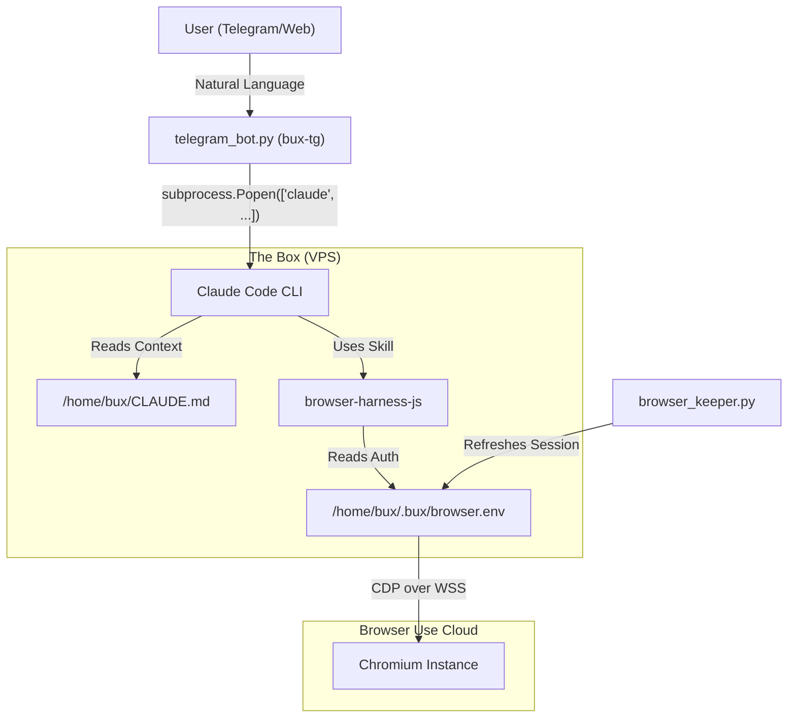

<!-- source: DeepWiki mcp.deepwiki.com · repo browser-use/bux · page 1 Overview · fetched 2026-10-30 -->

# Overview

<details>
<summary>Relevant source files</summary>

The following files were used as context for generating this wiki page:

- [README.md](README.md)
- [docs/hero.jpg](docs/hero.jpg)

</details>


`bux` is a system designed to provide a 24/7 persistent Linux environment for **Claude Code**, integrated with a cloud-hosted Chromium session. It allows users to run a powerful AI agent on any Ubuntu-based hardware (VPS, Raspberry Pi, or local machine) and interact with it via Telegram or a web terminal.

The project bridges the gap between local CLI agents and remote browser automation by maintaining a persistent "Box" where cookies, session state, and agent "skills" remain active across reboots and agent restarts.

## Core Value Proposition

`bux` solves the problem of transient agent environments and brittle browser automation by providing:
*   **Persistent Identity:** A dedicated `bux` user context where Claude Code maintains its history and OAuth sessions [README.md:29-30](), [README.md:52-53]().
*   **Remote Browser Sync:** Integration with **Browser Use Cloud** to provide a real Chromium session that bypasses local resource constraints and provides "Human-in-the-loop" handoffs for CAPTCHAs or 2FA [README.md:33-38]().
*   **Ubiquitous Access:** A Telegram bot interface that allows commanding the agent from a mobile device [README.md:31-32]().

For a deeper dive into the philosophy and deployment model, see [What is bux?](#1.1).

## System Architecture

The `bux` runtime consists of three primary systemd services that coordinate to maintain the agent's environment.

### Service Orchestration

| Service | Entity Name | Responsibility |
| :--- | :--- | :--- |
| **Browser Keeper** | `bux-browser-keeper` | Manages the lifecycle of the remote browser session and writes connection strings to `browser.env` [agent/browser_keeper.py:1-10](). |
| **Telegram Bot** | `bux-tg` | Acts as the primary interface, executing `claude` commands as the `bux` user [agent/telegram_bot.py:1-15](). |
| **Web Terminal** | `bux-ttyd` | Provides a browser-based terminal access to the `bux` user's shell [README.md:32](). |

### Logical Data Flow
The following diagram illustrates how natural language commands from a user are translated into code execution and browser automation.

**Diagram: User Intent to Browser Action**

Sources: [README.md:44-50](), [agent/browser_keeper.py:1-20](), [agent/telegram_bot.py:100-120]()

## Key Components

### The `bux` User and Environment
The installer creates a dedicated `bux` user to isolate the agent's files and processes. The agent's behavior is governed by a `CLAUDE.md` file located in the home directory, which instructs it on how to use the `browser-harness-js` tool to interact with the web [README.md:49-53]().

### Browser Harness
`browser-harness-js` is the bridge between Claude Code and the Chrome DevTools Protocol (CDP). It allows the agent to navigate pages, click elements, and extract data using a cloud-hosted browser session provided by Browser Use Cloud [README.md:30]().

For definitions of specific terms like "Profile Binding" or "CDP", see [Key Concepts and Terminology](#1.2).

## Getting Started

To deploy `bux`, a single installation script handles the environment setup, service registration, and dependency management.

```bash
# Example installation command
curl -fsSL https://raw.githubusercontent.com/browser-use/bux/main/install.sh \
    | sudo BROWSER_USE_API_KEY=bu_xxx bash
```
Sources: [README.md:10-13]()

For detailed setup instructions, including VPS requirements and Telegram bot configuration, see [Installation and Deployment](section-2).

## Security and Isolation
`bux` implements a privilege separation model where the Telegram bot runs as `root` to manage system services but executes the AI agent as the unprivileged `bux` user. Sensitive credentials like the `BROWSER_USE_API_KEY` are stored in restricted files within `/etc/bux/` [README.md:52-53]().

Detailed security documentation can be found in the [Security Model](section-6) child pages.

---

