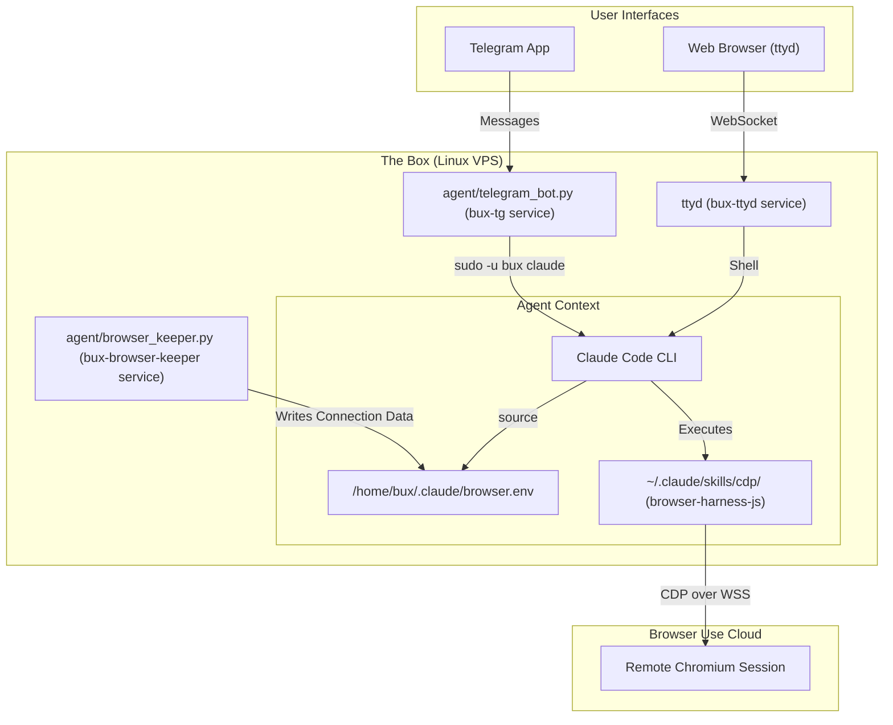
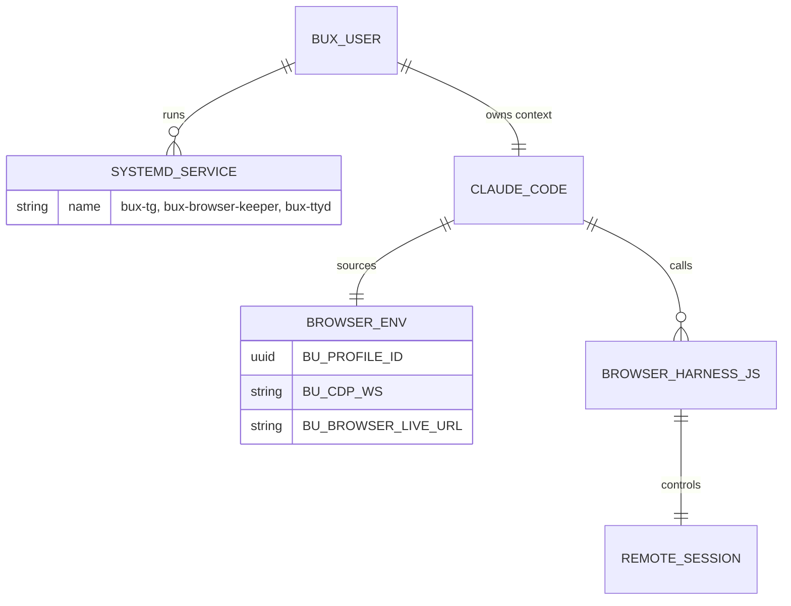

<!-- source: DeepWiki mcp.deepwiki.com · repo browser-use/bux · page 1.1 What is bux? · fetched 2026-10-30 -->

# What is bux?

Relevant source files

The following files were used as context for generating this wiki page:

- [README.md](README.md)
- [agent/CLAUDE.md](agent/CLAUDE.md)

**bux** (Browser Use Box) is a persistent, 24/7 Linux-based agent environment designed to run [Claude Code](https://github.com/anthropics/claude-code) with integrated web automation capabilities [README.md:1-8](). It transforms any standard Ubuntu VPS into a dedicated AI agent that can be controlled via Telegram or a web terminal [README.md:27-33]().

The core value proposition of bux is providing a stable, long-lived context where an AI agent can perform complex, multi-step web tasks—such as checking email, managing calendars, or interacting with SaaS tools—while maintaining persistent logins and session state [README.md:15-30]().

## Core Concept: Local-Agent, Remote-Browser

Unlike traditional automation setups that attempt to run heavy browser engines (like Chromium or Playwright) locally, bux adopts a split-execution model [agent/CLAUDE.md:3-5]():

1.  **Local Agent**: The Claude Code CLI runs on your Linux box (the "bux"). It handles the logic, file system operations, and task planning [README.md:44-50]().
2.  **Remote Browser**: The actual Chromium instance runs in **Browser Use Cloud**. The local agent controls this remote browser via the Chrome DevTools Protocol (CDP) over a secure WebSocket (`wss://`) [agent/CLAUDE.md:12-25]().

This architecture ensures that the agent box remains lightweight (requiring as little as 2GB RAM) while benefiting from high-performance, proxy-backed, and CAPTCHA-solving browser infrastructure [README.md:37-38]().

## The Three-Service Architecture

A bux installation consists of three primary systemd services that coordinate to provide the agent experience [README.md:52-53]():

| Service | Code Entity | Role |
| :--- | :--- | :--- |
| **Browser Keeper** | `bux-browser-keeper` | Manages the lifecycle of the remote cloud session, rotating connections before they expire and writing connection strings to the environment [agent/CLAUDE.md:17-18](). |
| **Telegram Bot** | `bux-tg` | Provides the primary interface. It receives messages, executes `claude` commands as the `bux` user, and returns the output to the user [README.md:45-46](). |
| **Web Terminal** | `bux-ttyd` | Runs `ttyd` to expose a web-based terminal on `localhost:7681`, allowing for direct interaction with the agent's shell when needed [README.md:32-33](). |

### System Data Flow
The following diagram illustrates how these services interact and how they map to the codebase:

**System Service Interaction Map**

**Sources:** [README.md:44-52](), [agent/CLAUDE.md:7-25](), [agent/CLAUDE.md:36-36]()

## Human-in-the-Loop Philosophy

A defining feature of bux is its "Handoff-First" design. Rather than failing or attempting to brute-force security challenges, the agent is instructed to pause and ask for help [agent/CLAUDE.md:42-44]().

*   **Live View URL**: When the agent encounters a login wall, 2FA, or CAPTCHA, it retrieves a `BU_BROWSER_LIVE_URL` from its environment [agent/CLAUDE.md:46-51]().
*   **Handoff Protocol**: The agent shares this URL with the user via Telegram. The user opens the URL, sees the *actual* browser session in their own browser, completes the interaction (e.g., typing an SMS code), and tells the agent "done" [agent/CLAUDE.md:55-62]().
*   **Persistence**: Because the session is bound to a persistent **Profile ID**, once the user logs in once, the cookies and localStorage are saved in the cloud and reused for future tasks [agent/CLAUDE.md:38-41]().

## Technical Implementation Details

### Browser Connection (browser-harness-js)
The agent interacts with the browser using a Bun-based CLI tool called `browser-harness-js`, located at `~/.claude/skills/cdp/` [agent/CLAUDE.md:21-25](). This tool wraps 652 typed CDP methods, allowing the agent to perform actions like:
*   `session.Page.navigate({url: '...'})` [agent/CLAUDE.md:26-26]()
*   `session.Runtime.evaluate({expression: '...'})` [agent/CLAUDE.md:27-27]()

### State and Context
Persistence is maintained across three layers:
1.  **File System**: All agent work, task artifacts, and the `notebook.md` (a cross-task scratchpad) live in `/home/bux/` [agent/CLAUDE.md:105-106]().
2.  **Environment**: The `bux-browser-keeper` maintains a `browser.env` file that ensures the agent always has the latest WebSocket credentials [agent/CLAUDE.md:17-18]().
3.  **Browser Profile**: Cookies and session data are stored in the Browser Use Cloud profile, linked via the `BUX_PROFILE_ID` [agent/CLAUDE.md:85-89]().

**Entity Relationship Diagram**

**Sources:** [agent/CLAUDE.md:7-15](), [agent/CLAUDE.md:21-36](), [README.md:52-53]()

---

