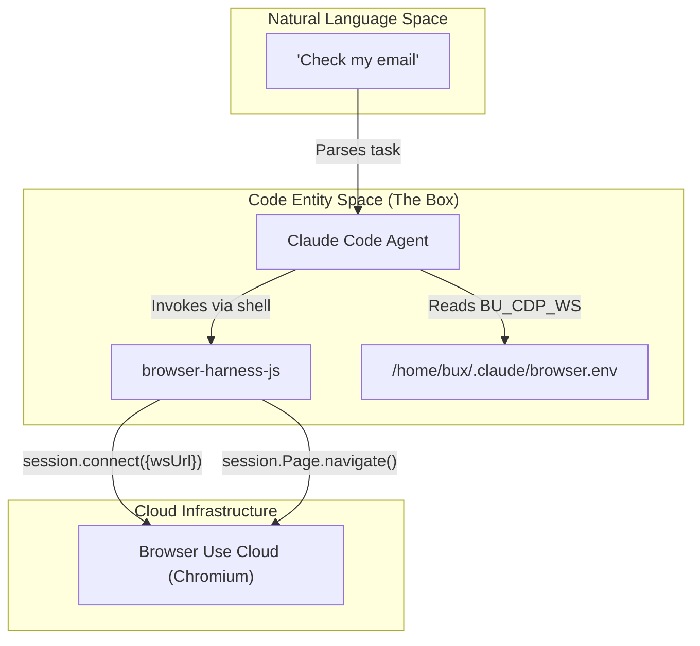
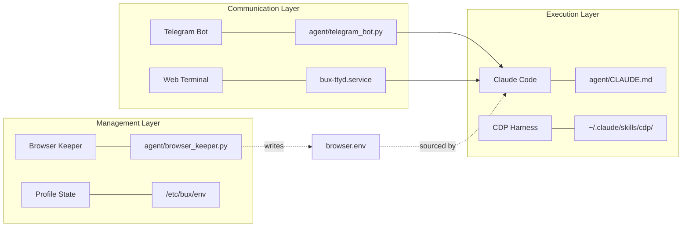

<!-- source: DeepWiki mcp.deepwiki.com · repo browser-use/bux · page 1.2 Key Concepts and Terminology · fetched 2026-10-30 -->

# Key Concepts and Terminology

Relevant source files

The following files were used as context for generating this wiki page:

- [README.md](README.md)
- [SKILL.md](SKILL.md)
- [agent/CLAUDE.md](agent/CLAUDE.md)
- [agent/browser_keeper.py](agent/browser_keeper.py)

This page defines the core vocabulary and technical abstractions used throughout the **bux** codebase. Understanding these concepts is essential for navigating the interaction between the local agent, the remote browser infrastructure, and the communication interfaces.

## The Box
The "Box" refers to the persistent Linux environment (typically an Ubuntu VPS) where the `bux` stack is installed [README.md:6-13](). It acts as the execution context for the agent. Unlike traditional automation setups, the Box does not host a local browser; instead, it maintains a long-lived connection to a remote session [agent/CLAUDE.md:1-3]().

**Key Attributes:**
*   **Persistence:** State, cookies, and skills are stored in `/home/bux` [README.md:49-52]().
*   **Identity:** Each box is bound to a specific `BUX_PROFILE_ID` [agent/browser_keeper.py:32]().
*   **User Context:** Most agent operations run as the `bux` user to isolate them from system-level root processes [agent/browser_keeper.py:129-134]().

## Browser Use Cloud
Browser Use Cloud is the infrastructure provider that hosts the actual Chromium instances [README.md:38](). The `bux` system communicates with its API (typically at `https://api.browser-use.com/api/v3`) to provision browsers and manage profiles [agent/browser_keeper.py:30]().

## browser-harness
The `browser-harness` (specifically `browser-harness-js`) is a Bun-based CLI tool that provides the agent with direct access to the Chrome DevTools Protocol (CDP) [agent/CLAUDE.md:21-36](). It allows the agent to execute complex browser actions using typed methods rather than high-level wrappers like Playwright [agent/CLAUDE.md:110-113]().

### Natural Language to Code Entity Mapping: Browser Interaction
The following diagram illustrates how an agent's intent (Natural Language) is translated into system calls and network traffic.

Title: Browser Interaction Data Flow

Sources: [agent/CLAUDE.md:21-36](), [agent/browser_keeper.py:5-15](), [README.md:44-50]()

## CDP (Chrome DevTools Protocol)
The system bypasses traditional automation drivers in favor of raw **CDP** [agent/CLAUDE.md:21-22](). This provides the agent with 652 typed methods, enabling fine-grained control over the browser's internal state, network, and runtime [agent/CLAUDE.md:36]().

## Profile Binding
A **Profile** is a persistent container in Browser Use Cloud that stores browser state, including cookies, `localStorage`, and session data [agent/CLAUDE.md:38-40](). 
*   **Binding:** A Box is "bound" to a profile via the `BUX_PROFILE_ID` environment variable in `/etc/bux/env` [agent/CLAUDE.md:85-89]().
*   **Continuity:** Because the profile is remote and persistent, the agent can resume sessions across browser rotations or Box reboots [agent/browser_keeper.py:12-17]().

## Live View
The **Live View** is a public URL (`BU_BROWSER_LIVE_URL`) that provides a real-time visual stream of the remote Chromium session [agent/browser_keeper.py:74-77](). It is primarily used for:
1.  **Debugging:** Letting the user watch the agent work [agent/CLAUDE.md:66-72]().
2.  **Human-in-the-Loop:** Handing off the session when the agent encounters a "Login Wall" [agent/CLAUDE.md:42-44]().

## Login Wall & Handoff
A **Login Wall** refers to any obstacle that requires human intervention, such as 2FA, CAPTCHAs, or manual login forms [agent/CLAUDE.md:42-44](). 
The **Handoff Protocol** dictates that the agent should not attempt to "credential-stuff" but should instead provide the Live View URL to the user and wait for a "done" signal [agent/CLAUDE.md:55-64]().

## Skills
In the `bux` context, **Skills** are specialized browser interaction scripts.
*   **Domain Skills:** The agent automatically generates and persists site-specific helpers in `~/.claude/skills/cdp/domain-skills/<site>/` [SKILL.md:15-18]().
*   **System Skills:** The core `browser-harness` itself is treated as a skill by Claude Code [agent/CLAUDE.md:21-22]().

## The bux User
The `bux` user is a dedicated Linux system user created during installation [README.md:52](). 
*   **Isolation:** The agent's files, including `CLAUDE.md`, `notebook.md`, and the `browser.env` connection details, are owned by this user [agent/browser_keeper.py:129-134]().
*   **Security:** The `bux-tg` service (Telegram bot) runs as root to manage processes but executes the Claude agent using `sudo -u bux` to maintain privilege separation [README.md:44-50]().

### System Architecture Mapping
This diagram maps the logical components of the `bux` system to their implementation files and service names.

Title: Component to Implementation Mapping

Sources: [README.md:44-52](), [agent/browser_keeper.py:30-36](), [agent/CLAUDE.md:1-15]()

## Core Terminology Summary Table

| Term | Technical Definition | Primary File/Location |
| :--- | :--- | :--- |
| **Box** | The host VPS/OS environment. | `install.sh` |
| **Keeper** | `bux-browser-keeper` service that manages session rotation. | [agent/browser_keeper.py]() |
| **browser.env** | Temporary file containing current CDP credentials and Live URL. | `/home/bux/.claude/browser.env` |
| **Notebook** | A persistent markdown file for cross-task memory. | `/home/bux/notebook.md` |
| **Grace Period** | The 60s overlap where an old browser stays alive after rotation. | [agent/browser_keeper.py:40]() |
| **Rotation** | The process of provisioning a new browser before the 240min timeout. | [agent/browser_keeper.py:12-14]() |

Sources: [agent/browser_keeper.py:5-15](), [agent/CLAUDE.md:103-109](), [README.md:42-53]()

---

