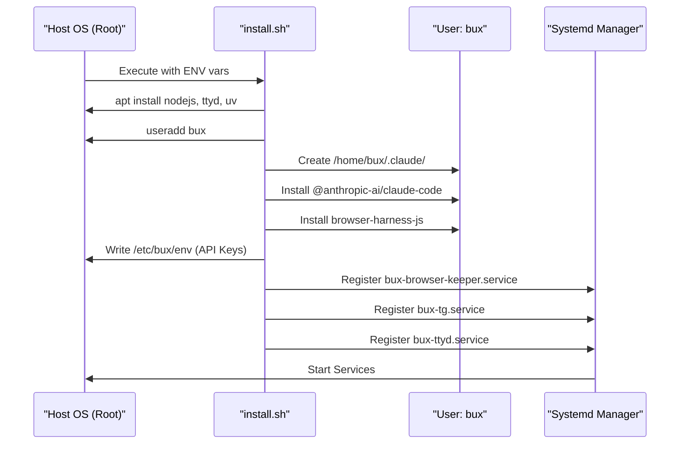
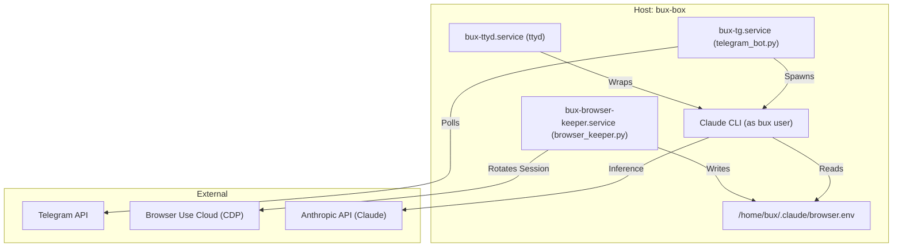

<!-- source: DeepWiki mcp.deepwiki.com · repo browser-use/bux · page 2.1 Installation Guide · fetched 2026-10-30 -->

# Installation Guide

<details>
<summary>Relevant source files</summary>

The following files were used as context for generating this wiki page:

- [.env.example](.env.example)
- [install.md](install.md)

</details>


This guide provides a comprehensive walkthrough for deploying **bux** on a persistent Linux instance. The installation process transforms a standard Ubuntu/Debian VPS into an autonomous agent host capable of running Claude Code with persistent browser access via Browser Use Cloud.

## 1. Prerequisites and Infrastructure

bux is designed to be lightweight. Since the heavy lifting of browser rendering occurs on Browser Use Cloud infrastructure, the local host requirements are minimal.

### Hardware Requirements
*   **OS**: Ubuntu or Debian 22.04+ (Ubuntu 24.04 recommended) [install.md:1-3]().
*   **RAM**: 2GB minimum [install.md:3-3]().
*   **Disk**: 10GB+ for Node.js dependencies and agent logs.

### Provider Selection
| Provider | Recommendation | Notes |
| :--- | :--- | :--- |
| **Hetzner** | CX11 (€4/mo) | Best price-to-performance ratio [install.md:24-24](). |
| **DigitalOcean** | $6/mo Droplet | Reliable, standard Ubuntu 24.04 images [install.md:25-25](). |
| **AWS EC2** | `t3.small` | Ensure the instance has at least 2GB RAM [install.md:27-27](). |
| **Home Lab** | Raspberry Pi 4/5 | Use Tailscale or Cloudflare Tunnel for ingress [install.md:30-30](). |

### Required Credentials
1.  **Browser Use API Key**: Obtain from [cloud.browser-use.com](https://cloud.browser-use.com/new-api-key). This powers the remote Chromium sessions [install.md:37-37]().
2.  **Telegram Bot Token (Optional)**: Created via [@BotFather](https://t.me/BotFather) to enable the mobile chat interface [install.md:39-47]().

---

## 2. Installation Workflow

The installation is driven by `install.sh`, an idempotent script that configures the system environment, creates a dedicated service user, and deploys systemd units.

### The One-Liner Execution
```bash
ssh root@your-box
curl -fsSL https://raw.githubusercontent.com/browser-use/bux/main/install.sh | \
  sudo BROWSER_USE_API_KEY=bu_xxx TG_BOT_TOKEN=123:abc bash
```
[install.md:58-60]()

### Installation Sequence Diagram
The following diagram illustrates how the installer bridges the gap between the host OS and the `bux` application entities.

"Installer Data Flow and Entity Creation"

Sources: [install.md:62-68](), [.env.example:1-12]()

---

## 3. Post-Installation: First Run & Auth

After the script completes, two critical manual steps are required to initialize the agent's identity and communication channel.

### Step A: Claude OAuth Handshake
Claude Code requires a one-time OAuth login to link the CLI to your Anthropic account.
1.  Switch to the `bux` user: `sudo -iu bux` [install.md:73-73]().
2.  Launch the CLI: `claude` [install.md:74-74]().
3.  Run the `/login` command within the CLI [install.md:77-77]().
4.  Copy the URL to your local browser, complete the auth, and return to the VPS.
5.  Exit the CLI using `/exit`. The session is now persisted in `/home/bux/.claude/` [install.md:77-77]().

### Step B: Telegram Bot Binding
bux uses a "first-message-wins" security model for Telegram.
1.  Open the bot URL provided by the installer (or find your bot in Telegram).
2.  Send any message (e.g., "hi") [install.md:81-81]().
3.  The `telegram_bot.py` service captures your `chat_id`, writes it to `/etc/bux/tg-state.json`, and locks the bot to you exclusively [install.md:87-87]().

---

## 4. Service Architecture and Data Flow

Once installed, the system operates via three primary systemd units.

### Component Relationship Diagram
"Runtime Service Architecture"

Sources: [install.md:112-137](), [install.md:63-66]()

---

## 5. Troubleshooting Common Failures

| Symptom | Probable Cause | Resolution |
| :--- | :--- | :--- |
| `browser.env` missing | `BROWSER_USE_API_KEY` invalid | Check `journalctl -u bux-browser-keeper`. Verify key in `/etc/bux/env` [install.md:112-116](). |
| TG bot silent | Wrong `chat_id` bound | Delete `/etc/bux/tg-state.json` and restart `bux-tg` [install.md:122-122](). |
| "no CDP_WS set" | Race condition on boot | Restart the keeper: `sudo systemctl restart bux-browser-keeper` [install.md:132-137](). |
| Claude CLI errors | Outdated package | Run `sudo npm install -g @anthropic-ai/claude-code@latest` [install.md:125-130](). |

### Clean Slate Reset
If the installation becomes corrupted, you can perform a full reset:
```bash
sudo systemctl stop bux-tg bux-browser-keeper bux-ttyd
sudo rm -rf /etc/bux /opt/bux /home/bux/.claude /home/bux/.bux
sudo userdel -r bux
```
[install.md:139-145]()

Sources: [install.md:110-145]()

---

