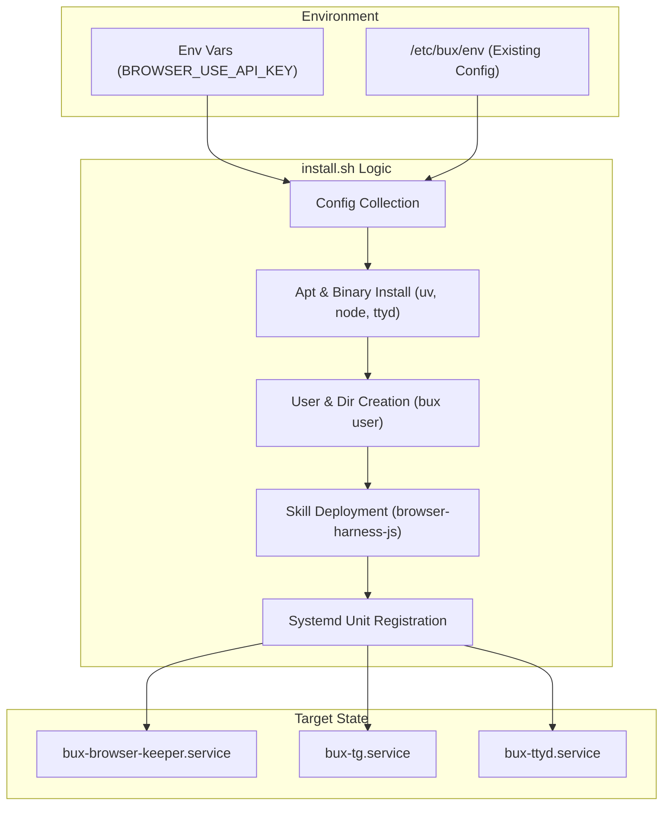
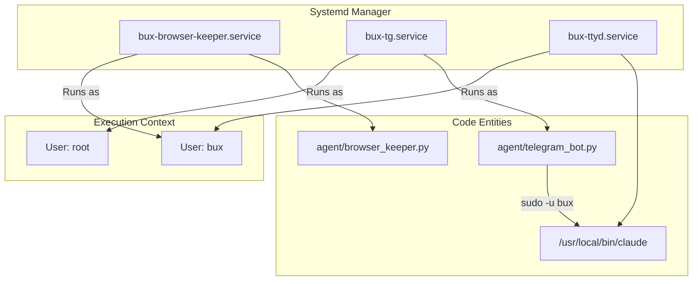

<!-- source: DeepWiki mcp.deepwiki.com · repo browser-use/bux · page 2.2 install.sh Reference · fetched 2026-10-30 -->

# install.sh Reference

Relevant source files

The following files were used as context for generating this wiki page:

- [.env.example](.env.example)
- [install.sh](install.sh)

The `install.sh` script is the primary entry point for deploying a `bux` instance. It is designed to transform a "blank" Ubuntu or Debian VPS into a fully functional agentic environment. The script is idempotent, meaning it can be safely re-run to update components or repair a configuration without losing existing state or credentials.

### Purpose and Scope

The installer automates the following high-level tasks:
1.  **Dependency Management**: Installs system-level packages and pinned binaries for Node.js 24, `uv`, and `ttyd`.
2.  **Identity & Security**: Creates a dedicated, non-privileged `bux` user and configures a restricted directory hierarchy.
3.  **Service Deployment**: Orchestrates the setup of three `systemd` units (`bux-browser-keeper`, `bux-tg`, and `bux-ttyd`).
4.  **Agent Environment**: Deploys the `browser-harness-js` skill and the `CLAUDE.md` instruction set.

---

### Implementation Flow

The script follows a linear execution path, verifying the environment and credentials before proceeding to binary installation and service configuration.

#### 1. Repository Fetching and Environment Check
The script ensures it is running as `root` on a supported distribution [install.sh:29-30](). If executed via a curl-pipe, it downloads the repository archive from GitHub using the `BUX_REF` variable (defaulting to `main`) to a temporary directory [install.sh:33-43]().

#### 2. Configuration & Idempotency
To support re-runs, the script attempts to recover `BROWSER_USE_API_KEY` and `BUX_PROFILE_ID` from `/etc/bux/env` if they are not provided via environment variables [install.sh:51-56]().

#### 3. Binary Installation (Pinned & Verified)
The script installs several key binaries with specific versioning and integrity checks:
*   **uv**: A fast Python package manager. It is downloaded as a release tarball, verified against a hardcoded SHA256 hash, and installed to `/usr/local/bin/uv` [install.sh:95-121]().
*   **Node.js 24**: Installed via NodeSource with GPG fingerprint verification [install.sh:126-138]().
*   **Claude Code**: Installed globally via `npm` [install.sh:143]().
*   **ttyd**: A web-based terminal. Downloaded and verified via SHA256 [install.sh:205-225]().

#### 4. User and Directory Setup
A `bux` user is created with a home directory at `/home/bux` [install.sh:147](). Crucially, the script enforces a security boundary: the `bux` user is **not** granted `sudo` privileges to protect root-owned secrets like the Telegram bot token [install.sh:153-157]().

#### 5. Skill and Agent Deployment
The script deploys the `browser-harness-js` package into the Claude skills directory and copies the `CLAUDE.md` instructions to the `bux` user's home [install.sh:255-274]().

**Diagram: Installation Data Flow**

**Sources:** [install.sh:1-274]()

---

### Security & Privilege Separation

The installer implements a strict privilege model to ensure that even if the agent (running as the `bux` user) is compromised, it cannot access the host's administrative functions or the Telegram bot's primary credentials.

| Entity | Path | Permissions | Purpose |
| :--- | :--- | :--- | :--- |
| **Global Env** | `/etc/bux/env` | `root:bux` (0640) | Shared API keys for browser access. |
| **TG Secret** | `/etc/bux/tg.env` | `root:root` (0600) | Telegram token, inaccessible to `bux` user. |
| **TG State** | `/etc/bux/tg-state.json`| `root:root` (0600) | Tracks bound users and setup status. |
| **App Code** | `/opt/bux` | `bux:bux` (0755) | Python agent code and virtual environment. |

**Sources:** [install.sh:148-151](), [install.sh:153-157]()

---

### Systemd Unit Deployment

The installer generates and enables three `systemd` units. These units manage the lifecycle of the core `bux` components.

**Diagram: Systemd Service Architecture**

1.  **bux-browser-keeper**: Runs `agent/browser_keeper.py` to maintain a fresh CDP connection [install.sh:282-300]().
2.  **bux-tg**: Runs `agent/telegram_bot.py`. It runs as `root` to read `/etc/bux/tg.env` but executes the `claude` CLI as the `bux` user using `sudo -u bux` [install.sh:318-340]().
3.  **bux-ttyd**: Wraps the `claude` command in a web terminal, restricted to `localhost:7681` [install.sh:302-316]().

**Sources:** [install.sh:282-340]()

---

### Accepted Environment Variables

The script behavior can be tuned using the following environment variables.

| Variable | Default | Description |
| :--- | :--- | :--- |
| `BROWSER_USE_API_KEY` | (Required) | Your API key from [Browser Use Cloud](https://cloud.browser-use.com/). |
| `BUX_PROFILE_ID` | (Empty) | UUID of an existing browser profile to reuse. |
| `TG_BOT_TOKEN` | (Optional) | Token from @BotFather for Telegram integration. |
| `BUX_REF` | `main` | Git ref (branch/sha) to pull when using the curl-pipe installer. |

**Sources:** [install.sh:20](), [install.sh:46-63](), [.env.example:1-12]()

---

### SSH Hardening

The installer includes an optional SSH hardening step. It modifies `/etc/ssh/sshd_config` to:
*   Disable password authentication (`PasswordAuthentication no`).
*   Disable root login (`PermitRootLogin no`).
*   Enable public key authentication.

This is triggered if the script detects it is running in a non-interactive environment or if explicitly requested, ensuring the VPS is not left vulnerable to brute-force attacks.

**Sources:** [install.sh:230-253]()

---

