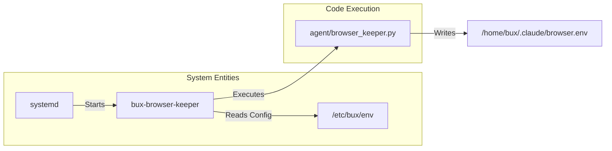

<!-- source: DeepWiki mcp.deepwiki.com · repo browser-use/bux · page 3.1 Browser Keeper Service · fetched 2026-10-30 -->

# Browser Keeper Service

<details>
<summary>Relevant source files</summary>

The following files were used as context for generating this wiki page:

- [agent/browser_keeper.py](agent/browser_keeper.py)
- [install.sh](install.sh)

</details>


The **Browser Keeper Service** is a long-lived Python daemon responsible for maintaining a persistent, high-availability connection to a remote Chromium instance hosted on Browser Use Cloud. By pre-warming and rotating browser sessions in the background, it eliminates the 20–30 second cold-start latency that would otherwise occur when an agent task begins.

## Purpose and Scope

The service manages the entire lifecycle of a cloud browser session. It ensures that the `bux` user always has access to a valid, authenticated, and "warm" browser via a local environment file.

**Key Responsibilities:**
*   **Session Lifecycle:** Provisioning new sessions via the Browser Use API.
*   **Health Monitoring:** Validating CDP (Chrome DevTools Protocol) connectivity before exposing the session to the agent.
*   **Rotation:** Seamlessly switching to new sessions before the 240-minute cloud timeout is reached.
*   **State Propagation:** Writing session metadata (WS URLs, IDs, Expiry) to an atomic environment file.

`Sources: [agent/browser_keeper.py:2-18]()`

---

## Technical Architecture

The service operates as a continuous loop within `agent/browser_keeper.py`. It utilizes a "Grace Period" rotation strategy to ensure that in-flight tasks are not interrupted when a session expires.

### Logic Flow: The Rotation Loop

```mermaid
graph TD
    subgraph "Natural Language Space"
        A["Start Service"]
        B["Create New Browser"]
        C["Validate Connection"]
        D["Update browser.env"]
        E["Wait for Rotation"]
        F["Stop Old Browser"]
    end

    subgraph "Code Entity Space"
        A --> "main()"
        "main()" --> "create_browser()"
        "create_browser()" --> "health_check()"
        "health_check()" -- "Success" --> "write_env()"
        "write_env()" --> "time.sleep(GRACE_SEC)"
        "time.sleep(GRACE_SEC)" --> "stop_browser(prev)"
        "stop_browser(prev)" --> "Rotation Wait"
        "health_check()" -- "Failure" --> "Retry Loop"
    end

    [agent/browser_keeper.py:149-187]()
```
`Sources: [agent/browser_keeper.py:149-187]()`

### Session Lifecycle Constants
The service enforces strict timing to prevent session dropouts:
*   **`SESSION_MIN` (239):** The requested duration for a new session. `[agent/browser_keeper.py:38-38]()`
*   **`ROTATE_AT_MIN_LEFT` (30):** Triggers a new browser creation 30 minutes before the current one expires. `[agent/browser_keeper.py:39-39]()`
*   **`GRACE_SEC` (60):** The overlap period where both the old and new browsers are alive. `[agent/browser_keeper.py:40-40]()`

---

## Data Flow and Persistence

The Browser Keeper communicates with the Browser Use Cloud API and persists the connection details to the filesystem for the agent to consume.

### API Interaction
The service uses `bu_req` to interact with the API:
1.  **POST `/browsers`**: Requests a new browser bound to the box's `BUX_PROFILE_ID`. `[agent/browser_keeper.py:70-70]()`
2.  **GET `/json/version`**: Fetches the `webSocketDebuggerUrl` (CDP URL) from the returned `cdpUrl`. `[agent/browser_keeper.py:60-66]()`
3.  **PATCH `/browsers/{id}`**: Sends a `stop` action to decommission old sessions. `[agent/browser_keeper.py:82-87]()`

### The `browser.env` File
This file is the primary interface between the Keeper and the Agent. It is written to `/home/bux/.claude/browser.env`.

| Variable | Description |
| :--- | :--- |
| `BU_PROFILE_ID` | The persistent profile ID (cookies/storage). |
| `BU_BROWSER_ID` | The unique ID of the current cloud session. |
| `BU_CDP_WS` | The signed WebSocket URL for CDP automation. |
| `BU_BROWSER_LIVE_URL` | The URL for the Live View UI. |
| `BU_BROWSER_EXPIRES_AT` | Unix epoch of session termination. |

`Sources: [agent/browser_keeper.py:5-10](), [agent/browser_keeper.py:108-114]()`

---

## Security and Robustness

### Atomic File Writes
To prevent the agent from reading a partially written `browser.env` file, the service uses an atomic "write-then-rename" pattern:
1.  Create a temporary file (`.tmp`) using `os.O_EXCL` to ensure exclusivity. `[agent/browser_keeper.py:119-123]()`
2.  Set permissions to `0640` (readable by `bux` group, but not world-readable) to protect the signed CDP URL. `[agent/browser_keeper.py:122-122]()`
3.  Write the payload and use `os.replace()` to atomically move the `.tmp` file to `browser.env`. `[agent/browser_keeper.py:128-128]()`

### Health Checks
Before a browser is "promoted" to `browser.env`, the service performs a `health_check`. It attempts to fetch the version metadata from the CDP endpoint. If this fails, the browser is immediately stopped, and the loop retries after 15 seconds.
`Sources: [agent/browser_keeper.py:89-99](), [agent/browser_keeper.py:161-165]()`

### Graceful Shutdown
The service captures `SIGTERM` and `SIGINT` signals. Upon receiving a shutdown signal, it attempts to stop the currently active cloud browser session to avoid dangling resources on the provider side.
`Sources: [agent/browser_keeper.py:142-146](), [agent/browser_keeper.py:151-152]()`

---

## Systemd Integration

The service is managed by `systemd` as the `bux-browser-keeper.service` unit.



**Deployment Details:**
*   **User:** Runs as the `bux` user. `[agent/browser_keeper.py:133-134]()`
*   **Environment:** Loads `BROWSER_USE_API_KEY` and `BUX_PROFILE_ID` from `/etc/bux/env`. `[agent/browser_keeper.py:31-32]()`
*   **Permissions:** `install.sh` ensures the `/etc/bux/env` file is readable by the `bux` group and that the `bux` user owns the state directory. `[install.sh:147-151]()`

`Sources: [install.sh:147-151](), [agent/browser_keeper.py:30-36]()`

---

