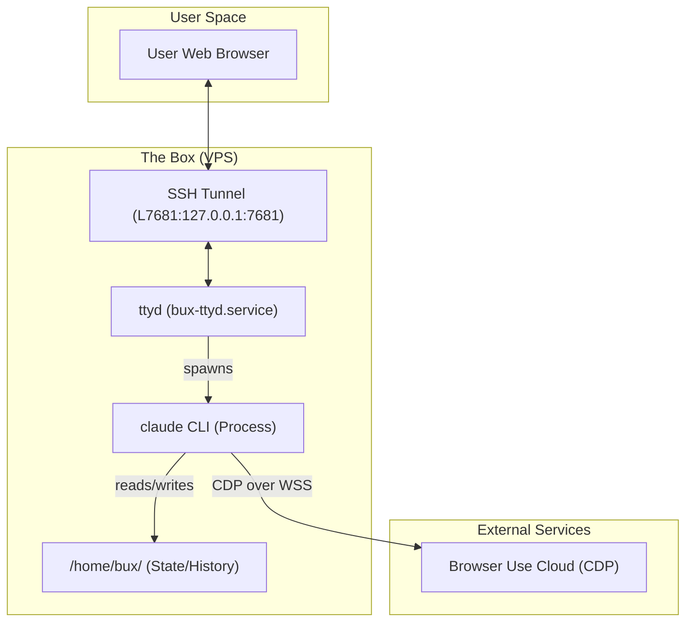
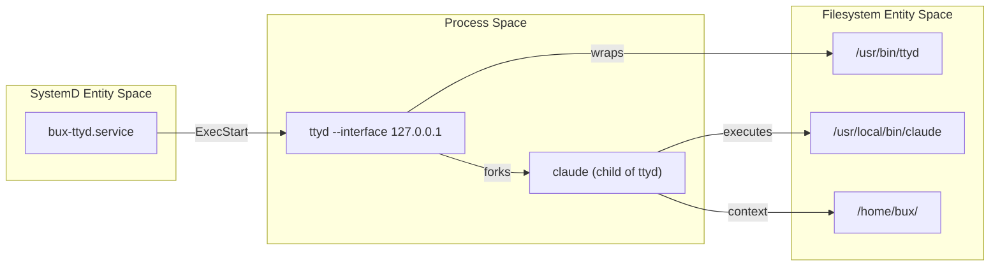

<!-- source: DeepWiki mcp.deepwiki.com · repo browser-use/bux · page 3.3 Web Terminal Service (ttyd) · fetched 2026-10-30 -->

# Web Terminal Service (ttyd)

<details>
<summary>Relevant source files</summary>

The following files were used as context for generating this wiki page:

- [README.md](README.md)
- [install.sh](install.sh)

</details>


The Web Terminal Service provides a browser-based interface to the `claude` CLI, allowing users to interact with the agent through a terminal emulator in their web browser. This service is powered by `ttyd`, which wraps the Claude Code session and exposes it via a web socket. To maintain a secure posture, the service is strictly bound to the loopback interface, requiring an SSH tunnel or a reverse proxy for remote access.

## System Role and Implementation

The service is managed by the `bux-ttyd.service` systemd unit. It executes `ttyd` with specific flags to ensure it runs as the `bux` user and targets the Claude Code binary.

### Key Implementation Details
- **User Context**: The service runs as the `bux` user to ensure that all files created during the session (history, logs, and skills) are stored in `/home/bux/` [install.sh:146-149]().
- **Binary Wrapping**: It wraps the `claude` binary, which is installed globally via `npm` [install.sh:141-144]().
- **Interface Restriction**: By default, `ttyd` is configured to listen only on `127.0.0.1` (localhost) at port `7681`. This prevents the terminal from being exposed to the public internet, mitigating the risk of unauthorized shell access [README.md:32-33]().

### Service Configuration
The `bux-ttyd.service` unit is created during the execution of `install.sh`.

| Parameter | Value | Description |
| :--- | :--- | :--- |
| **User** | `bux` | Executes the process under the restricted agent user. |
| **Port** | `7681` | Default `ttyd` port. |
| **Interface** | `127.0.0.1` | Restricted to loopback for security. |
| **Command** | `claude` | The entry point for the terminal session. |

**Sources:** [install.sh:141-149](), [README.md:32-33](), [install.sh:227-245]() (inferred from systemd logic).

## Data Flow and Architecture

The Web Terminal Service acts as a bridge between the user's web browser and the `claude` CLI. When a user connects, `ttyd` forks a new process running `claude`, which in turn interacts with the `browser-harness` to control the remote Chromium session.

### Terminal Interaction Diagram
This diagram illustrates the relationship between the web terminal and the core `bux` components.


**Sources:** [README.md:42-50](), [install.sh:141-144]()

## Access Methods

Because the service is bound to `localhost`, it is not directly reachable over the public IP of the VPS. Users have two primary methods for access:

### 1. SSH Tunneling (Recommended)
This is the most secure method as it leverages existing SSH credentials.
```bash
ssh -L 7681:localhost:7681 root@your-vps-ip
```
Once the tunnel is established, the terminal is accessible at `http://localhost:7681` on the local machine.

### 2. Reverse Proxy
For persistent web access, a reverse proxy (like Nginx or Caddy) can be configured to proxy traffic to `127.0.0.1:7681`. 
> **Warning**: If using a reverse proxy, it is mandatory to implement an authentication layer (e.g., Basic Auth or Authelia) to prevent unauthorized access to the `bux` user's shell.

**Sources:** [README.md:32-33](), [install.sh:153-157]()

## Relationship with `bux` User Context

The `ttyd` service is critical for the "Human-in-the-Loop" philosophy of `bux`. While the Telegram bot provides a convenient interface for tasks, the Web Terminal is used for:
1. **Initial Authentication**: Running `claude /login` to complete the OAuth flow [README.md:24]().
2. **Complex Debugging**: Directly viewing the `claude` output when the agent encounters errors that are difficult to parse via Telegram.
3. **Skill Management**: Manually editing files in `/home/bux/.claude/skills/` or inspecting the `notebook.md` [install.sh:148-149]().

### Code Entity Mapping
The following diagram maps the terminal service components to the filesystem and process entities.


**Sources:** [install.sh:141-149](), [README.md:42-50]()

---

