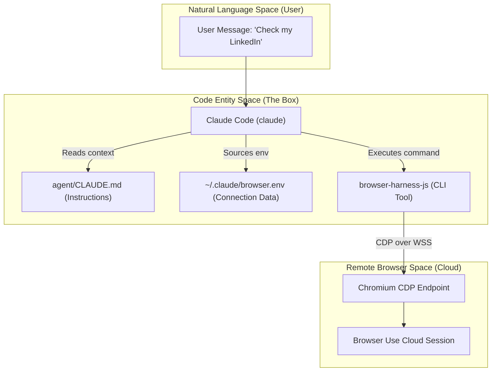
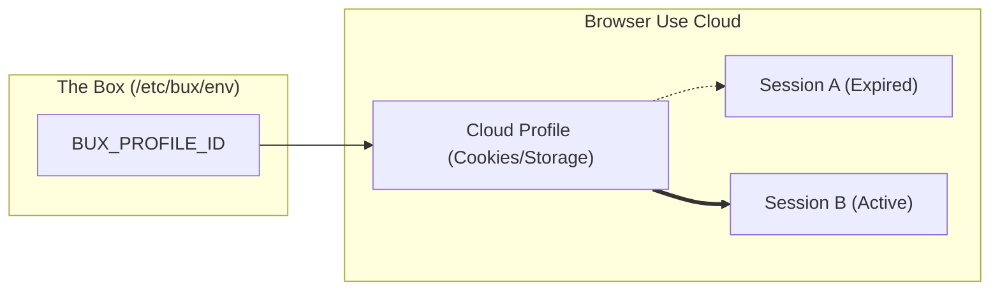

<!-- source: DeepWiki mcp.deepwiki.com · repo browser-use/bux · page 4 Browser Automation Layer · fetched 2026-10-30 -->

# Browser Automation Layer

Relevant source files

The following files were used as context for generating this wiki page:

- [SKILL.md](SKILL.md)
- [agent/CLAUDE.md](agent/CLAUDE.md)

The Browser Automation Layer in `bux` enables Claude Code to control a remote Chromium instance hosted on **Browser Use Cloud**. Unlike traditional automation setups, there is no local browser installation on the box [agent/CLAUDE.md:3-3](). Instead, the agent interacts with a persistent cloud session via the Chrome DevTools Protocol (CDP).

This layer consists of three primary components:
1.  **browser-harness-js**: A specialized CLI tool that provides a typed interface to the CDP.
2.  **browser.env**: A dynamic configuration file that provides connection strings and session metadata.
3.  **CLAUDE.md**: An instruction set that teaches the agent how to navigate the automation stack and when to hand off control to a human.

### Automation Stack Overview

The following diagram illustrates how natural language commands from the user are translated into browser actions across the network boundary.

**Diagram: Natural Language to Browser Action Flow**

**Sources:** [agent/CLAUDE.md:21-28](), [agent/CLAUDE.md:32-34]()

---

### Core Components

#### 1. browser-harness-js and CDP Interface
The `browser-harness-js` tool is the primary bridge between the agent's shell and the remote browser. It is installed at `~/.claude/skills/cdp/` [agent/CLAUDE.md:21-21](). It wraps the complex CDP into a persistent `Session` object, allowing the agent to run sequential commands (e.g., navigate, then click, then extract text) while maintaining the same WebSocket connection [agent/CLAUDE.md:36-36]().

For detailed API documentation and usage patterns, see **[browser-harness-js and CDP Interface](#4.1)**.

#### 2. The browser.env Connection File
The agent does not manage session lifecycles. Instead, it relies on `~/.claude/browser.env`, which is automatically managed and rotated by the `bux-browser-keeper` service [agent/CLAUDE.md:17-17](). This file contains the WebSocket URL (`BU_CDP_WS`), the live view URL (`BU_BROWSER_LIVE_URL`), and session expiry timestamps [agent/CLAUDE.md:9-15]().

**Sources:** [agent/CLAUDE.md:7-17]()

#### 3. Agent Context (CLAUDE.md)
The file `agent/CLAUDE.md` (deployed to `/home/bux/CLAUDE.md`) acts as the "system prompt" for the browser automation layer. it defines the conventions for driving the browser, such as:
*   Always sourcing `browser.env` before running commands [agent/CLAUDE.md:112-113]().
*   Using the "Login Wall Handoff" protocol when blocked by 2FA or CAPTCHAs [agent/CLAUDE.md:42-44]().
*   Persisting findings in `notebook.md` [agent/CLAUDE.md:106-106]().

For details on customizing agent behavior, see **[Agent Context File (CLAUDE.md / SKILL.md)](#4.2)**.

---

### Profile Persistence Model

`bux` uses a "Profile Binding" model where a specific box is linked to a persistent profile on Browser Use Cloud via `BUX_PROFILE_ID` [agent/CLAUDE.md:76-76](). This profile stores cookies and `localStorage`, ensuring that once a user logs into a site, the agent remains logged in across session rotations and reboots [agent/CLAUDE.md:38-40]().

**Diagram: Profile and Session Relationship**

**Sources:** [agent/CLAUDE.md:85-89](), [agent/CLAUDE.md:99-100]()

For details on managing profiles and switching between them, see **[Profile and Session Management](#4.3)**.

---

### Child Pages
*   **[browser-harness-js and CDP Interface](#4.1)**: Deep dive into the 652 typed CDP methods and CLI usage.
*   **[Agent Context File (CLAUDE.md / SKILL.md)](#4.2)**: Instructions on how to customize the agent's browser logic and domain-specific skills.
*   **[Profile and Session Management](#4.3)**: Technical details on how profiles are bound, stored, and rotated.

---

