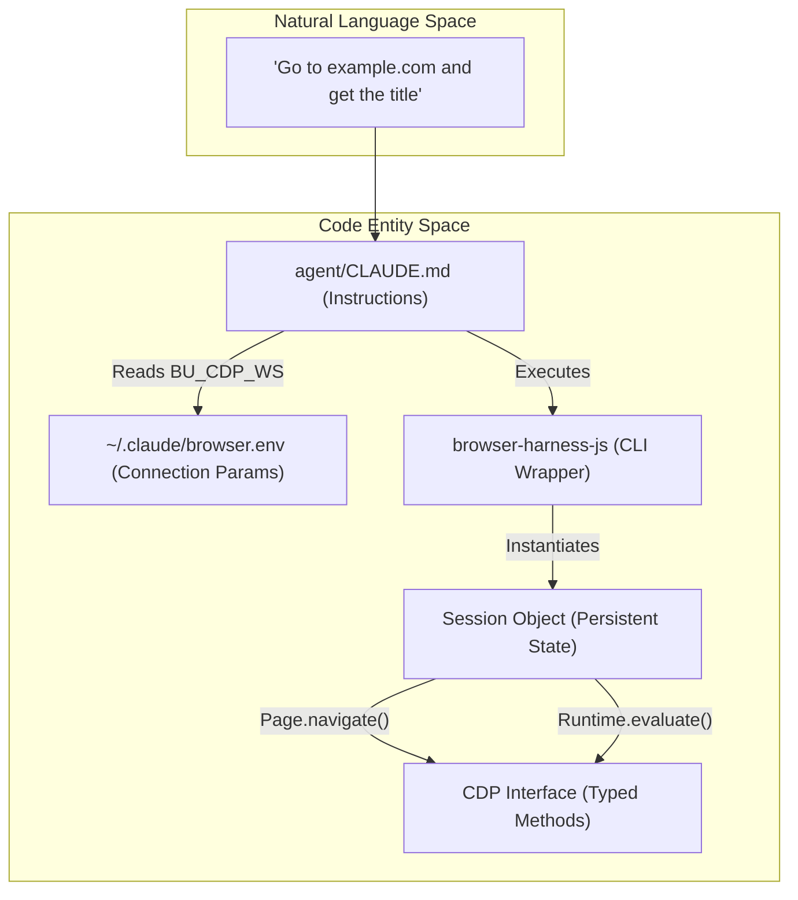
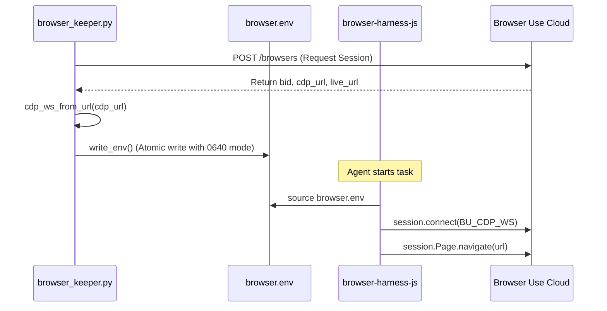

<!-- source: DeepWiki mcp.deepwiki.com · repo browser-use/bux · page 4.1 browser-harness-js and CDP Interface · fetched 2026-10-30 -->

# browser-harness-js and CDP Interface

<details>
<summary>Relevant source files</summary>

The following files were used as context for generating this wiki page:

- [agent/CLAUDE.md](agent/CLAUDE.md)
- [agent/browser_keeper.py](agent/browser_keeper.py)

</details>


This page documents the `browser-harness-js` CLI tool and its integration with the Chrome DevTools Protocol (CDP). This interface serves as the primary mechanism for the Claude agent to control a remote Chromium instance hosted on Browser Use Cloud.

## Overview

The `browser-harness-js` is a Bun-based CLI utility located at `~/.claude/skills/cdp/` [agent/CLAUDE.md:21-21](). It provides a persistent `Session` object model that abstracts 652 typed CDP methods, allowing the agent to perform complex browser automation without a local Chromium installation [agent/CLAUDE.md:36-36]().

### Data Flow: Agent to Browser

The following diagram illustrates how the Claude agent transitions from a natural language intent to a technical CDP command executed via the harness.

**Natural Language to Code Entity Mapping**

Sources: [agent/CLAUDE.md:21-36](), [agent/browser_keeper.py:5-15]()

## The browser-harness-js CLI

The harness is designed to be used within the Claude Code environment. It maintains a persistent session between invocations, ensuring that the connection to the remote browser does not need to be re-established for every individual command unless explicitly requested.

### Session Management
The core of the harness is the `Session` object. The first step in any browser task is connecting this object to the WebSocket URL provided by the `bux-browser-keeper` service [agent/CLAUDE.md:23-25]().

Key connection variables sourced from `~/.claude/browser.env`:
| Variable | Purpose |
| :--- | :--- |
| `BU_CDP_WS` | The signed WebSocket URL for the CDP session [agent/browser_keeper.py:111-111](). |
| `BU_BROWSER_ID` | The unique identifier for the current cloud browser instance [agent/browser_keeper.py:110-110](). |
| `BU_PROFILE_ID` | The UUID of the persistent user profile (cookies/storage) [agent/browser_keeper.py:109-109](). |

### Usage Patterns

The agent typically uses the harness in two ways:

1.  **Multi-step script**: Chaining commands in a single shell execution to minimize overhead.
    ```bash
    source ~/.claude/browser.env && browser-harness-js 'await session.connect({wsUrl: process.env.BU_CDP_WS}); await session.Page.navigate({url: "https://example.com"})'
    ```
    [agent/CLAUDE.md:32-34]()

2.  **Atomic operations**: Running single commands to inspect state or evaluate JavaScript.
    ```bash
    browser-harness-js "await session.Runtime.evaluate({expression: 'document.title'})"
    ```
    [agent/CLAUDE.md:27-27]()

Sources: [agent/CLAUDE.md:21-36](), [agent/browser_keeper.py:102-114]()

## CDP Interface and Typed Methods

The harness exposes the full breadth of the Chrome DevTools Protocol. This allows for high-fidelity automation that goes beyond simple page navigation.

### Key Functional Areas
*   **Page**: Controls document navigation, frame management, and screenshots [agent/CLAUDE.md:26-26]().
*   **Runtime**: Executes arbitrary JavaScript within the context of the page [agent/CLAUDE.md:27-27]().
*   **Input**: Simulates hardware-level mouse movements, clicks, and keyboard events.
*   **Network**: Inspects and intercepts network requests/responses.

### Implementation Logic

The `bux-browser-keeper` service ensures the `BU_CDP_WS` URL is always valid by rotating sessions before they expire [agent/browser_keeper.py:177-180]().

**Session Rotation and Connection Flow**

Sources: [agent/browser_keeper.py:69-79](), [agent/browser_keeper.py:102-128](), [agent/CLAUDE.md:23-28]()

## Integration with Browser Keeper

The `browser-harness-js` relies on `agent/browser_keeper.py` to maintain the underlying infrastructure. The keeper performs several critical functions that the harness consumes:

1.  **Signed URL Generation**: The keeper fetches the base CDP URL and converts it to a functional WebSocket URL via `cdp_ws_from_url` [agent/browser_keeper.py:60-66]().
2.  **Health Checks**: Before writing the environment file, the keeper verifies the CDP endpoint is responsive via `health_check(ws)` [agent/browser_keeper.py:89-99]().
3.  **Grace Periods**: When rotating browsers, the keeper maintains the old session for 60 seconds (`GRACE_SEC`) to ensure the harness doesn't lose connection mid-command [agent/browser_keeper.py:40-40](), [agent/browser_keeper.py:173-175]().
4.  **Security**: The keeper writes the environment file with `0640` permissions and `O_EXCL` to prevent sensitive WebSocket URLs from being leaked to other users on the system [agent/browser_keeper.py:119-123]().

Sources: [agent/browser_keeper.py:1-18](), [agent/browser_keeper.py:156-180]()

---

