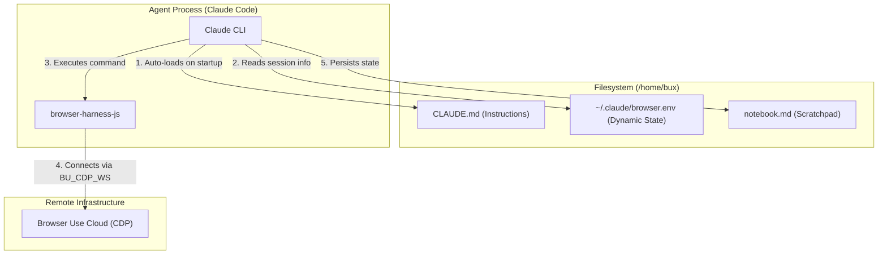

<!-- source: DeepWiki mcp.deepwiki.com · repo browser-use/bux · page 4.2 Agent Context File (CLAUDE.md / SKILL.md) · fetched 2026-10-30 -->

# Agent Context File (CLAUDE.md / SKILL.md)

<details>
<summary>Relevant source files</summary>

The following files were used as context for generating this wiki page:

- [SKILL.md](SKILL.md)
- [agent/CLAUDE.md](agent/CLAUDE.md)

</details>


This page details the configuration and instruction set that governs the behavior of the Claude Code agent within the **bux** environment. The primary mechanism for this control is the `CLAUDE.md` file, which serves as the agent's system prompt and operational manual.

## Purpose and Scope

When Claude Code is executed within the `/home/bux` directory, it automatically loads `CLAUDE.md` as context [SKILL.md:1-3](). This file defines the "personality" and technical constraints of the agent, specifically:
*   How to interface with the remote Browser Use Cloud session.
*   The protocol for handling authentication barriers (Login Walls).
*   How to persist knowledge across tasks using `notebook.md`.
*   The methodology for creating and using domain-specific skills.

## Implementation and Data Flow

The agent context is established during the installation phase and maintained through a combination of static instructions and dynamic environment variables.

### File Relationship
The repository contains a template/source file which is deployed to the active agent environment.

| Source Path | Deployment Path | Purpose |
| :--- | :--- | :--- |
| `agent/CLAUDE.md` | `/home/bux/CLAUDE.md` | The primary instruction set for the agent [SKILL.md:5](). |
| `SKILL.md` | N/A | Documentation explaining how to customize the agent [SKILL.md:1-18](). |

### Context Loading Diagram
The following diagram illustrates how the agent consumes context and environment data to perform browser actions.

**Agent Execution Context Flow**

**Sources:** [agent/CLAUDE.md:1-15](), [agent/CLAUDE.md:105-106](), [SKILL.md:1-3]()

## Browser Usage Conventions

The agent is strictly forbidden from attempting to install local browser engines (Playwright, Chromium, etc.) [agent/CLAUDE.md:112](). Instead, it must use the `browser-harness-js` tool to communicate with the cloud session.

### The Connection Protocol
The agent must source `~/.claude/browser.env` before every browser interaction to ensure it has the latest `BU_CDP_WS` (WebSocket URL) and `BU_BROWSER_ID` [agent/CLAUDE.md:113]().

**Example Implementation Pattern:**
```bash
source ~/.claude/browser.env && browser-harness-js 'await session.connect({wsUrl: process.env.BU_CDP_WS}); await session.Page.navigate({url: "https://example.com"})'
```
**Sources:** [agent/CLAUDE.md:24-34]()

## Login-Wall Handoff Protocol

A core philosophy of **bux** is the "Human-in-the-loop" model for authentication. The agent is instructed to stop immediately when encountering:
1.  Login screens (without provided credentials).
2.  2FA (SMS, Email, Authenticator).
3.  CAPTCHAs or anti-bot challenges.
4.  Cookie-consent dialogs that block progress [agent/CLAUDE.md:42-64]().

### Handoff Data Flow
The agent follows a specific sequence to transfer control to the user:

1.  **Extract Live URL:** Reads `BU_BROWSER_LIVE_URL` from `~/.claude/browser.env` [agent/CLAUDE.md:46-51]().
2.  **Notify User:** Sends a message via the Telegram bot explaining the blocker and providing the link.
3.  **Wait:** The agent enters a waiting state and does not poll or retry until the user confirms completion [agent/CLAUDE.md:60]().

**Sources:** [agent/CLAUDE.md:44-64]()

## Profile Switching and Persistence

The agent has the authority to change the box's profile binding if requested by the user. This involves interacting with the Browser Use API and modifying system configuration.

**Profile Management Steps:**
1.  **Discovery:** List profiles using `curl` and the `BROWSER_USE_API_KEY` [agent/CLAUDE.md:78-83]().
2.  **Modification:** Use `sudo sed` to update `BUX_PROFILE_ID` in `/etc/bux/env` [agent/CLAUDE.md:85-89]().
3.  **Restart:** Trigger the `bux-browser-keeper` service to rotate the session to the new profile [agent/CLAUDE.md:93-97]().

**Sources:** [agent/CLAUDE.md:74-101]()

## Domain-Skills Persistence

As the agent performs tasks, it generates "skills" — reusable JavaScript snippets for specific websites. These are stored in `~/.claude/skills/cdp/domain-skills/` [SKILL.md:17]().

*   **Persistence:** Because these are written to the `/home/bux` directory, they survive session rotations and system reboots.
*   **Automation:** The agent is encouraged to build these up over time rather than hand-authoring helpers for every site in advance [SKILL.md:17]().

## Shared Notebook (`notebook.md`)

To bridge the gap between separate Claude sessions (which may lose short-term memory), the agent uses `/home/bux/notebook.md` as a persistent scratchpad.
*   **Startup:** The agent reads the notebook at the beginning of a task to regain context [agent/CLAUDE.md:106]().
*   **Shutdown:** The agent appends findings, progress, or pending items to the notebook at the end of a task [agent/CLAUDE.md:106]().

## Customization via SKILL.md

Developers can modify the agent's behavior by editing `agent/CLAUDE.md` in the repository and running the idempotent `install.sh` script [SKILL.md:9]().

**Common Customization Points:**
*   **Skill Policies:** Changing whether the agent asks for permission before specific actions [SKILL.md:12]().
*   **Working Directory:** Redefining where task artifacts should be stored [SKILL.md:11]().
*   **Tool Permissions:** Adjusting the `--permission-mode` or restricting specific CLI tools via `~/.claude.json` [SKILL.md:13]().

**Sources:** [SKILL.md:7-13]()

---

