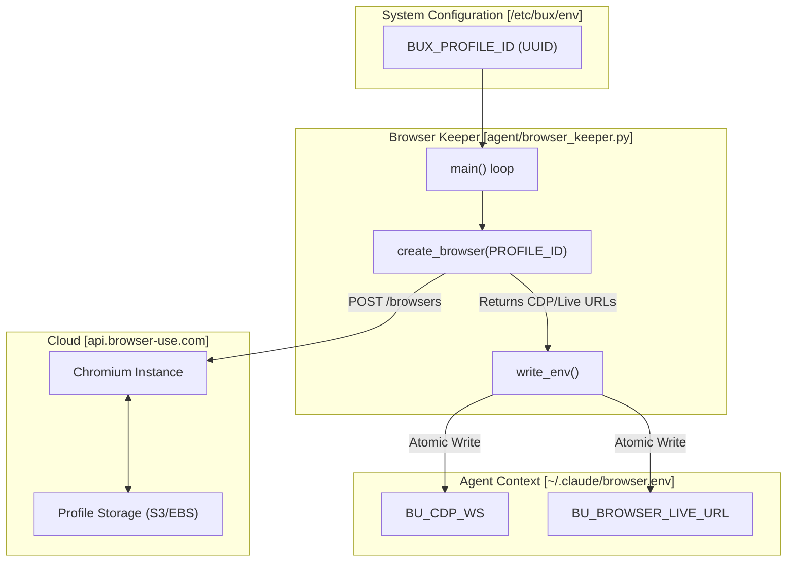
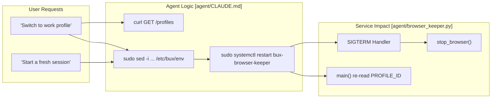

<!-- source: DeepWiki mcp.deepwiki.com · repo browser-use/bux · page 4.3 Profile and Session Management · fetched 2026-10-30 -->

# Profile and Session Management

Relevant source files

The following files were used as context for generating this wiki page:

- [.env.example](.env.example)
- [agent/CLAUDE.md](agent/CLAUDE.md)
- [agent/browser_keeper.py](agent/browser_keeper.py)

This page details how **bux** manages persistent browser state and session lifecycles through Browser Use Cloud. Unlike traditional automation scripts that start a fresh browser for every task, bux maintains a long-lived, profile-bound session that persists cookies, localStorage, and authentication states across reboots and agent restarts.

## Profile Binding and Persistence

A profile in Browser Use Cloud acts as the persistent storage layer for the browser's state. It ensures that when the agent logs into a site (e.g., GitHub, LinkedIn), the session remains active for future tasks.

### What a Profile Stores
*   **Cookies:** Session tokens and authentication data.
*   **LocalStorage/SessionStorage:** Application-level state.
*   **IndexedDB:** Client-side databases used by modern web apps.
*   **Browser Preferences:** Site-specific settings and permissions.

### Profile Identification
The box is linked to a specific cloud profile via the `BUX_PROFILE_ID` environment variable, typically stored in `/etc/bux/env` [agent/browser_keeper.py:32](). If this variable is empty during installation, the system starts with a **fresh/empty profile** [agent/CLAUDE.md:40]().

### Fresh vs. Seeded Profiles
| Profile Type | Description | Initial State |
| :--- | :--- | :--- |
| **Fresh** | Created automatically if `BUX_PROFILE_ID` is not provided. | No logins; user must authenticate on every site once [agent/CLAUDE.md:40](). |
| **Seeded** | Linked to an existing UUID from the Browser Use Cloud dashboard. | May contain pre-existing cookies/logins if imported from a local browser [agent/CLAUDE.md:40](). |

Sources: [agent/browser_keeper.py:32-33](), [agent/CLAUDE.md:38-41](), [.env.example:7-9]()

## Session Lifecycle Management

The `bux-browser-keeper` service is responsible for maintaining a continuous connection to a remote Chromium instance. It abstracts away the 20-30s "cold-start" time of cloud browsers by pre-warming and rotating sessions.

### The Rotation Loop
Browser Use Cloud sessions are capped at 240 minutes [agent/browser_keeper.py:12](). To provide a seamless experience, the keeper implements a rotation strategy:

1.  **Request:** A new 239-minute session is requested [agent/browser_keeper.py:38]().
2.  **Validation:** The keeper performs a `health_check` via the CDP `/json/version` endpoint [agent/browser_keeper.py:89-99]().
3.  **Atomic Update:** Upon success, the new connection details are written to `~/.claude/browser.env` using an atomic rename to prevent partial reads [agent/browser_keeper.py:102-128]().
4.  **Grace Period:** The previous browser session is kept alive for 60 seconds (`GRACE_SEC`) to allow any in-flight agent tasks to finish their current CDP commands [agent/browser_keeper.py:40, 173-175]().
5.  **Rotation:** The system schedules the next rotation 30 minutes before the current session expires (`ROTATE_AT_MIN_LEFT`) [agent/browser_keeper.py:39, 177]().

### Data Flow: Profile to Agent Context

The following diagram illustrates how the `BUX_PROFILE_ID` is used to generate the runtime environment for the Claude agent.

**Profile Binding and Environment Propagation**

Sources: [agent/browser_keeper.py:69-80](), [agent/browser_keeper.py:102-128](), [agent/browser_keeper.py:156-180]()

## Switching Profiles

The agent has the capability to switch profiles at runtime if requested by the user. This is a manual process orchestrated by the agent through the CLI.

### Profile Switching Procedure
1.  **Discovery:** The agent lists available profiles via the Browser Use API [agent/CLAUDE.md:78-83]().
2.  **Update:** The agent modifies `/etc/bux/env` using `sed` to update the `BUX_PROFILE_ID` [agent/CLAUDE.md:87-89]().
3.  **Restart:** The agent restarts the `bux-browser-keeper` service [agent/CLAUDE.md:93-97]().
4.  **Reload:** The agent sources the updated `~/.claude/browser.env` for subsequent commands [agent/CLAUDE.md:99]().

### Implementation Mapping: Profile Actions to Code
The following diagram maps natural language user requests to the specific code entities and shell commands used to execute them.

**Profile Management Implementation**

Sources: [agent/CLAUDE.md:74-101](), [agent/browser_keeper.py:142-146](), [agent/browser_keeper.py:32]()

## The Login-Wall Protocol

Since profiles persist state, the agent is instructed to handle "Login Walls" (2FA, CAPTCHA, etc.) by handing control to the human user rather than attempting to bypass security measures.

1.  **Detection:** The agent identifies a blocker (e.g., a LinkedIn login page) [agent/CLAUDE.md:42-44]().
2.  **Extraction:** The agent reads the `BU_BROWSER_LIVE_URL` from `~/.claude/browser.env` [agent/CLAUDE.md:46-51]().
3.  **Handoff:** The agent provides the URL to the user and pauses execution [agent/CLAUDE.md:55-60]().
4.  **Persistence:** Once the user completes the login in the live view, the session cookies are automatically saved to the cloud profile [agent/CLAUDE.md:62]().

Sources: [agent/CLAUDE.md:42-64]()

---

