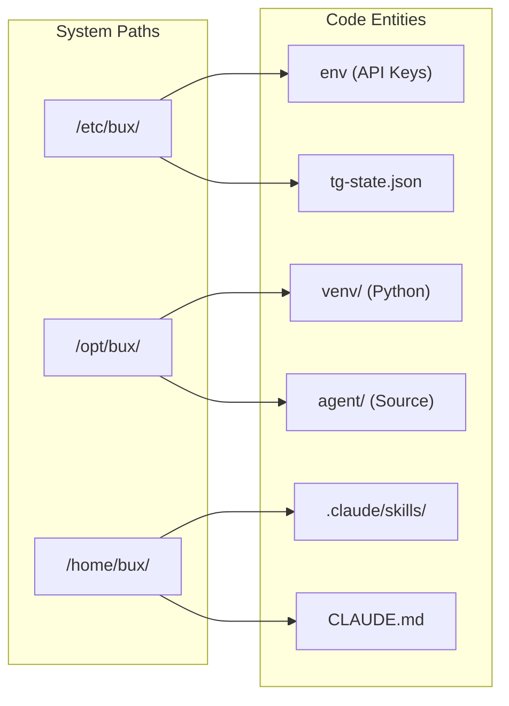

<!-- source: DeepWiki mcp.deepwiki.com · repo browser-use/bux · page 5 Configuration Reference · fetched 2026-10-30 -->

# Configuration Reference

<details>
<summary>Relevant source files</summary>

The following files were used as context for generating this wiki page:

- [.env.example](.env.example)
- [install.sh](install.sh)

</details>


The `bux` system is designed for high portability and persistence, utilizing a multi-layered configuration strategy. Configuration is managed through environment variables, persistent state files on the filesystem, and systemd unit definitions.

## Configuration Surfaces

`bux` spreads its configuration across three primary surfaces to balance security, ease of installation, and runtime flexibility:

1.  **Environment Variables**: Used for initial provisioning and service-level secrets.
2.  **Filesystem Layout**: Persistent storage for agent state, browser connection details, and identity binding.
3.  **Systemd Units**: Service definitions that manage process lifecycle and execution context.

### Configuration Flow

The following diagram illustrates how configuration data flows from the initial installation phase into the operational services.

**Configuration Data Flow**
```mermaid
graph TD
    subgraph "Natural Language Space"
        "User Credentials"
        "Bot Token"
        "Profile Identity"
    end

    subgraph "Code Entity Space"
        ENV["Environment Variables"]
        INSTALL["install.sh"]
        ETCB["/etc/bux/env"]
        ETCTG["/etc/bux/tg.env"]
        BENV["browser.env"]
        BK["browser_keeper.py"]
        TG["telegram_bot.py"]
    end

    "User Credentials" --> ENV
    "Bot Token" --> ENV
    "Profile Identity" --> ENV

    ENV -- "initial run" --> INSTALL
    INSTALL -- "persists" --> ETCB
    INSTALL -- "persists" --> ETCTG
    
    ETCB -- "loads" --> BK
    BK -- "generates" --> BENV
    BENV -- "consumed by" --> TG
    ETCTG -- "loads" --> TG
```
Sources: [install.sh:45-64](), [agent/browser_keeper.py:21-45](), [agent/telegram_bot.py:40-60]()

---

## Environment Variables

Environment variables are the primary mechanism for injecting secrets and identity into the `bux` environment. 

*   **Provisioning Variables**: Used by `install.sh` to set up the box (e.g., `BROWSER_USE_API_KEY`, `BUX_PROFILE_ID`).
*   **Runtime Variables**: Injected into services via systemd or generated dynamically by the `browser_keeper.py` service.
*   **Dynamic Browser Variables**: Variables like `BU_CDP_WS` and `BU_BROWSER_LIVE_URL` are written to `browser.env` and rotated frequently to maintain connection health.

For a complete list of all variables and their roles, see [Environment Variables](#5.1).

Sources: [.env.example:1-12](), [install.sh:12-20](), [agent/browser_keeper.py:118-128]()

---

## Filesystem Layout

The filesystem layout follows standard Linux conventions while ensuring strict privilege separation. 

*   **/etc/bux/**: Contains sensitive configuration and state that must persist across reboots.
*   **/opt/bux/**: Holds the application source code and virtual environments.
*   **/home/bux/**: The primary workspace for the Claude agent, containing `CLAUDE.md`, `notebook.md`, and agent skills.

The following diagram maps high-level system components to their specific locations on the filesystem.

**Filesystem Mapping**

Sources: [install.sh:146-151](), [agent/telegram_bot.py:32-35](), [agent/browser_keeper.py:21-25]()

For a detailed breakdown of every directory and file permission, see [Filesystem Layout](#5.2).

---

## Service Configuration (Systemd)

`bux` is managed by three primary systemd units. These units define the execution environment, including the user context (root vs. bux) and the restart policies.

| Service | Unit Name | Purpose |
| :--- | :--- | :--- |
| **Browser Keeper** | `bux-browser-keeper.service` | Manages the lifecycle of the remote browser session. |
| **Telegram Bot** | `bux-tg.service` | Provides the interface between the user and the agent. |
| **Web Terminal** | `bux-ttyd.service` | Hosts the local web terminal for direct Claude Code access. |

Sources: [install.sh:220-250]() (referencing service generation logic)

---

