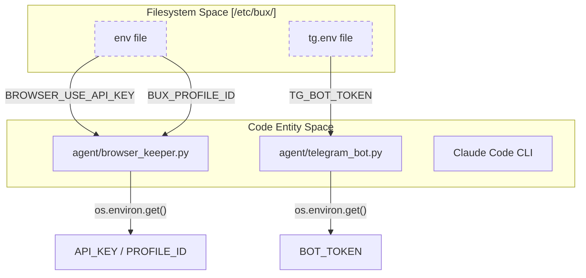
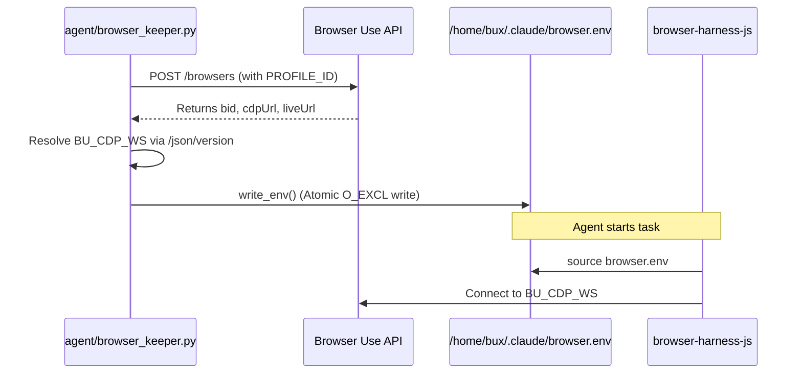

<!-- source: DeepWiki mcp.deepwiki.com · repo browser-use/bux · page 5.1 Environment Variables · fetched 2026-10-30 -->

# Environment Variables

<details>
<summary>Relevant source files</summary>

The following files were used as context for generating this wiki page:

- [.env.example](.env.example)
- [agent/CLAUDE.md](agent/CLAUDE.md)
- [agent/browser_keeper.py](agent/browser_keeper.py)

</details>


This page provides a complete technical reference for the environment variables used in `bux`. The system utilizes two distinct categories of variables: **Configuration Variables**, which are static and define the box's identity and credentials, and **Runtime Variables**, which are dynamically generated by the system to facilitate communication between the agent and the remote browser.

## Configuration Variables

These variables are typically defined in `/etc/bux/env` or `/etc/bux/tg.env` and are consumed by the systemd services during startup.

| Variable | Source File | Consumer | Description |
| :--- | :--- | :--- | :--- |
| `BROWSER_USE_API_KEY` | `.env.example:5` | `browser_keeper.py`, `telegram_bot.py` | Authentication key for Browser Use Cloud API. Required for session creation and profile management. |
| `BUX_PROFILE_ID` | `.env.example:8` | `browser_keeper.py` | The UUID of the Browser Use Cloud profile. Determines which cookies and local storage are loaded. |
| `TG_BOT_TOKEN` | `.env.example:11` | `telegram_bot.py` | Telegram Bot API token obtained from @BotFather. |
| `BUX_REF` | N/A | `install.sh` | Used during installation to track the source or version of the deployment. |

### Configuration Data Flow

The following diagram illustrates how static configuration variables flow from the filesystem into the active service processes.

**Configuration Injection Diagram**

Sources: [agent/browser_keeper.py:30-32](), [.env.example:1-12]()

---

## Runtime Variables (`browser.env`)

The `bux-browser-keeper` service maintains a persistent browser session. To allow the Claude Code agent to connect to this session without performing its own API calls, the keeper writes session metadata to a specialized environment file located at `/home/bux/.claude/browser.env` [agent/browser_keeper.py:34-35]().

### Variable Reference

| Variable | Type | Description |
| :--- | :--- | :--- |
| `BU_PROFILE_ID` | UUID | The active profile ID bound to the current session [agent/browser_keeper.py:109](). |
| `BU_BROWSER_ID` | String | The unique identifier for the specific remote browser instance [agent/browser_keeper.py:110](). |
| `BU_CDP_WS` | URL | The signed WebSocket URL used to connect via Chrome DevTools Protocol [agent/browser_keeper.py:111](). |
| `BU_BROWSER_LIVE_URL` | URL | The public URL for the "Live View" UI, allowing humans to intervene [agent/browser_keeper.py:112](). |
| `BU_BROWSER_EXPIRES_AT` | Epoch | Unix timestamp indicating when the current session will be terminated [agent/browser_keeper.py:113](). |

### Implementation and Security

The `browser.env` file is updated atomically using a temporary file and `os.replace()` to ensure that the agent never reads a partial or corrupted state [agent/browser_keeper.py:115-128](). Because `BU_CDP_WS` contains a sensitive signed token, the file is created with mode `0640` and owned by the `bux` user to prevent unauthorized access by other processes on the box [agent/browser_keeper.py:122-134]().

**Runtime Variable Lifecycle**

Sources: [agent/browser_keeper.py:69-79](), [agent/browser_keeper.py:102-128](), [agent/CLAUDE.md:23-28]()

---

## Usage in Agent Skills

The agent is instructed to always `source` the runtime environment before executing browser commands. This pattern ensures that the `browser-harness-js` CLI tool has the necessary credentials to bridge to the remote session.

### Example Shell Execution
The agent executes the following pattern to interact with the browser:
```bash
source ~/.claude/browser.env && browser-harness-js "await session.connect({wsUrl: process.env.BU_CDP_WS})"
```
Sources: [agent/CLAUDE.md:23-25](), [agent/CLAUDE.md:49-51]()

### Manual Profile Switching
If a user requests a profile change, the agent modifies the static `BUX_PROFILE_ID` in `/etc/bux/env` and restarts the keeper service. This triggers a fresh session creation using the new profile [agent/CLAUDE.md:85-97]().

1. **Modify Configuration**: `sudo sed -i "s|^BUX_PROFILE_ID=.*|BUX_PROFILE_ID=<new-uuid>|" /etc/bux/env` [agent/CLAUDE.md:88]()
2. **Restart Service**: `sudo systemctl restart bux-browser-keeper` [agent/CLAUDE.md:96]()
3. **Verification**: The keeper's `main()` loop re-reads the environment and calls `create_browser(PROFILE_ID)` [agent/browser_keeper.py:154-158]().

Sources: [agent/CLAUDE.md:74-101](), [agent/browser_keeper.py:149-160]()

---

