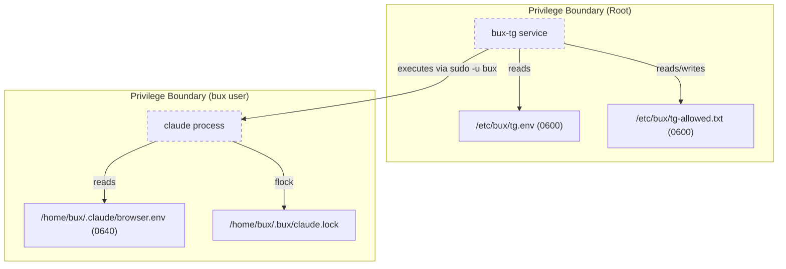
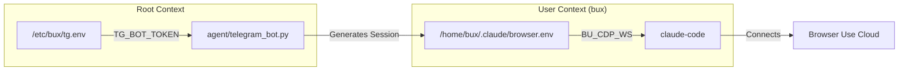

<!-- source: DeepWiki mcp.deepwiki.com · repo browser-use/bux · page 6 Security Model · fetched 2026-10-30 -->

# Security Model

Relevant source files

The following files were used as context for generating this wiki page:

- [agent/telegram_bot.py](agent/telegram_bot.py)
- [install.sh](install.sh)

The bux security model is designed to provide a persistent, agentic environment for Claude Code while strictly isolating sensitive credentials and protecting the host system from potential agent escape or compromise. It follows the principle of least privilege by separating the high-privileged management services from the low-privileged agent execution environment.

## High-Level Design Principles

The system architecture is divided into three distinct security zones:

1.  **Root/System Zone**: Manages systemd units, logs, and sensitive configuration files.
2.  **Management Zone (bux-tg)**: Runs as root to manage process lifecycles but interacts with the user via Telegram.
3.  **Agent Zone (bux user)**: A restricted user account where `claude` and `browser-harness-js` execute. This user has no `sudo` privileges [install.sh:153-157]().

### Security Entity Map

The following diagram maps natural language security concepts to their specific code entities and filesystem locations.

**Diagram: Security Entity Mapping**

Sources: [agent/telegram_bot.py:43-47](), [agent/telegram_bot.py:182-182](), [agent/telegram_bot.py:257-259](), [install.sh:153-157]()

---

## Privilege Separation

Bux implements strict privilege separation between the Telegram bot and the Claude agent. While the `bux-tg` service runs as `root` to facilitate system-level management and secure logging [agent/telegram_bot.py:216-217](), it never executes the agent with root permissions. 

Instead, it uses `sudo -u bux` to drop privileges before starting any `claude` session [agent/telegram_bot.py:257-259](). This ensures that even if the agent is tricked into running malicious code, it cannot access the Telegram bot token or modify system configuration.

**Key Mechanisms:**
*   **User Isolation**: The `bux` user is created without a password and without entries in `sudoers` [install.sh:147-162]().
*   **Concurrency Control**: A `flock` mechanism on `/home/bux/.bux/claude.lock` prevents multiple agent instances from corrupting the session [agent/telegram_bot.py:21-21]().
*   **Environment Scrubbing**: Sensitive variables like `TG_BOT_TOKEN` are kept in root-only files and are not leaked to the `bux` user environment [agent/telegram_bot.py:8-10]().

For details, see [Privilege Separation](#6.1).

Sources: [agent/telegram_bot.py:21-21](), [agent/telegram_bot.py:257-259](), [install.sh:147-162]()

---

## Credential and Secret Management

Secrets in bux are tiered based on their sensitivity and the service that requires them.

| Secret | Location | Owner | Permissions | Purpose |
| :--- | :--- | :--- | :--- | :--- |
| `TG_BOT_TOKEN` | `/etc/bux/tg.env` | `root` | `0600` | Authenticates with Telegram API |
| `BROWSER_USE_API_KEY` | `/etc/bux/env` | `root:bux` | `0640` | Authenticates with Browser Use Cloud |
| `BU_CDP_WS` | `~/.claude/browser.env` | `bux` | `0640` | Temporary signed URL for CDP access |
| `TG_SETUP_TOKEN` | `/etc/bux/tg.env` | `root` | `0600` | One-time token for initial bot binding |

**First-Message-Wins Binding:**
To prevent unauthorized access, the Telegram bot uses a "first-message-wins" model. The first `chat_id` to message the bot while a `TG_SETUP_TOKEN` exists becomes the permanent owner [agent/telegram_bot.py:3-6](). Once bound, the `TG_SETUP_TOKEN` is "burned" (deleted from disk) to prevent re-binding [agent/telegram_bot.py:185-191]().

**Diagram: Secret Access Flow**

Sources: [agent/telegram_bot.py:3-6](), [agent/telegram_bot.py:185-191](), [agent/telegram_bot.py:216-221](), [install.sh:149-151]()

For details, see [Credential and Secret Management](#6.2).

---

