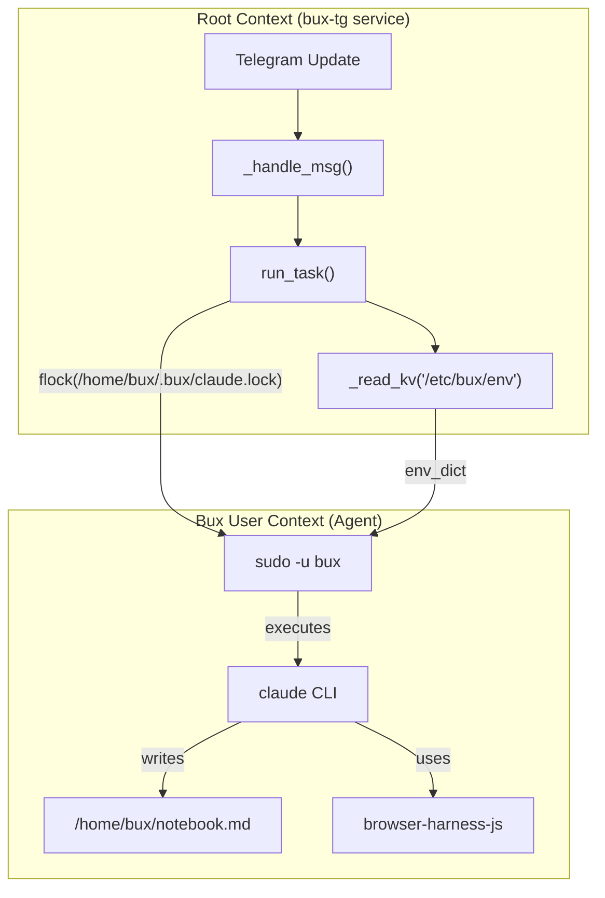
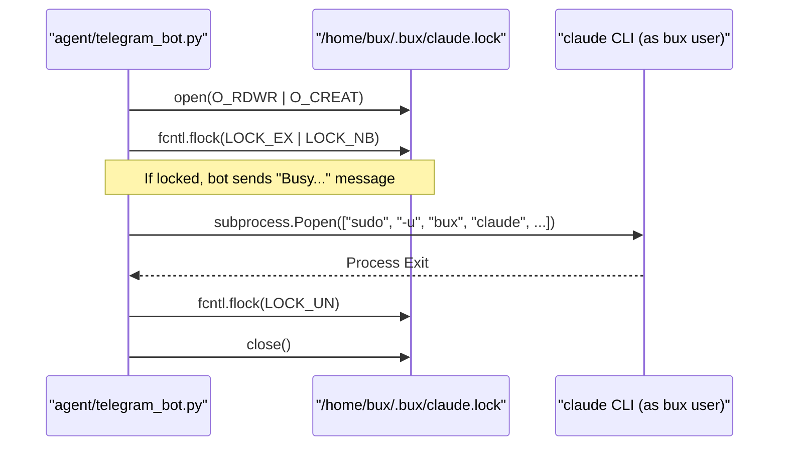

<!-- source: DeepWiki mcp.deepwiki.com · repo browser-use/bux · page 6.1 Privilege Separation · fetched 2026-10-30 -->

# Privilege Separation

Relevant source files

The following files were used as context for generating this wiki page:

- [agent/telegram_bot.py](agent/telegram_bot.py)
- [install.sh](install.sh)

The `bux` security model is built on the principle of least privilege, isolating the high-risk agent execution environment (the `bux` user) from the sensitive administrative and credential-handling environment (the `root` user). This separation ensures that even if an agent session is compromised or performs unintended actions, it cannot access the Telegram bot token or modify system-level configurations.

## Isolation Model Overview

The system operates using two primary security contexts:

1.  **Administrative Context (`root`)**: Runs the `bux-tg` (Telegram bot) and `bux-browser-keeper` services. This context manages credentials in `/etc/bux/` that are inaccessible to the agent.
2.  **Agent Context (`bux` user)**: A dedicated, non-privileged system user created by `install.sh` [install.sh:147-147](). All Claude Code executions, browser automation scripts, and `ttyd` terminal sessions run within this restricted boundary.

### User and Directory Permissions

The `install.sh` script establishes a strict filesystem hierarchy to enforce this separation:

| Path | Owner:Group | Permissions | Purpose |
| :--- | :--- | :--- | :--- |
| `/etc/bux/tg.env` | `root:root` | `0600` | Contains `TG_BOT_TOKEN`. Invisible to the agent. |
| `/etc/bux/env` | `root:bux` | `0640` | Shared config (e.g., `BROWSER_USE_API_KEY`). Agent can read, but not write. |
| `/home/bux/` | `bux:bux` | `0700` | Agent's home directory and workspace. |
| `/opt/bux/` | `bux:bux` | `0755` | Application code and virtual environments. |

Sources: [install.sh:147-152](), [agent/telegram_bot.py:43-47](), [agent/telegram_bot.py:182-182]()

## Execution Flow and Privilege Escalation

The `bux-tg` service runs as `root` to manage the Telegram polling loop and access protected state files. When a user sends a command, the bot escalates to `root` to execute `claude` but immediately drops privileges to the `bux` user using `sudo -u bux`.

### Environment Variable Forwarding

Because `bux` does not rely on `sudoers` `env_keep` (to avoid weakening system security), `telegram_bot.py` manually constructs the environment for the sub-process. It reads the necessary variables from `/etc/bux/env` and explicitly passes them to the `subprocess.Popen` call [agent/telegram_bot.py:246-261]().

### Serialized Execution (flock)

To prevent race conditions and terminal corruption when multiple Telegram messages arrive, `bux` uses a file-based locking mechanism. The `claude.lock` file is managed using `fcntl.flock` [agent/telegram_bot.py:235-244]().

**Natural Language to Code Entity: Execution Dispatch**

Sources: [agent/telegram_bot.py:230-244](), [agent/telegram_bot.py:246-270](), [agent/telegram_bot.py:311-320]()

## Symlink Attack Mitigations

The system is hardened against symlink attacks, where a compromised `bux` user might attempt to trick a `root` process into reading or writing to a sensitive file (like `/etc/shadow`) by creating a symbolic link.

1.  **O_NOFOLLOW**: When the Telegram bot creates or reads files in directories that might be influenced by the user, it uses `O_NOFOLLOW` logic where applicable to ensure it does not follow symlinks.
2.  **Atomic Creation (O_EXCL)**: Files like `tg-allowed.txt` and `tg-state.json` are managed by the root process with strict `0600` permissions, ensuring they cannot be pre-created or symlinked by the `bux` user [agent/telegram_bot.py:182-182](), [agent/telegram_bot.py:219-221]().
3.  **Directory Sticky Bits**: The `/etc/bux` directory is set with `chmod 2775` (setgid), ensuring files created there inherit the `bux` group, while the root-owned files remain protected [install.sh:151-151]().

## Lock Mechanism Implementation

The `claude.lock` mechanism ensures that only one instance of the Claude agent is interacting with the persistent session and the virtual terminal at any given time.

**Code Entity Space: Locking Data Flow**

Sources: [agent/telegram_bot.py:230-244](), [agent/telegram_bot.py:270-275]()

## Security of Credentials

`bux` implements a "one-shot" binding for the Telegram bot to prevent hijacking:

*   **TG_SETUP_TOKEN**: Generated during installation and stored in `/etc/bux/tg.env`.
*   **Binding**: The first user to message the bot with the correct setup token (or the first user to message a fresh bot) has their `chat_id` written to `/etc/bux/tg-allowed.txt` [agent/telegram_bot.py:179-183]().
*   **Token Burning**: Immediately after a successful bind, the `burn_setup_token()` function removes the `TG_SETUP_TOKEN` from the disk [agent/telegram_bot.py:185-204](). This ensures that even if the configuration files are leaked later, no new owners can be added.

Sources: [agent/telegram_bot.py:3-10](), [agent/telegram_bot.py:185-204]()

---

