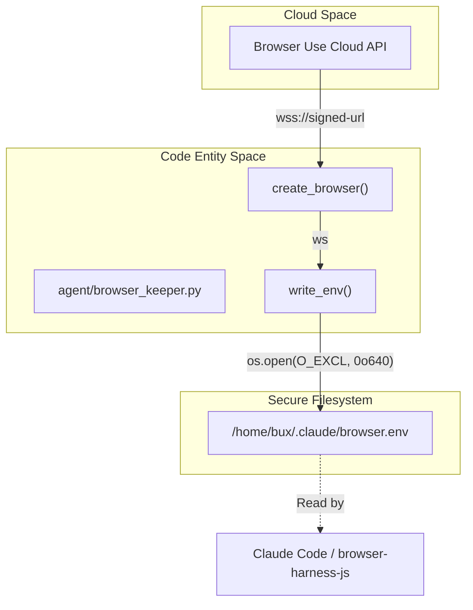

<!-- source: DeepWiki mcp.deepwiki.com · repo browser-use/bux · page 6.2 Credential and Secret Management · fetched 2026-10-30 -->

# Credential and Secret Management

<details>
<summary>Relevant source files</summary>

The following files were used as context for generating this wiki page:

- [.env.example](.env.example)
- [.gitignore](.gitignore)
- [agent/browser_keeper.py](agent/browser_keeper.py)
- [agent/telegram_bot.py](agent/telegram_bot.py)

</details>


This page documents the security architecture for storing and protecting sensitive credentials in `bux`. The system employs a defense-in-depth strategy using filesystem permissions, one-time tokens, and privilege separation to ensure that secrets like API keys and session URLs are protected from unauthorized access.

## Secret Storage and Access Control

Secrets in `bux` are partitioned by service requirements. The system uses `/etc/bux/` for global configuration and `/home/bux/.claude/` for dynamic session credentials.

| Secret | Location | Permissions | Owner | Description |
|:---|:---|:---|:---|:---|
| `BROWSER_USE_API_KEY` | `/etc/bux/env` | `0640` | `root:bux` | Global API key for Browser Use Cloud. |
| `TG_BOT_TOKEN` | `/etc/bux/tg.env` | `0600` | `root:root` | Token for the Telegram Bot API. |
| `TG_SETUP_TOKEN` | `/etc/bux/tg.env` | `0600` | `root:root` | One-time token for initial owner binding. |
| `BU_CDP_WS` | `/home/bux/.claude/browser.env` | `0640` | `bux:bux` | Signed WebSocket URL for the active browser. |

### Implementation Details
- **Environment Isolation**: `TG_BOT_TOKEN` is restricted to the `bux-tg` service (running as root) and is never exposed to the `bux` user context [agent/telegram_bot.py:8-14]().
- **Group Readability**: `/etc/bux/env` is readable by the `bux` group, allowing both the `bux-keeper` and `bux-tg` (via sudo) to access the `BROWSER_USE_API_KEY` [agent/telegram_bot.py:44-46]().
- **Git Protection**: The `.gitignore` file explicitly excludes `.env` files to prevent accidental credential leakage during development [/.gitignore:4-4]().

Sources: [agent/telegram_bot.py:8-14](), [agent/telegram_bot.py:44-46](), [/.gitignore:4-4]()

## Telegram Binding (First-Message-Wins)

To prevent unauthorized control of the bot, `bux` implements a "first-message-wins" binding model. This mechanism ensures that the first user to interact with the bot becomes its permanent owner.

### The TG_SETUP_TOKEN Burn
When the system is first installed, a random `TG_SETUP_TOKEN` is generated and stored in `/etc/bux/tg.env`.
1. The `bux-tg` service checks if `TG_SETUP_TOKEN` exists in its environment.
2. If present, the first incoming message's `chat_id` is recorded in `/etc/bux/tg-allowed.txt` [agent/telegram_bot.py:173-184]().
3. The function `burn_setup_token()` is called to physically remove the token from the disk [agent/telegram_bot.py:185-204]().

This "burn" ensures that even if the `tg.env` file is later leaked or accessed via a backup, a new owner cannot be bound because the setup gate is permanently closed.

### Credential Flow: Telegram Binding
The following diagram illustrates the transition from the setup state to the bound state.

**Telegram Owner Binding Logic**
```mermaid
sequenceDiagram
    participant U as User (Telegram)
    participant T as agent/telegram_bot.py
    participant F as /etc/bux/tg.env
    participant A as /etc/bux/tg-allowed.txt

    T->>F: _read_kv()
    Note over T: Checks for TG_SETUP_TOKEN
    U->>T: Sends first message
    T->>A: add_allow(chat_id)
    T->>F: burn_setup_token()
    Note over F: TG_SETUP_TOKEN deleted
    U->>T: Sends second message
    T->>A: load_allow()
    Note over T: chat_id matches; proceed
```
Sources: [agent/telegram_bot.py:173-184](), [agent/telegram_bot.py:185-204](), [agent/telegram_bot.py:43-47]()

## Signed URL Protection (BU_CDP_WS)

The `BU_CDP_WS` variable contains a signed WebSocket URL that provides direct, unauthenticated access to the remote browser instance. Protecting this URL is critical to prevent session hijacking.

### Secure File Creation
The `browser_keeper.py` service manages the rotation of this secret using a secure atomic write pattern in the `write_env` function:
1. **O_EXCL & O_CREAT**: Opens a `.tmp` file ensuring it is a new file created by the process [agent/browser_keeper.py:119-123]().
2. **Strict Mode**: The file is created with mode `0640` (owner read/write, group read) [agent/browser_keeper.py:122]().
3. **Atomic Rename**: The `tmp.replace(ENV_FILE)` call ensures the destination file inherits the strict permissions and that the update is atomic [agent/browser_keeper.py:128]().
4. **Ownership Enforcement**: Explicitly calls `os.chown` to ensure the `bux` user owns the credential file [agent/browser_keeper.py:130-136]().

### Data Flow: CDP Secret Management
This diagram shows how `browser_keeper.py` handles the sensitive `BU_CDP_WS` token.

**CDP Secret Propagation**

Sources: [agent/browser_keeper.py:102-138](), [agent/browser_keeper.py:69-79]()

## Privilege Separation and Credential Exposure

`bux` minimizes the exposure of root-level secrets to the agent process.

- **`bux-tg` (Root)**: Has access to `TG_BOT_TOKEN` and `TG_SETUP_TOKEN`. It performs the sensitive owner-binding logic.
- **`bux` (User)**: Runs the actual agent tasks. It can only see the `BROWSER_USE_API_KEY` (via group permissions on `/etc/bux/env`) and the current browser session details in `browser.env`.
- **Sudo Environment**: When `bux-tg` executes a task, it uses `sudo -u bux` but does not rely on `env_keep`. Instead, it explicitly sources the required environment variables to maintain a clean security boundary [agent/telegram_bot.py:237-248]().

Sources: [agent/telegram_bot.py:237-248](), [agent/telegram_bot.py:43-47]()

---

