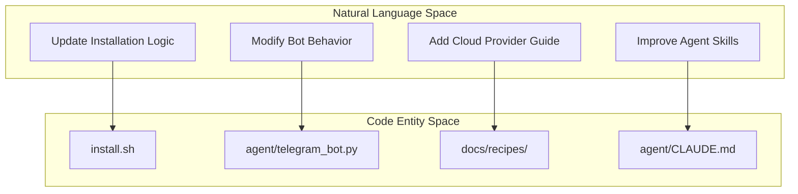
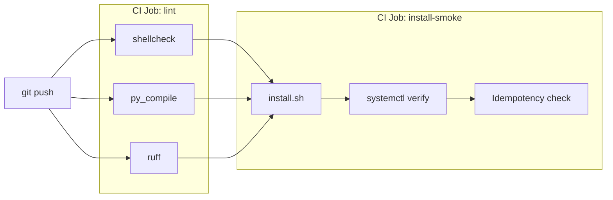

<!-- source: DeepWiki mcp.deepwiki.com · repo browser-use/bux · page 7 CI/CD and Development · fetched 2026-10-30 -->

# CI/CD and Development

Relevant source files

The following files were used as context for generating this wiki page:

- [.github/workflows/ci.yml](.github/workflows/ci.yml)

This section provides an overview of the continuous integration (CI) pipeline and the development workflow for the `bux` project. The project maintains a high standard for stability by ensuring that the complex installation process and the multi-service Python agent remain functional across updates.

## Development Workflow

Development on `bux` primarily involves three areas: the core shell installer, the Python-based management services, and the agentic instructions that guide Claude's behavior. 

The project follows a standard GitHub flow where changes are proposed via Pull Requests. Because `bux` is designed to be deployed on fresh Linux instances, the development process emphasizes idempotency—ensuring that scripts can be run multiple times without corrupting the system state.

### Bridging Logic and Code

The following diagram illustrates how development tasks map to specific entities within the repository:

**Development Task Mapping**

**Sources:** [.github/workflows/ci.yml:1-53](), [agent/telegram_bot.py:1-10](), [agent/browser_keeper.py:1-10]()

---

## Continuous Integration (CI)

The CI pipeline, defined in `.github/workflows/ci.yml`, is triggered on every push to the `main` branch and for all pull requests [.github/workflows/ci.yml:3-7](). The pipeline is designed to catch syntax errors, linting violations, and deployment regressions before code is merged.

The pipeline consists of two primary jobs:
1.  **Linting**: Validates the integrity of shell scripts using `shellcheck` [.github/workflows/ci.yml:13-17]() and Python code using `ruff` and `py_compile` [.github/workflows/ci.yml:18-24]().
2.  **Smoke Test**: Executes the `install.sh` script on a clean Ubuntu 24.04 runner [.github/workflows/ci.yml:26-36](). This ensures that the complex chain of dependencies (Node.js, `ttyd`, `uv`, `claude` CLI) can be successfully provisioned and that the `systemd` units are correctly registered [.github/workflows/ci.yml:37-48]().

For a deep dive into the CI stages and the specifics of the smoke test validation, see **[CI Pipeline](#7.1)**.

**CI Pipeline Flow**

**Sources:** [.github/workflows/ci.yml:9-53]()

---

## Contributing and Extending

`bux` is designed to be extensible. Contributions generally fall into three categories:
*   **Provider Recipes**: Adding new deployment guides to `docs/recipes/` for various VPS providers or hardware configurations.
*   **Agent Skills**: Enhancing the capabilities of the agent by modifying `agent/CLAUDE.md` or adding new domain-specific skills.
*   **Core Improvements**: Enhancing the `browser_keeper.py` or `telegram_bot.py` services.

All contributions are accepted under the MIT license. For detailed instructions on how to add recipes or customize agent behavior, see **[Contributing and Extending bux](#7.2)**.

**Sources:** [.github/workflows/ci.yml:1-53](), [agent/browser_keeper.py:1-10](), [agent/telegram_bot.py:1-10]()

---

