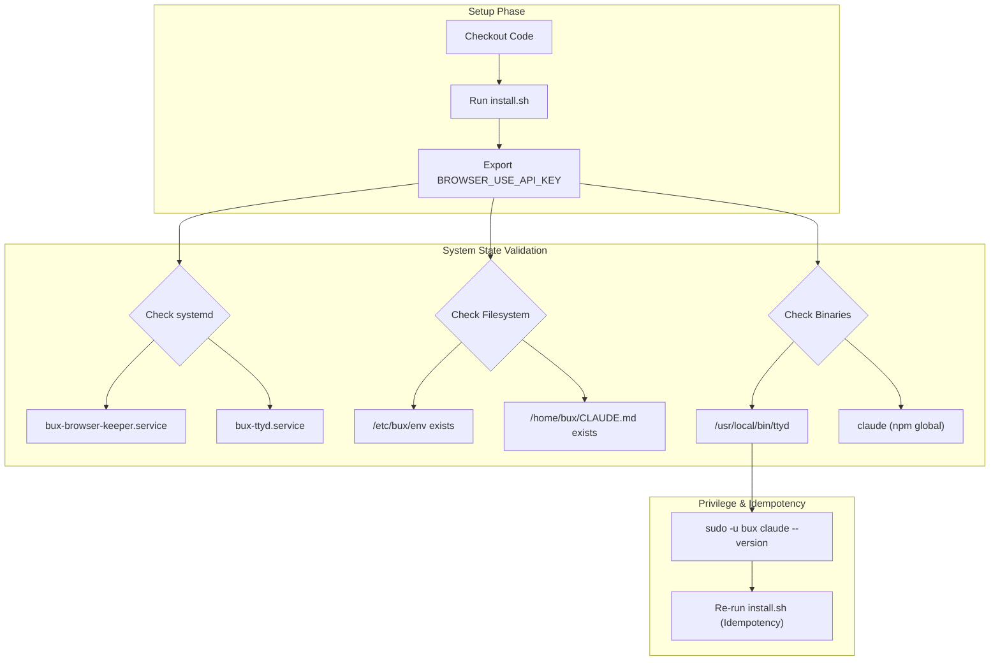

<!-- source: DeepWiki mcp.deepwiki.com · repo browser-use/bux · page 7.1 CI Pipeline · fetched 2026-10-30 -->

# CI Pipeline

Relevant source files

The following files were used as context for generating this wiki page:

- [.github/workflows/ci.yml](.github/workflows/ci.yml)

The `bux` project utilizes a GitHub Actions workflow to ensure the stability of the installation script and the integrity of the Python agent services. The pipeline is designed to validate the end-to-end setup process on a clean environment, simulating a fresh VPS deployment.

## Pipeline Structure

The CI pipeline is defined in [.github/workflows/ci.yml:1-53](). It consists of two primary jobs: `lint` and `install-smoke`. The workflow triggers on every push to the `main` branch and on all pull requests [.github/workflows/ci.yml:3-7]().

### Workflow Stages

| Job | Task | Description |
| :--- | :--- | :--- |
| **Lint** | `shellcheck` | Validates `install.sh` for POSIX compliance and common bash pitfalls [.github/workflows/ci.yml:13-17](). |
| **Lint** | `py_compile` | Checks `agent/*.py` for syntax errors [.github/workflows/ci.yml:18-20](). |
| **Lint** | `ruff` | Performs static analysis and linting on the Python codebase [.github/workflows/ci.yml:21-24](). |
| **Install Smoke** | `install.sh` | Executes the full installation on a fresh Ubuntu 24.04 runner [.github/workflows/ci.yml:31-36](). |
| **Install Smoke** | `verify` | Asserts that services, binaries, and configurations are correctly placed [.github/workflows/ci.yml:37-48](). |
| **Install Smoke** | `idempotence` | Re-runs the installer to ensure it can handle existing configurations [.github/workflows/ci.yml:49-52](). |

**Sources:**
- [.github/workflows/ci.yml:1-53]()

---

## The Lint Job

The linting stage focuses on static analysis to catch errors before code execution.

### Shell Script Validation
The `install.sh` script is the entry point for all `bux` deployments. The CI uses `shellcheck -x` to verify the script [.github/workflows/ci.yml:17-17](). The `-x` flag allows the linter to follow sourced files, ensuring that the installation logic is robust and follows shell scripting best practices.

### Python Static Analysis
The pipeline validates the two core Python services: `agent/browser_keeper.py` and `agent/telegram_bot.py`.
1.  **Syntax Check**: `python3 -m py_compile` is used as a fast smoke test for syntax errors [.github/workflows/ci.yml:20-20]().
2.  **Linting**: `ruff` is executed against the `agent/` directory to enforce code quality and style standards [.github/workflows/ci.yml:24-24]().

**Sources:**
- [.github/workflows/ci.yml:13-24]()

---

## The Install-Smoke Job

The `install-smoke` job is the most critical part of the CI, as it performs a "live" installation on an `ubuntu-24.04` runner [.github/workflows/ci.yml:31-31](). Since the runner does not have a real Browser Use API key, the test uses a placeholder `bu_ci_placeholder` [.github/workflows/ci.yml:36-36]().

### Data Flow: Installation and Verification

The following diagram illustrates how the `install-smoke` job transitions from a clean state to a verified system.

**CI Execution Flow**

**Sources:**
- [.github/workflows/ci.yml:31-52]()

### Smoke Test Validations
The CI explicitly validates the following conditions to ensure a successful deployment:

1.  **Systemd Unit Registration**: Uses `systemctl cat` to verify that `bux-browser-keeper.service` and `bux-ttyd.service` are correctly registered in the system [.github/workflows/ci.yml:40-41]().
2.  **Configuration Persistence**: Verifies that the global environment file `/etc/bux/env` and the agent instruction file `/home/bux/CLAUDE.md` were created [.github/workflows/ci.yml:42-43]().
3.  **Binary Accessibility**:
    *   Checks that `ttyd` is executable at `/usr/local/bin/ttyd` [.github/workflows/ci.yml:44-44]().
    *   Ensures the `claude` CLI (installed via npm) is present in the system `PATH` [.github/workflows/ci.yml:47-47]().
4.  **Privilege Separation**: A critical check ensures that the `bux` user (created during installation) has the necessary permissions to execute the `claude` binary [.github/workflows/ci.yml:48-48]().

### Idempotency Re-run
The final step of the smoke test is a second execution of `install.sh` [.github/workflows/ci.yml:52-52](). This validates that the installer:
*   Does not fail if `bux` user or directories already exist.
*   Correcty reads existing configuration from `/etc/bux/env` when the `BROWSER_USE_API_KEY` environment variable is not explicitly passed the second time [.github/workflows/ci.yml:51-52]().

**Sources:**
- [.github/workflows/ci.yml:37-52]()

---

