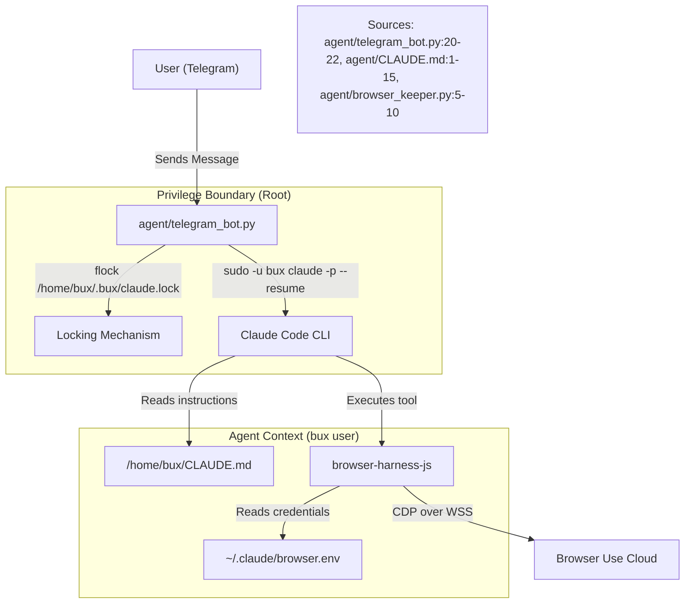
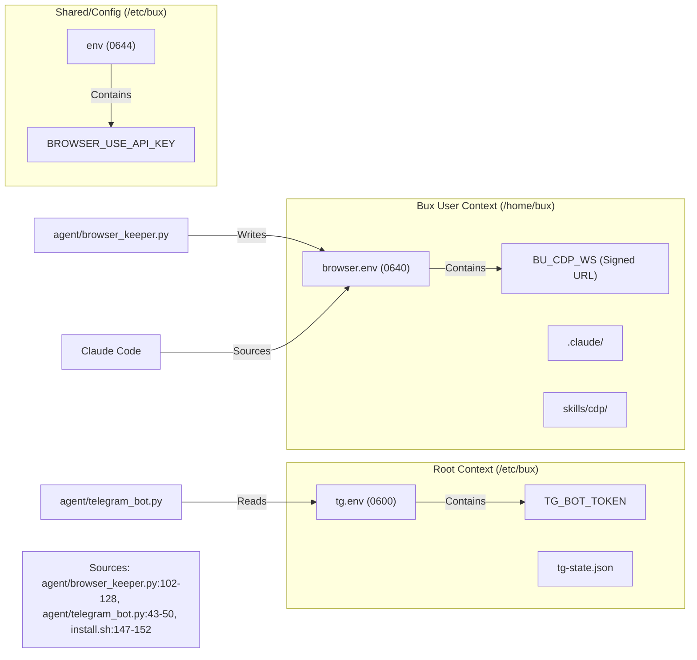

<!-- source: DeepWiki mcp.deepwiki.com · repo browser-use/bux · page 8 Glossary · fetched 2026-10-30 -->

# Glossary

Relevant source files

The following files were used as context for generating this wiki page:

- [.env.example](.env.example)
- [README.md](README.md)
- [SKILL.md](SKILL.md)
- [agent/CLAUDE.md](agent/CLAUDE.md)
- [agent/browser_keeper.py](agent/browser_keeper.py)
- [agent/telegram_bot.py](agent/telegram_bot.py)
- [install.sh](install.sh)

This glossary defines the core technical terms, domain concepts, and abbreviations specific to the `bux` codebase. It serves as a reference for onboarding engineers to understand the system's architecture, security boundaries, and data flow.

## Core Concepts

### The Box
The persistent Linux environment (typically an Ubuntu VPS) where the `bux` services reside [README.md:6-8](). It acts as the host for the Claude Code agent and maintains a 24/7 connection to the browser infrastructure.

### Browser Use Cloud
The remote infrastructure provider that hosts the actual Chromium instances [README.md:30](). `bux` connects to these instances via Chrome DevTools Protocol (CDP) over Secure WebSockets (WSS).
- **Code Pointer:** Managed via `agent/browser_keeper.py` [agent/browser_keeper.py:2-10]().

### Browser Keeper
A Python service (`bux-browser-keeper`) responsible for the lifecycle of the remote browser session [agent/browser_keeper.py:2-18](). It ensures a browser is always "warm" and ready for the agent, rotating sessions before they expire to avoid cold-starts.
- **Code Pointer:** `agent/browser_keeper.py` [agent/browser_keeper.py:149-187]().

### browser-harness-js
A Bun-based CLI tool that allows Claude Code to execute CDP commands against the remote browser [agent/CLAUDE.md:21-36](). It maintains a persistent `Session` object to ensure state continuity between individual command invocations.
- **Code Pointer:** Installed at `~/.claude/skills/cdp/` [agent/CLAUDE.md:21]().

### Profile Binding
The association between a `bux` box and a specific Browser Use Cloud profile ID (`BUX_PROFILE_ID`) [agent/CLAUDE.md:74-77](). This binding ensures that cookies, localStorage, and session states persist across browser rotations and reboots.
- **Code Pointer:** Environment variable in `/etc/bux/env` [agent/CLAUDE.md:85-89]().

---

## System Entities and Data Flow

The following diagram illustrates how natural language commands from a user translate into code execution across the various system entities.

### From Request to Execution

Sources: [agent/telegram_bot.py:20-22](), [agent/CLAUDE.md:1-15](), [agent/browser_keeper.py:5-10]().

---

## Technical Terms

| Term | Definition | Code Pointer |
| :--- | :--- | :--- |
| **CDP** | Chrome DevTools Protocol. The wire protocol used to instrument, inspect, and debug Chromium browsers. | [agent/CLAUDE.md:21-36]() |
| **Live View** | A public URL (`BU_BROWSER_LIVE_URL`) providing a real-time visual stream of the remote browser, used for human-in-the-loop interventions. | [agent/browser_keeper.py:74-77]() |
| **Login Wall** | Any state (CAPTCHA, 2FA, Login form) where the agent cannot proceed autonomously and must hand off to the user. | [agent/CLAUDE.md:42-45]() |
| **Rotation** | The process of creating a new remote browser session and updating `browser.env` before the current session expires (typically every 239 minutes). | [agent/browser_keeper.py:12-14]() |
| **ttyd** | A tool that shares a terminal over the web. In `bux`, it provides a web-based terminal for the `bux` user, restricted to localhost. | [README.md:32](), [install.sh:220-230]() |
| **Notebook** | A scratchpad file (`/home/bux/notebook.md`) used by the agent to persist findings and context across different chat sessions. | [agent/CLAUDE.md:106]() |

---

## Security and Infrastructure Entities

The system relies on strict file permissions and user isolation to protect secrets like the `TG_BOT_TOKEN` and `BROWSER_USE_API_KEY`.

### Security Boundary Mapping

Sources: [agent/browser_keeper.py:102-128](), [agent/telegram_bot.py:43-50](), [install.sh:147-152]().

### File Definitions

*   **`/etc/bux/env`**: Global configuration containing the `BROWSER_USE_API_KEY` and `BUX_PROFILE_ID`. Owned by `root:bux` with `0644` or `0640` permissions [install.sh:147-152]().
*   **`/etc/bux/tg.env`**: Root-only file containing the `TG_BOT_TOKEN`. This is never accessible to the `bux` user to prevent a compromised agent from hijacking the Telegram bot [agent/telegram_bot.py:8-10]().
*   **`~/.claude/browser.env`**: A runtime-generated file written by the Browser Keeper. It contains the ephemeral `BU_CDP_WS` and `BU_BROWSER_LIVE_URL` for the current active session [agent/browser_keeper.py:5-10]().
*   **`tg-allowed.txt`**: A whitelist of Telegram `chat_id`s authorized to command the bot. Implements the "first-message-wins" binding model [agent/telegram_bot.py:3-6]().

---

## Systemd Units

`bux` operates via three primary system services:

1.  **`bux-browser-keeper`**: Runs `agent/browser_keeper.py`. Maintains the remote browser connection.
2.  **`bux-tg`**: Runs `agent/telegram_bot.py`. Handles the Telegram interface and dispatches tasks to Claude.
3.  **`bux-ttyd`**: Runs the `ttyd` binary to provide web-based terminal access to the `bux` user account [install.sh:220-230]().

Sources: [README.md:52](), [agent/browser_keeper.py:1-18](), [agent/telegram_bot.py:1-23](), [install.sh:220-230]().