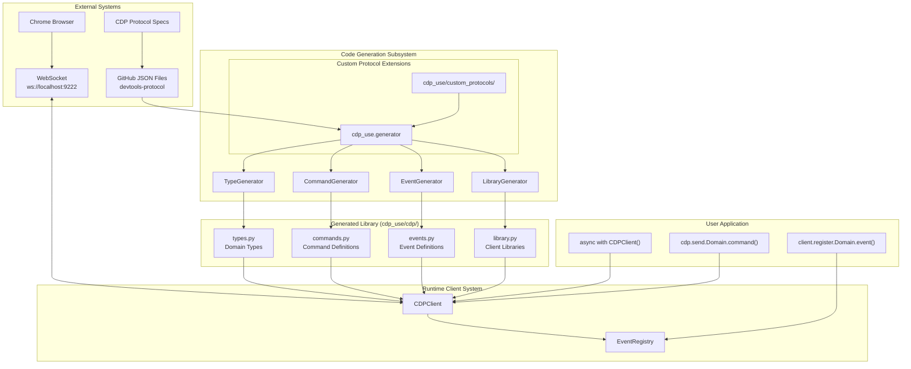
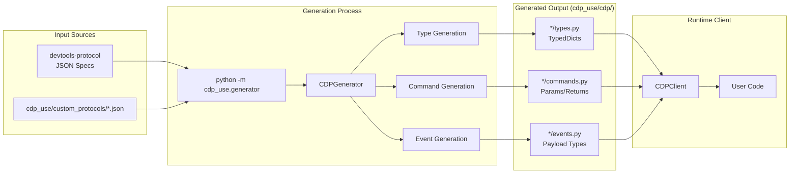
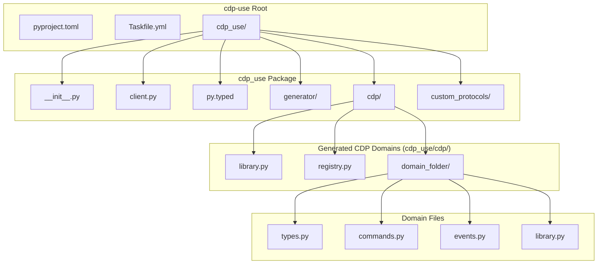

<!-- source: DeepWiki mcp.deepwiki.com · repo browser-use/cdp-use · page 1 Overview · fetched 2026-10-30 -->

# Overview

Relevant source files

The following files were used as context for generating this wiki page:

- [.python-version](.python-version)
- [README.md](README.md)
- [Taskfile.yml](Taskfile.yml)
- [cdp_use/__init__.py](cdp_use/__init__.py)
- [cdp_use/custom_protocols/browseruse.json](cdp_use/custom_protocols/browseruse.json)
- [cdp_use/py.typed](cdp_use/py.typed)
- [pyproject.toml](pyproject.toml)

This document provides a comprehensive overview of the `cdp-use` library, a type-safe Python client generator for the Chrome DevTools Protocol (CDP). The library automatically generates Python bindings with full type safety from official CDP protocol specifications, enabling developers to interact with Chrome browsers programmatically with compile-time guarantees and IDE support.

For details on how the codebase is organized, see [Project Structure](#1.1). For information on runtime requirements and setup, see [Dependencies and Environment](#1.2).

## System Architecture

The `cdp-use` library consists of two main subsystems: a WebSocket-based CDP client and an automated code generation pipeline that creates type-safe Python bindings.

Title: System Component Interaction

Sources: [README.md:1-13](), [README.md:177-201](), [cdp_use/custom_protocols/browseruse.json:1-5]()

## Core Components

The system is organized around several key components that work together to provide type-safe CDP interactions:

| Component | Purpose | Key Classes |
|-----------|---------|-------------|
| **CDPClient** | WebSocket communication and session management | `CDPClient` [cdp_use/client.py:1]() |
| **Event Registry** | Async event handling and callback dispatch | `EventRegistry` [README.md:197]() |  
| **Code Generator** | Orchestrates the generation of Python bindings | `cdp_use.generator` [README.md:27]() |
| **CDP Library** | Proxy for sending typed commands to domains | `CDPLibrary` [README.md:188]() |
| **Registration Library** | Proxy for registering typed event handlers | `CDPRegistrationLibrary` [README.md:196]() |

The `CDPClient` class serves as the main entry point, providing two primary interfaces:
- `client.send`: Access to type-safe CDP command execution via `CDPLibrary`.
- `client.register`: Access to type-safe event registration via `CDPRegistrationLibrary`.

Sources: [README.md:181-201](), [cdp_use/__init__.py:1-3]()

## Code Generation Pipeline

The library uses an automated pipeline to transform CDP protocol specifications into type-safe Python code. This includes official protocols and custom extensions like `browseruse.json` [cdp_use/custom_protocols/browseruse.json:1-4]().

Title: Data Flow from Protocol to Code

The generation process downloads the latest CDP specifications and creates:
- **Types**: `TypedDict` classes for complex CDP data structures.
- **Commands**: Parameter and return type definitions for CDP commands.
- **Events**: Payload type definitions for CDP events.
- **Libraries**: Domain-specific client classes with type-safe method signatures.

Sources: [README.md:24-30](), [README.md:159-175](), [Taskfile.yml:4-7]()

## Package Structure

The library is organized into distinct modules with clear separation between core functionality and generated code. The generator logic is specifically excluded from the final build to keep the runtime lightweight [pyproject.toml:32-32]().

Title: Repository Layout

The library includes a `py.typed` marker file [cdp_use/py.typed:1]() to signal to type checkers that it provides inline type hints (PEP 561).

Sources: [pyproject.toml:30-32](), [README.md:161-175](), [cdp_use/py.typed:1]()

## Type Safety System

The library achieves compile-time type safety through automatically generated `TypedDict` classes and type hints. This ensures that parameters like `expression` in `Runtime.evaluate` are correctly typed as strings [README.md:57-60]().

| Type Category | Implementation | Example Usage |
|---------------|----------------|---------------|
| **Command Parameters** | `TypedDict` classes | `await cdp.send.Page.navigate({"url": "..."})` |
| **Return Types** | `TypedDict` classes | `result = await cdp.send.DOM.getDocument(...)` |  
| **Event Payloads** | `TypedDict` classes | `def on_event(event: ConsoleAPICalledEvent, ...)` |
| **Method Signatures** | Type-hinted methods | `client.register.Page.frameAttached(callback)` |

This enables full IDE support with autocompletion, parameter validation, and compile-time error detection for all CDP interactions.

Sources: [README.md:7-10](), [README.md:53-68](), [README.md:108-114]()

---

