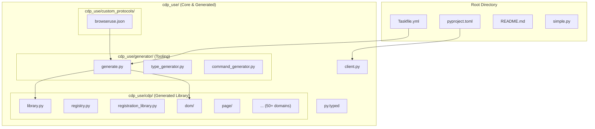
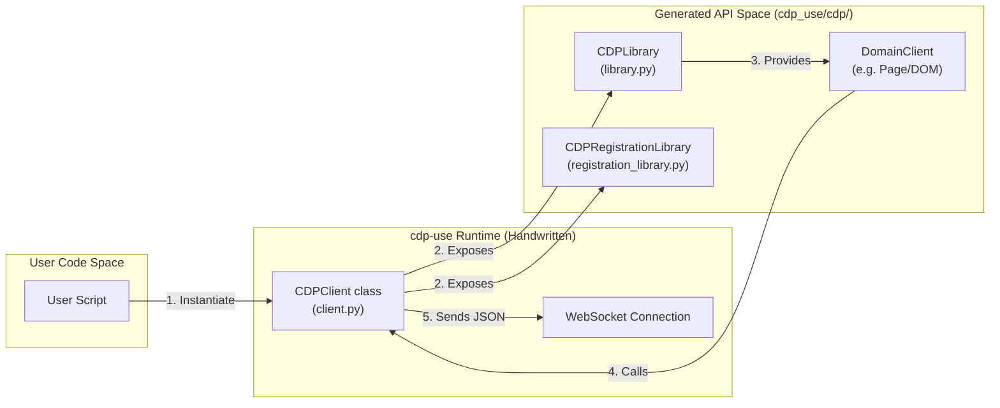

<!-- source: DeepWiki mcp.deepwiki.com · repo browser-use/cdp-use · page 1.1 Project Structure · fetched 2026-10-30 -->

# Project Structure

Relevant source files

The following files were used as context for generating this wiki page:

- [README.md](README.md)
- [Taskfile.yml](Taskfile.yml)
- [cdp_use/cdp/__init__.py](cdp_use/cdp/__init__.py)
- [cdp_use/custom_protocols/browseruse.json](cdp_use/custom_protocols/browseruse.json)
- [cdp_use/generator/__init__.py](cdp_use/generator/__init__.py)
- [pyproject.toml](pyproject.toml)

This document explains the organization and layout of the `cdp-use` repository, detailing the relationship between handwritten core logic, the code generation system, and the resulting type-safe CDP bindings. The project is designed as a two-layer architecture: a runtime client that manages WebSocket communication and an auto-generated library that provides domain-specific type hints.

## Repository Layout

The repository is organized to separate the generation logic from the runtime library. This allows developers to regenerate the protocol bindings whenever the Chrome DevTools Protocol updates without modifying the core client logic.

**Sources**: [pyproject.toml:30-32](), [cdp_use/cdp/__init__.py:7-64](), [README.md:161-175](), [Taskfile.yml:4-7]()

## Package Organization

The codebase is split into three functional areas:

### 1. Core Runtime (`cdp_use/`)
Contains the handwritten logic for managing connections.
- `client.py`: Implements `CDPClient`, the primary entry point for users. It manages the `websockets` connection and coordinates between the command-sending `CDPLibrary` and the event-handling `CDPRegistrationLibrary` [README.md:182-201]().
- `py.typed`: A marker file indicating the package provides inline type hints for PEP 561 compliance [pyproject.toml:31]().

### 2. Code Generation System (`cdp_use/generator/`)
This sub-package is responsible for transforming JSON protocol definitions into Python code.
- **Input**: It fetches official specifications and reads local extensions from `cdp_use/custom_protocols/` (e.g., `browseruse.json` for custom automation events) [cdp_use/custom_protocols/browseruse.json:1-92]().
- **Logic**: Individual modules like `type_generator.py` and `command_generator.py` handle the mapping of CDP primitives to Python `TypedDict` and `async` methods [README.md:205-215]().
- **Exclusion**: The generator is excluded from the final distribution build to keep the runtime package lightweight [pyproject.toml:32]().

### 3. Generated CDP Library (`cdp_use/cdp/`)
The output of the generator. It contains a directory for every CDP domain (e.g., `dom`, `page`, `network`).
- Each domain directory typically contains:
    - `types.py`: `TypedDict` definitions for domain objects [README.md:167]().
    - `commands.py`: Parameter and return types for domain methods [README.md:168]().
    - `events.py`: Payload types for domain-specific events [README.md:169]().
    - `library.py`: The `DomainClient` class providing the typed command interface [README.md:170]().
    - `registration.py`: The interface for registering typed event callbacks [README.md:171]().

**Sources**: [pyproject.toml:30-32](), [README.md:161-175](), [cdp_use/cdp/__init__.py:7-60]()

## Data Flow and Component Interaction

The following diagram illustrates how the handwritten `CDPClient` interacts with the generated `CDPLibrary` and `CDPRegistrationLibrary` to provide a type-safe user experience.

**Sources**: [README.md:37-50](), [README.md:182-201](), [cdp_use/cdp/__init__.py:62-64]()

## Configuration and Build System

The project uses `hatchling` as the build backend and `uv` for dependency management.

| Configuration File | Role | Key Entities |
|:---|:---|:---|
| `pyproject.toml` | Metadata & Build Rules | `[project]`, `[tool.hatch.build]`, `[tool.ruff.lint.per-file-ignores]` [pyproject.toml:1-44]() |
| `Taskfile.yml` | Automation | `generate`, `build`, `lint`, `format-json` [Taskfile.yml:1-48]() |
| `custom_protocols/` | Protocol Extensions | `BrowserUse` domain, `captchaSolverStarted` event [cdp_use/custom_protocols/browseruse.json:4-10]() |

### Linting and Quality Control
The project uses `ruff` for linting. Because the generated code in `cdp_use/cdp/` uses wildcard imports and redefinitions to maintain the protocol's structure, specific linting rules (`F403`, `F811`) are ignored for that directory [pyproject.toml:41-43]().

**Sources**: [pyproject.toml:23-44](), [Taskfile.yml:1-48]()

---

