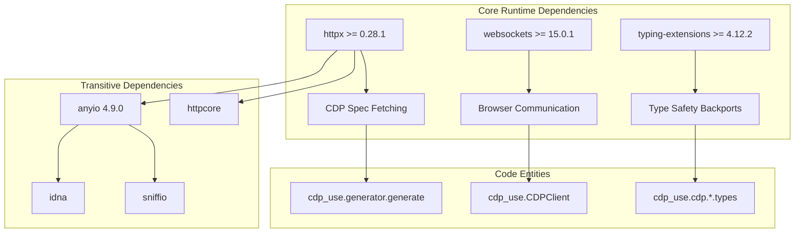
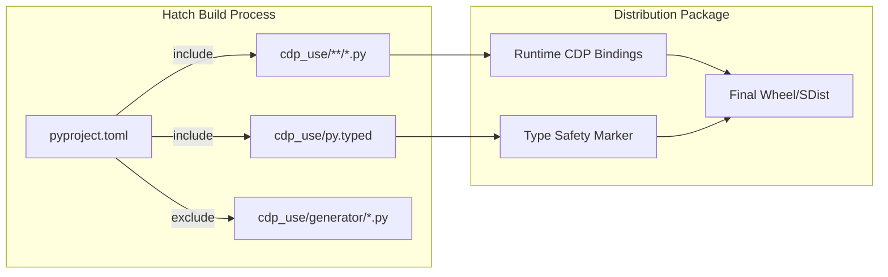

<!-- source: DeepWiki mcp.deepwiki.com · repo browser-use/cdp-use · page 1.2 Dependencies and Environment · fetched 2026-10-30 -->

# Dependencies and Environment

Relevant source files

The following files were used as context for generating this wiki page:

- [.github/workflows/lint.yml](.github/workflows/lint.yml)
- [LICENSE](LICENSE)
- [cdp_use/py.typed](cdp_use/py.typed)
- [pyproject.toml](pyproject.toml)
- [uv.lock](uv.lock)

This document details the runtime and development dependencies, Python version requirements, and environment setup for the `cdp-use` library. It covers package management configuration via `uv`, the build system, and the significance of type safety markers for PEP 561 compliance.

## Python Version Requirements

The `cdp-use` library requires Python 3.11 or higher. This requirement is enforced at multiple levels in the project configuration to ensure compatibility with modern typing features and async performance.

| Configuration Level | Requirement | Source |
|-------------------|-------------|---------|
| Project Metadata | `requires-python = ">=3.11"` | [pyproject.toml:7-7]() |
| Dependency Lock | `requires-python = ">=3.11"` | [uv.lock:3-3]() |

The Python 3.11+ requirement enables:
- **Advanced Typing**: Extensive use of `TypedDict` and `NotRequired` for CDP command parameters and event payloads.
- **Async Improvements**: Optimized `asyncio` task groups and improved WebSocket handling.
- **Performance**: Faster startup and execution times for the code generator.

Sources: [pyproject.toml:7-7](), [uv.lock:3-3]()

## Runtime Dependencies

The library maintains a lean set of runtime dependencies to minimize the footprint of browser automation tasks.

### websockets
The `websockets` library is the primary communication channel for the `CDPClient`. It handles the low-level frame management and connection lifecycle with the Chrome DevTools Protocol server.
- **Version**: `>=15.0.1` [pyproject.toml:17-17]()
- **Implementation**: Used in `CDPClient` to establish connections to the browser's debugger URL.

### httpx
Used primarily by the generator and for initial browser discovery (fetching `/json/version`).
- **Version**: `>=0.28.1` [pyproject.toml:15-15]()
- **Implementation**: Provides async HTTP capabilities for retrieving the protocol JSON from the `ChromeDevTools/devtools-protocol` repository.

### typing-extensions
Provides backports for modern typing features (like `TypedDict`, `Annotated`, and `Literal`) to ensure the generated CDP bindings remain type-safe across all supported Python 3.11+ versions.
- **Version**: `>=4.12.2` [pyproject.toml:16-16]()

Sources: [pyproject.toml:14-18](), [uv.lock:34-41](), [uv.lock:103-115]()

## Development Dependencies

Development tools are managed via `dependency-groups` in `pyproject.toml`.

| Tool | Version | Purpose |
|------|---------|---------|
| `ruff` | `>=0.12.2` | Linting and formatting of handwritten and generated code. |
| `build` | `>=1.2.2.post1` | PEP 517 package building. |
| `anyio` | `4.9.0` | Asynchronous compatibility layer used by `httpx`. |

### Ruff Configuration
The project uses `ruff` for strict linting. Specific rules are ignored for the `cdp_use/cdp/` directory because the auto-generated code intentionally uses wildcard imports to simplify the domain-based API.
- **Wildcard Import Ignore**: `F403` [pyproject.toml:43-43]()
- **Redefinition Ignore**: `F811` [pyproject.toml:43-43]()

Sources: [pyproject.toml:27-29](), [pyproject.toml:34-44](), [uv.lock:5-17]()

## Build System and PEP 561 Compliance

The project utilizes `hatchling` as the build backend and follows PEP 561 for distributing type information.

### py.typed Marker
The file `cdp_use/py.typed` is an empty marker file that signals to static type checkers (like Mypy or Pyright) that the package provides inline type hints.
- **Location**: `cdp_use/py.typed` [cdp_use/py.typed:1-1]()
- **Inclusion**: Explicitly included in the build distribution [pyproject.toml:31-31]().

### Hatchling Build Configuration
The build process separates the runtime library from the code generation tools.

- **Build Backend**: `hatchling.build` [pyproject.toml:25-25]()
- **Exclusion Logic**: The generator scripts are excluded from the final package to keep the installation lightweight for end-users [pyproject.toml:32-32]().

Sources: [pyproject.toml:23-25](), [pyproject.toml:30-32](), [cdp_use/py.typed:1-1]()

## Dependency Management with uv

The project uses `uv` for reproducible environments. The `uv.lock` file ensures that all developers and CI pipelines use the exact same versions of dependencies, including transitive ones like `anyio` and `idna`.

### CI Workflow
The GitHub Actions pipeline utilizes `astral-sh/setup-uv` to verify the environment:
1. **lint-syntax**: Runs `ruff check` to catch Python syntax errors [lint.yml:15-23]().
2. **lint-style**: Runs full `ruff` linting [lint.yml:25-33]().
3. **import-check**: Verifies the environment by attempting to import `CDPClient` [lint.yml:35-43]().

Sources: [uv.lock:1-17](), [.github/workflows/lint.yml:1-44]()

---

