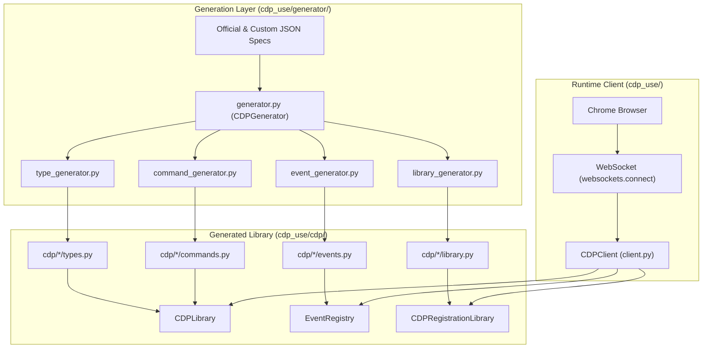
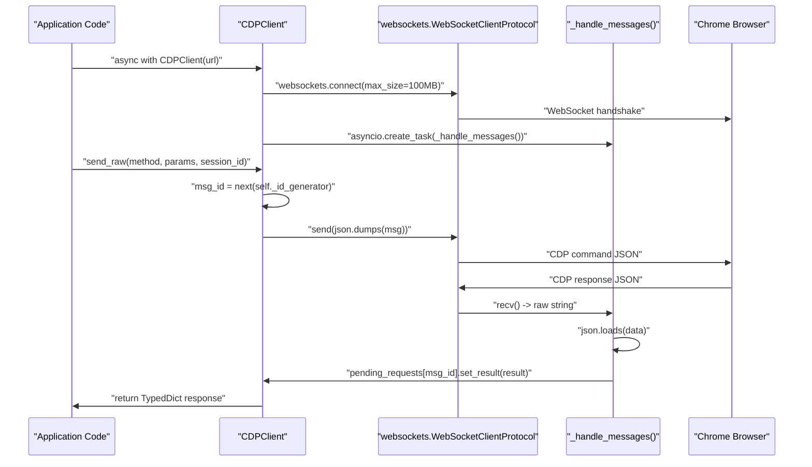
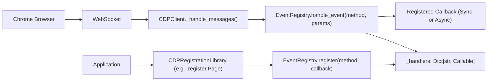

<!-- source: DeepWiki mcp.deepwiki.com · repo browser-use/cdp-use · page 2 Architecture · fetched 2026-10-30 -->

# Architecture

Relevant source files

The following files were used as context for generating this wiki page:

- [README.md](README.md)
- [Taskfile.yml](Taskfile.yml)
- [cdp_use/cdp/registry.py](cdp_use/cdp/registry.py)
- [cdp_use/client.py](cdp_use/client.py)
- [cdp_use/custom_protocols/browseruse.json](cdp_use/custom_protocols/browseruse.json)
- [cdp_use/generator/registry_generator.py](cdp_use/generator/registry_generator.py)

This document describes the high-level technical architecture of the `cdp-use` library, including the WebSocket-based CDP client system and the automated code generation pipeline that creates type-safe Python bindings from Chrome DevTools Protocol specifications.

For specific implementation details of individual components, see [CDPClient System](#2.1), [Code Generation Pipeline](#2.2), [Type Safety System](#2.3), and [Generated Library Architecture](#2.4).

## System Overview

`cdp-use` implements a two-phase architecture: a build-time code generation phase that produces type-safe Python bindings from CDP specifications, and a runtime client system that uses these bindings to communicate with Chrome via WebSocket.

### Three-Layer Model

The system is organized into three distinct layers:
1.  **The Generator**: A set of modules that ingest CDP JSON protocols (both official and custom) to produce Python source code.
2.  **The Runtime Client**: A handwritten `CDPClient` that manages the low-level `websockets` connection, message IDs, and asynchronous event loops.
3.  **The Generated Library**: A massive collection of over 50 domain-specific modules (e.g., `Page`, `DOM`, `Network`) that provide the type-safe API for commands and events.

Sources: [cdp_use/generator/generator.py:10-35](), [cdp_use/client.py:217-236](), [cdp_use/cdp/registry.py:14-18]()

## Core Components

The architecture consists of four primary components that work together to provide type-safe CDP communication:

| Component | Purpose | Key Classes |
|-----------|---------|-------------|
| **CDPClient** | WebSocket communication and session management | `CDPClient`, `WebSocketLogFilter` |
| **EventRegistry** | Centralized asynchronous CDP event dispatching | `EventRegistry` |
| **Code Generation** | Automated binding generation from JSON protocols | `CDPGenerator`, `TypeGenerator`, `LibraryGenerator` |
| **Generated Library** | Domain-specific proxies for commands and events | `CDPLibrary`, `CDPRegistrationLibrary` |

### CDPClient Communication Architecture

The `CDPClient` manages the lifecycle of the connection and correlates requests to responses using a `pending_requests` map. It uses an internal `_handle_messages` loop to process incoming data from the WebSocket.

Sources: [cdp_use/client.py:287-347](), [cdp_use/client.py:349-378](), [cdp_use/client.py:408-435]()

### Event System Architecture

The event handling system uses a registry pattern to dispatch CDP events. When `_handle_messages` detects a message with a `method` but no `id`, it is treated as an event and routed to the `EventRegistry`.

The `EventRegistry` supports both synchronous and asynchronous callback functions, detecting the function type using `inspect.isawaitable()` to ensure proper execution within the `asyncio` loop.

Sources: [cdp_use/cdp/registry.py:18-34](), [cdp_use/cdp/registry.py:46-73](), [cdp_use/client.py:314-328]()

## Code Generation Pipeline

The generation system transforms CDP JSON specifications into type-safe Python code. It supports both the official DevTools protocol and custom additions, such as the `BrowserUse` domain.

- **Input**: Remote JSON from `ChromeDevTools/devtools-protocol` and local files in `cdp_use/custom_protocols/`.
- **Process**: The `CDPGenerator` iterates through every domain, invoking specialized generators for types, commands, and events.
- **Output**: A structured directory in `cdp_use/cdp/` where each domain has its own package containing `types.py`, `commands.py`, `events.py`, and `library.py`.

For details on the generation stages, see [Code Generation Pipeline](#2.2).

Sources: [cdp_use/generator/generator.py:100-139](), [cdp_use/custom_protocols/browseruse.json:1-5]()

## Type Safety Strategy

The library achieves compile-time type safety by mapping CDP's JSON schema directly to Python `TypedDict` classes. This provides:
- **IntelliSense**: Autocompletion for command parameters and event payloads.
- **Static Analysis**: `mypy` or `pyright` can validate that required fields are present and types match (e.g., `targetId` must be a string).
- **Documentation**: The generated types serve as inline documentation for the protocol.

For details on how types are mapped, see [Type Safety System](#2.3).

Sources: [cdp_use/generator/type_generator.py:12-45](), [README.md:53-68]()

## Debugging and Logging

A unique aspect of the architecture is the `WebSocketLogFilter`. It intercepts raw `websockets.client` logs and uses regex to transform them into human-readable CDP summaries, including PING/PONG latency monitoring and automatic truncation of large payloads.

Sources: [cdp_use/client.py:20-110](), [cdp_use/client.py:114-185]()

---

