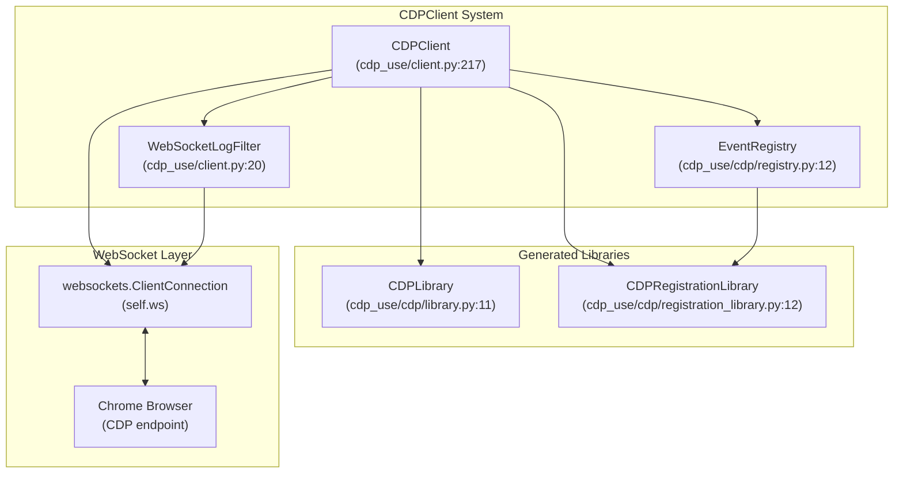
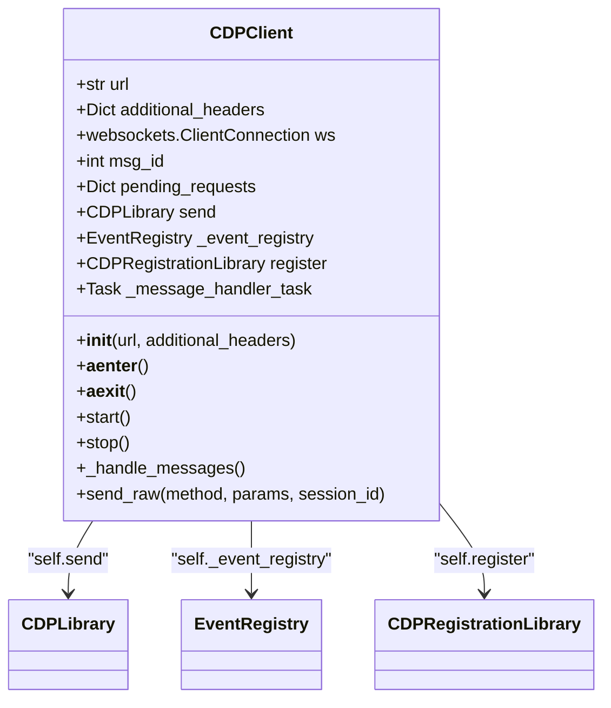
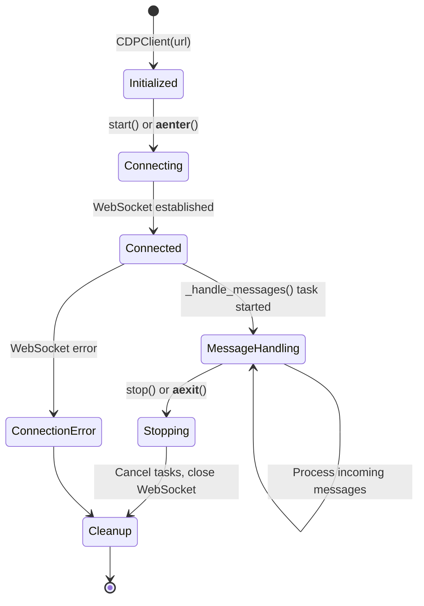
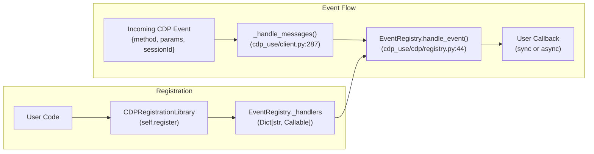
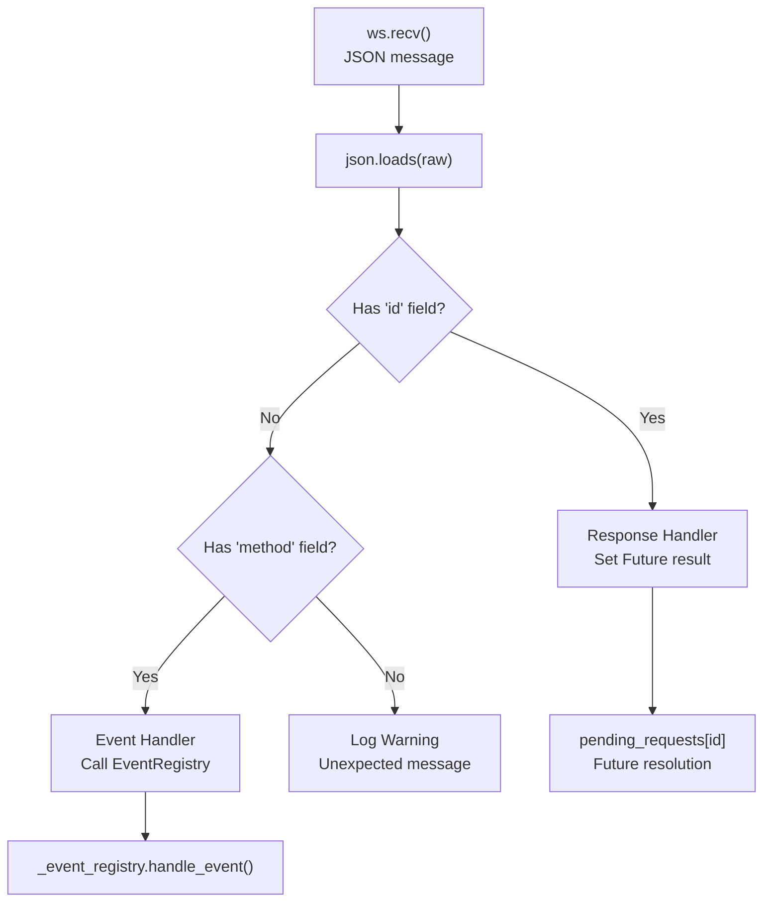
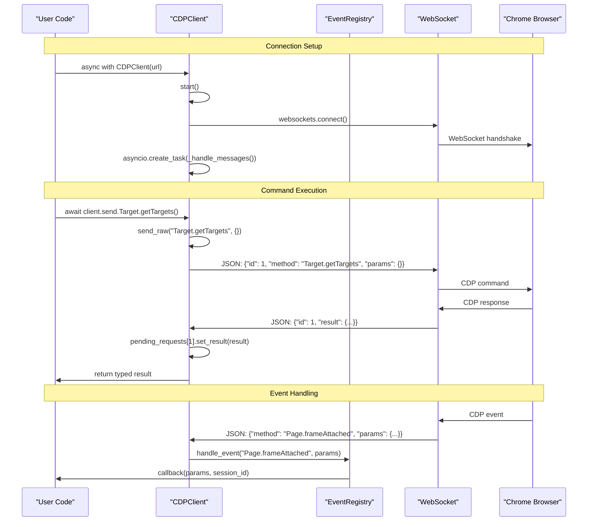
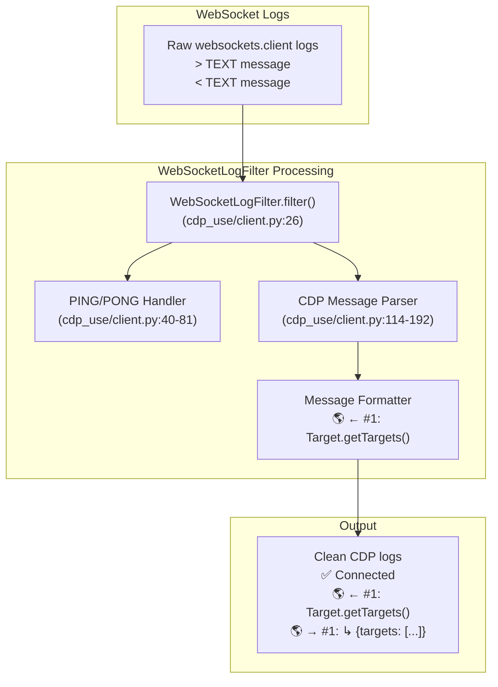
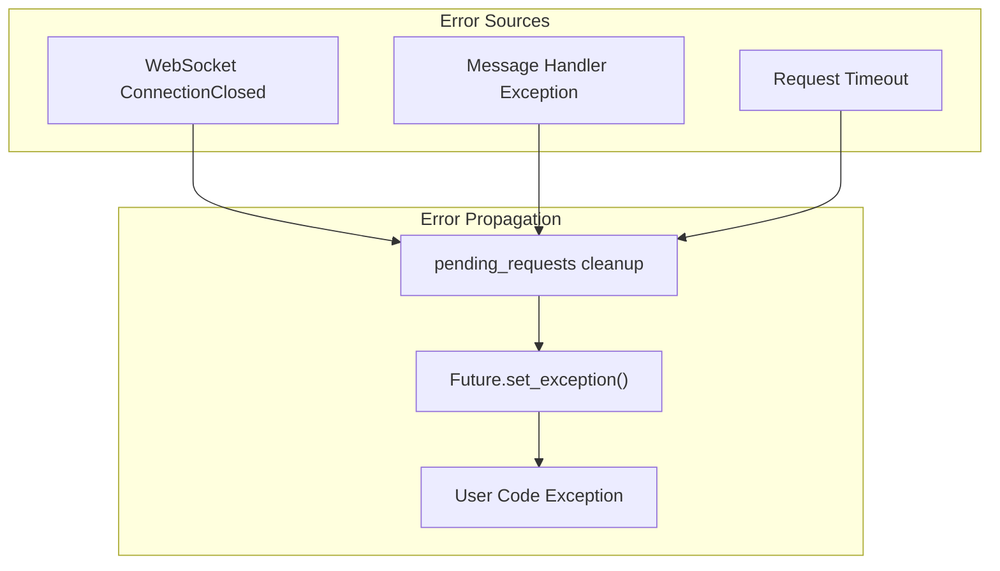

<!-- source: DeepWiki mcp.deepwiki.com · repo browser-use/cdp-use · page 2.1 CDPClient System · fetched 2026-10-30 -->

# CDPClient System

Relevant source files

The following files were used as context for generating this wiki page:

- [.github/workflows/lint.yml](.github/workflows/lint.yml)
- [.python-version](.python-version)
- [LICENSE](LICENSE)
- [cdp_use/__init__.py](cdp_use/__init__.py)
- [cdp_use/client.py](cdp_use/client.py)

This document covers the core WebSocket-based CDP client architecture, including the main `CDPClient` class, event handling through `EventRegistry`, and the communication infrastructure that enables type-safe Chrome DevTools Protocol interactions. 

## Core Components Overview

The CDPClient system consists of three main components that work together to provide a robust WebSocket-based CDP client:

Sources: [cdp_use/client.py:217-237](), [cdp_use/cdp/registry.py:12-16]()

## CDPClient Class Architecture

The `CDPClient` class serves as the main entry point and orchestrates all WebSocket communication with Chrome. It implements the async context manager pattern and manages the lifecycle of connections and message handling.

### Core Attributes and Initialization

The client initializes three key components during construction [cdp_use/client.py:227-236]():
- `self.send`: A `CDPLibrary` instance providing type-safe command methods.
- `self._event_registry`: An `EventRegistry` for handling incoming CDP events.
- `self.register`: A `CDPRegistrationLibrary` for registering event callbacks.

Sources: [cdp_use/client.py:217-236]()

### Connection Lifecycle Management

The client supports both explicit lifecycle management and async context manager usage:

The `start()` method [cdp_use/client.py:251-263]() establishes the WebSocket connection with a 100MB message size limit (`max_size=100 * 1024 * 1024`) and starts the message handling task. The `stop()` method [cdp_use/client.py:265-285]() gracefully shuts down by canceling the background task and closing the connection.

Sources: [cdp_use/client.py:238-285]()

## Event Handling Architecture

The event handling system is built around the `EventRegistry` class, which manages callbacks for CDP events and supports both synchronous and asynchronous handlers.

### EventRegistry Implementation

The `EventRegistry` class [cdp_use/cdp/registry.py:12-88]() provides:
- `register(method, callback)`: Register event handlers [cdp_use/cdp/registry.py:18-25]().
- `handle_event(method, params, session_id)`: Dispatch events to registered handlers [cdp_use/cdp/registry.py:44-78]().
- Support for both sync and async callbacks via `inspect.isawaitable` introspection [cdp_use/cdp/registry.py:67-73]().

Sources: [cdp_use/client.py:314-328](), [cdp_use/cdp/registry.py:44-78]()

### Message Processing Flow

The client processes three types of incoming messages in the `_handle_messages` loop [cdp_use/client.py:287-347]():

Sources: [cdp_use/client.py:287-347]()

## WebSocket Communication Flow

The following sequence diagram shows a typical CDP interaction cycle:

The client maintains request/response correlation through the `pending_requests` dictionary [cdp_use/client.py:223](), which maps message IDs to `asyncio.Future` objects that resolve when responses arrive [cdp_use/client.py:297-312]().

Sources: [cdp_use/client.py:349-378](), [cdp_use/client.py:297-312]()

## Logging and Monitoring

The `WebSocketLogFilter` class [cdp_use/client.py:20-211]() provides sophisticated logging for WebSocket communication, transforming raw `websockets` library logs into readable CDP message traces.

### WebSocket Log Processing

Key features of the logging system:
- **PING/PONG tracking**: Measures WebSocket ping latency and detects timeouts (>3s) [cdp_use/client.py:40-81]().
- **CDP message parsing**: Extracts method names, IDs, and parameters from JSON messages using regex [cdp_use/client.py:131-154]().
- **Direction indicators**: Uses emoji (🌎 ← for outgoing, 🌎 → for incoming) [cdp_use/client.py:150-152]().
- **Size filtering**: Shows message sizes only for large payloads (>5KB) [cdp_use/client.py:122-123]().
- **Result truncation**: Truncates long responses (>200 chars) to prevent log spam [cdp_use/client.py:172-173]().

Sources: [cdp_use/client.py:19-214]()

## Error Handling and Resilience

The client implements comprehensive error handling across multiple layers:

### Connection Error Handling

The message handler [cdp_use/client.py:334-347]() catches WebSocket connection errors and ensures all `pending_requests` are resolved with appropriate exceptions, preventing resource leaks and hanging awaits. If the browser returns an error field in the CDP response, the client raises a `RuntimeError` with the error details [cdp_use/client.py:309-311]().

Sources: [cdp_use/client.py:334-347](), [cdp_use/client.py:309-311](), [cdp_use/client.py:276-280]()

---

