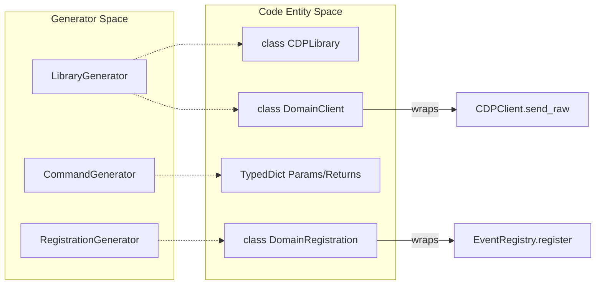

<!-- source: DeepWiki mcp.deepwiki.com · repo browser-use/cdp-use · page 2.2 Code Generation Pipeline · fetched 2026-10-30 -->

# Code Generation Pipeline

<details>
<summary>Relevant source files</summary>

The following files were used as context for generating this wiki page:

- [README.md](README.md)
- [Taskfile.yml](Taskfile.yml)
- [cdp_use/custom_protocols/browseruse.json](cdp_use/custom_protocols/browseruse.json)
- [cdp_use/generator/__init__.py](cdp_use/generator/__init__.py)
- [cdp_use/generator/__main__.py](cdp_use/generator/__main__.py)
- [cdp_use/generator/constants.py](cdp_use/generator/constants.py)
- [cdp_use/generator/generate.py](cdp_use/generator/generate.py)
- [cdp_use/generator/generator.py](cdp_use/generator/generator.py)
- [cdp_use/generator/library_generator.py](cdp_use/generator/library_generator.py)

</details>


The Code Generation Pipeline is the core mechanism that transforms Chrome DevTools Protocol (CDP) specifications into type-safe Python bindings. This system automatically downloads official CDP protocol definitions, merges them with custom protocol extensions, and generates complete Python client libraries with full type safety, IntelliSense support, and domain-specific organization.

## Generation Process Overview

The generation pipeline follows a structured workflow that ensures consistency and type safety across all generated CDP domains. It is designed to be idempotent and easily reproducible.

### Pipeline Entry Point

The generation process is initiated through the main generator module. It can be invoked via the `Taskfile.yml` or directly using the Python module syntax:

```bash
# Using Taskfile (recommended)
task generate

# Or directly via python
python -m cdp_use.generator
```

Sources: [Taskfile.yml:4-7](), [README.md:24-28](), [cdp_use/generator/__main__.py:1-6]()

### Generation Workflow

The `CDPGenerator` class orchestrates the data flow from raw JSON specifications to formatted Python source files.

```mermaid
graph TB
    subgraph "Input Phase"
        A["`cdp_use.generator.generate.main`"] --> B["`download_protocol_files()`"]
        B --> C["`js_protocol.json` & `browser_protocol.json`"]
        A --> D["Scan `cdp_use/custom_protocols/*.json`"]
    end
    
    subgraph "Processing Phase"
        C & D --> E["`CDPGenerator.load_protocols()`"]
        E --> F["Merged Protocol Dictionary"]
        F --> G["`CDPGenerator.generate_all()`"]
    end
    
    subgraph "Generation Phase"
        G --> H["`TypeGenerator`"]
        G --> I["`CommandGenerator`"]
        G --> J["`EventGenerator`"]
        G --> K["`LibraryGenerator`"]
        G --> L["`RegistrationGenerator`"]
    end
    
    subgraph "Output Phase"
        H & I & J & K & L --> M["Write to `cdp_use/cdp/`"]
        M --> N["`ruff` format & fix"]
    end
```

Sources: [cdp_use/generator/generate.py:39-58](), [cdp_use/generator/generator.py:100-138](), [cdp_use/generator/generator.py:41-68]()

## Input Sources

The generator pulls from three primary sources to create the final unified API:

1.  **Remote JS Protocol**: Fetched from `ChromeDevTools/devtools-protocol` repository, covering V8-specific domains. [cdp_use/generator/constants.py:33-36]()
2.  **Remote Browser Protocol**: Fetched from the same repository, covering browser-level domains like `Page`, `Network`, and `DOM`. [cdp_use/generator/constants.py:28-31]()
3.  **Local Custom Protocols**: Any JSON files found in `cdp_use/custom_protocols/` are merged. This allows adding non-standard events like `BrowserUse.captchaSolverStarted`. [cdp_use/generator/generate.py:45-52](), [cdp_use/custom_protocols/browseruse.json:1-92]()

The protocol is pinned to a specific Chromium revision (e.g., `144.0.7559.109`) to ensure the generated types match the expected browser environment. [cdp_use/generator/constants.py:21-25]()

## Generator Components

The system uses a modular architecture where specific classes handle different parts of the Python code generation.

### Component Mapping

| Component | Class Name | Responsibility |
|-----------|------------|----------------|
| **Core Orchestrator** | `CDPGenerator` | Manages directory lifecycle, merging, and component invocation. [cdp_use/generator/generator.py:22-32]() |
| **Type Engine** | `TypeGenerator` | Maps CDP primitives to Python types and creates `TypedDict` for domain objects. [cdp_use/generator/generator.py:149-151]() |
| **Command Engine** | `CommandGenerator` | Generates `Parameters` and `Returns` `TypedDict` classes for each method. [cdp_use/generator/generator.py:153-155]() |
| **Event Engine** | `EventGenerator` | Generates event payload types used in callbacks. [cdp_use/generator/generator.py:157-159]() |
| **Library Engine** | `LibraryGenerator` | Generates the `DomainClient` classes and the top-level `CDPLibrary`. [cdp_use/generator/library_generator.py:10-15]() |
| **Registration Engine** | `RegistrationGenerator` | Generates type-safe event registration interfaces. [cdp_use/generator/generator.py:172-177]() |

### Code Entity Relationship

This diagram illustrates how the generator classes relate to the final code entities found in the `cdp_use` package.



Sources: [cdp_use/generator/library_generator.py:119-136](), [cdp_use/generator/generator.py:165-182](), [README.md:182-201]()

## Output Structure

The pipeline produces a consistent directory structure under `cdp_use/cdp/`. For every domain (e.g., `Page`, `DOM`), a sub-package is created containing:

*   `types.py`: Domain-specific shared type definitions. [cdp_use/generator/generator.py:150-151]()
*   `commands.py`: `TypedDict` definitions for every command's parameters and return values. [cdp_use/generator/generator.py:154-155]()
*   `events.py`: `TypedDict` definitions for event payloads. [cdp_use/generator/generator.py:158-159]()
*   `library.py`: The `DomainClient` class containing async methods for that domain. [cdp_use/generator/generator.py:169-170]()
*   `registration.py`: The `DomainRegistration` class for attaching event handlers. [cdp_use/generator/generator.py:176-177]()
*   `__init__.py`: Exports the domain's primary interfaces. [cdp_use/generator/generator.py:162-163]()

At the root of the `cdp/` directory, the generator creates the aggregator files:
*   `library.py`: Contains the `CDPLibrary` class which holds instances of all domain clients. [cdp_use/generator/generator.py:181-182]()
*   `registration_library.py`: Contains the `CDPRegistrationLibrary` for all domain events. [cdp_use/generator/generator.py:188-189]()
*   `registry.py`: The central `EventRegistry` implementation. [cdp_use/generator/generator.py:184-186]()

Sources: [README.md:161-175](), [cdp_use/generator/generator.py:140-192]()

## Post-Generation Quality Assurance

After the files are written, the pipeline performs automated cleanup:

1.  **Header Injection**: Every file receives a standard warning header: `# This file is auto-generated...`. [cdp_use/generator/generator.py:33-39]()
2.  **Code Formatting**: The generator invokes `ruff check --fix` and `ruff format` on the output directory to ensure PEP 8 compliance and import sorting. [cdp_use/generator/generator.py:78-98]()
3.  **Type Quote Wrapping**: To prevent circular dependencies and support forward references, types are often wrapped in quotes (e.g., `params: "GetTargetsParameters"`). [cdp_use/generator/library_generator.py:101-116]()

Sources: [cdp_use/generator/generator.py:136-138](), [cdp_use/generator/library_generator.py:145-161]()

---

