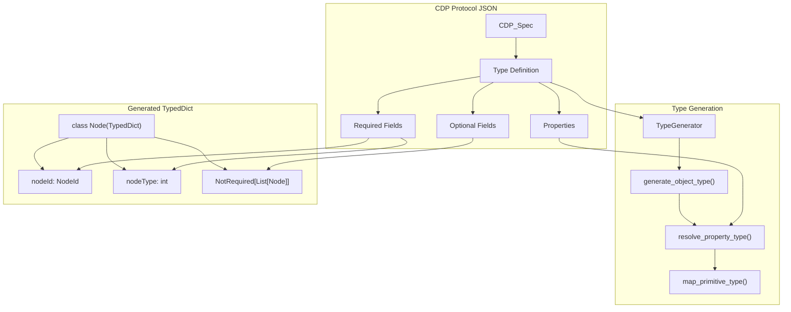
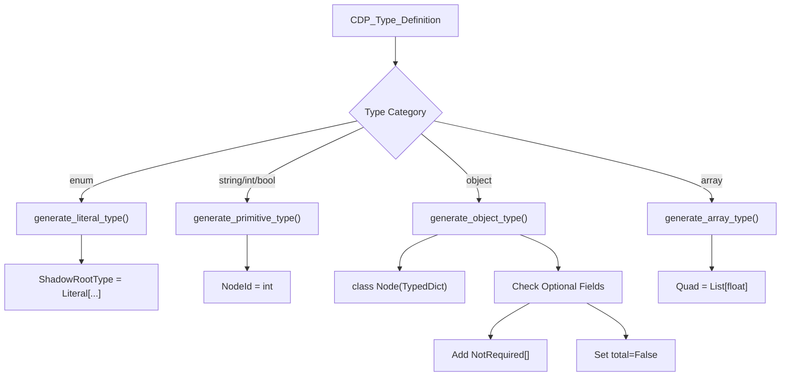
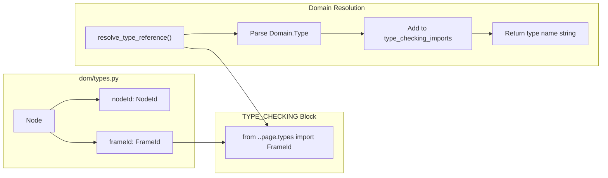

<!-- source: DeepWiki mcp.deepwiki.com · repo browser-use/cdp-use · page 2.3 Type Safety System · fetched 2026-10-30 -->

# Type Safety System

Relevant source files

The following files were used as context for generating this wiki page:

- [cdp_use/cdp/dom/types.py](cdp_use/cdp/dom/types.py)
- [cdp_use/cdp/network/types.py](cdp_use/cdp/network/types.py)
- [cdp_use/generator/command_generator.py](cdp_use/generator/command_generator.py)
- [cdp_use/generator/event_generator.py](cdp_use/generator/event_generator.py)
- [cdp_use/generator/type_generator.py](cdp_use/generator/type_generator.py)
- [cdp_use/py.typed](cdp_use/py.typed)
- [pyproject.toml](pyproject.toml)

This document explains how the `cdp-use` library provides compile-time type safety for Chrome DevTools Protocol interactions through automatically generated `TypedDict` classes and comprehensive type annotations. The type safety system ensures that CDP commands, events, and data structures are properly typed, enabling static analysis tools and IDEs to catch errors before runtime.

The library is PEP 561 compliant, including a `py.typed` marker file to signal to type checkers that it provides inline type hints [cdp_use/py.typed:1-1]().

## TypedDict Foundation

The `cdp-use` library uses Python's `TypedDict` as the foundation for all CDP data structures. The `TypeGenerator` class converts CDP protocol JSON specifications into strongly-typed Python classes that provide both runtime structure validation and static type checking support.

Sources: [cdp_use/generator/type_generator.py:11-12](), [cdp_use/generator/type_generator.py:147-172](), [cdp_use/cdp/dom/types.py:105-128]()

## Type Generation Process

The `TypeGenerator.generate_type_definition()` method transforms CDP definitions into Python structures based on their underlying protocol type [cdp_use/generator/type_generator.py:77-103](). The generator handles different categories of types through specialized methods:

| Type Category | Method | Generated Output |
|---------------|--------|------------------|
| Enum Types | `generate_literal_type()` | `Literal["value1", "value2"]` |
| Primitive Types | `generate_primitive_type()` | Type aliases (`NodeId = int`) |
| Object Types | `generate_object_type()` | `TypedDict` classes |
| Array Types | `generate_array_type()` | `List[ItemType]` aliases |

Sources: [cdp_use/generator/type_generator.py:105-127](), [cdp_use/generator/type_generator.py:129-145](), [cdp_use/generator/type_generator.py:147-204](), [cdp_use/cdp/dom/types.py:16-20](), [cdp_use/cdp/dom/types.py:85-85]()

## Cross-Domain Type References

The type safety system handles references between different CDP domains (e.g., a `DOM.Node` referencing a `Page.FrameId`). The generator creates forward references using `TYPE_CHECKING` imports to avoid circular dependencies at runtime [cdp_use/generator/type_generator.py:61-68]().

The generator distinguishes between same-domain and cross-domain references in `resolve_type_reference`:
- **Same domain**: References the type directly; often requires quoted strings in the generated code to handle forward references within the same file [cdp_use/generator/type_generator.py:197-197]().
- **Cross domain**: Splits the reference (e.g., `Page.FrameId`), lowercases the domain for the module path, and adds it to `type_checking_imports` [cdp_use/generator/type_generator.py:162-171]().

Sources: [cdp_use/generator/type_generator.py:154-175](), [cdp_use/cdp/dom/types.py:11-15]()

## Optional vs Required Fields

The system uses `NotRequired` from `typing-extensions` to distinguish between optional and required fields in `TypedDict` classes [cdp_use/generator/type_generator.py:30-30](). 

1. **Required Fields**: Defined normally within the `TypedDict`.
2. **Optional Fields**: Wrapped in `NotRequired[...]` [cdp_use/generator/type_generator.py:195-195]().
3. **Total=False**: If *all* properties in a definition are optional, the generator uses `total=False` on the class definition instead of individual `NotRequired` wrappers [cdp_use/generator/type_generator.py:169-170]().

This logic is mirrored in `EventGenerator` and `CommandGenerator` for event payloads and command parameters [cdp_use/generator/event_generator.py:108-109](), [cdp_use/generator/command_generator.py:118-119]().

Sources: [cdp_use/generator/type_generator.py:155-172](), [cdp_use/cdp/network/types.py:171-171](), [cdp_use/cdp/dom/types.py:113-113]()

## Primitive Type Mapping

The `map_primitive_type()` method ensures CDP's JSON-based types are correctly represented in Python [cdp_use/generator/type_generator.py:289-299]():

| CDP Type | Python Type | Usage in Codebase |
|----------|-------------|-------------------|
| `string` | `str` | `LoaderId`, `RequestId` |
| `integer` | `int` | `NodeId`, `BackendNodeId` |
| `number` | `float` | `MonotonicTime`, `TimeSinceEpoch` |
| `boolean` | `bool` | `isSVG`, `hasPostData` |
| `any` | `Any` | Generic payloads |
| `object` | `Dict[str, Any]` | `Headers` |

Sources: [cdp_use/generator/type_generator.py:289-299](), [cdp_use/cdp/network/types.py:44-82](), [cdp_use/cdp/dom/types.py:16-20]()

## Static Analysis and IDE Benefits

By using `typing-extensions` and standard library `typing` constructs, the library provides several benefits to developers:

- **Autocompletion**: IDEs like VS Code or PyCharm can suggest keys for `TypedDict` objects when constructing command parameters.
- **Static Validation**: Tools like `mypy` or `pyright` can verify that the response from a CDP command matches the expected `Returns` `TypedDict`.
- **Documentation**: Docstrings from the CDP protocol are preserved and attached to the generated classes and fields [cdp_use/generator/type_generator.py:175-178]().

The `pyproject.toml` ensures these types are packaged correctly by including the `py.typed` marker and the generated `cdp` directory in the build [pyproject.toml:30-31]().

Sources: [pyproject.toml:14-18](), [cdp_use/generator/type_generator.py:37-42](), [cdp_use/cdp/dom/types.py:1-5]()

---

