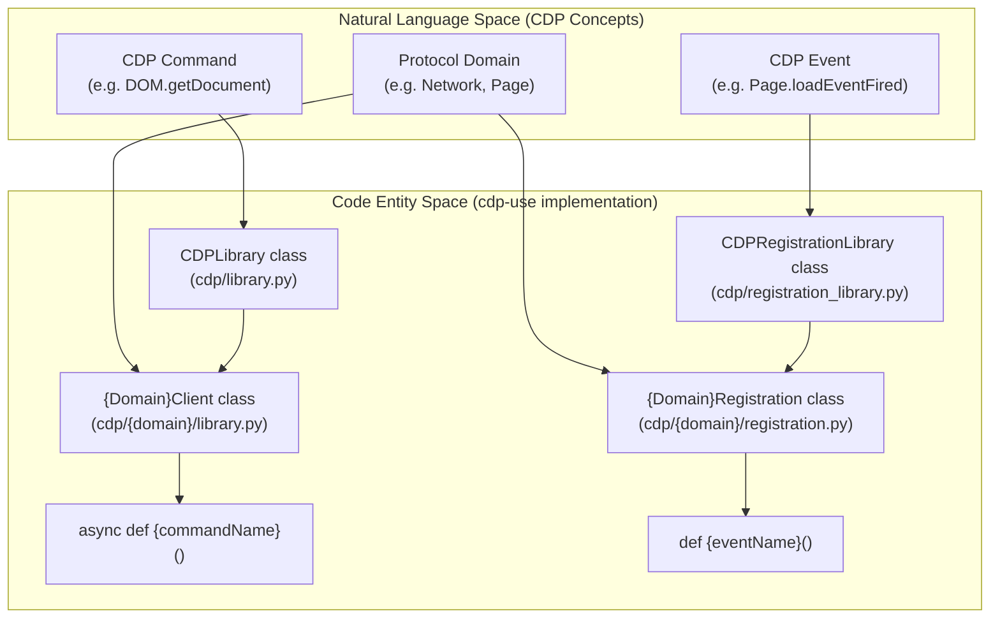
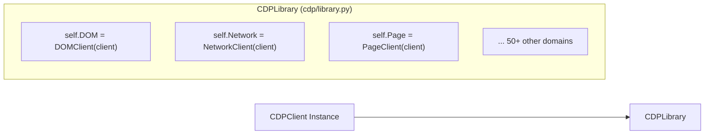
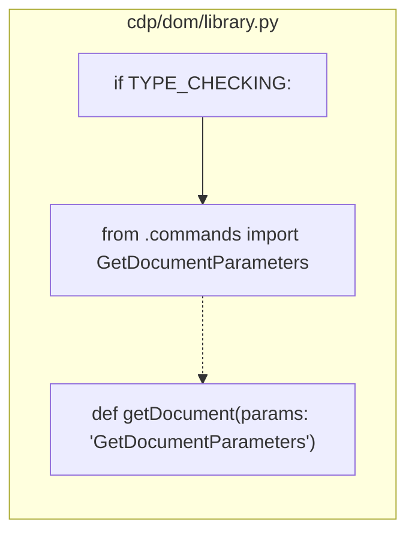

<!-- source: DeepWiki mcp.deepwiki.com · repo browser-use/cdp-use · page 2.4 Generated Library Architecture · fetched 2026-10-30 -->

# Generated Library Architecture

<details>
<summary>Relevant source files</summary>

The following files were used as context for generating this wiki page:

- [cdp_use/cdp/dom/library.py](cdp_use/cdp/dom/library.py)
- [cdp_use/cdp/library.py](cdp_use/cdp/library.py)
- [cdp_use/cdp/network/library.py](cdp_use/cdp/network/library.py)
- [cdp_use/cdp/page/registration.py](cdp_use/cdp/page/registration.py)
- [cdp_use/cdp/registration_library.py](cdp_use/cdp/registration_library.py)

</details>


This document covers the structure and organization of the auto-generated CDP domain libraries that provide type-safe interfaces to Chrome DevTools Protocol commands and events. The generated library transforms CDP's JSON specifications into a hierarchical Python package with domain-specific clients, event registration interfaces, and type definitions.

For information about how these libraries are generated, see [Code Generation Pipeline](#2.2) and [Library Generation](#5.5). For details about the type safety mechanisms used, see [Type Safety System](#2.3).

## Overall Architecture

The generated CDP library follows a hierarchical domain-based structure where each CDP domain becomes a Python subpackage. The system provides two main aggregator classes: `CDPLibrary` for executing commands and `CDPRegistrationLibrary` for subscribing to events.

### Command and Event Flow Architecture

The following diagram bridges the "Natural Language Space" (CDP Concepts) to the "Code Entity Space" (Class and File names).



Sources: [cdp_use/cdp/library.py:13-102](), [cdp_use/cdp/registration_library.py:13-215]()

## Per-Domain File Layout

Each of the 54+ CDP domains is organized into a consistent set of files within its own subpackage (e.g., `cdp_use/cdp/dom/`).

| File | Role | Content Description |
| :--- | :--- | :--- |
| `types.py` | Data Models | `TypedDict` classes for domain-specific objects. |
| `commands.py` | Command I/O | `TypedDict` classes for every command's `Parameters` and `Returns`. |
| `events.py` | Event Data | `TypedDict` classes representing the payload of every domain event. |
| `library.py` | Command Proxy | The `{Domain}Client` class containing async methods for every command. |
| `registration.py`| Event Proxy | The `{Domain}Registration` class for attaching callbacks to domain events. |
| `__init__.py` | Package Init | Exports for the domain subpackage. |

### Domain Client Implementation (`library.py`)

The domain client (e.g., `DOMClient` or `NetworkClient`) acts as a type-safe proxy. It wraps the low-level `CDPClient.send_raw` method, providing IDE autocompletion and static type checking for parameters and return values.

```python
# Example from cdp_use/cdp/dom/library.py:91-110
class DOMClient:
    def __init__(self, client: "CDPClient"):
        self._client = client

    async def collectClassNamesFromSubtree(
        self,
        params: "CollectClassNamesFromSubtreeParameters",
        session_id: Optional[str] = None,
    ) -> "CollectClassNamesFromSubtreeReturns":
        return cast(
            "CollectClassNamesFromSubtreeReturns",
            await self._client.send_raw(
                method="DOM.collectClassNamesFromSubtree",
                params=params,
                session_id=session_id,
            ),
        )
```

Sources: [cdp_use/cdp/dom/library.py:91-110](), [cdp_use/cdp/network/library.py:60-79]()

### Event Registration Implementation (`registration.py`)

The registration class (e.g., `PageRegistration`) provides a named method for every event in the domain. These methods wrap calls to the central `EventRegistry.register` function.

```python
# Example from cdp_use/cdp/page/registration.py:45-63
class PageRegistration:
    def __init__(self, registry: "EventRegistry"):
        self._registry = registry

    def domContentEventFired(
        self,
        callback: Callable[["DomContentEventFiredEvent", Optional[str]], None],
    ) -> None:
        self._registry.register("Page.domContentEventFired", callback)
```

Sources: [cdp_use/cdp/page/registration.py:45-63]()

## Aggregator Classes

To provide a unified developer experience, the library aggregates all domain clients and registration interfaces into two primary classes.

### CDPLibrary

The `CDPLibrary` class is initialized with a `CDPClient`. It uses lazy imports within its `__init__` method to instantiate every domain client (e.g., `self.Console`, `self.DOM`, `self.Network`). This avoids massive startup overhead and circular import issues.



Sources: [cdp_use/cdp/library.py:13-252]()

### CDPRegistrationLibrary

Similarly, the `CDPRegistrationLibrary` aggregates the event registration interfaces. It is initialized with an `EventRegistry` and provides access to domain-specific registration objects.

```python
# Example from cdp_use/cdp/registration_library.py:13-22
class CDPRegistrationLibrary:
    def __init__(self, registry: "EventRegistry"):
        self._registry = registry
        
        from .console.registration import ConsoleRegistration
        self.Console = ConsoleRegistration(registry)
        # ...
```

Sources: [cdp_use/cdp/registration_library.py:13-215]()

## Type Safety and Import Patterns

The generated library uses several patterns to maintain type safety while avoiding circular import issues common in large generated codebases:

### Forward Reference Pattern

The generated code extensively uses string-literal type hints (forward references) and `TYPE_CHECKING` blocks. This allows the Python interpreter to load the modules without immediately resolving all types, which is critical given the deep cross-domain dependencies in the CDP protocol.



### Type Casting

Because the underlying transport (`CDPClient.send_raw`) returns generic `Dict[str, Any]` objects from the WebSocket, the generated methods use `typing.cast` to assert the specific `Returns` TypedDict expected for that command.

Sources: [cdp_use/cdp/dom/library.py:7-12](), [cdp_use/cdp/dom/library.py:103-110](), [cdp_use/cdp/network/library.py:7-12]()

---

