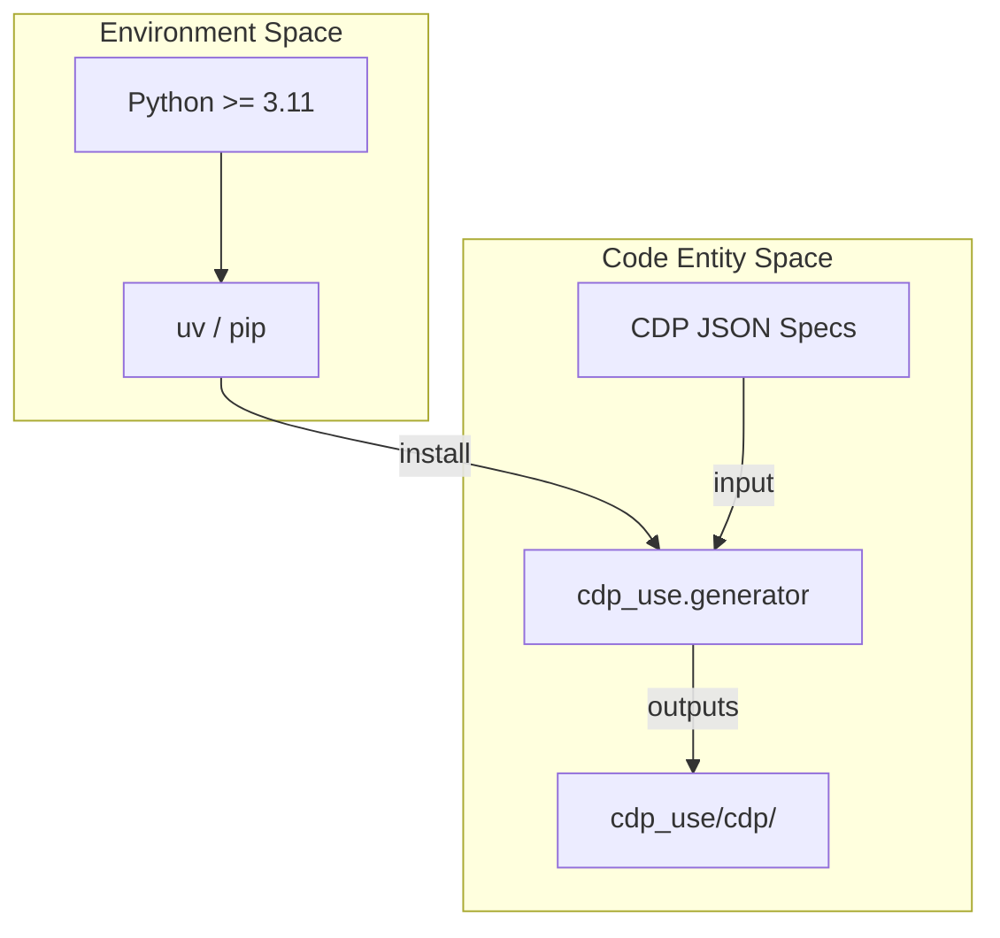
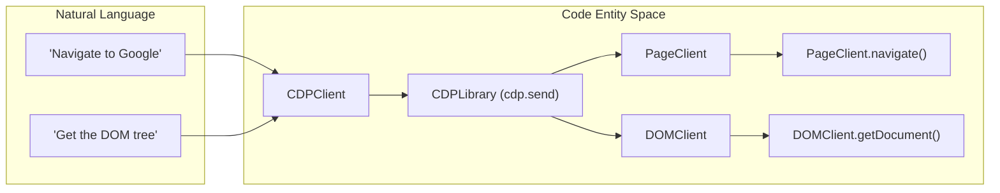
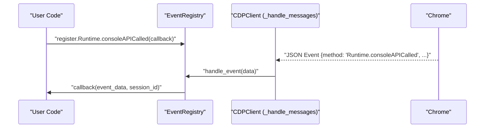

<!-- source: DeepWiki mcp.deepwiki.com · repo browser-use/cdp-use · page 3 Getting Started · fetched 2026-10-30 -->

# Getting Started

<details>
<summary>Relevant source files</summary>

The following files were used as context for generating this wiki page:

- [README.md](README.md)
- [Taskfile.yml](Taskfile.yml)
- [cdp_use/custom_protocols/browseruse.json](cdp_use/custom_protocols/browseruse.json)
- [simple.py](simple.py)

</details>


This document provides a practical guide to installing and using the `cdp-use` library. It covers the user journey from installation through the first type-safe CDP command, linking to child pages for deep dives into setup, basic examples, and advanced patterns.

## Installation and Setup

The `cdp-use` library requires Python 3.11 or higher. It is designed to work seamlessly with modern Python tooling like `uv` or standard `pip`.

### Quick Install
```bash
# Clone the repository
git clone https://github.com/browser-use/cdp-use
cd cdp-use

# Install dependencies using uv (recommended)
uv sync

# Or using pip
pip install -r requirements.txt
```

### Initial Code Generation
Before first use, you must generate the type-safe bindings from the protocol specifications:
```bash
python -m cdp_use.generator
```
This command downloads the latest protocol JSON and populates the `cdp_use/cdp/` directory with domain-specific modules.

For detailed environment requirements and connection verification (such as checking the `/json/version` endpoint), see **[Installation and Setup](#3.1)**.

**Installation & Generation Flow**

Sources: [README.md:14-30](), [pyproject.toml:6-10](), [Taskfile.yml:4-7]()

## Basic Usage

The library provides a high-level `CDPClient` that manages the WebSocket connection and provides access to the generated `CDPLibrary`.

### Discovery and Connection
A common pattern involves discovering the browser's WebSocket URL via an HTTP request before initializing the client.

```python
async with httpx.AsyncClient() as client:
    version_info = await client.get("http://localhost:9222/json/version")
    browser_ws_url = version_info.json()["webSocketDebuggerUrl"]

async with CDPClient(browser_ws_url) as cdp:
    # Use cdp.send to call commands
    targets = await cdp.send.Target.getTargets()
```

### Core Workflow
1.  **Connect**: Establish a session via `CDPClient` context manager.
2.  **Discover**: Use `Target.getTargets` to find available pages.
3.  **Attach**: Create a session for a specific page using `Target.attachToTarget`.
4.  **Execute**: Enable domains (e.g., `DOM.enable`) and run commands (e.g., `Page.navigate`).

For a walkthrough of `simple.py` and `examples/basic.py`, see **[Basic Usage Examples](#3.2)**.

**Command Execution Bridge**

Sources: [simple.py:15-51](), [README.md:34-51]()

## Advanced Patterns

Once basic connectivity is established, `cdp-use` supports complex automation scenarios.

### Event Handling
Events are handled through the `cdp.register` interface. You can define typed callbacks for events like `ConsoleAPICalledEvent` or `FrameAttachedEvent`.

```python
def on_console(event: ConsoleAPICalledEvent, session_id: Optional[str]):
    print(f"Browser console: {event['args']}")

client.register.Runtime.consoleAPICalled(on_console)
```

### Concurrency and Sessions
The client supports `asyncio.gather` for firing multiple CDP commands simultaneously. It also manages `session_id` routing, allowing a single WebSocket connection to control multiple browser tabs or frames independently.

For details on event registration, synthetic event injection (`emit_event`), and multi-session management, see **[Advanced Usage Patterns](#3.3)**.

**Event & Session Interaction**

Sources: [README.md:70-106](), [simple.py:60-68](), [cdp_use/custom_protocols/browseruse.json:1-92]()

## Summary of Capabilities

| Feature | Code Entity | Description |
| :--- | :--- | :--- |
| **Command Execution** | `cdp.send` | Entry point for all 50+ CDP domains. |
| **Event Registration** | `cdp.register` | Type-safe subscription to browser events. |
| **Session Routing** | `session_id` | Param in commands to target specific tabs/frames. |
| **Custom Protocols** | `cdp_use/custom_protocols/` | Support for non-standard automation events. |

Sources: [README.md:159-201](), [simple.py:36-55]()

---

