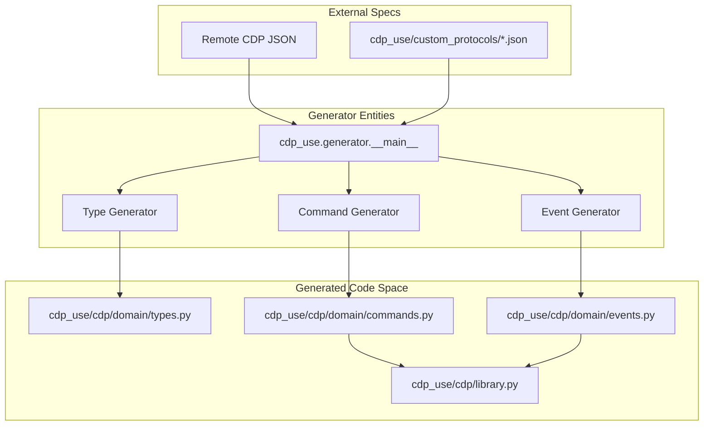
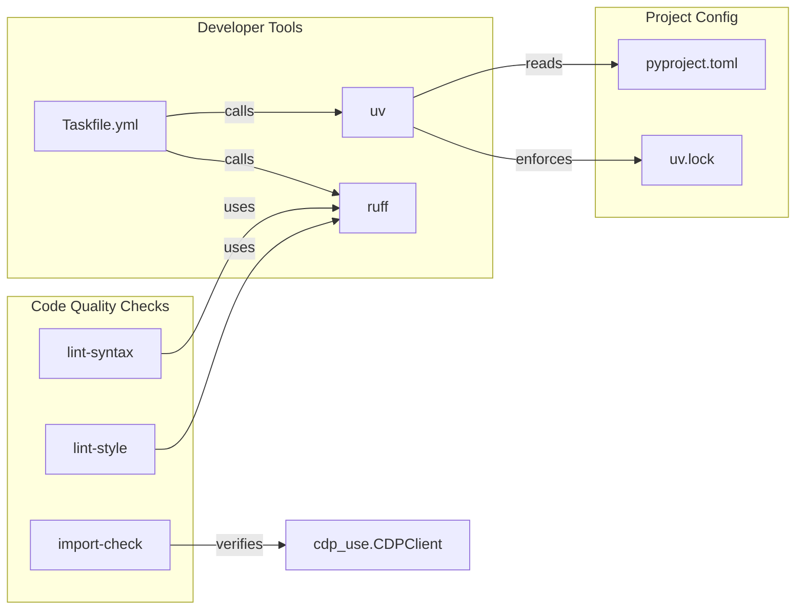

<!-- source: DeepWiki mcp.deepwiki.com · repo browser-use/cdp-use · page 3.1 Installation and Setup · fetched 2026-10-30 -->

# Installation and Setup

<details>
<summary>Relevant source files</summary>

The following files were used as context for generating this wiki page:

- [.github/workflows/lint.yml](.github/workflows/lint.yml)
- [LICENSE](LICENSE)
- [README.md](README.md)
- [Taskfile.yml](Taskfile.yml)
- [cdp_use/custom_protocols/browseruse.json](cdp_use/custom_protocols/browseruse.json)
- [pyproject.toml](pyproject.toml)
- [uv.lock](uv.lock)

</details>


This document provides a technical guide for installing the `cdp-use` library and configuring a development environment. It covers Python requirements, dependency management using `uv` or `pip`, starting Chrome with remote debugging, and verifying connectivity.

## Prerequisites

The `cdp-use` library targets modern Python environments to leverage advanced type hinting and asynchronous features.

| Requirement | Specification | Purpose |
|:---|:---|:---|
| **Python** | `>=3.11` | Required for `TypedDict` enhancements and modern `asyncio` [pyproject.toml:7-7](). |
| **Browser** | Chrome / Chromium | Target for the Chrome DevTools Protocol (CDP) [README.md:3-3](). |
| **Package Manager** | `uv` (recommended) or `pip` | For dependency resolution and environment sync [README.md:21-21](). |

Sources: [pyproject.toml:7-7](), [uv.lock:3-3](), [README.md:3-3]()

## Installation

### Using uv (Recommended)
`uv` is the preferred tool for managing `cdp-use` as it respects the `uv.lock` file for reproducible builds [uv.lock:1-2]().

```bash
git clone https://github.com/browser-use/cdp-use
cd cdp-use
uv sync
```

### Using pip
For standard environments, install the library and its core dependencies:

```bash
pip install .
```

### Runtime Dependencies
The following core libraries are required for the client to function:
*   `websockets>=15.0.1`: Handles the low-level bi-directional communication with the browser [pyproject.toml:17-17]().
*   `httpx>=0.28.1`: Used for browser discovery and fetching protocol definitions [pyproject.toml:15-15]().
*   `typing-extensions>=4.12.2`: Provides backports for advanced type safety features [pyproject.toml:16-16]().

Sources: [pyproject.toml:14-18](), [uv.lock:34-41](), [README.md:21-21]()

## Browser Configuration

To use `cdp-use`, you must launch Chrome with the Remote Debugging Port enabled. This opens a WebSocket server that the `CDPClient` connects to.

### Starting Chrome
Launch Chrome from the command line with the `--remote-debugging-port` flag:

```bash
# macOS
/Applications/Google\ Chrome.app/Contents/MacOS/Google\ Chrome --remote-debugging-port=9222

# Linux
google-chrome --remote-debugging-port=9222

# Windows
start chrome.exe --remote-debugging-port=9222
```

### Verifying Connectivity
Once Chrome is running, verify the CDP endpoint is active by visiting `http://localhost:9222/json/version` in your browser or using `curl`:

```bash
curl http://localhost:9222/json/version
```

Look for the `webSocketDebuggerUrl` field in the JSON response. This URL is required to initialize the `CDPClient` [README.md:42-42]().

Sources: [README.md:40-42]()

## Code Generation Setup

Because `cdp-use` provides type-safe bindings generated from the protocol, you must run the generator after installation to create the domain-specific modules (e.g., `Page`, `DOM`, `Runtime`).

### Running the Generator
The generator fetches the latest CDP specifications and builds the Python package structure in `cdp_use/cdp/` [README.md:162-175]().

```bash
# Using the Taskfile
task generate

# Or via python module
python -m cdp_use.generator
```

### Generator Logic Flow
The following diagram illustrates how the generator transforms protocol definitions into the code entity space.

Title: Code Generation Data Flow


Sources: [README.md:24-30](), [Taskfile.yml:4-7](), [cdp_use/custom_protocols/browseruse.json:1-4](), [README.md:162-175]()

## Development Environment

For contributors, the environment includes linting and formatting tools to maintain code quality.

### Development Dependencies
Install the `dev` group defined in `pyproject.toml`:
*   `ruff>=0.12.2`: Used for both linting and formatting [pyproject.toml:28-28]().
*   `build>=1.2.2.post1`: For creating distribution packages [pyproject.toml:28-28]().

### CI and Linting
The project uses `ruff` to enforce code style. Specific rules are applied to ignore wildcard imports in generated code [pyproject.toml:41-43]().

```bash
# Run linter
task lint

# Format code
task format
```

Title: Development Workflow and Code Entities


Sources: [pyproject.toml:27-32](), [Taskfile.yml:19-28](), [.github/workflows/lint.yml:15-43](), [uv.lock:43-60]()

---

