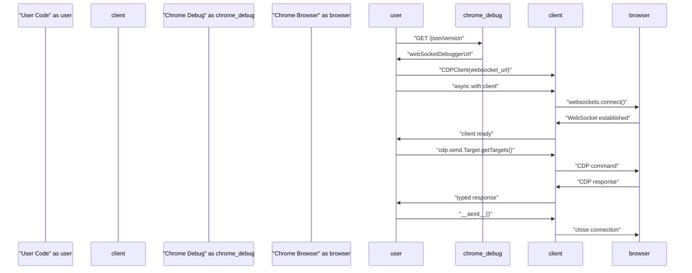
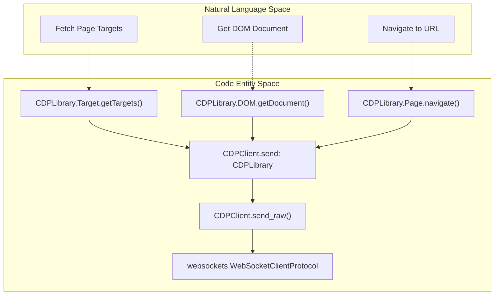
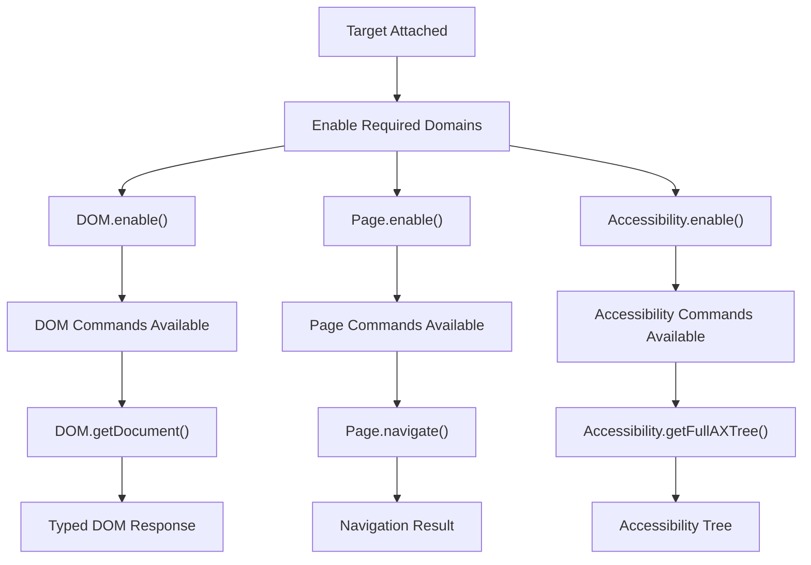
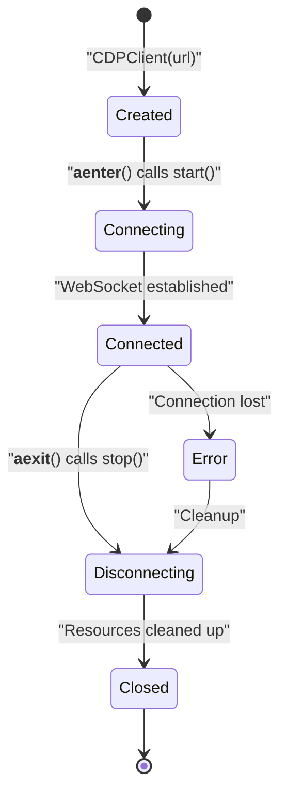

<!-- source: DeepWiki mcp.deepwiki.com · repo browser-use/cdp-use · page 3.2 Basic Usage Examples · fetched 2026-10-30 -->

# Basic Usage Examples

<details>
<summary>Relevant source files</summary>

The following files were used as context for generating this wiki page:

- [README.md](README.md)
- [Taskfile.yml](Taskfile.yml)
- [cdp_use/client.py](cdp_use/client.py)
- [cdp_use/custom_protocols/browseruse.json](cdp_use/custom_protocols/browseruse.json)
- [simple.py](simple.py)

</details>


This document demonstrates fundamental usage patterns for the `cdp-use` library, showing how to establish WebSocket connections to Chrome DevTools and execute basic CDP commands with full type safety. These examples walk through the implementation details found in `simple.py` and the core `CDPClient` runtime.

For installation and environment setup, see [Installation and Setup](#3.1). For more complex patterns including advanced event handling and concurrent operations, see [Advanced Usage Patterns](#3.3).

## Connection and Basic Commands

The most basic usage pattern involves creating a `CDPClient` instance and using it as an async context manager to ensure proper connection lifecycle management.

### WebSocket Connection Flow

The following diagram illustrates the handshake and command flow between the user code, the `CDPClient`, and the browser.



Sources: [simple.py:15-23](), [cdp_use/client.py:238-245]()

### Basic Connection Example

The fundamental pattern starts with obtaining Chrome's WebSocket endpoint (typically via the `/json/version` HTTP endpoint) and establishing a connection:

```python
# Get Chrome's WebSocket debugging URL
async with httpx.AsyncClient() as client:
    version_info = await client.get("http://localhost:9222/json/version")
    browser_ws_url = version_info.json()["webSocketDebuggerUrl"]

# Connect and execute commands
async with CDPClient(browser_ws_url) as cdp:
    # Type-safe command execution
    targets_result = await cdp.send.Target.getTargets()
    print("Available targets:", targets_result["targetInfos"])
```

The `CDPClient` constructor accepts the WebSocket URL and optional additional headers [cdp_use/client.py:218-221](). The async context manager pattern ensures proper connection setup in `__aenter__` [cdp_use/client.py:238-241]() and cleanup in `__aexit__` [cdp_use/client.py:243-245]().

Sources: [simple.py:16-25](), [cdp_use/client.py:218-245]()

## Type-Safe Command Interface

The library provides a fully type-safe interface through the `send` property, which is an instance of `CDPLibrary` containing generated method signatures for all CDP domains.

### Command Execution Architecture

This diagram bridges the Natural Language "Command" to the specific Code Entities responsible for dispatching them.



Sources: [cdp_use/client.py:228-236](), [simple.py:24-25](), [cdp_use/client.py:349-378]()

### Working with Parameters and Sessions

Many CDP commands require parameters and operate within specific browser sessions. The `send_raw` method handles the internal `msg_id` incrementing and mapping [cdp_use/client.py:360-365]().

```python
async with CDPClient(browser_ws_url) as cdp:
    # Commands with parameters (TypedDict validation)
    attach_result = await cdp.send.Target.attachToTarget(
        params={"targetId": target_id, "flatten": True}
    )
    session_id = attach_result["sessionId"]
    
    # Domain-specific commands with session context
    await cdp.send.DOM.enable(session_id=session_id)
    
    # Navigation with parameters and session
    await cdp.send.Page.navigate(
        params={"url": "https://www.google.com"}, 
        session_id=session_id
    )
```

The `params` parameter accepts a dictionary that matches the generated `TypedDict` for each command. The `session_id` parameter routes commands to specific browser contexts (tabs, iframes, etc.) [cdp_use/client.py:366-370]().

Sources: [simple.py:36-46](), [cdp_use/client.py:349-378]()

## Target and Session Management

Chrome DevTools operates on targets (tabs, extensions, workers) through sessions. The following example shows the typical workflow for discovering and connecting to a specific page:

```python
async with CDPClient(browser_ws_url) as cdp:
    # Get all available targets
    targets_result = await cdp.send.Target.getTargets()
    page_targets = [t for t in targets_result["targetInfos"] if t["type"] == "page"]
    
    if not page_targets:
        raise RuntimeError("No page targets found.")
    
    # Attach to the first page target
    target_id = page_targets[0]["targetId"]
    attach_result = await cdp.send.Target.attachToTarget(
        params={"targetId": target_id, "flatten": True}
    )
    session_id = attach_result["sessionId"]
```

This pattern filters available targets by type and establishes a session for subsequent domain-specific operations [simple.py:24-42]().

Sources: [simple.py:24-42]()

## Domain Operations

Once connected to a target, you must enable specific CDP domains to receive events or use certain stateful commands.

### Domain Interaction Flow



Sources: [simple.py:42-56]()

### Domain Command Examples

```python
# Enable domains before using their commands
await cdp.send.DOM.enable(session_id=session_id)

# Get complete DOM tree
dom_result = await cdp.send.DOM.getDocument(
    params={"depth": -1, "pierce": True}, 
    session_id=session_id
)

# Get accessibility tree (using the Accessibility domain)
ax_tree = await cdp.send.Accessibility.getFullAXTree(
    params={}, 
    session_id=session_id
)
```

The library provides type-safe interfaces for all parameters and return values, allowing for IntelliSense completion on objects like `dom_result["root"]["nodeId"]` [simple.py:58]().

Sources: [simple.py:42-58]()

## Concurrent Command Execution

The async nature of `CDPClient` allows for efficient concurrent operations. The client maintains a `pending_requests` map to correlate responses with their original futures [cdp_use/client.py:224]().

```python
# Execute 10 concurrent CDP requests
tasks = [
    cdp.send.DOM.getDocument(
        params={"depth": -1, "pierce": True}, 
        session_id=session_id
    )
    for _ in range(10)
]

# Gather all results concurrently
results = await asyncio.gather(*tasks)
```

This leverages the WebSocket's ability to handle multiple in-flight requests, with each request identified by a unique `msg_id` managed by `CDPClient.send_raw` [cdp_use/client.py:360-378]().

Sources: [simple.py:60-68](), [cdp_use/client.py:224](), [cdp_use/client.py:360-378]()

## Connection Lifecycle and Error Handling

The client manages its lifecycle through the `start()` and `stop()` methods, which are typically wrapped by the context manager.

### Lifecycle State Machine



Sources: [cdp_use/client.py:238-245](), [cdp_use/client.py:251-285](), [cdp_use/client.py:334-348]()

The `CDPClient` includes a `WebSocketLogFilter` that intercepts and cleans up the verbose `websockets` logs, providing clearer debugging information for CDP messages, PING/PONG sequences, and connection states [cdp_use/client.py:20-110]().

Sources: [cdp_use/client.py:20-110](), [cdp_use/client.py:265-285](), [cdp_use/client.py:334-348]()

---

