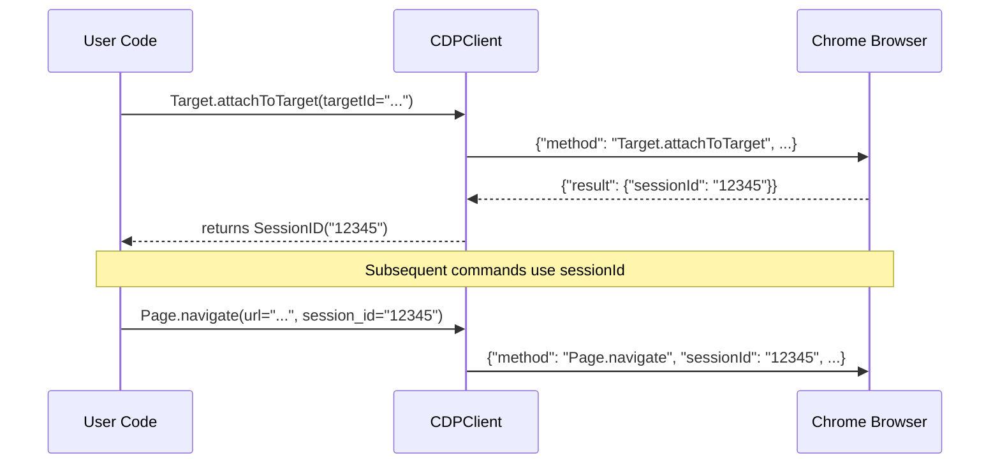
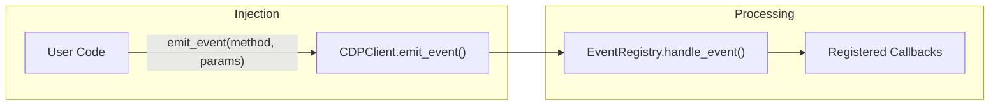

<!-- source: DeepWiki mcp.deepwiki.com · repo browser-use/cdp-use · page 3.3 Advanced Usage Patterns · fetched 2026-10-30 -->

# Advanced Usage Patterns

<details>
<summary>Relevant source files</summary>

The following files were used as context for generating this wiki page:

- [cdp_use/cdp/page/events.py](cdp_use/cdp/page/events.py)
- [cdp_use/cdp/registry.py](cdp_use/cdp/registry.py)
- [cdp_use/cdp/target/commands.py](cdp_use/cdp/target/commands.py)
- [cdp_use/client.py](cdp_use/client.py)
- [cdp_use/generator/registry_generator.py](cdp_use/generator/registry_generator.py)

</details>


This document covers advanced usage patterns for the `cdp-use` library, focusing on event handling, multi-target session management, concurrent operations, and synthetic event injection. These patterns enable sophisticated browser automation workflows beyond basic command execution.

## Event-Driven Architecture

The `cdp-use` library provides a type-safe event registry system for monitoring browser state changes, DOM modifications, and network activity in real-time.

### Event Handling Architecture

The `EventRegistry` acts as a central dispatcher for all incoming CDP events. It maintains a mapping of CDP method names to user-defined callbacks.

```mermaid
graph TB
    subgraph "Natural Language Space"
        "Listen for Page Load" --> "Handle Navigation"
        "Monitor Network" --> "Log Requests"
    end

    subgraph "Code Entity Space"
        "CDPClient._handle_messages()" -- "1. Receive JSON" --> "EventRegistry.handle_event()"
        "EventRegistry.handle_event()" -- "2. Dispatch" --> "User Callback"
        "CDPRegistrationLibrary" -- "Setup" --> "EventRegistry.register()"
        "EventRegistry._handlers" -- "Store" --> "Dict[str, Callable]"
    end
    
    "Handle Navigation" -.-> "CDPRegistrationLibrary"
    "Log Requests" -.-> "CDPRegistrationLibrary"
```

Sources: [cdp_use/cdp/registry.py:14-18](), [cdp_use/client.py:314-328](), [cdp_use/cdp/registry.py:46-51]()

### Event Handler Registration

Users register callbacks via the `client.register` property, which exposes the `CDPRegistrationLibrary`. This library provides a domain-grouped, type-safe interface for event registration.

| Feature | Description | Implementation |
| :--- | :--- | :--- |
| **Type Safety** | Callbacks receive typed `TypedDict` objects matching the CDP event payload. | [cdp_use/cdp/page/events.py:47-53]() |
| **Async Support** | Handlers can be sync or `async` functions; the registry handles `await` automatically. | [cdp_use/cdp/registry.py:66-68]() |
| **Session Isolation** | Handlers receive the `session_id` to identify which target triggered the event. | [cdp_use/cdp/registry.py:50-58]() |

Sources: [cdp_use/cdp/registry.py:20-34](), [cdp_use/cdp/registry.py:63-73]()

## Session Management for Multi-Target Scenarios

Advanced automation often requires interacting with multiple targets (tabs, iframes, or workers) over a single WebSocket connection. This is achieved using the `session_id`.

### Multi-Target Flow



Sources: [cdp_use/cdp/target/commands.py:26-37](), [cdp_use/client.py:353-378]()

### Using session_id in Commands

Every generated command method in the `CDPLibrary` accepts an optional `session_id` keyword argument. If provided, the `CDPClient` includes this ID in the outgoing JSON payload, routing the command to the specific target.

Sources: [cdp_use/client.py:353-356](), [cdp_use/cdp/target/commands.py:151-157]()

## Concurrent Operations

The `CDPClient` is designed for high-performance concurrent operations using `asyncio`. Since each request is assigned a unique `msg_id`, multiple commands can be "in flight" simultaneously.

### Concurrent Execution Pattern

Using `asyncio.gather`, users can trigger multiple CDP commands in parallel, significantly reducing latency for independent operations like capturing multiple element screenshots or evaluating scripts across frames.

```python
# Example Pattern
results = await asyncio.gather(
    client.send.Runtime.evaluate(expression="1+1"),
    client.send.Page.getLayoutMetrics(),
    client.send.DOM.getDocument()
)
```

The `CDPClient.send_raw` method creates a `Future` for every request and stores it in `self.pending_requests`. The background `_handle_messages` loop resolves these futures as responses arrive from the browser.

Sources: [cdp_use/client.py:360-378](), [cdp_use/client.py:298-312]()

## Synthetic Event Injection

The `emit_event` method allows users to manually inject events into the `EventRegistry`. This is useful for testing event handlers or creating synthetic signals within an automation script.

### emit_event Data Flow



Sources: [cdp_use/client.py:380-391](), [cdp_use/cdp/registry.py:46-51]()

## Advanced WebSocket Logging

The `WebSocketLogFilter` provides sophisticated monitoring of the underlying protocol traffic. It automatically suppresses high-volume "noise" like PING/PONG frames while calculating latency.

| Log Indicator | Meaning | Logic Site |
| :--- | :--- | :--- |
| `✔ PING (X.Xms)` | Successful keep-alive with round-trip time. | [cdp_use/client.py:66-81]() |
| `⚠️ PING not answered` | Browser unresponsive for >3 seconds. | [cdp_use/client.py:47-54]() |
| `🌎 ← #ID: Method()` | Outgoing type-safe command. | [cdp_use/client.py:144-154]() |
| `🌎 → #ID: ↳ Result` | Incoming command response. | [cdp_use/client.py:156-177]() |
| `🌎 → Event: Method()` | Incoming CDP event notification. | [cdp_use/client.py:186-200]() |

Sources: [cdp_use/client.py:20-35](), [cdp_use/client.py:114-142]()

---

