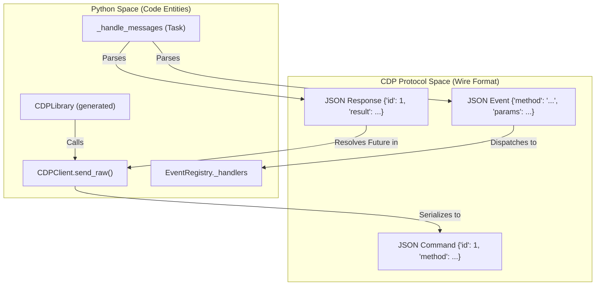

<!-- source: DeepWiki mcp.deepwiki.com · repo browser-use/cdp-use · page 4 Core Components · fetched 2026-10-30 -->

# Core Components

<details>
<summary>Relevant source files</summary>

The following files were used as context for generating this wiki page:

- [cdp_use/cdp/registry.py](cdp_use/cdp/registry.py)
- [cdp_use/client.py](cdp_use/client.py)
- [cdp_use/generator/registry_generator.py](cdp_use/generator/registry_generator.py)

</details>


This page provides a high-level overview of the main system components that enable communication with the Chrome DevTools Protocol (CDP). The architecture is built around three pillars: the WebSocket communication layer, the asynchronous event registry, and the command execution pipeline.

## WebSocket Communication

The `CDPClient` class in `cdp_use/client.py` manages the lifecycle of the WebSocket connection to Chrome. It utilizes the `websockets` library to establish a persistent connection, configuring a high `max_ws_frame_size` (defaulting to 100MB) to handle large CDP payloads like screencast frames or full DOM trees.

The connection is managed through an asynchronous background task loop, `_handle_messages`, which continuously listens for incoming data. The client also includes a `WebSocketLogFilter` to monitor connection health via PING/PONG frames and provide human-readable logs for protocol traffic.

For details, see [WebSocket Communication](#4.1).

**Sources:** [cdp_use/client.py:20-110](), [cdp_use/client.py:217-285](), [cdp_use/client.py:349-378]()

## Event Registry System

The `EventRegistry` is a central dispatcher for CDP events. When the browser sends an event (a message with a `method` but no `id`), the `CDPClient` passes it to this registry. 

The registry maintains a mapping of CDP method names (e.g., `"Page.loadEventFired"`) to callback functions. It supports both synchronous and asynchronous callbacks by using `inspect.isawaitable` to determine how to execute the handler. This system ensures that event processing is isolated; an error in one handler does not crash the main message loop.

For details, see [Event Registry System](#4.2).

**Sources:** [cdp_use/cdp/registry.py:14-83](), [cdp_use/generator/registry_generator.py:29-103]()

## Command Execution

Command execution follows a request-response pattern coordinated by the `CDPClient.send_raw` method. Each command is assigned an incrementing `msg_id` and stored in a `pending_requests` dictionary as an `asyncio.Future`.

When a response arrives from the browser, the `_handle_messages` loop correlates the response `id` with the pending future to resolve the call. The system provides type safety by wrapping these raw calls in a `CDPLibrary` proxy hierarchy, where generated methods enforce the correct `TypedDict` structures for parameters and return values.

For details, see [Command Execution](#4.3).

**Sources:** [cdp_use/client.py:227-236](), [cdp_use/client.py:287-347]()

## Component Relationship

The following diagram illustrates how these components bridge the gap between high-level Python code and the low-level CDP WebSocket protocol.

### From Natural Language to Code Entities



**Sources:** [cdp_use/client.py:287-378](), [cdp_use/cdp/registry.py:46-73]()

### System Interaction Map

This diagram shows the internal ownership and communication flow between the core classes.

```mermaid
classDiagram
    class CDPClient {
        +msg_id: int
        +pending_requests: Dict[int, Future]
        +_event_registry: EventRegistry
        +send_raw(method, params)
        -_handle_messages()
    }
    class EventRegistry {
        -_handlers: Dict[str, Callable]
        +register(method, callback)
        +handle_event(method, params)
    }
    class WebSocketLogFilter {
        +filter(record)
        -ping_times: Dict
    }

    CDPClient "1" *-- "1" EventRegistry : "owns"
    CDPClient ..> WebSocketLogFilter : "logs via"
    CDPClient --|> "websockets.connect" : "manages"
```

**Sources:** [cdp_use/client.py:20-25](), [cdp_use/client.py:217-236](), [cdp_use/cdp/registry.py:14-18]()

---

