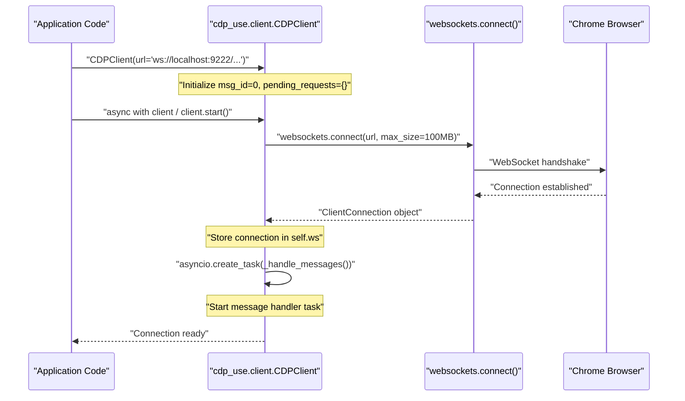
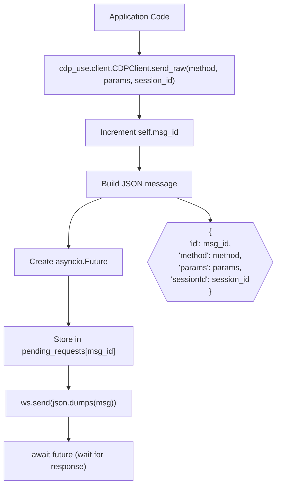
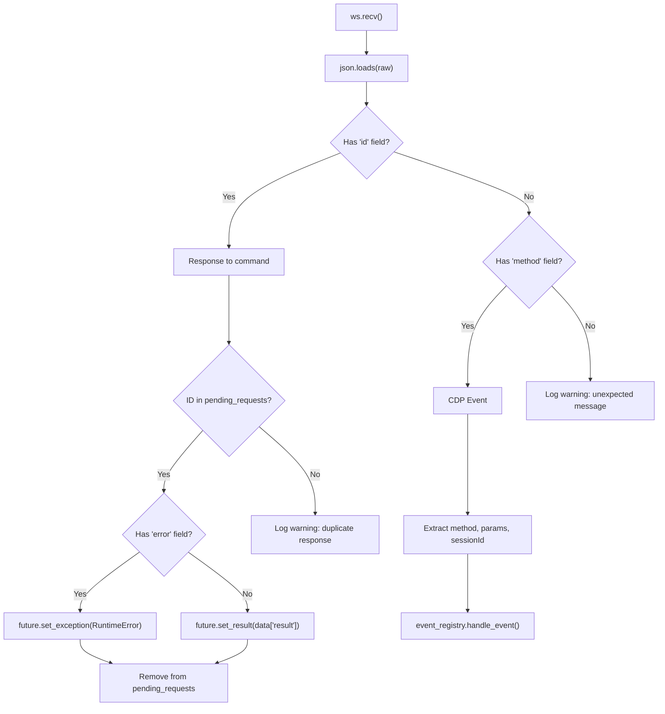
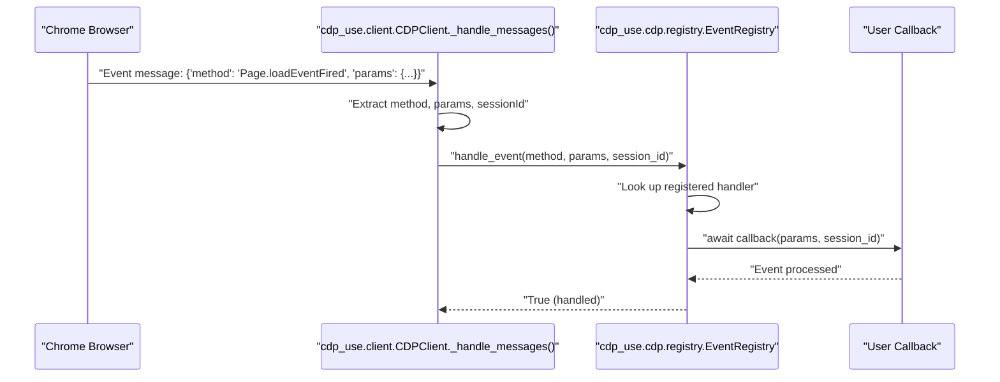
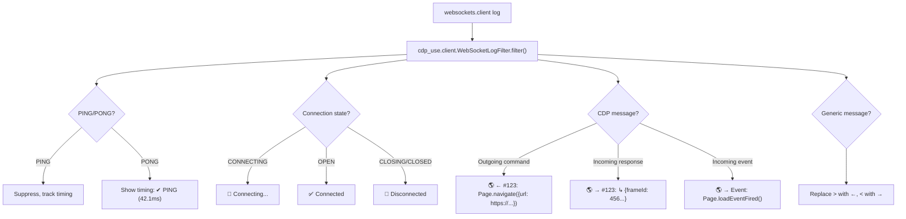
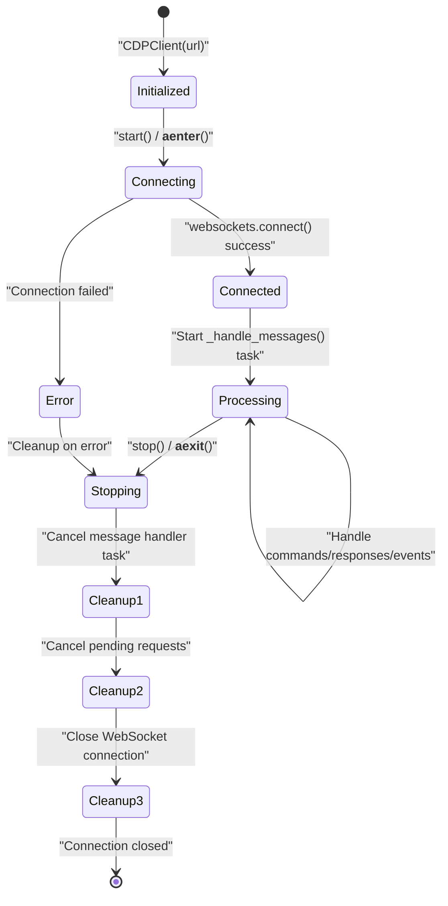
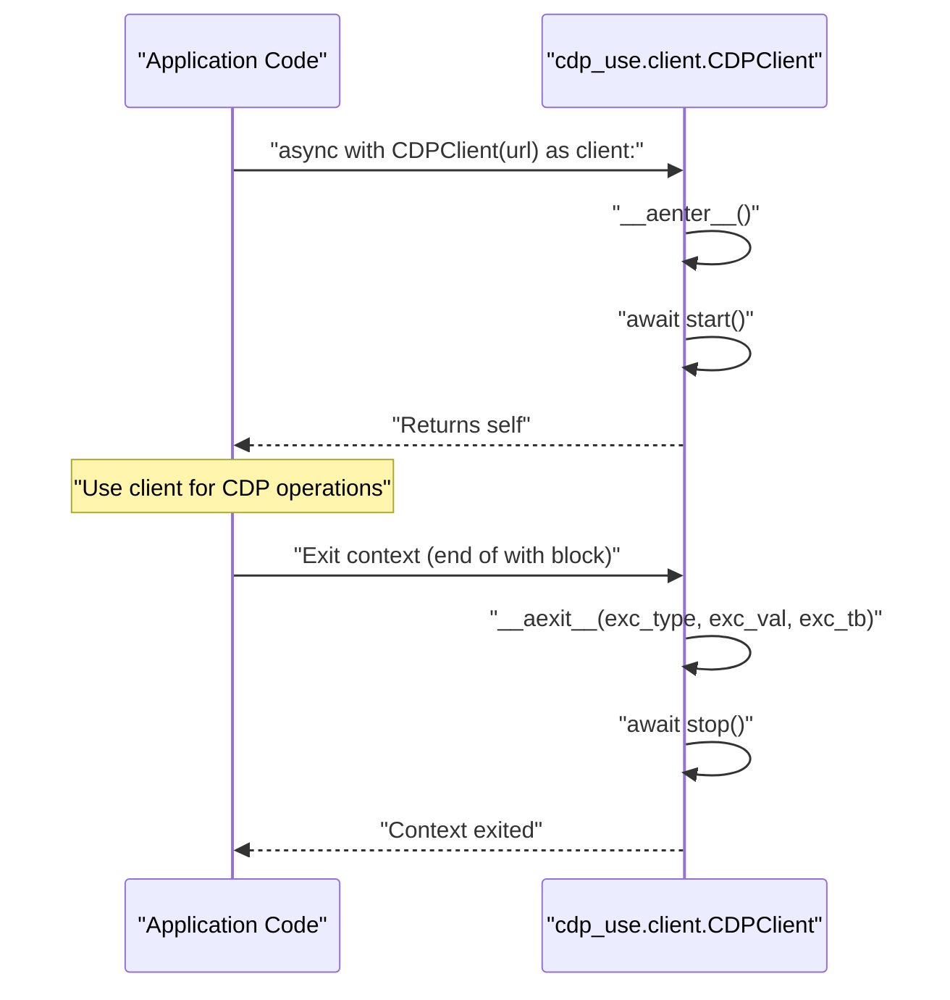

<!-- source: DeepWiki mcp.deepwiki.com · repo browser-use/cdp-use · page 4.1 WebSocket Communication · fetched 2026-10-30 -->

# WebSocket Communication

Relevant source files

The following files were used as context for generating this wiki page:

- [cdp_use/client.py](cdp_use/client.py)
- [uv.lock](uv.lock)

This document covers how the `CDPClient` establishes and manages WebSocket connections with Chrome DevTools Protocol endpoints. It explains the low-level communication mechanics, message handling, and connection lifecycle management.

For information about how CDP events are registered and dispatched after being received through the WebSocket, see [Event Registry System](4.2.md). For details about command construction and execution, see [Command Execution](4.3.md).

## Connection Management

The `CDPClient` class manages WebSocket connections using the `websockets` library. The connection is established through the async context manager pattern or explicit `start()` and `stop()` methods.

### Connection Establishment

The `CDPClient.start()` method initiates the connection to the browser.

The connection process involves several key configurations:
- Maximum message size is set to 100MB (`100 * 1024 * 1024`) instead of the default 1MB to handle large DOM trees or screenshots [[cdp_use/client.py:258]]().
- Additional headers can be provided for authentication or custom browser configurations [[cdp_use/client.py:260-261]]().
- A background message handler task `_handle_messages` is started to process incoming messages asynchronously [[cdp_use/client.py:263]]().

**Sources:** [[cdp_use/client.py:251-263]]()

### Connection State Management

The `CDPClient` maintains connection state through several instance variables:

| Variable | Type | Purpose |
|----------|------|---------|
| `ws` | `Optional[websockets.ClientConnection]` | Active WebSocket connection [[cdp_use/client.py:221]]() |
| `msg_id` | `int` | Incrementing message ID counter [[cdp_use/client.py:222]]() |
| `pending_requests` | `Dict[int, asyncio.Future]` | Outstanding request futures for response correlation [[cdp_use/client.py:223]]() |
| `_message_handler_task` | `Optional[asyncio.Task]` | Background message processing task [[cdp_use/client.py:224]]() |

**Sources:** [[cdp_use/client.py:221-224]]()

## Message Protocol

The WebSocket communication follows the Chrome DevTools Protocol JSON-RPC format. Messages are exchanged as JSON objects with specific structures for commands, responses, and events.

### Outgoing Messages (Commands)

The `send_raw()` method is the primary interface for sending commands to the browser.

The `send_raw()` method handles the complete request lifecycle:
1. Increments the message ID counter [[cdp_use/client.py:360]]().
2. Constructs a JSON-RPC message with required fields [[cdp_use/client.py:361-365]]().
3. Adds optional `sessionId` for target-specific commands (e.g., when attached to a specific tab) [[cdp_use/client.py:367-368]]().
4. Creates an `asyncio.Future` to await the response [[cdp_use/client.py:371-372]]().
5. Sends the message over WebSocket [[cdp_use/client.py:375]]().
6. Returns the awaited response once the background loop fulfills the future [[cdp_use/client.py:378]]().

**Sources:** [[cdp_use/client.py:349-378]]()

### Incoming Messages (Responses and Events)

The `_handle_messages()` method continuously processes incoming WebSocket messages:

**Sources:** [[cdp_use/client.py:287-347]]()

## Event Handling Integration

When CDP events are received (messages with `method` but no `id`), they are forwarded to the internal `EventRegistry` system:

The integration points are:
- Event detection in message handler [[cdp_use/client.py:314-328]]().
- Event registry initialization in constructor [[cdp_use/client.py:233]]().
- Event forwarding to registry via `self.event_registry.handle_event()` [[cdp_use/client.py:323-325]]().

**Sources:** [[cdp_use/client.py:233]](), [[cdp_use/client.py:314-328]]()

## Logging and Debugging

The `WebSocketLogFilter` class provides sophisticated logging for WebSocket communication, transforming raw `websockets` library logs into human-readable CDP message traces.

### Log Message Transformation

Key filtering behaviors:
- Tracks PING/PONG timing and shows round-trip time, issuing a warning if a PONG is not received within 3 seconds [[cdp_use/client.py:39-76]]().
- Suppresses keepalive and EOF messages to reduce noise [[cdp_use/client.py:84-90]]().
- Formats CDP messages with emojis and structured display by parsing the JSON content [[cdp_use/client.py:114-192]]().
- Truncates large response payloads (>200 chars) and removes redundant `sessionId` fields for cleaner logs [[cdp_use/client.py:165-173]]().

**Sources:** [[cdp_use/client.py:20-192]](), [[cdp_use/client.py:212-214]]()

### Message Format Examples

| Message Type | Raw Format | Filtered Display |
|--------------|------------|------------------|
| Outgoing Command | `> TEXT {"id":1,"method":"Page.navigate","params":{"url":"https://example.com"}}` | `🌎 ← #1: Page.navigate({url: https://example.com})` |
| Incoming Response | `< TEXT {"id":1,"result":{"frameId":"ABC123"}}` | `🌎 → #1: ↳ {frameId: ABC123}` |
| Incoming Event | `< TEXT {"method":"Page.loadEventFired","params":{"timestamp":123}}` | `🌎 → Event: Page.loadEventFired({timestamp: 123})` |
| PING/PONG | `> PING ab cd ef [binary]` | `✔ PING (15.2ms)` |

**Sources:** [[cdp_use/client.py:133-192]]()

## Connection Lifecycle

The connection lifecycle is managed through async context managers (`__aenter__`/`__aexit__`) or explicit `start()`/`stop()` methods.

### Cleanup Process

When `stop()` is called, the client performs thorough cleanup:

1. **Cancel message handler task**: Stops the background loop and waits for it to finish [[cdp_use/client.py:268-274]]().
2. **Resolve pending requests**: Any outstanding futures in `pending_requests` are cancelled with a `RuntimeError` to prevent application hangs [[cdp_use/client.py:276-280]]().
3. **Close WebSocket connection**: Explicitly closes the `websockets` connection [[cdp_use/client.py:283-285]]().

Error conditions in the message loop also trigger cleanup, such as when the browser closes the connection unexpectedly [[cdp_use/client.py:334-347]]().

**Sources:** [[cdp_use/client.py:265-285]](), [[cdp_use/client.py:334-347]]()

### Context Manager Integration

The `CDPClient` supports the `async with` syntax for automatic lifecycle management.

**Sources:** [[cdp_use/client.py:238-245]]()

---

