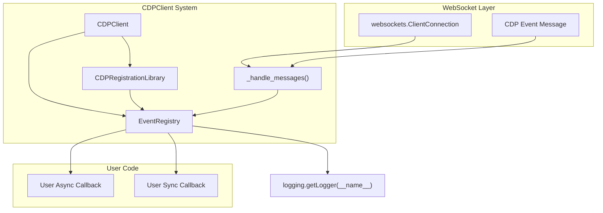
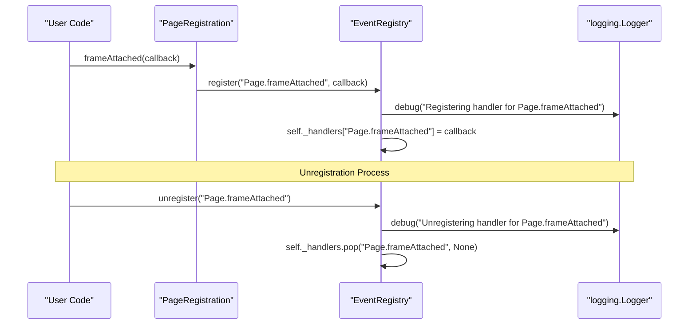
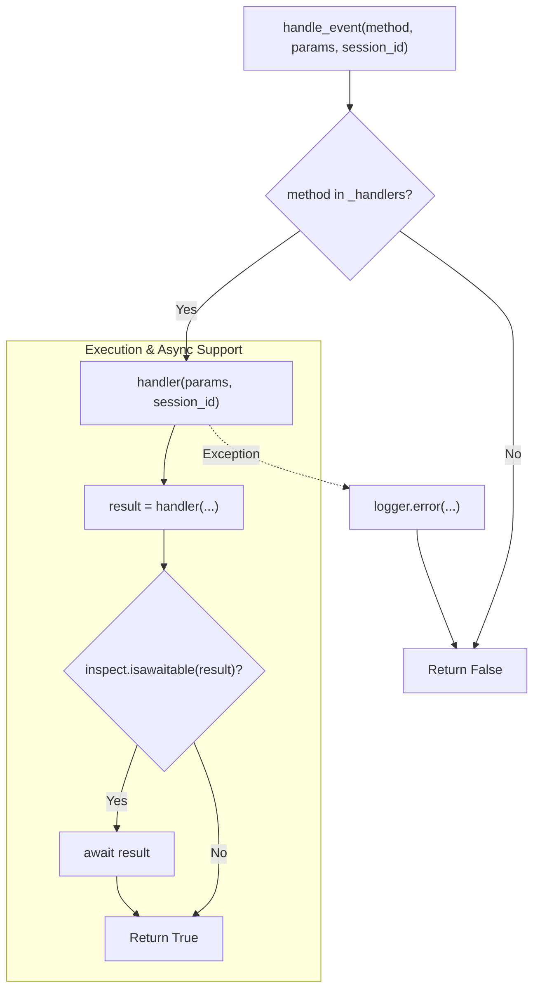

<!-- source: DeepWiki mcp.deepwiki.com · repo browser-use/cdp-use · page 4.2 Event Registry System · fetched 2026-10-30 -->

# Event Registry System

<details>
<summary>Relevant source files</summary>

The following files were used as context for generating this wiki page:

- [cdp_use/cdp/browseruse/registration.py](cdp_use/cdp/browseruse/registration.py)
- [cdp_use/cdp/media/registration.py](cdp_use/cdp/media/registration.py)
- [cdp_use/cdp/page/registration.py](cdp_use/cdp/page/registration.py)
- [cdp_use/cdp/registry.py](cdp_use/cdp/registry.py)
- [cdp_use/generator/registry_generator.py](cdp_use/generator/registry_generator.py)

</details>


The Event Registry System manages asynchronous event callbacks for Chrome DevTools Protocol (CDP) events within the `cdp-use` library. It provides a centralized registry for registering, unregistering, and dispatching CDP events to user-defined callback functions. This system handles both synchronous and asynchronous event handlers and integrates tightly with the WebSocket communication layer.

The registry is auto-generated by the `RegistryGenerator` [cdp_use/generator/registry_generator.py:10-13]() to ensure it remains synchronized with the CDP specification.

## Architecture Overview

The Event Registry System centers around the `EventRegistry` class, which maintains a mapping of CDP event method names to callback functions. The system supports both synchronous and asynchronous callbacks and integrates with the `CDPClient` through domain-specific registration classes.

### Event Registry Architecture



Sources: [cdp_use/cdp/registry.py:14-18](), [cdp_use/generator/registry_generator.py:29-32]()

### Core Components

| Component | File Location | Purpose |
|-----------|---------------|---------|
| `EventRegistry` | [cdp_use/cdp/registry.py:14-83]() | Central registry for event callbacks. |
| `_handlers` | [cdp_use/cdp/registry.py:18]() | Private dictionary mapping method strings to callables. |
| `RegistryGenerator` | [cdp_use/generator/registry_generator.py:10-105]() | Logic for generating the registry source code. |
| Domain Registration | [cdp_use/cdp/page/registration.py:45-51]() | Type-safe wrappers for specific CDP domains (e.g., `PageRegistration`). |

Sources: [cdp_use/cdp/registry.py:14-18](), [cdp_use/cdp/page/registration.py:45-51]()

## Event Registration API

The `EventRegistry` provides a standard API for managing the lifecycle of event subscriptions. While users can call these directly, they are typically accessed via generated domain registration classes.

### Registration Methods



- **`register(method, callback)`**: Maps a CDP method string (e.g., `"Page.loadEventFired"`) to a callable. The callback receives `(event_data, session_id)` [cdp_use/cdp/registry.py:20-34]().
- **`unregister(method)`**: Removes the handler for the specified method using `pop(method, None)` to avoid `KeyError` if the handler does not exist [cdp_use/cdp/registry.py:36-44]().
- **`clear()`**: Flushes all registered handlers from the `_handlers` dictionary [cdp_use/cdp/registry.py:75-78]().
- **`get_registered_methods()`**: Returns a list of strings representing all currently subscribed CDP events [cdp_use/cdp/registry.py:80-82]().

Sources: [cdp_use/cdp/registry.py:20-44](), [cdp_use/cdp/registry.py:75-82]()

## Event Dispatching Logic

The `handle_event` method is the primary entry point for incoming CDP messages identified as events. It implements logic to bridge synchronous and asynchronous execution.

### handle_event Dispatch Flow



### Implementation Details

1. **Async Detection**: The registry uses `inspect.isawaitable()` on the result of the callback execution. If the callback is a coroutine or returns an awaitable, the registry `awaits` it [cdp_use/cdp/registry.py:66-68]().
2. **Error Isolation**: The execution is wrapped in a `try...except` block. If a user-provided callback raises an exception, it is caught and logged at the `ERROR` level, preventing the library's internal message loop from crashing [cdp_use/cdp/registry.py:70-72]().
3. **Dispatch Status**: The method returns `True` if a handler was found and executed (regardless of the handler's internal success), and `False` if no handler was registered for that method [cdp_use/cdp/registry.py:69-73]().

Sources: [cdp_use/cdp/registry.py:46-73]()

## Domain-Specific Registration

To provide IDE autocompletion and type safety, the generator creates "Registration" classes for every CDP domain. These classes act as proxies to the central `EventRegistry`.

### Example: PageRegistration

The `PageRegistration` class provides named methods for every event in the `Page` domain.

```python
class PageRegistration:
    def __init__(self, registry: "EventRegistry"):
        self._registry = registry

    def frameAttached(self, callback: Callable[["FrameAttachedEvent", Optional[str]], None]) -> None:
        # Maps the Python method to the CDP string "Page.frameAttached"
        self._registry.register("Page.frameAttached", callback)
```

This pattern is repeated across all domains, such as `BrowserUse` [cdp_use/cdp/browseruse/registration.py:20-40](), `Media` [cdp_use/cdp/media/registration.py:22-43](), and `Page` [cdp_use/cdp/page/registration.py:45-63]().

### Introspection

The system supports introspection via `get_registered_methods()`. This is useful for debugging or for the `CDPClient` to verify which events should be processed [cdp_use/cdp/registry.py:80-82]().

Sources: [cdp_use/cdp/page/registration.py:45-63](), [cdp_use/cdp/registry.py:80-82]()

---

