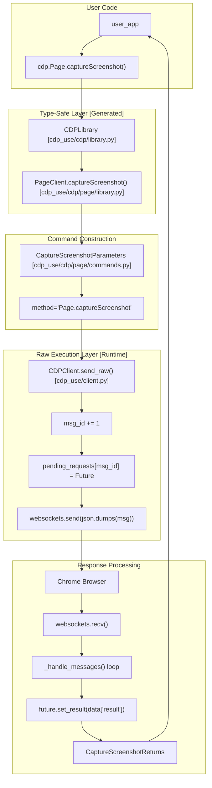
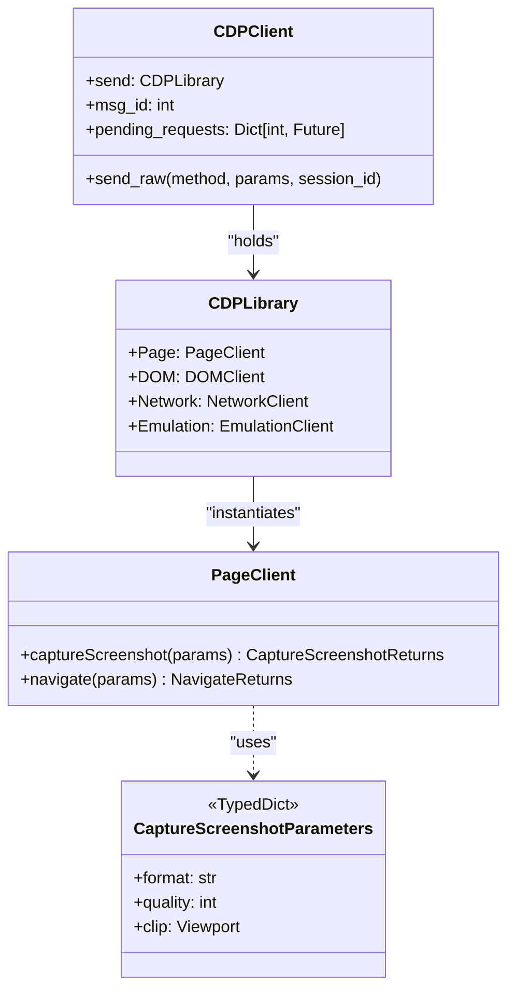

<!-- source: DeepWiki mcp.deepwiki.com · repo browser-use/cdp-use · page 4.3 Command Execution · fetched 2026-10-30 -->

# Command Execution

<details>
<summary>Relevant source files</summary>

The following files were used as context for generating this wiki page:

- [cdp_use/cdp/css/commands.py](cdp_use/cdp/css/commands.py)
- [cdp_use/cdp/dom/commands.py](cdp_use/cdp/dom/commands.py)
- [cdp_use/cdp/emulation/commands.py](cdp_use/cdp/emulation/commands.py)
- [cdp_use/cdp/emulation/library.py](cdp_use/cdp/emulation/library.py)
- [cdp_use/cdp/library.py](cdp_use/cdp/library.py)
- [cdp_use/cdp/network/commands.py](cdp_use/cdp/network/commands.py)
- [cdp_use/cdp/page/commands.py](cdp_use/cdp/page/commands.py)
- [cdp_use/cdp/target/library.py](cdp_use/cdp/target/library.py)
- [cdp_use/client.py](cdp_use/client.py)

</details>


This document covers how CDP (Chrome DevTools Protocol) commands are constructed, sent to the browser, and how their responses are processed within the `cdp-use` library. It focuses on the command execution pipeline from the type-safe API through to the raw WebSocket messaging layer.

For information about WebSocket connection management, see [WebSocket Communication](#4.1). For CDP event handling, see [Event Registry System](#4.2). For details on how command bindings are generated, see [Code Generation System](#5).

## Command Execution Flow

The command execution system operates through a layered architecture where type-safe command interfaces are translated into raw CDP messages sent over WebSocket connections.



**Command Execution Pipeline**

Sources: [cdp_use/client.py:228-378](), [cdp_use/cdp/library.py:13-222](), [cdp_use/cdp/page/library.py:241-255]()

## Type-Safe Command Interface

The `CDPClient` exposes commands through the `send` attribute, which is an instance of the generated `CDPLibrary`. This library acts as a proxy hierarchy, providing access to domain-specific clients (e.g., `PageClient`, `DOMClient`).



**Type-Safe Command Architecture**

The type-safe interface is initialized during `CDPClient` instantiation. The `CDPLibrary` maps protocol domains to specific client classes that wrap the `send_raw` method.

```python
# From cdp_use/client.py:228-236
from cdp_use.cdp.library import CDPLibrary
# ...
self.send: "CDPLibrary" = CDPLibrary(self)
```

Each domain client method (like `EmulationClient.canEmulate`) performs a `cast` to the expected return type after calling `send_raw`.

```python
# From cdp_use/cdp/emulation/library.py:64-77
async def canEmulate(
    self,
    params: None = None,
    session_id: Optional[str] = None,
) -> "CanEmulateReturns":
    """Tells whether emulation is supported."""
    return cast(
        "CanEmulateReturns",
        await self._client.send_raw(
            method="Emulation.canEmulate",
            params=params,
            session_id=session_id,
        ),
    )
```

Sources: [cdp_use/client.py:228-236](), [cdp_use/cdp/library.py:13-222](), [cdp_use/cdp/emulation/library.py:58-77]()

## Raw Command Execution Internals

The `send_raw` method is the entry point for all outgoing CDP messages. It handles the low-level protocol requirements:

1.  **Message ID Management**: Increments `self.msg_id` for every call to ensure request-response correlation. [cdp_use/client.py:360-360]()
2.  **Request Tracking**: Creates an `asyncio.Future` and stores it in the `self.pending_requests` dictionary, keyed by the message ID. [cdp_use/client.py:371-372]()
3.  **JSON Serialization**: Constructs the payload (including `method`, `params`, and optional `sessionId`) and serializes it using `json.dumps`. [cdp_use/client.py:361-369]()
4.  **WebSocket Dispatch**: Sends the raw string over the established WebSocket connection. [cdp_use/client.py:374-374]()

```python
# From cdp_use/client.py:349-378
async def send_raw(
    self,
    method: str,
    params: Optional[Any] = None,
    session_id: Optional[str] = None,
) -> dict[str, Any]:
    if not self.ws:
        raise RuntimeError("Client is not started. Call start() first.")

    self.msg_id += 1
    msg = {
        "id": int(self.msg_id),
        "method": method,
        "params": params or {},
    }

    if session_id:
        msg["sessionId"] = session_id

    future = asyncio.Future()
    self.pending_requests[self.msg_id] = future

    await self.ws.send(json.dumps(msg))
    return await future
```

Sources: [cdp_use/client.py:349-378]()

## Response Correlation and Processing

The `_handle_messages` background task acts as the central dispatcher for all incoming WebSocket data. It distinguishes between command responses and asynchronous events.

```mermaid
sequenceDiagram
    participant WS as "websockets.WebSocketClientProtocol"
    participant Loop as "_handle_messages()"
    participant Pending as "pending_requests: Dict"
    participant Fut as "asyncio.Future"

    WS->>Loop: "recv() raw JSON"
    Loop->>Loop: "data = json.loads(msg)"
    
    alt is Response (contains 'id')
        Loop->>Pending: "pop(data['id'])"
        Pending-->>Loop: "future"
        alt has 'error'
            Loop->>Fut: "set_exception(RuntimeError)"
        else has 'result'
            Loop->>Fut: "set_result(data['result'])"
        end
    else is Event (contains 'method')
        Loop->>Loop: "dispatch to EventRegistry"
    end
```

**Response Processing Logic**

The library correlates responses using the `id` field. If the browser returns an `error` object, the library raises a `RuntimeError` containing the CDP error message.

```python
# From cdp_use/client.py:302-312
if "id" in data and data["id"] in self.pending_requests:
    future = self.pending_requests.pop(data["id"])
    if not future.done():
        if "error" in data:
            logger.error(f"CDP Error for request {data['id']}: {data['error']}")
            # Extract message from error object if possible
            error_msg = str(data["error"])
            future.set_exception(RuntimeError(error_msg))
        else:
            future.set_result(data["result"])
```

Sources: [cdp_use/client.py:287-332]()

## Generated Parameter and Return Types

To ensure type safety, the generator produces `TypedDict` classes for every command. These mirror the CDP specification exactly.

| Domain | Command | Parameter Class | Return Class |
| :--- | :--- | :--- | :--- |
| `Page` | `captureScreenshot` | `CaptureScreenshotParameters` | `CaptureScreenshotReturns` |
| `DOM` | `getDocument` | `GetDocumentParameters` | `GetDocumentReturns` |
| `Network` | `setExtraHTTPHeaders` | `SetExtraHTTPHeadersParameters` | `Dict[str, Any]` (if empty) |

Example of generated parameters with `NotRequired` for optional CDP fields:

```python
# From cdp_use/cdp/page/commands.py:70-82
class CaptureScreenshotParameters(TypedDict, total=False):
    format: "str"
    """Image compression format (defaults to png)."""
    quality: "int"
    """Compression quality from range [0..100] (jpeg only)."""
    clip: "Viewport"
    """Capture the screenshot of a given region only."""
    # ...
```

Sources: [cdp_use/cdp/page/commands.py:70-88](), [cdp_use/cdp/dom/commands.py:145-157]()

## Error Handling Scenarios

The execution engine is designed to handle failures gracefully:

1.  **Connection Loss**: If the WebSocket closes while requests are pending, `_handle_messages` iterates through `self.pending_requests` and sets a `ConnectionError` on every `Future`. [cdp_use/client.py:334-343]()
2.  **Invalid State**: Calling `send_raw` before `start()` results in an immediate `RuntimeError`. [cdp_use/client.py:355-358]()
3.  **CDP Errors**: Protocol-level errors (e.g., "Node not found") are caught in the response handler and propagated as `RuntimeError` to the awaiting caller. [cdp_use/client.py:305-309]()

Sources: [cdp_use/client.py:305-309](), [cdp_use/client.py:334-343](), [cdp_use/client.py:355-358]()

---

