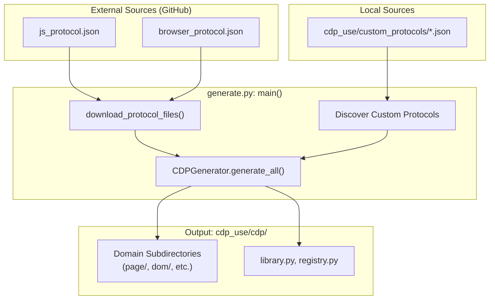
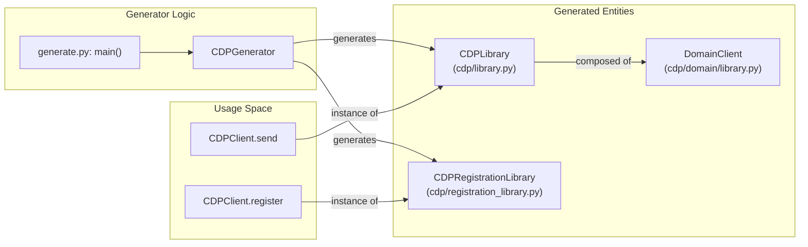

<!-- source: DeepWiki mcp.deepwiki.com · repo browser-use/cdp-use · page 5.1 Generation Overview · fetched 2026-10-30 -->

# Generation Overview

Relevant source files

The following files were used as context for generating this wiki page:

- [README.md](README.md)
- [Taskfile.yml](Taskfile.yml)
- [cdp_use/custom_protocols/browseruse.json](cdp_use/custom_protocols/browseruse.json)
- [cdp_use/generator/__init__.py](cdp_use/generator/__init__.py)
- [cdp_use/generator/__main__.py](cdp_use/generator/__main__.py)
- [cdp_use/generator/constants.py](cdp_use/generator/constants.py)
- [cdp_use/generator/generate.py](cdp_use/generator/generate.py)

This document provides a high-level overview of the code generation system that transforms Chrome DevTools Protocol (CDP) specifications into type-safe Python bindings. The generation process is orchestrated by the `CDPGenerator` class and produces a complete library of domain-specific modules with `TypedDict` classes, command definitions, event handlers, and client libraries.

For detailed information about specific generation phases, see [Type Generation](5.2), [Command Generation](5.3), [Event Generation](5.4), and [Library Generation](5.5).

## Purpose and Scope

The code generation system automates the creation of Python bindings from CDP protocol JSON specifications. It fetches remote protocol files from the official Chrome DevTools repository and merges them with local custom protocols. The system handles over 50 CDP domains, creating thousands of type definitions, command parameters, event payloads, and client interface methods under the `cdp_use/cdp/` directory.

**Sources:** [cdp_use/generator/generate.py:5-8](), [README.md:159-175]()

## Entry Points and Orchestration

The generation process can be triggered through several entry points, all leading to the `main()` function in `cdp_use/generator/generate.py`.

*   **Module Execution**: `python -m cdp_use.generator` calls the `main()` function via the `__main__.py` wrapper [cdp_use/generator/__main__.py:1-7]().
*   **Task Automation**: `task generate` executes the module using `uv run` [Taskfile.yml:4-7]().
*   **Direct Script**: Running `cdp_use/generator/generate.py` directly [cdp_use/generator/generate.py:39-72]().

### Protocol Versioning
The generator uses constants defined in `cdp_use/generator/constants.py` to pin the protocol to a specific Chromium revision. This ensures that the generated types exactly match the browser version being targeted.

| Constant | Value | Purpose |
| :--- | :--- | :--- |
| `CHROMIUM_TAG` | `144.0.7559.109` | The specific Chromium version reference [cdp_use/generator/constants.py:24]() |
| `DEVTOOLS_PROTOCOL_TAG` | `v0.0.1551306` | The corresponding GitHub tag for protocol JSONs [cdp_use/generator/constants.py:25]() |
| `CDP_VERSION` | `chromium-144...` | String used for logging during generation [cdp_use/generator/constants.py:39]() |

**Sources:** [cdp_use/generator/constants.py:1-40](), [cdp_use/generator/generate.py:22]()

## Data Flow: Specification to Code

The generation pipeline follows a strict flow: fetching remote data, discovering local overrides, and executing the generation logic.

**Sources:** [cdp_use/generator/generate.py:18-58](), [cdp_use/generator/constants.py:27-36]()

### 1. Fetching Remote Protocols
The `download_protocol_files()` function creates a temporary directory and uses `urllib.request.urlretrieve` to download the `js_protocol.json` and `browser_protocol.json` files from the `ChromeDevTools/devtools-protocol` repository [cdp_use/generator/generate.py:18-36]().

### 2. Processing Custom Protocols
The generator looks for additional JSON files in `cdp_use/custom_protocols/` [cdp_use/generator/generate.py:45-52](). This allows the library to support non-standard or experimental extensions, such as the `BrowserUse` custom domain which defines events like `captchaSolverStarted` [cdp_use/custom_protocols/browseruse.json:1-92]().

### 3. Execution (CDPGenerator)
The `CDPGenerator` class (imported from `.generator`) is initialized and its `generate_all()` method is called with a combined list of paths to the downloaded and custom protocol files [cdp_use/generator/generate.py:55-58]().

## Output Directory Structure

The generator produces a standardized file layout for every CDP domain. This structure facilitates clean imports and full IntelliSense support.

| Path | Description |
| :--- | :--- |
| `cdp_use/cdp/<domain>/types.py` | `TypedDict` classes for domain-specific objects [README.md:167]() |
| `cdp_use/cdp/<domain>/commands.py` | Parameter and Return types for domain commands [README.md:168]() |
| `cdp_use/cdp/<domain>/events.py` | Type definitions for domain events [README.md:169]() |
| `cdp_use/cdp/<domain>/library.py` | The `DomainClient` class containing command methods [README.md:170]() |
| `cdp_use/cdp/<domain>/registration.py` | Registration interface for the domain's events [README.md:171]() |
| `cdp_use/cdp/library.py` | The main `CDPLibrary` aggregator [README.md:163]() |
| `cdp_use/cdp/registry.py` | The core `EventRegistry` system [README.md:164]() |

**Sources:** [README.md:159-175](), [cdp_use/generator/generate.py:63-64]()

## Code Entity Mapping

This diagram maps the conceptual generation stages to the specific files and classes responsible for them.

**Sources:** [README.md:177-201](), [cdp_use/generator/generate.py:39-72]()

---

