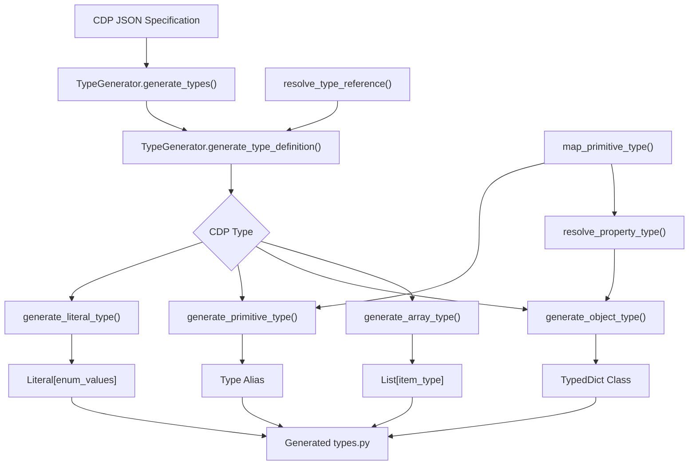
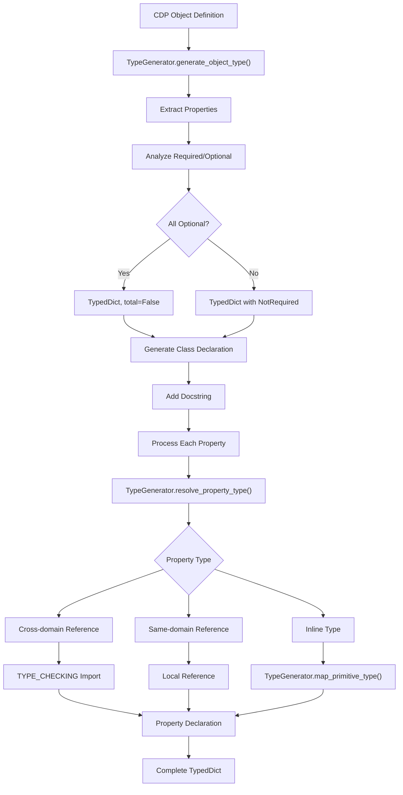
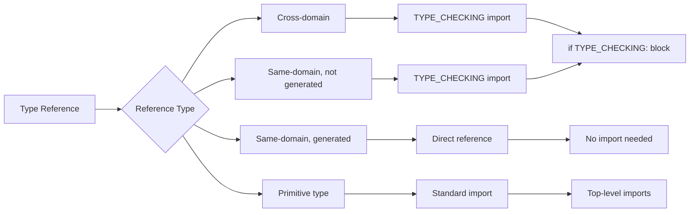

<!-- source: DeepWiki mcp.deepwiki.com · repo browser-use/cdp-use · page 5.2 Type Generation · fetched 2026-10-30 -->

# Type Generation

<details>
<summary>Relevant source files</summary>

The following files were used as context for generating this wiki page:

- [cdp_use/cdp/dom/types.py](cdp_use/cdp/dom/types.py)
- [cdp_use/cdp/network/types.py](cdp_use/cdp/network/types.py)
- [cdp_use/cdp/page/types.py](cdp_use/cdp/page/types.py)
- [cdp_use/cdp/runtime/types.py](cdp_use/cdp/runtime/types.py)
- [cdp_use/generator/command_generator.py](cdp_use/generator/command_generator.py)
- [cdp_use/generator/event_generator.py](cdp_use/generator/event_generator.py)
- [cdp_use/generator/type_generator.py](cdp_use/generator/type_generator.py)

</details>


The Type Generation system transforms Chrome DevTools Protocol (CDP) type definitions from JSON specifications into type-safe Python `TypedDict` classes and type aliases. This system ensures compile-time type safety by generating precise Python type annotations that match the CDP specification requirements.

For overall code generation workflow, see [Generation Overview](#5.1). For command parameter type generation, see [Command Generation](#5.3). For event payload types, see [Event Generation](#5.4).

## Purpose and Functionality

The `TypeGenerator` class converts CDP protocol JSON type definitions into Python type annotations, handling the mapping between CDP's type system and Python's typing system. It generates `TypedDict` classes for complex objects, `Literal` types for enumerations, and type aliases for primitive and array types.

Sources: [cdp_use/generator/type_generator.py:1-23]()

## Type Generation Architecture



**Type Generation Flow**
This diagram shows how CDP type definitions are processed through the `TypeGenerator` class methods to produce Python type annotations.

Sources: [cdp_use/generator/type_generator.py:19-103]()

## CDP to Python Type Mapping

The generator maps CDP primitive types to Python built-in types using a static mapping dictionary in `map_primitive_type`.

| CDP Type | Python Type | Generation Method | Example |
|----------|-------------|-------------------|---------|
| `string` with `enum` | `Literal[values]` | `generate_literal_type()` | `Literal["mouse", "touch"]` |
| `string` | `str` | `generate_primitive_type()` | `NodeId = str` |
| `integer` | `int` | `generate_primitive_type()` | `BackendNodeId = int` |
| `number` | `float` | `generate_primitive_type()` | `Timestamp = float` |
| `boolean` | `bool` | `generate_primitive_type()` | `Enabled = bool` |
| `object` | `TypedDict` | `generate_object_type()` | `class Node(TypedDict):` |
| `array` | `List[T]` | `generate_array_type()` | `NodeList = List[Node]` |
| `any` | `Any` | `map_primitive_type()` | `Value = Any` |

Sources: [cdp_use/generator/type_generator.py:289-299](), [cdp_use/generator/type_generator.py:86-103]()

## TypedDict Generation Process

The `generate_object_type` method is responsible for creating `TypedDict` classes. It inspects the `properties` list of a CDP type definition to determine field names, types, and optionality.



**TypedDict Class Generation**
This diagram illustrates how CDP object definitions are transformed into Python `TypedDict` classes with proper type annotations and optional field handling.

Sources: [cdp_use/generator/type_generator.py:147-204](), [cdp_use/generator/type_generator.py:228-246]()

## Import Management System

The `TypeGenerator` maintains three sets of imports to handle different type reference scenarios:

- **`self.imports`**: Standard runtime imports like `typing` and `typing_extensions` [cdp_use/generator/type_generator.py:29-30]().
- **`self.type_checking_imports`**: Forward references wrapped in `TYPE_CHECKING` blocks to avoid circular dependencies [cdp_use/generator/type_generator.py:62-67]().
- **`self.generated_types`**: Set of types defined within the current domain to track local vs external references [cdp_use/generator/type_generator.py:33-34]().



**Import Resolution Strategy**
This diagram shows how the type generator decides whether to add imports based on the type of reference encountered.

Sources: [cdp_use/generator/type_generator.py:247-287](), [cdp_use/generator/type_generator.py:62-67]()

## Optional Property Handling

The generator implements sophisticated optional property handling using `NotRequired` and `total=False`. In `generate_object_type`, it calculates `required_props` and `optional_props` [cdp_use/generator/type_generator.py:156-166]().

- **`total=False`**: Used when **all** properties in an object are marked as optional in the CDP spec [cdp_use/generator/type_generator.py:169-170]().
- **`NotRequired[T]`**: Used for individual optional fields when the object also contains required fields [cdp_use/generator/type_generator.py:194-195]().

Example output:
```python
# cdp_use/cdp/runtime/types.py:174-180
class CallArgument(TypedDict, total=False):
    value: "Any"
    unserializableValue: "UnserializableValue"
```

Sources: [cdp_use/generator/type_generator.py:156-196](), [cdp_use/cdp/runtime/types.py:174-180]()

## Generated Output Structure

The type generator produces output files with this structure:

1. **Auto-generated header** - Warning about automatic generation [cdp_use/generator/type_generator.py:37-39]().
2. **Domain docstring** - Documentation for the CDP domain [cdp_use/generator/type_generator.py:42]().
3. **Standard imports** - `typing`, `typing_extensions` imports [cdp_use/generator/type_generator.py:52-59]().
4. **TYPE_CHECKING block** - Forward references for cross-domain types [cdp_use/generator/type_generator.py:62-67]().
5. **Type definitions** - Generated `TypedDict` classes and type aliases [cdp_use/generator/type_generator.py:70-71]().

Each generated `types.py` file follows this consistent pattern, ensuring predictable imports and type availability across all CDP domains.

Sources: [cdp_use/generator/type_generator.py:36-75]()

## Type Name Sanitization

The generator includes methods for ensuring generated type names are valid Python identifiers:

- `sanitize_name()`: Replaces invalid characters with underscores [cdp_use/generator/type_generator.py:301-304]().
- `to_python_identifier()`: Converts string values to valid uppercase identifiers, handling leading digits by prefixing with an underscore [cdp_use/generator/type_generator.py:306-322]().

These methods handle edge cases like names starting with digits or containing special characters, ensuring all generated types have valid Python names.

Sources: [cdp_use/generator/type_generator.py:301-322]()

---

