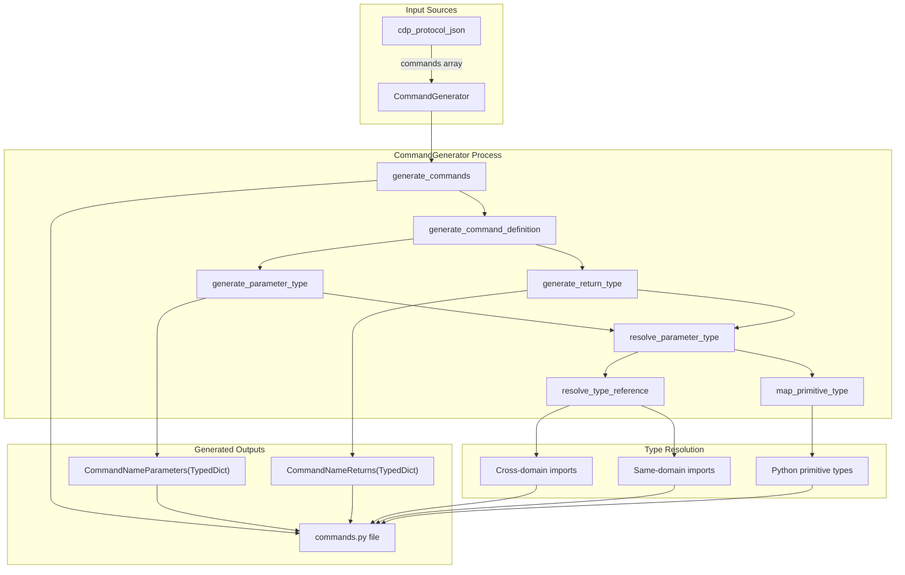
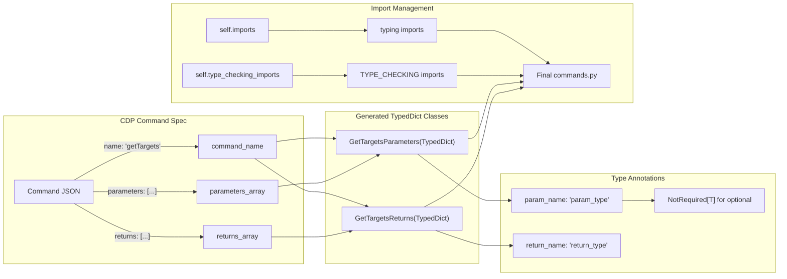
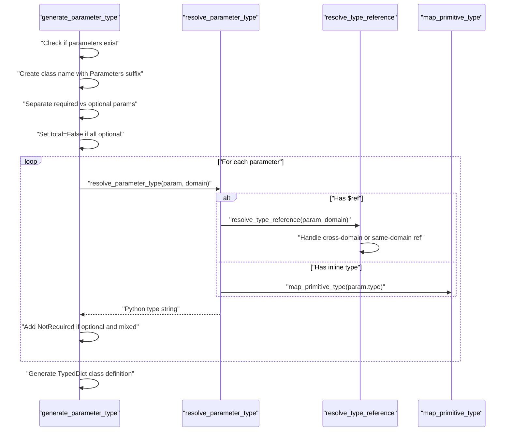
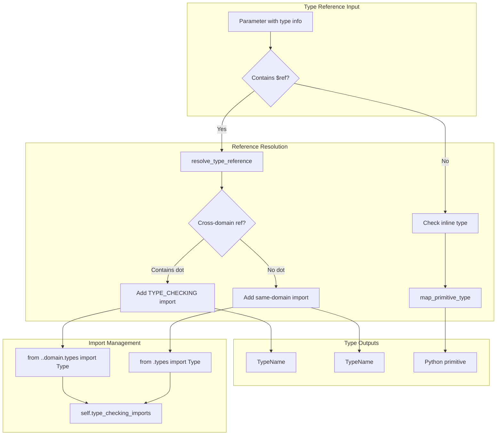
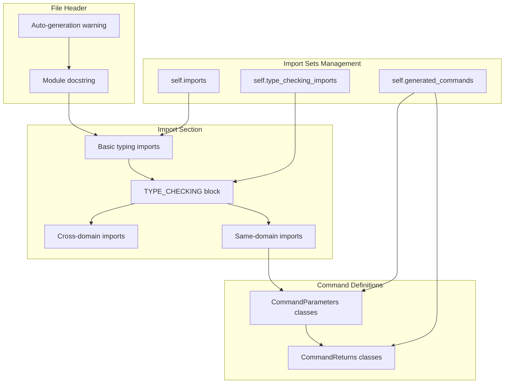

<!-- source: DeepWiki mcp.deepwiki.com · repo browser-use/cdp-use · page 5.3 Command Generation · fetched 2026-10-30 -->

# Command Generation

Relevant source files

The following files were used as context for generating this wiki page:

- [cdp_use/cdp/css/commands.py](cdp_use/cdp/css/commands.py)
- [cdp_use/cdp/dom/commands.py](cdp_use/cdp/dom/commands.py)
- [cdp_use/cdp/emulation/commands.py](cdp_use/cdp/emulation/commands.py)
- [cdp_use/cdp/emulation/library.py](cdp_use/cdp/emulation/library.py)
- [cdp_use/cdp/network/commands.py](cdp_use/cdp/network/commands.py)
- [cdp_use/cdp/page/commands.py](cdp_use/cdp/page/commands.py)
- [cdp_use/cdp/target/commands.py](cdp_use/cdp/target/commands.py)
- [cdp_use/generator/command_generator.py](cdp_use/generator/command_generator.py)
- [cdp_use/generator/event_generator.py](cdp_use/generator/event_generator.py)
- [cdp_use/generator/type_generator.py](cdp_use/generator/type_generator.py)

This document covers the automated generation of type-safe Python command definitions from Chrome DevTools Protocol (CDP) command specifications. The command generation system creates `TypedDict` classes for command parameters and return types, enabling compile-time type checking for CDP interactions.

For information about generating `TypedDict` classes for basic CDP types, see [Type Generation](5.2). For generating event payload types, see [Event Generation](5.4). For generating domain-specific client libraries that use these commands, see [Library Generation](5.5).

## Purpose and Scope

The `CommandGenerator` class transforms CDP command specifications into Python `TypedDict` classes that define:

- Command parameter types (`{CommandName}Parameters`) [cdp_use/generator/command_generator.py:103-103]()
- Command return types (`{CommandName}Returns`) [cdp_use/generator/command_generator.py:152-152]()
- Type-safe imports and cross-domain references [cdp_use/generator/command_generator.py:194-221]()
- Proper handling of optional vs required parameters [cdp_use/generator/command_generator.py:107-135]()

The generated command definitions are consumed by the CDP client system and domain-specific libraries to provide compile-time type safety for browser automation.

Sources: [cdp_use/generator/command_generator.py:1-252]()

## Command Generation Architecture

The `CommandGenerator` processes CDP command specifications by iterating through each command in a domain and generating corresponding Python `TypedDict` classes for parameters and return values.

Sources: [cdp_use/generator/command_generator.py:19-66]()

## Generated Command Structure

Each CDP command generates two `TypedDict` classes: one for parameters and one for return values. The generator handles optional parameters using `NotRequired` and manages imports through dedicated sets.

Sources: [cdp_use/generator/command_generator.py:68-94](), [cdp_use/generator/command_generator.py:96-143](), [cdp_use/generator/command_generator.py:145-173]()

## Parameter Type Generation Process

The `generate_parameter_type` method creates `TypedDict` classes for command input parameters:

| Component | Purpose | Implementation |
|-----------|---------|----------------|
| Class naming | Convert command name to PascalCase | `to_class_name()` adds `Parameters` suffix [cdp_use/generator/command_generator.py:103-103]() |
| Optional handling | Use `NotRequired` for optional params | Check `param.get("optional", False)` [cdp_use/generator/command_generator.py:112-115]() |
| TypedDict configuration | Set `total=False` when all optional | Conditional `TypedDict` inheritance [cdp_use/generator/command_generator.py:118-119]() |
| Type resolution | Convert CDP types to Python types | `resolve_parameter_type()` delegation [cdp_use/generator/command_generator.py:128-128]() |
| Documentation | Embed parameter descriptions | Escaped docstrings in `TypedDict` [cdp_use/generator/command_generator.py:137-140]() |

The generator distinguishes between required and optional parameters, applying `NotRequired` wrapper types appropriately and setting `total=False` on the `TypedDict` when all parameters are optional.

Sources: [cdp_use/generator/command_generator.py:96-143]()

## Type Reference Resolution

The type resolution system handles three categories of type references:

Cross-domain references (containing dots) generate `TYPE_CHECKING` imports to avoid circular dependencies, while same-domain references import directly from the local `types` module.

Sources: [cdp_use/generator/command_generator.py:175-221](), [cdp_use/generator/command_generator.py:194-221]()

## Primitive Type Mapping

The `map_primitive_type` method converts CDP primitive types to their Python equivalents:

| CDP Type | Python Type | Usage Context |
|----------|-------------|---------------|
| `string` | `str` | Text parameters and returns |
| `integer` | `int` | Numeric IDs and counts |
| `number` | `float` | Decimal values and measurements |
| `boolean` | `bool` | Feature flags and state |
| `any` | `Any` | Untyped or dynamic content |
| `object` | `Dict[str, Any]` | JSON objects and maps |

Array types are handled separately by wrapping the item type in `List[...]` [cdp_use/generator/command_generator.py:184-187](), while object types without specific structure default to `Dict[str, Any]` [cdp_use/generator/command_generator.py:189-190]().

Sources: [cdp_use/generator/command_generator.py:223-233]()

## Generated File Structure

The complete command generation process produces a `commands.py` file with this structure:

The generator maintains separate sets for regular imports, `TYPE_CHECKING` imports, and generated command class names to avoid duplicates and organize the output properly.

Sources: [cdp_use/generator/command_generator.py:28-66](), [cdp_use/generator/command_generator.py:14-17]()

## Class Name and Identifier Handling

The generator includes utilities for converting CDP identifiers to valid Python class names:

- `to_class_name()` converts camelCase command names to PascalCase class names [cdp_use/generator/command_generator.py:235-240]()
- `sanitize_name()` ensures identifiers are valid Python identifiers by replacing invalid characters [cdp_use/generator/command_generator.py:242-251]()
- Parameter and return class names follow the pattern `{CommandName}Parameters` and `{CommandName}Returns` [cdp_use/generator/command_generator.py:103-103](), [cdp_use/generator/command_generator.py:152-152]()

Both methods handle edge cases like names starting with digits and containing special characters that are invalid in Python identifiers.

Sources: [cdp_use/generator/command_generator.py:235-251]()

---

