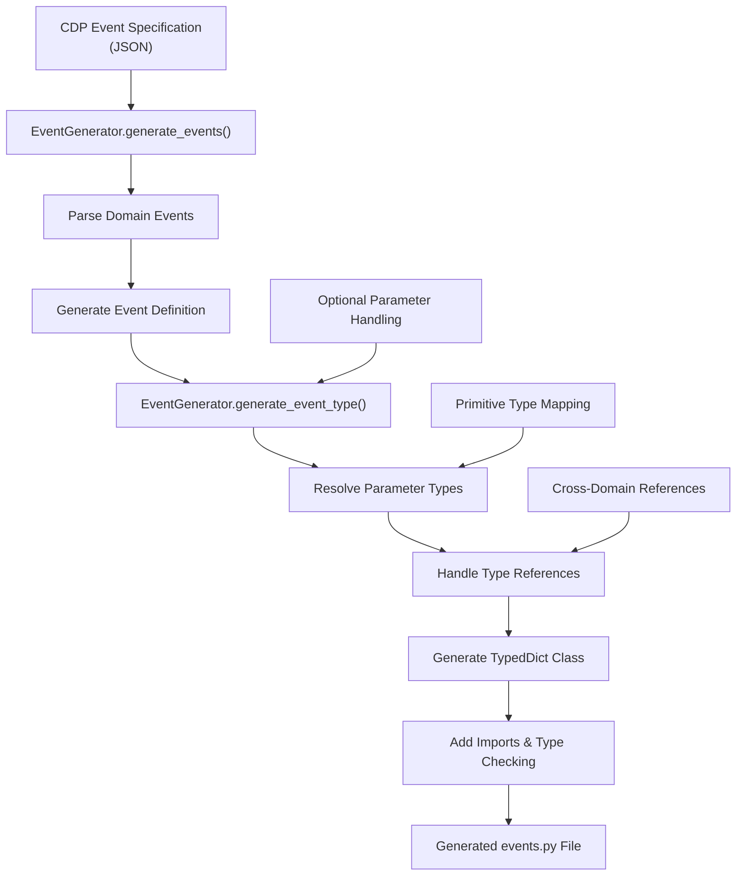
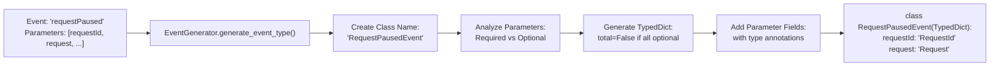
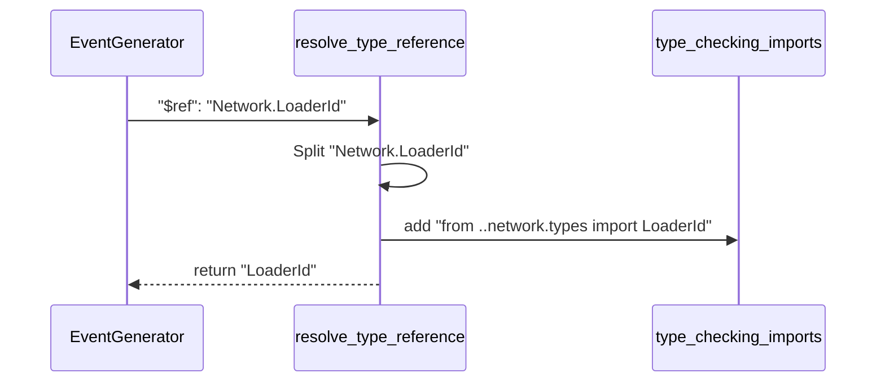
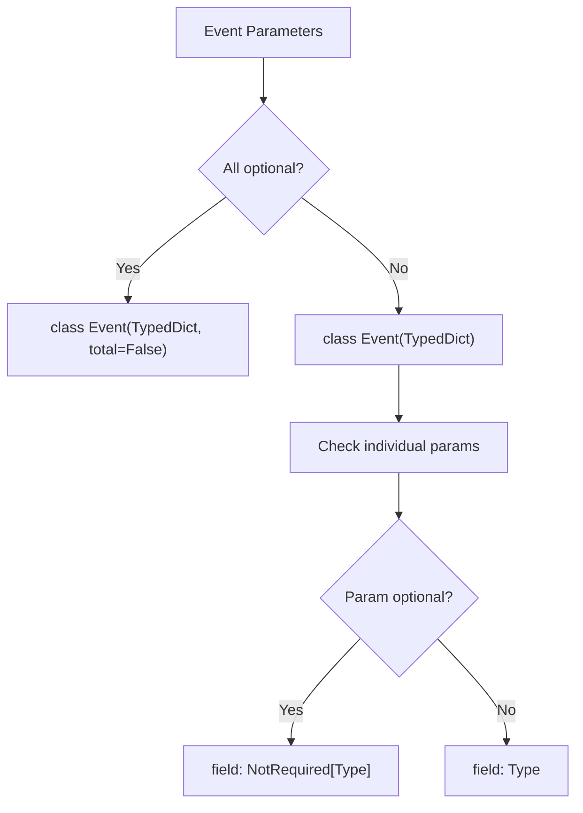

<!-- source: DeepWiki mcp.deepwiki.com · repo browser-use/cdp-use · page 5.4 Event Generation · fetched 2026-10-30 -->

# Event Generation

<details>
<summary>Relevant source files</summary>

The following files were used as context for generating this wiki page:

- [cdp_use/cdp/debugger/events.py](cdp_use/cdp/debugger/events.py)
- [cdp_use/cdp/fetch/events.py](cdp_use/cdp/fetch/events.py)
- [cdp_use/cdp/page/events.py](cdp_use/cdp/page/events.py)
- [cdp_use/generator/command_generator.py](cdp_use/generator/command_generator.py)
- [cdp_use/generator/event_generator.py](cdp_use/generator/event_generator.py)
- [cdp_use/generator/type_generator.py](cdp_use/generator/type_generator.py)

</details>


## Purpose and Scope

The Event Generation system is responsible for automatically creating type-safe Python `TypedDict` classes from Chrome DevTools Protocol (CDP) event specifications. This system transforms CDP event definitions into strongly-typed Python event classes that provide compile-time type safety and IDE support for handling browser events. 

This system ensures that when a developer registers a listener for a CDP event, the payload received by the callback matches the structure defined in the protocol. For information about generating command parameter types, see [5.3 Command Generation](). For generating basic type definitions, see [5.2 Type Generation]().

## Event Generation Process

The event generation process transforms CDP event specifications into Python `TypedDict` classes through a systematic pipeline managed by the `EventGenerator` class.

### Event Generation Flow



Sources: [cdp_use/generator/event_generator.py:19-66]()

### EventGenerator Class Architecture

The `EventGenerator` class [cdp_use/generator/event_generator.py:11-18]() provides the core functionality for transforming CDP event specifications into Python code. It maintains state for imports and generated event names to ensure consistency within a domain's `events.py` file.

```mermaid
classDiagram
    class EventGenerator {
        +set imports
        +set generated_events
        +set type_checking_imports
        +generate_events(domain: Dict) str
        +generate_event_definition(event: Dict, domain_name: str) str
        +generate_event_type(event_name, parameters, domain_name, description) str
        +resolve_parameter_type(param, domain_name) str
        +resolve_type_reference(type_ref, current_domain) str
        +map_primitive_type(cdp_type: str) str
        +to_class_name(name: str) str
    }
    
    class "CDP_JSON_Domain" {
        +domain: str
        +events: List[Dict]
    }
    
    class "Generated_TypedDict" {
        +EventNameEvent: TypedDict
        +fields: annotations
    }
    
    EventGenerator ..> "CDP_JSON_Domain" : parses
    EventGenerator ..> "Generated_TypedDict" : outputs
```

Sources: [cdp_use/generator/event_generator.py:11-26](), [cdp_use/generator/event_generator.py:68-77]()

## Event Type Generation

### TypedDict Class Generation

The system generates `TypedDict` classes for each CDP event. The class name is derived by appending "Event" to the PascalCase version of the CDP event name [cdp_use/generator/event_generator.py:87-87]().



Sources: [cdp_use/generator/event_generator.py:79-133](), [cdp_use/cdp/fetch/events.py:35-58]()

### Type Resolution System

The event generator handles various type resolution scenarios, including mapping CDP primitives to Python types and resolving references to other types defined in the protocol.

| Type Category | Example Input | Generated Output | Handling Method |
|---------------|---------------|------------------|-----------------|
| Primitive Type | `{"type": "string"}` | `str` | `map_primitive_type()` |
| Same-Domain Reference | `{"$ref": "FrameId"}` | `FrameId` | `resolve_type_reference()` |
| Cross-Domain Reference | `{"$ref": "Network.LoaderId"}` | `LoaderId` | Cross-domain import |
| Array Type | `{"type": "array", "items": {...}}` | `List[...]` | `resolve_parameter_type()` |

Sources: [cdp_use/generator/event_generator.py:135-152](), [cdp_use/generator/event_generator.py:183-193]()

## Import and Reference Management

### Cross-Domain Type References

When an event parameter refers to a type in another domain (e.g., `Page.frameNavigated` using `Network.LoaderId`), the generator adds the necessary import to a `TYPE_CHECKING` block to avoid circular dependencies while maintaining type safety [cdp_use/generator/event_generator.py:161-171]().



Sources: [cdp_use/generator/event_generator.py:154-181](), [cdp_use/cdp/page/events.py:10-25]()

## Optional Parameter Handling

The generator implements logic to handle optional CDP parameters using `NotRequired` or the `total=False` attribute of `TypedDict`.

1.  **Global Optionality**: If *all* parameters in an event are optional, the class is defined with `total=False` [cdp_use/generator/event_generator.py:108-109]().
2.  **Specific Optionality**: If only some parameters are optional, those specific fields are wrapped in `NotRequired[...]` [cdp_use/generator/event_generator.py:122-123]().



Sources: [cdp_use/generator/event_generator.py:97-124](), [cdp_use/cdp/page/events.py:40-41]()

## Event Mapping to Registry

While `EventGenerator` creates the data structures, these types are used by the `RegistrationGenerator` to create the `CDPRegistrationLibrary`. 

The mapping follows a strict pattern:
- **CDP Event Name**: `Domain.eventName` (e.g., `Page.domContentEventFired`)
- **Generated TypedDict**: `DomContentEventFiredEvent` in `cdp_use/cdp/page/events.py` [cdp_use/cdp/page/events.py:28-29]()
- **Registration Method**: Users register these via `client.register.page.dom_content_event_fired(callback)`.

## Name Conversion

The system converts CDP event names (camelCase) to Python class names (PascalCase) and internal identifiers.

| CDP Event Name | Generated Class Name | File Location |
|----------------|---------------------|---------------|
| `paused` | `PausedEvent` | `cdp_use/cdp/debugger/events.py` |
| `scriptParsed` | `ScriptParsedEvent` | `cdp_use/cdp/debugger/events.py` |
| `requestPaused` | `RequestPausedEvent` | `cdp_use/cdp/fetch/events.py` |

Sources: [cdp_use/generator/event_generator.py:195-200](), [cdp_use/cdp/debugger/events.py:38-108](), [cdp_use/cdp/fetch/events.py:35-35]()

---

