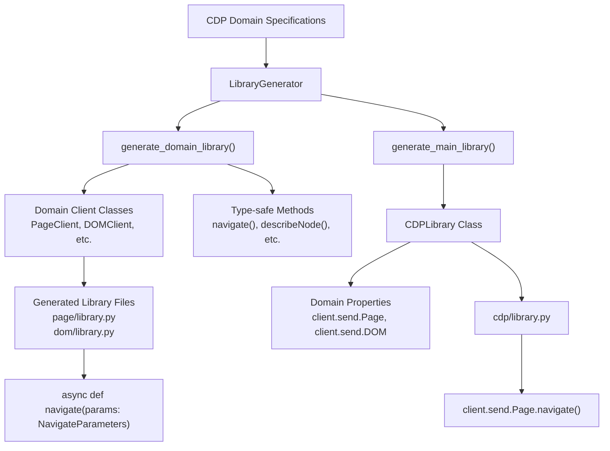
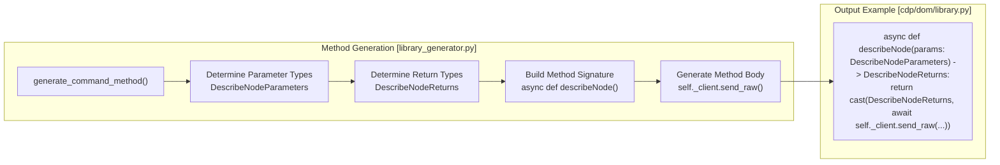
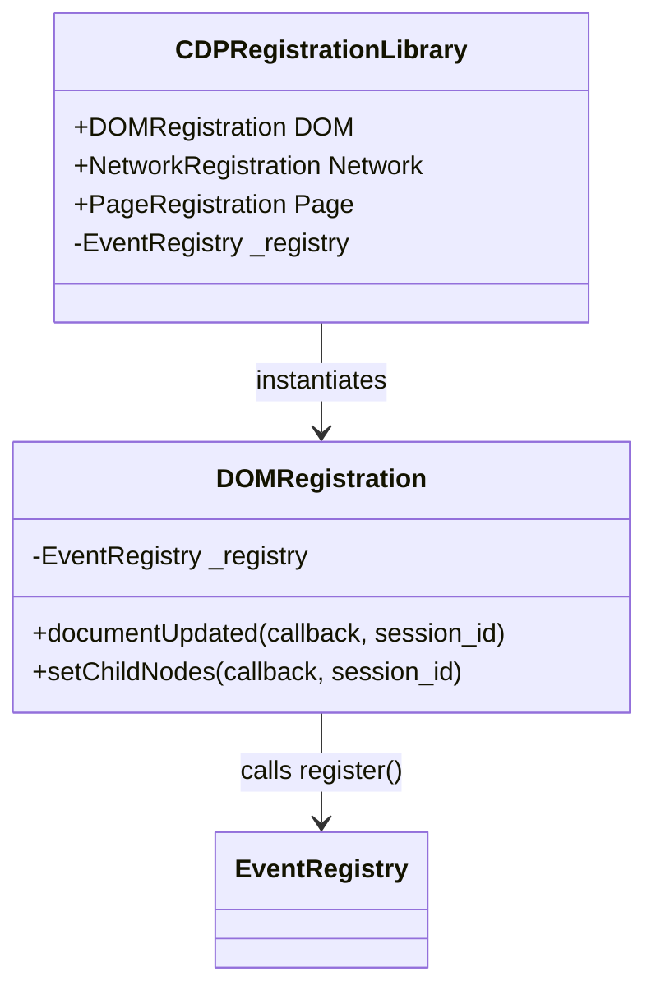
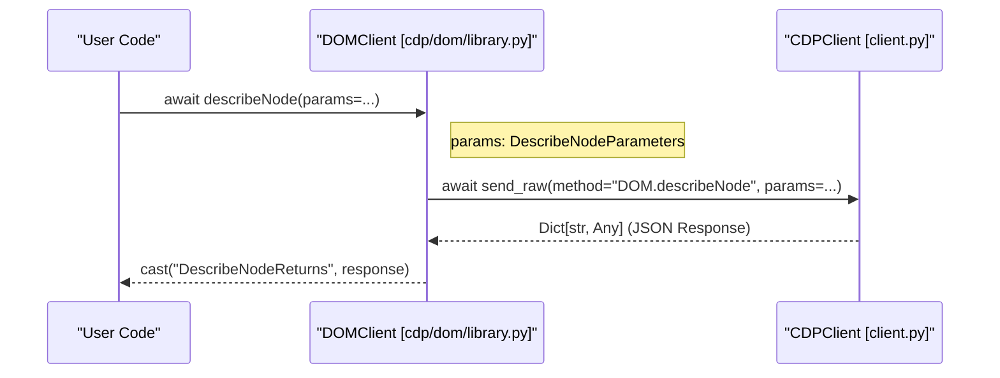

<!-- source: DeepWiki mcp.deepwiki.com · repo browser-use/cdp-use · page 5.5 Library Generation · fetched 2026-10-30 -->

# Library Generation

Relevant source files

The following files were used as context for generating this wiki page:

- [cdp_use/cdp/browser/library.py](cdp_use/cdp/browser/library.py)
- [cdp_use/cdp/dom/library.py](cdp_use/cdp/dom/library.py)
- [cdp_use/cdp/network/library.py](cdp_use/cdp/network/library.py)
- [cdp_use/cdp/registration_library.py](cdp_use/cdp/registration_library.py)
- [cdp_use/generator/generator.py](cdp_use/generator/generator.py)
- [cdp_use/generator/library_generator.py](cdp_use/generator/library_generator.py)

The library generation system creates domain-specific client libraries with type-safe method signatures for CDP commands and events. This system transforms CDP protocol specifications into Python client classes that provide a convenient, strongly-typed interface for browser automation tasks.

This document covers the generation of client libraries via `library_generator.py` and event registration libraries via `registration_generator.py`.

## Library Generation Overview

The `LibraryGenerator` class in `cdp_use/generator/library_generator.py` orchestrates the creation of two types of library files:

1.  **Domain-specific libraries**: Individual client classes for each CDP domain (e.g., `PageClient`, `DOMClient`) located in `cdp/{domain}/library.py`.
2.  **Main library**: A combined library class (`CDPLibrary`) in `cdp/library.py` that provides access to all domain clients.

Sources: [cdp_use/generator/library_generator.py:10-47](), [cdp_use/generator/library_generator.py:49-70](), [cdp_use/generator/generator.py:165-171]()

## Domain Client Generation Process

Each CDP domain gets its own client class with methods corresponding to the domain's commands. The `CDPGenerator` iterates through domains and calls `generate_domain_library_file` [cdp_use/generator/generator.py:165-171]().

### Method Signature Construction
The `generate_command_method` function [cdp_use/generator/library_generator.py:91-138]() constructs the Python method for each CDP command:

*   **Method Name**: Converted from camelCase to snake_case (e.g., `describeNode` becomes `describeNode` in the generated file but follows protocol naming) [cdp_use/cdp/dom/library.py:128]().
*   **Parameters**: Wraps command parameters into a single `params` argument using the generated `Parameters` TypedDict [cdp_use/generator/library_generator.py:101-111]().
*   **Return Type**: Uses the generated `Returns` TypedDict for the specific command [cdp_use/generator/library_generator.py:113-116]().
*   **Implementation**: Calls `self._client.send_raw` and uses `typing.cast` to ensure the return value matches the expected type-safe signature [cdp_use/generator/library_generator.py:132-136]().

Sources: [cdp_use/generator/library_generator.py:91-138](), [cdp_use/cdp/dom/library.py:128-142]()

## Event Registration Generation

While `LibraryGenerator` handles commands (sending), `RegistrationGenerator` [cdp_use/generator/registration_generator.py]() handles events (receiving). It generates classes that wrap the `EventRegistry.register` calls.

### Domain Registration Classes
Each domain has a `Registration` class (e.g., `DOMRegistration`) that provides methods for every event in that domain. These methods accept a callback and an optional `session_id` [cdp_use/generator/registration_generator.py:70-85]().

### Main Registration Library
The `CDPRegistrationLibrary` [cdp_use/cdp/registration_library.py:13-215]() aggregates all domain-specific registration classes. It is initialized with an `EventRegistry` instance [cdp_use/cdp/registration_library.py:16-17]().

Sources: [cdp_use/cdp/registration_library.py:13-215](), [cdp_use/generator/registration_generator.py:1-90]()

## Data Flow: From Generator to Type-Safe Call

The following diagram bridges the "Natural Language/Protocol Space" to the "Code Entity Space" for a typical command execution.

| Protocol Entity | Generated Code Entity | File Location |
| :--- | :--- | :--- |
| `DOM.describeNode` | `DOMClient.describeNode` | `cdp_use/cdp/dom/library.py` |
| `DescribeNode` Params | `DescribeNodeParameters` | `cdp_use/cdp/dom/commands.py` |
| `DescribeNode` Returns | `DescribeNodeReturns` | `cdp_use/cdp/dom/commands.py` |
| `CDPClient` | `CDPClient.send_raw` | `cdp_use/client.py` |

Sources: [cdp_use/cdp/dom/library.py:128-142](), [cdp_use/generator/library_generator.py:132-136]()

## Import Management and Type Safety

To prevent circular dependencies and maintain performance, the generators use a `TYPE_CHECKING` block for all heavy type imports [cdp_use/generator/library_generator.py:155-161]().

*   **Forward References**: Type hints in method signatures are often quoted (e.g., `-> "DescribeNodeReturns"`) to handle cases where the type is defined later or imported within a `TYPE_CHECKING` block [cdp_use/cdp/dom/library.py:132]().
*   **Lazy Instantiation**: The `CDPLibrary` and `CDPRegistrationLibrary` instantiate domain clients using the shared `CDPClient` or `EventRegistry` instance [cdp_use/cdp/registration_library.py:16-215]().

| File | Class | Responsibility |
| :--- | :--- | :--- |
| `cdp/library.py` | `CDPLibrary` | Entry point for all commands (`client.send.Domain.method`) |
| `cdp/registration_library.py` | `CDPRegistrationLibrary` | Entry point for all events (`client.register.Domain.event`) |
| `cdp/{domain}/library.py` | `{Domain}Client` | Wraps `send_raw` with domain-specific types |
| `cdp/{domain}/registration.py` | `{Domain}Registration` | Wraps `EventRegistry.register` with domain-specific types |

Sources: [cdp_use/cdp/registration_library.py:13-215](), [cdp_use/generator/library_generator.py:168-210](), [cdp_use/cdp/dom/library.py:91-160]()

---

