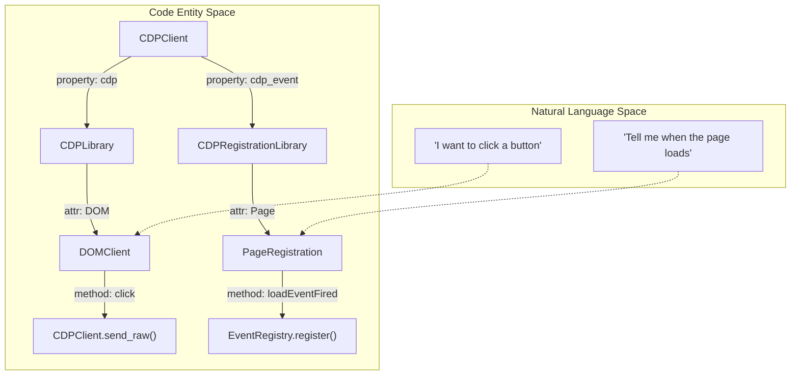
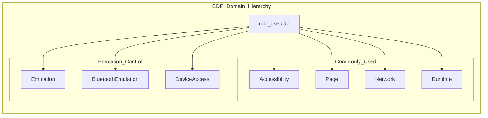

<!-- source: DeepWiki mcp.deepwiki.com · repo browser-use/cdp-use · page 6 Domain Reference · fetched 2026-10-30 -->

# Domain Reference

Relevant source files

The following files were used as context for generating this wiki page:

- [cdp_use/cdp/__init__.py](cdp_use/cdp/__init__.py)
- [cdp_use/cdp/library.py](cdp_use/cdp/library.py)
- [cdp_use/cdp/registration_library.py](cdp_use/cdp/registration_library.py)

This document provides a high-level reference for the Chrome DevTools Protocol (CDP) domains implemented in the `cdp-use` library. It covers the structure of the 54 generated domains, the standard file layout for each, and links to detailed child pages for commonly used domains.

The library provides complete, type-safe Python bindings for the entire CDP specification, including internal extensions like `browseruse`.

## Domain Overview

CDP domains represent functional areas of the browser (e.g., `DOM`, `Network`, `Page`). The `cdp-use` library organizes these into a consistent modular structure under the `cdp_use.cdp` package.

### Standard Domain Layout

Each of the 54 domains follows a strict five-file pattern generated by the [Code Generation Pipeline](#2.2). This ensures that whether you are working with `Accessibility` or `Network`, the API surface is predictable.

| File | Purpose | Key Entities |
|:---|:---|:---|
| `types.py` | Data structures | `TypedDict` definitions, Enums, Type Aliases |
| `commands.py` | Command schemas | `Params` and `Returns` TypedDicts for every method |
| `events.py` | Event schemas | Payload definitions for domain-specific events |
| `library.py` | Command Proxy | The `DomainClient` class (e.g., `PageClient`) |
| `registration.py` | Event Proxy | The `DomainRegistration` class (e.g., `PageRegistration`) |

Sources: [cdp_use/cdp/__init__.py:7-60](), [cdp_use/cdp/library.py:19-254](), [cdp_use/cdp/registration_library.py:19-215]()

### Library Aggregation

The library uses two main "Aggregator" classes to expose these domains to the `CDPClient`.

1.  **`CDPLibrary`**: Holds instances of every `DomainClient`. It is the entry point for sending commands (e.g., `client.cdp.Page.navigate(...)`).
2.  **`CDPRegistrationLibrary`**: Holds instances of every `DomainRegistration`. It is the entry point for subscribing to events (e.g., `client.cdp_event.Page.loadEventFired(...)`).

Sources: [cdp_use/cdp/library.py:13-254](), [cdp_use/cdp/registration_library.py:13-215]()

## Domain Catalog

The library generates bindings for 54 domains. While all are available, several are central to browser automation and are documented in detail in child pages.

### Primary Automation Domains

*   **Accessibility**: Provides access to the browser's accessibility tree, crucial for finding elements by their semantic roles. For details, see [Accessibility Domain](#6.1).
*   **Animation**: Allows for inspection and control of CSS animations and transitions. For details, see [Animation Domain](#6.2).
*   **Audits**: Exposes browser-level checks for performance, security, and accessibility issues. For details, see [Audits Domain](#6.3).
*   **Browser**: Manages browser-level state, such as window bounds, permissions, and download behavior. For details, see [Browser Domain](#6.4).
*   **Console**: Captures `console.log` and other message types emitted by the page. For details, see [Console Domain](#6.6).

### Specialized & Emulation Domains

*   **Bluetooth Emulation**: Simulates Bluetooth devices and interactions for testing Web Bluetooth APIs. For details, see [Bluetooth Emulation Domain](#6.5).
*   **Background Service**: Records and monitors background tasks like Push Messaging and Background Fetch. For details, see [Background Service Domain](#6.7).

### Infrastructure Domains (Summary)

The following domains provide the backbone for most interactions:
*   **DOM / DOMDebugger**: Traversing the node tree and setting breakpoints on DOM modifications.
*   **Network**: Intercepting requests, simulating offline modes, and inspecting headers.
*   **Page**: Navigation, frame management, and lifecycle events (e.g., `DOMContentLoaded`).
*   **Runtime**: Evaluation of arbitrary JavaScript in the context of the page.
*   **Target**: Management of multiple tabs, windows, and service worker targets.

Sources: [cdp_use/cdp/__init__.py:7-60](), [cdp_use/cdp/library.py:49-158]()

## Cross-Domain Type Safety

A key feature of the generated library is how types are shared across domains. For example, a `BackendNodeId` defined in the `DOM` domain is correctly imported and used by the `Accessibility` and `Input` domains.

*   **`types.py`**: Contains the `TypedDict` definitions that mirror CDP objects.
*   **`registration.py`**: Uses these types to provide signature-accurate callbacks for the `EventRegistry`.

For a deep dive into how these types are constructed from the protocol JSON, see [Type Generation](#5.2).

Sources: [cdp_use/cdp/registration_library.py:13-215](), [cdp_use/cdp/library.py:13-254]()

---

