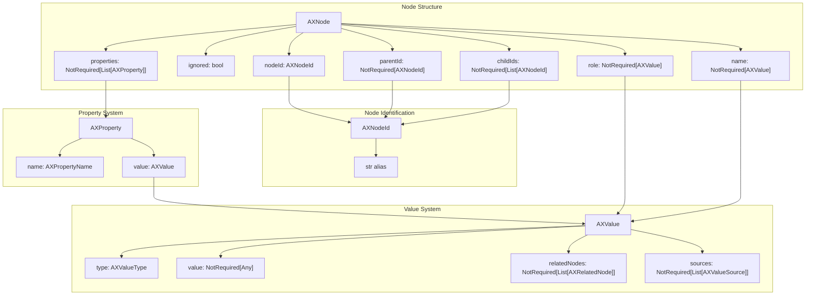
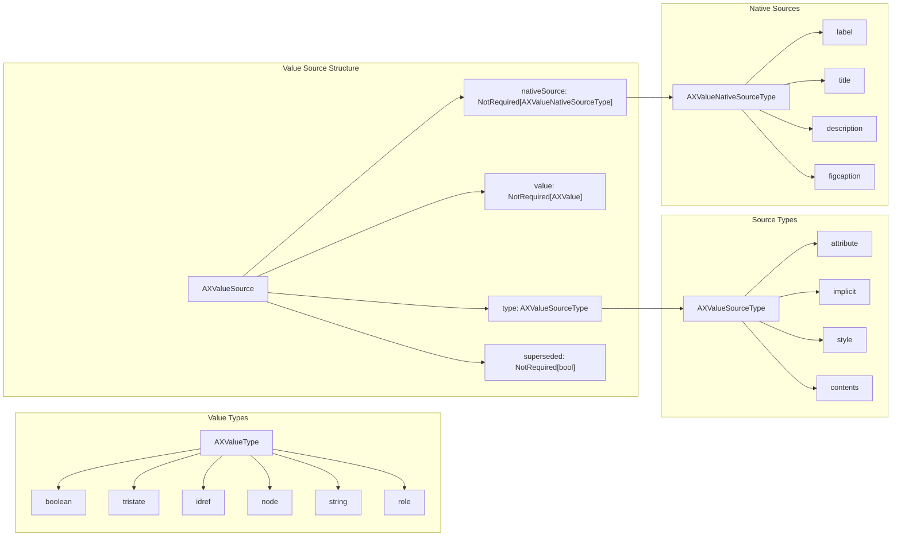
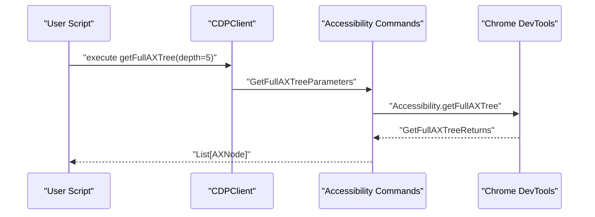
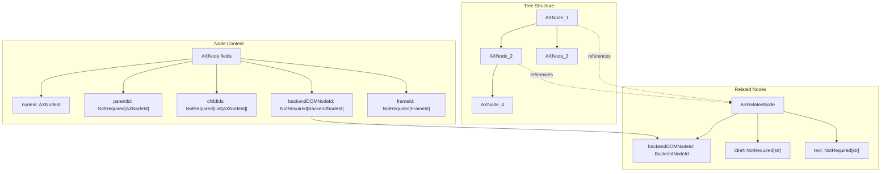

<!-- source: DeepWiki mcp.deepwiki.com · repo browser-use/cdp-use · page 6.1 Accessibility Domain · fetched 2026-10-30 -->

# Accessibility Domain

<details>
<summary>Relevant source files</summary>

The following files were used as context for generating this wiki page:

- [cdp_use/cdp/accessibility/commands.py](cdp_use/cdp/accessibility/commands.py)
- [cdp_use/cdp/accessibility/types.py](cdp_use/cdp/accessibility/types.py)
- [cdp_use/cdp/audits/commands.py](cdp_use/cdp/audits/commands.py)
- [cdp_use/cdp/autofill/commands.py](cdp_use/cdp/autofill/commands.py)
- [cdp_use/cdp/bluetoothemulation/commands.py](cdp_use/cdp/bluetoothemulation/commands.py)
- [cdp_use/cdp/bluetoothemulation/events.py](cdp_use/cdp/bluetoothemulation/events.py)
- [cdp_use/cdp/browser/events.py](cdp_use/cdp/browser/events.py)

</details>


This page documents the generated Python bindings for the Chrome DevTools Protocol (CDP) Accessibility domain. The Accessibility domain provides access to the browser's accessibility tree, enabling programmatic inspection of accessibility properties, roles, and relationships for web page elements.

## Overview

The CDP Accessibility domain exposes the browser's internal accessibility tree, which is used by assistive technologies like screen readers. The domain provides types and commands for querying accessibility node properties, relationships, and computed values.

The generated bindings in `cdp_use/cdp/accessibility/types.py` [cdp_use/cdp/accessibility/types.py:1-214]() define `TypedDict` classes that represent accessibility tree nodes, properties, and values with full type safety. Commands for interacting with this domain are defined in `cdp_use/cdp/accessibility/commands.py` [cdp_use/cdp/accessibility/commands.py:1-102]().

Sources: [cdp_use/cdp/accessibility/types.py:1-5](), [cdp_use/cdp/accessibility/commands.py:1-5]()

## Core Type System

The Accessibility domain defines several key type categories that work together to represent the accessibility tree structure:

**Natural Language to Code Entity Mapping: Node Structure**


**Core Type Definitions:**

| Type | Purpose | Definition |
|------|---------|------------|
| `AXNodeId` | Node identification | String alias for unique node identifiers [cdp_use/cdp/accessibility/types.py:17-18]() |
| `AXNode` | Tree structure | Complete accessibility node with properties and relationships [cdp_use/cdp/accessibility/types.py:185-214]() |
| `AXValue` | Property values | Computed accessibility property with sources and related nodes [cdp_use/cdp/accessibility/types.py:103-114]() |
| `AXProperty` | Node attributes | Name-value pairs representing accessibility properties [cdp_use/cdp/accessibility/types.py:96-100]() |

Sources: [cdp_use/cdp/accessibility/types.py:17-214]()

## Value Type System

The accessibility domain uses a sophisticated type system to represent different kinds of accessibility values and their sources:



**Value Type Categories:**

- **Primitive Types**: `boolean`, `string`, `number`, `integer` [cdp_use/cdp/accessibility/types.py:22-31]()
- **Reference Types**: `idref`, `idrefList`, `node`, `nodeList` [cdp_use/cdp/accessibility/types.py:25-30]()
- **Semantic Types**: `role`, `internalRole`, `computedString` [cdp_use/cdp/accessibility/types.py:32-37]()
- **State Types**: `tristate`, `booleanOrUndefined`, `valueUndefined` [cdp_use/cdp/accessibility/types.py:23-38]()

Sources: [cdp_use/cdp/accessibility/types.py:21-84]()

## Commands and Tree Retrieval

The domain provides several commands to fetch parts of or the entire accessibility tree. These commands return lists of `AXNode` objects.

**Natural Language to Code Entity Mapping: Tree Commands**


| Command | Parameters | Returns | Description |
|---------|------------|---------|-------------|
| `getFullAXTree` | `depth`, `frameId` | `nodes: List[AXNode]` | Retrieves the full accessibility tree for a frame [cdp_use/cdp/accessibility/commands.py:38-49](). |
| `getPartialAXTree` | `nodeId`, `backendNodeId`, `objectId`, `fetchRelatives` | `nodes: List[AXNode]` | Fetches a subset of the tree centered around a specific node [cdp_use/cdp/accessibility/commands.py:21-36](). |
| `getRootAXNode` | `frameId` | `node: AXNode` | Returns the root accessibility node for a document [cdp_use/cdp/accessibility/commands.py:51-59](). |
| `queryAXTree` | `nodeId`, `accessibleName`, `role` | `nodes: List[AXNode]` | Queries the tree for nodes matching specific attributes [cdp_use/cdp/accessibility/commands.py:85-101](). |

Sources: [cdp_use/cdp/accessibility/commands.py:21-102]()

## Property Name System

The domain defines a comprehensive set of standard accessibility property names through the `AXPropertyName` literal type [cdp_use/cdp/accessibility/types.py:116-175]():

| Category | Properties | Purpose |
|----------|------------|---------|
| **States** | `busy`, `disabled`, `focusable`, `focused`, `hidden`, `invalid` | Basic element states [cdp_use/cdp/accessibility/types.py:118-125]() |
| **Live Regions** | `live`, `atomic`, `relevant`, `root` | Dynamic content attributes [cdp_use/cdp/accessibility/types.py:129-132]() |
| **Widgets** | `autocomplete`, `hasPopup`, `level`, `multiselectable`, `readonly`, `required` | Interactive element properties [cdp_use/cdp/accessibility/types.py:133-140]() |
| **Widget States** | `checked`, `expanded`, `modal`, `pressed`, `selected` | Widget-specific states [cdp_use/cdp/accessibility/types.py:144-148]() |
| **Relationships** | `activedescendant`, `controls`, `describedby`, `labelledby`, `owns` | Element relationships [cdp_use/cdp/accessibility/types.py:149-156]() |

Sources: [cdp_use/cdp/accessibility/types.py:116-182]()

## Node Relationships and Tree Structure

Accessibility nodes form a tree structure with parent-child relationships and cross-references:



**Key Relationships:**
- **Tree Structure**: `parentId` and `childIds` establish the accessibility tree hierarchy [cdp_use/cdp/accessibility/types.py:206-209]().
- **DOM Mapping**: `backendDOMNodeId` links accessibility nodes to DOM elements [cdp_use/cdp/accessibility/types.py:210-211]().
- **Cross-References**: `AXRelatedNode` objects reference related elements via `idref` or DOM node ID [cdp_use/cdp/accessibility/types.py:87-93]().
- **Frame Context**: `frameId` identifies the document frame containing the node [cdp_use/cdp/accessibility/types.py:212-213]().

Sources: [cdp_use/cdp/accessibility/types.py:87-93](), [cdp_use/cdp/accessibility/types.py:185-214]()

## Type Import Dependencies

The accessibility types depend on types from other CDP domains to facilitate cross-domain navigation:

```python
if TYPE_CHECKING:
    from ..dom.types import BackendNodeId
    from ..page.types import FrameId
```

This creates integration points with:
- **DOM Domain**: Links accessibility nodes to DOM elements via `BackendNodeId` [cdp_use/cdp/accessibility/types.py:14]().
- **Page Domain**: Associates nodes with document frames via `FrameId` [cdp_use/cdp/accessibility/types.py:15]().

Sources: [cdp_use/cdp/accessibility/types.py:13-15]()

---

